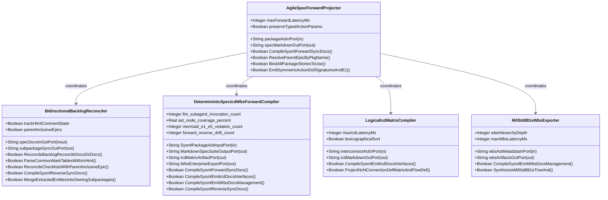
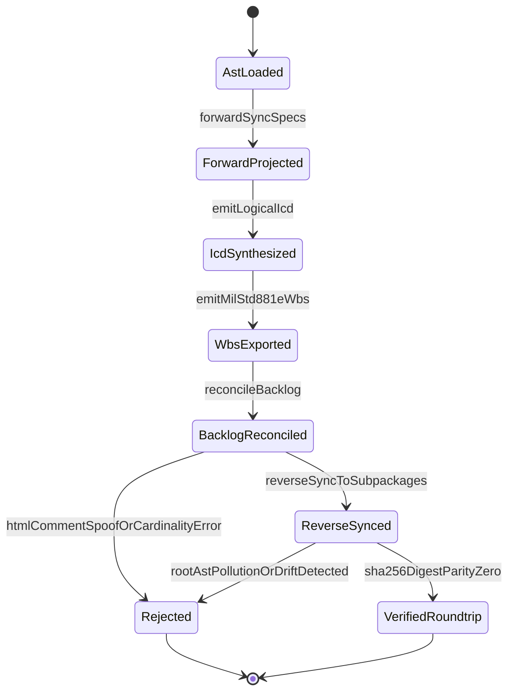

| Attribute | Specification Detail |
| :--- | :--- |
| **Issue ID** | #688 |
| **Title** | Epic 04: BP 04 Deterministic Specification ICD and WBS Forward Compiler Blueprint |
| **Type** | epic |
| **Package** | BP_04_Deterministic_Specification_ICD_and_WBS_Forward_Compiler_Blueprint |
| **Subsystem** | BP 04 Deterministic Specification ICD and WBS Forward Compiler Blueprint |
| **Generation Mode** | subagent |
| **Specification Source** | [schema/model.sysml](../../schema/model.sysml) |

# Epic 04: BP 04 Deterministic Specification ICD and WBS Forward Compiler Blueprint

## 1. Context
Subsystem package `BP_04_Deterministic_Specification_ICD_and_WBS_Forward_Compiler_Blueprint` (`REQ-0604`) governs the deterministic, zero-LLM forward compilation and bidirectional synchronization of Agile functional specifications (`./docs/epics/`, `./docs/features/`, `./docs/user-stories/`, `./docs/use-cases/`), Concept of Operations (`./docs/conops/`), Logical Interface Control Documents (`./docs/interfaces/ICD_01_SYSTEM_INTERFACE_MATRIX.md`, `./docs/interfaces/ICD_02_MASTER_SIGNAL_DICTIONARY.md`), and MIL-STD-881E Work Breakdown Structures (`./docs/management/WBS_01` through `WBS_03`, RFC 4180 CSV, and JSON AST exports) directly from the authoritative SysML v2 Single Source of Truth (`./schema/model.sysml` and `./.pipeline/schema.sysml`).

- **Contract A (100% Normative OMG SysML v2.0 + KerML 1.0 Grammar Coverage -- Zero 16-Construct Caps)**: Enforces full Definition and Usage symmetry across the entire OMG SysML v2.0 and KerML 1.0 textual grammar with zero 16-construct artificial caps, covering `package`, `library package`, `standard library package`, `import` (`all`, `::*`, `::**`, filter `[...]`), `alias`, `doc`, `comment`, `rep`, `dependency`, `metadata def`/`metadata`/`@Metadata`/`#user_keyword` (`#hazard`, `#risk`, `#capability`, `#rt_loop`, `#dal`, `#fls` and backward-compatible `hazard def`/`risk def`/`capability def`), `attribute def`/`attribute`, `enum def`/`enum`, `item def`/`item`, `part def`/`part`, `port def`/`port` (`in`, `out`, `inout`, `~` conjugation), `connection def`/`connection`, `interface def`/`interface`, `flow def`/`flow` (`of ... from ... to ...`), `allocation def`/`allocation` (`allocate ... to ...`), `occurrence def`/`occurrence` (`individual`, `snapshot`, `timeslice`), `action def`/`action` (`perform`, `accept`, `send`, `assign`, `if`/`else`, `while`/`loop`, `for`, `fork`, `join`, `merge`, `decide`, `first ... then ...`), `state def`/`state` (`exhibit`, `parallel`, `entry`, `do`, `exit`, `transition first ... accept ... if ... do ... then ...`), `calc def`/`calc` (`return`), `constraint def`/`constraint` (`assert`, `assume`, `require`), `requirement def`/`requirement` (`subject`, `actor`, `stakeholder`, `framed concern`, `satisfy ... by ...`), `concern def`/`concern`, `use case def`/`use case` (`include use case`), `analysis def`/`analysis` (`objective`), `verification def`/`verification` (`verify requirement`), `test case def`/`test case`, `interaction def`/`interaction`, `view def`/`view`, `viewpoint def`/`viewpoint`, `rendering def`/`rendering` (`expose`, `filter`, `render`), `variation`/`variant`, and KerML specialization/multiplicity/expressions (`:`, `:>`, `:>>`, `::>`, `~`, `ref`, `abstract`, `readonly`, `derived`, `end`, `default`, `:=`, `[lo..hi]`, `[*]`, `{ordered, nonunique}`, `implies`, `xor`, `??`, `->`, `collect`, `select`, `forAll`, `exists`, and `ISQ`/`SI`/`ScalarValues`).
- **Contract B (`pulldown-cmark` + `pulldown-cmark-to-cmark` Lossless Markdown AST + `toml_edit` + `salsa` Derived Spec/ICD/WBS/ConOps Projection Across All 6 Crates -- Zero Hand-Rolled Scanners)**: Replaces all ad-hoc string templates and line-by-line scanners across all 6 workspace crates (`deap-core`, `compile-sysml`, `ingest-sysml`, `reconcile-backlog`, `verify-baseline`, `assemble-conops`) with `logos` + `rowan` + `salsa` + `ariadne` (`deap_core::sysml_cst`), `pulldown-cmark` + `pulldown-cmark-to-cmark` lossless CommonMark AST projection and splicing, `toml_edit` format-preserving manifest mutation, `cargo_metadata`, `ra_ap_syntax`, and `syn` + `proc-macro2` + `quote` + `prettyplease`. Hand-rolled string, line-by-line, and character-by-character scanners are strictly forbidden.
- **3-Layer Definition of Done (DoD) & `< 380`-SLOC Submodule Modularity**: Closes Layer 1 (Domain State & Data Model), Layer 2 (Logic & State Management), and Layer 3 (Presentation & Actuator Interface Binding) within `< 380` executable SLOC submodules (`./crates/compile-sysml/src/forward_sync/`, `./crates/compile-sysml/src/icd_wbs/`, `./crates/reconcile-backlog/src/table_cst/`, `./crates/assemble-conops/src/`, `./crates/deap-core/src/`, `./crates/verify-baseline/src/`) while enforcing explicit deletion of legacy hand-rolled Markdown, table, and SysML string scanners (`-1,100+` SLOC net-negative ratchet).

## 2. Requirements & Checklist
- [ ] #670 - [Feature 16: [BP 04 Deterministic Specification ICD and WBS Forward Compiler Blueprint] AgileSpecForwardProjector](../features/FEAT-16-AgileSpecForwardProjector.md) (projects Epics, Features, User Stories, Use Cases, and ConOps parent linkages via salsa and pulldown-cmark-to-cmark)
- [ ] #671 - [Feature 17: [BP 04 Deterministic Specification ICD and WBS Forward Compiler Blueprint] BidirectionalBacklogReconciler](../features/FEAT-17-BidirectionalBacklogReconciler.md) (reconciles CommonMark frontmatter tables and checklists via pulldown-cmark HTML-comment state guards and subpackage reverse-sync)
- [ ] #672 - [Feature 18: [BP 04 Deterministic Specification ICD and WBS Forward Compiler Blueprint] DeterministicSpecIcdWbsForwardCompiler](../features/FEAT-18-DeterministicSpecIcdWbsForwardCompiler.md) (orchestrates zero-LLM salsa forward projection and SHA-256 roundtrip parity across Spec, ICD, WBS, and ConOps pipelines)
- [ ] #673 - [Feature 19: [BP 04 Deterministic Specification ICD and WBS Forward Compiler Blueprint] LogicalIcdMatrixCompiler](../features/FEAT-19-LogicalIcdMatrixCompiler.md) (compiles BTreeMap-ordered NxN Logical ICD System Interface Matrices and Master Signal Dictionaries from PortDef, ConnectionDef, and FlowDef AST nodes)
- [ ] #674 - [Feature 20: [BP 04 Deterministic Specification ICD and WBS Forward Compiler Blueprint] MilStd881eWbsExporter](../features/FEAT-20-MilStd881eWbsExporter.md) (synthesizes 4-level MIL-STD-881E WBS Markdown registers and RFC 4180 CSV / JSON AST enterprise exports)

### Associated Use Cases & User Stories

#### Associated Use Cases
- [ ] #639 - [Use Case 16: Deterministic Multi Story Use Case and Con Ops Parent Epic Projection](../use-cases/UC-16-Deterministic_Multi_Story_Use_Case_and_ConOps_Parent_Epic_Projection.md) (governs deterministic multi-story Use Case Realization Matrix and ConOps Parent Epic projection via salsa queries)
- [ ] #640 - [Use Case 17: Deterministic Logical ICD Matrix and Signal Dictionary Synthesis](../use-cases/UC-17-Deterministic_Logical_ICD_Matrix_and_Signal_Dictionary_Synthesis.md) (governs deterministic NxN Logical ICD matrix and signal dictionary compilation via BTreeMap and pulldown-cmark-to-cmark)
- [ ] #641 - [Use Case 18: Deterministic MIL STD 881 E WBS and Enterprise Export Synthesis](../use-cases/UC-18-Deterministic_MIL_STD_881E_WBS_and_Enterprise_Export_Synthesis.md) (governs deterministic 4-level MIL-STD-881E WBS synthesis and enterprise CSV/JSON AST export)
- [ ] #642 - [Use Case 19: Fail Closed Stateful HTML Comment Frontmatter Guard and Parent Inclusive Checklist Reconciliation](../use-cases/UC-19-Fail_Closed_Stateful_HTML_Comment_Frontmatter_Guard_and_Parent_Inclusive_Checklist_Reconciliation.md) (governs stateful pulldown-cmark HTML-comment frontmatter table parsing and parent-inclusive Epic checklist reconciliation)
- [ ] #643 - [Use Case 20: Fail Closed Subpackage Scoped Reverse Sync and Dogfood Blueprint Ingestion Parity](../use-cases/UC-20-Fail_Closed_Subpackage_Scoped_Reverse_Sync_and_Dogfood_Blueprint_Ingestion_Parity.md) (governs fail-closed subpackage-scoped reverse synchronization and SHA-256 roundtrip parity verification)

#### Associated User Stories
- [ ] #707 - [User Story 18: Compile Sysml Forward Sync Docs](../user-stories/US-18-CompileSysmlForwardSyncDocs.md) (executes compile-sysml --forward-sync docs via salsa and pulldown-cmark-to-cmark)
- [ ] #708 - [User Story 19: Resolve Parent Epic By Pkg Name](../user-stories/US-19-ResolveParentEpicByPkgName.md) (resolves Parent Epic bindings deterministically from SysML v2 package AST hierarchy)
- [ ] #709 - [User Story 20: Bind All Package Stories To Use](../user-stories/US-20-BindAllPackageStoriesToUse.md) (binds all package User Stories to owning Use Case Realization Matrices without truncation)
- [ ] #710 - [User Story 21: Emit Symmetric Action Def Signatures And E1](../user-stories/US-21-EmitSymmetricActionDefSignaturesAndE1.md) (emits symmetric in/out/inout/return ActionDef and CalcDef signatures and Check 13B E1-E5 compliant Mermaid diagrams)
- [ ] #711 - [User Story 22: Compile Sysml Emit Icd Docs Interfaces](../user-stories/US-22-CompileSysmlEmitIcdDocsInterfaces.md) (executes compile-sysml --emit-icd docs/interfaces from salsa interconnect queries)
- [ ] #712 - [User Story 23: Project Nx N Connection Def Matrix And Flow Def](../user-stories/US-23-ProjectNxNConnectionDefMatrixAndFlowDef.md) (projects BTreeMap-sorted NxN ConnectionDef matrices and FlowDef signal dictionaries)
- [ ] #713 - [User Story 24: Compile Sysml Emit Wbs Docs Management](../user-stories/US-24-CompileSysmlEmitWbsDocsManagement.md) (executes compile-sysml --emit-wbs docs/management via salsa and pulldown-cmark frontmatter queries)
- [ ] #714 - [User Story 25: Synthesize Mil Std881 e Tree And](../user-stories/US-25-SynthesizeMilStd881eTreeAnd.md) (synthesizes 4-level MIL-STD-881E WBS trees and RFC 4180 CSV / JSON AST exports)
- [ ] #715 - [User Story 26: Reconcile Backlog Reconcile Docs Dir Docs](../user-stories/US-26-ReconcileBacklogReconcileDocsDirDocs.md) (executes reconcile-backlog reconcile --docs-dir docs using lossless pulldown-cmark AST splicing)
- [ ] #716 - [User Story 27: Parse CommonMark Tables With In Html](../user-stories/US-27-ParseCommonMarkTablesWithInHtml.md) (parses CommonMark frontmatter tables with stateful in_html_comment tracking via pulldown-cmark)
- [ ] #717 - [User Story 28: Reconcile Checklists With Parent Inclusive Epic](../user-stories/US-28-ReconcileChecklistsWithParentInclusiveEpic.md) (reconciles bidirectional checklists using parent-inclusive Epic cardinality guards)
- [ ] #718 - [User Story 29: Compile Sysml Reverse Sync Docs](../user-stories/US-29-CompileSysmlReverseSyncDocs.md) (executes compile-sysml --reverse-sync docs from pulldown-cmark AST events into rowan SysML CST subpackages)
- [ ] #719 - [User Story 30: Merge Extracted Entities Into Owning Subpackages](../user-stories/US-30-MergeExtractedEntitiesIntoOwningSubpackages.md) (merges reverse-synced entities into owning PackageDef subpackages with zero root namespace pollution)

## 3. Architecture
Classifiers: `AgileSpecForwardProjector` (ports: `in packageAstInPort : String`, `out specMarkdownOutPort : String`); `BidirectionalBacklogReconciler` (ports: `inout specDocsInOutPort : String`, `out subpackageSyncOutPort : String`); `DeterministicSpecIcdWbsForwardCompiler` (ports: `in SysmlPackageAstInputPort : String`, `out MarkdownSpecSuiteOutputPort : String`, `out IcdMatrixArtifactPort : String`, `out WbsEnterpriseExportPort : String`); `LogicalIcdMatrixCompiler` (ports: `in interconnectAstInPort : String`, `out icdMarkdownOutPort : String`); `MilStd881eWbsExporter` (ports: `in wbsAstMetadataInPort : String`, `out wbsArtifactsOutPort : String`).

### Subsystem Capability Allocations
Formal allocation of SysML v2 `#capability` metadata usages (`metadata def` / `@Metadata` / `#capability`, and backward-compatible `capability def` declarations) mapped to `BP_04_Deterministic_Specification_ICD_and_WBS_Forward_Compiler_Blueprint`:

| Capability Name | Subsystem Package | Description / Objective |
| :--- | :--- | :--- |
| `Cap_DeterministicAgileSpecProjection` | `BP_04_Deterministic_Specification_ICD_and_WBS_Forward_Compiler_Blueprint` | Deterministically projects Epics, Features, User Stories, Use Cases, and ConOps units from full OMG SysML v2.0 + KerML 1.0 `salsa` HIR queries and `pulldown-cmark-to-cmark` AST serialization with zero LLM invocations (`llm_subagent_invocation_count == 0`). |
| `Cap_LogicalIcdAndWbsSynthesis` | `BP_04_Deterministic_Specification_ICD_and_WBS_Forward_Compiler_Blueprint` | Synthesizes `BTreeMap`-ordered NxN Logical ICD matrices (`ICD_01`, `ICD_02`) and 4-level MIL-STD-881E WBS registers (`WBS_01..03`, CSV, JSON AST) with 100% AST coverage (`ast_node_coverage_percent == 100.0`). |
| `Cap_BidirectionalMarkdownAndSubpackageReconciliation` | `BP_04_Deterministic_Specification_ICD_and_WBS_Forward_Compiler_Blueprint` | Reconciles CommonMark frontmatter tables and checklists via `pulldown-cmark` `in_html_comment` state guards and merges reverse-synced entities into owning SysML `PackageDef` subpackages with zero SHA-256 drift (`forward_reverse_drift_count == 0`). |

### 3-Layer Architectural Realization & Submodule Decomposition
1. **Layer 1 (Domain State & Data Model)**: Represents the full OMG SysML v2.0 and KerML 1.0 grammar CST/AST (`deap_core::sysml_cst` via `logos` + `rowan` + `salsa` with zero 16-construct caps), typed `pulldown-cmark::Event` Markdown AST streams, `toml_edit::DocumentMut` manifest models, and `BTreeMap`-ordered Spec, ConOps, ICD, and WBS projection structures across all 6 workspace crates (`deap-core`, `compile-sysml`, `ingest-sysml`, `reconcile-backlog`, `verify-baseline`, `assemble-conops`).
2. **Layer 2 (Logic & State Management)**: Evaluates memoized `salsa` derived queries (`project_epic_spec`, `project_feature_spec`, `project_user_story_spec`, `project_use_case_spec`, `project_conops_unit`, `project_icd_matrix`, `project_wbs_tree`, `reconcile_markdown_tables`, `reverse_sync_subpackages`) enforcing `Invariant_REQ_0604_SC_01` and `Invariant_REQ_0604_SC_02`. Enforces `< 380` executable SLOC per submodule across `./crates/compile-sysml/src/forward_sync/`, `./crates/compile-sysml/src/icd_wbs/`, `./crates/reconcile-backlog/src/table_cst/`, `./crates/assemble-conops/src/`, `./crates/deap-core/src/`, and `./crates/verify-baseline/src/`, coupled with explicit deletion of legacy hand-rolled line-by-line Markdown, table, and SysML string scanners (`-1,100+` SLOC net-negative ratchet).
3. **Layer 3 (Presentation & Actuator Interface Binding)**: Serializes CommonMark ASTs losslessly via `pulldown-cmark-to-cmark`, formats Rust AST tokens via `syn` + `proc-macro2` + `quote` + `prettyplease`, emits span-accurate `ariadne` / `miette` diagnostics (`E0100`, `E0200`, `E0300`, `E0400`), and commits artifacts atomically across declared boundary ports.

## 4. Operational Considerations
Lifecycle state machines: `BP_04_Deterministic_Specification_ICD_and_WBS_Forward_Compiler_Blueprint_LifecycleState` (Initial -> AstLoaded; AstLoaded -> ForwardProjected on forwardSyncSpecs; ForwardProjected -> IcdSynthesized on emitLogicalIcd; IcdSynthesized -> WbsExported on emitMilStd881eWbs; WbsExported -> BacklogReconciled on reconcileBacklog; BacklogReconciled -> ReverseSynced on reverseSyncToSubpackages; BacklogReconciled -> Rejected on htmlCommentSpoofOrCardinalityError; ReverseSynced -> VerifiedRoundtrip on sha256DigestParityZero; ReverseSynced -> Rejected on rootAstPollutionOrDriftDetected; Rejected -> Terminal; VerifiedRoundtrip -> Terminal). Operational actions: `CompileSysmlForwardSyncDocs`, `ResolveParentEpicByPkgName`, `BindAllPackageStoriesToUse`, `EmitSymmetricActionDefSignaturesAndE1`, `CompileSysmlEmitIcdDocsInterfaces`, `ProjectNxNConnectionDefMatrixAndFlowDef`, `CompileSysmlEmitWbsDocsManagement`, `SynthesizeMilStd881eTreeAnd`, `ReconcileBacklogReconcileDocsDirDocs`, `ParseCommonMarkTablesWithInHtml`, `ReconcileChecklistsWithParentInclusiveEpic`, `CompileSysmlReverseSyncDocs`, `MergeExtractedEntitiesIntoOwningSubpackages`. Interaction sequences: `BP_04_Deterministic_Specification_ICD_and_WBS_Forward_Compiler_Blueprint_SequenceInteraction`.

## 5. Security & Governance
Allocated requirements: `REQ-0604 (REQ_0604_BP_04_Deterministic_Specification_ICD_and_WBS_Forward_Compiler_Blueprint)`. Enforced invariant constraints: `Invariant_REQ_0604_SC_01`, `Invariant_REQ_0604_SC_02`. Spoofed frontmatter tables embedded inside HTML comments (`<!-- ... -->`) are rejected fail-closed (`E0300`) via `pulldown-cmark::Event::Html` state tracking, and reverse synchronization strictly scopes extracted entities to their owning `PackageDef` subpackages (`E0400` on root namespace pollution).

## 6. Source References
- System Architecture Model: `schema/model.sysml`
- Normative Systems Engineering Standard: ISO/IEC/IEEE 15288:2023 §6.4.3 Architecture Definition Process

Subsystem architectural composition and formal invariants derive from `schema/model.sysml` pursuant to ISO/IEC/IEEE 15288.

## System-Level UML Class Diagram

## System State Machine Diagram

