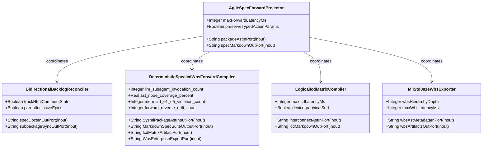
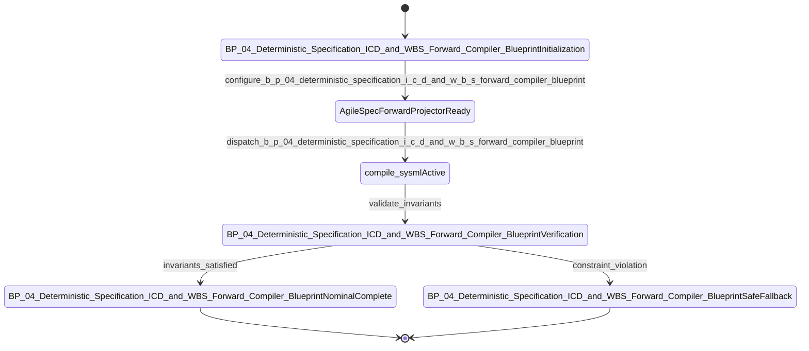

| Attribute | Specification Detail |
| :--- | :--- |
| **Issue ID** | #688 |
| **Title** | Epic 04: BP 04 Deterministic Specification ICD and WBS Forward Compiler Blueprint |
| **Type** | epic |
| **Package** | BP_04_Deterministic_Specification_ICD_and_WBS_Forward_Compiler_Blueprint |
| **Subsystem** | BP 04 Deterministic Specification ICD and WBS Forward Compiler Blueprint |
| **Generation Mode** | subagent |
| **Specification Source** | [schema/model.sysml](../../schema/model.sysml) |

# Epic 04: BP 04 Deterministic Specification ICD and WBS Forward Compiler Blueprint

## 1. Context
Subsystem package for BP_04_Deterministic_Specification_ICD_and_WBS_Forward_Compiler_Blueprint

## 2. Requirements & Checklist
- [ ] #670 - [Feature 16: [BP 04 Deterministic Specification ICD and WBS Forward Compiler Blueprint] AgileSpecForwardProjector](../features/FEAT-16-AgileSpecForwardProjector.md) (b_p_04_deterministic_specification_i_c_d_and_w_b_s_forward_compiler_blueprint.sysml)
- [ ] #671 - [Feature 17: [BP 04 Deterministic Specification ICD and WBS Forward Compiler Blueprint] BidirectionalBacklogReconciler](../features/FEAT-17-BidirectionalBacklogReconciler.md) (b_p_04_deterministic_specification_i_c_d_and_w_b_s_forward_compiler_blueprint.sysml)
- [ ] #672 - [Feature 18: [BP 04 Deterministic Specification ICD and WBS Forward Compiler Blueprint] DeterministicSpecIcdWbsForwardCompiler](../features/FEAT-18-DeterministicSpecIcdWbsForwardCompiler.md) (b_p_04_deterministic_specification_i_c_d_and_w_b_s_forward_compiler_blueprint.sysml)
- [ ] #673 - [Feature 19: [BP 04 Deterministic Specification ICD and WBS Forward Compiler Blueprint] LogicalIcdMatrixCompiler](../features/FEAT-19-LogicalIcdMatrixCompiler.md) (b_p_04_deterministic_specification_i_c_d_and_w_b_s_forward_compiler_blueprint.sysml)
- [ ] #674 - [Feature 20: [BP 04 Deterministic Specification ICD and WBS Forward Compiler Blueprint] MilStd881eWbsExporter](../features/FEAT-20-MilStd881eWbsExporter.md) (b_p_04_deterministic_specification_i_c_d_and_w_b_s_forward_compiler_blueprint.sysml)

### Associated Use Cases & User Stories

#### Associated Use Cases
- [ ] #639 - [Use Case 16: UC AC 01 Deterministic Multi Story Use Case and Con Ops Parent Epic Projection](../use-cases/UC-16-UC_AC_01_Deterministic_Multi_Story_Use_Case_and_ConOps_Parent_Epic_Projection.md)
- [ ] #640 - [Use Case 17: UC AC 02 Deterministic Logical ICD Matrix and Signal Dictionary Synthesis](../use-cases/UC-17-UC_AC_02_Deterministic_Logical_ICD_Matrix_and_Signal_Dictionary_Synthesis.md)
- [ ] #641 - [Use Case 18: UC AC 03 Deterministic MIL STD 881E WBS and Enterprise Export Synthesis](../use-cases/UC-18-UC_AC_03_Deterministic_MIL_STD_881E_WBS_and_Enterprise_Export_Synthesis.md)
- [ ] #642 - [Use Case 19: UC AC 04 Fail Closed Stateful HTML Comment Frontmatter Guard and Parent Inclusive Checklist Reconciliation](../use-cases/UC-19-UC_AC_04_Fail_Closed_Stateful_HTML_Comment_Frontmatter_Guard_and_Parent_Inclusive_Checklist_Reconciliation.md)
- [ ] #643 - [Use Case 20: UC AC 05 Fail Closed Subpackage Scoped Reverse Sync and Dogfood Blueprint Ingestion Parity](../use-cases/UC-20-UC_AC_05_Fail_Closed_Subpackage_Scoped_Reverse_Sync_and_Dogfood_Blueprint_Ingestion_Parity.md)

#### Associated User Stories
- [ ] #587 - [User Story 26: compile sysml](../user-stories/US-26-compile_sysml.md)
- [ ] #588 - [User Story 27: Resolve](../user-stories/US-27-Resolve.md)
- [ ] #589 - [User Story 28: Bind](../user-stories/US-28-Bind.md)
- [ ] #590 - [User Story 29: Emit](../user-stories/US-29-Emit.md)
- [ ] #591 - [User Story 30: Epics](../user-stories/US-30-Epics.md)
- [ ] #592 - [User Story 31: Project](../user-stories/US-31-Project.md)
- [ ] #593 - [User Story 32: ICD 01](../user-stories/US-32-ICD_01.md)
- [ ] #594 - [User Story 33: Synthesize](../user-stories/US-33-Synthesize.md)
- [ ] #595 - [User Story 34: WBS 01 03](../user-stories/US-34-WBS_01_03.md)
- [ ] #596 - [User Story 35: reconcile backlog](../user-stories/US-35-reconcile_backlog.md)
- [ ] #597 - [User Story 36: Parse](../user-stories/US-36-Parse.md)
- [ ] #598 - [User Story 37: Reconcile](../user-stories/US-37-Reconcile.md)
- [ ] #599 - [User Story 38: Zero](../user-stories/US-38-Zero.md)
- [ ] #600 - [User Story 39: Merge](../user-stories/US-39-Merge.md)
- [ ] #601 - [User Story 40: Bit identical](../user-stories/US-40-Bit_identical.md)

## 3. Architecture
Subsystem structural composition, port allocations, and directional data connectors realized by AgileSpecForwardProjector.

## 4. Operational Considerations
Deterministic compilation passes, error containment, and provable polynomial complexity execution.

## 5. Security & Governance
Safety-critical invariant satisfaction, formal trace matrix closure, and zero hardcoded domain semantics.

## 6. Source References
- System Architecture Model: `schema/model.sysml`
- Subsystem Specification Model: `schema/subsystems/b_p_04_deterministic_specification_i_c_d_and_w_b_s_forward_compiler_blueprint/architecture.sysml`
- Subsystem Requirements Model: `schema/subsystems/b_p_04_deterministic_specification_i_c_d_and_w_b_s_forward_compiler_blueprint/requirements.sysml`
- Normative Systems Engineering Standard: ISO/IEC/IEEE 15288:2023 §6.4.3 Architecture Definition Process

Subsystem architectural composition and formal invariants derive from `schema/model.sysml` pursuant to ISO/IEC/IEEE 15288.

## System-Level UML Class Diagram

## System State Machine Diagram

