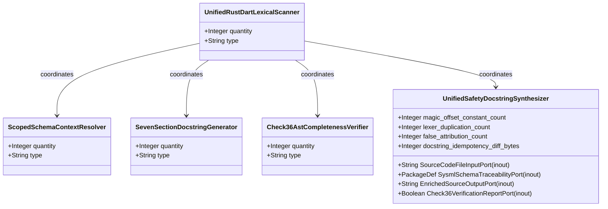
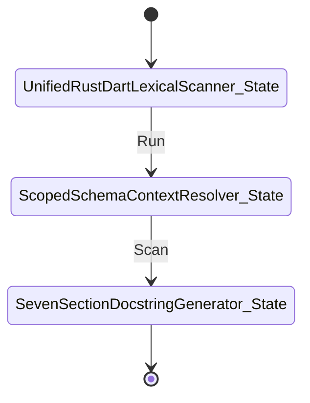

| Attribute | Specification Detail |
| :--- | :--- |
| **Issue ID** | #689 |
| **Title** | Epic 05: BP 05 Unified AST Safety Docstring Synthesizer and Check 36 Verification Blueprint |
| **Type** | epic |
| **Package** | BP_05_Unified_AST_Safety_Docstring_Synthesizer_and_Check_36_Verification_Blueprint |
| **Subsystem** | BP 05 Unified AST Safety Docstring Synthesizer and Check 36 Verification Blueprint |
| **Generation Mode** | subagent |
| **Specification Source** | [schema/model.sysml](../../schema/model.sysml) |

# Epic 05: BP 05 Unified AST Safety Docstring Synthesizer and Check 36 Verification Blueprint

## 1. Context
Subsystem package for BP_05_Unified_AST_Safety_Docstring_Synthesizer_and_Check_36_Verification_Blueprint

## 2. Requirements & Checklist
- [ ] #675 - [Feature 21: [BP 05 Unified AST Safety Docstring Synthesizer and Check 36 Verification Blueprint] UnifiedRustDartLexicalScanner](../features/FEAT-21-UnifiedRustDartLexicalScanner.md)
- [ ] #676 - [Feature 22: [BP 05 Unified AST Safety Docstring Synthesizer and Check 36 Verification Blueprint] ScopedSchemaContextResolver](../features/FEAT-22-ScopedSchemaContextResolver.md)
- [ ] #677 - [Feature 23: [BP 05 Unified AST Safety Docstring Synthesizer and Check 36 Verification Blueprint] SevenSectionDocstringGenerator](../features/FEAT-23-SevenSectionDocstringGenerator.md)
- [ ] #678 - [Feature 24: [BP 05 Unified AST Safety Docstring Synthesizer and Check 36 Verification Blueprint] Check36AstCompletenessVerifier](../features/FEAT-24-Check36AstCompletenessVerifier.md)
- [ ] #679 - [Feature 25: [BP 05 Unified AST Safety Docstring Synthesizer and Check 36 Verification Blueprint] UnifiedSafetyDocstringSynthesizer](../features/FEAT-25-UnifiedSafetyDocstringSynthesizer.md)

### Associated Use Cases & User Stories

#### Associated Use Cases
- [ ] #644 - [Use Case 21: Unified Rust and Dart Lexical State Machine Without Magic Offsets](../use-cases/UC-21-Unified_Rust_and_Dart_Lexical_State_Machine_Without_Magic_Offsets.md)
- [ ] #645 - [Use Case 22: Strict Schema Context Resolution and Recursive Part Traversal](../use-cases/UC-22-Strict_Schema_Context_Resolution_and_Recursive_Part_Traversal.md)
- [ ] #646 - [Use Case 23: Scoped mod tests Brace Tracking unsafe extern Classification and Arrow Aware impl Headers](../use-cases/UC-23-Scoped_mod_tests_Brace_Tracking_unsafe_extern_Classification_and_Arrow_Aware_impl_Headers.md)
- [ ] #647 - [Use Case 24: Bit for Bit Idempotency and Fail Closed Check 34 Per Function Normalized Body Uniqueness](../use-cases/UC-24-Bit_for_Bit_Idempotency_and_Fail_Closed_Check_34_Per_Function_Normalized_Body_Uniqueness.md)
- [ ] #648 - [Use Case 25: Dogfood Ingestion and Sys ML v2 Compilation of REQ 0605](../use-cases/UC-25-Dogfood_Ingestion_and_SysML_v2_Compilation_of_REQ_0605.md)

#### Associated User Stories
- [ ] #602 - [User Story 41: [UnifiedRustDartLexicalScanner] Run](../user-stories/US-41-Run.md)
- [ ] #603 - [User Story 42: Scan](../user-stories/US-42-Scan.md)
- [ ] #604 - [User Story 43: [UnifiedRustDartLexicalScanner] Return](../user-stories/US-43-Return.md)
- [ ] #605 - [User Story 44: [UnifiedRustDartLexicalScanner] Resolve](../user-stories/US-44-Resolve.md)
- [ ] #606 - [User Story 45: Write](../user-stories/US-45-Write.md)
- [ ] #607 - [User Story 46: Tokenize](../user-stories/US-46-Tokenize.md)
- [ ] #608 - [User Story 47: Verify item](../user-stories/US-47-Verify_item.md)
- [ ] #609 - [User Story 48: [UnifiedRustDartLexicalScanner] Emit](../user-stories/US-48-Emit.md)

## 3. Architecture
Subsystem structural composition, port allocations, and directional data connectors realized by UnifiedRustDartLexicalScanner.

## 4. Operational Considerations
Deterministic compilation passes, error containment, and provable polynomial complexity execution.

## 5. Security & Governance
Safety-critical invariant satisfaction, formal trace matrix closure, and zero hardcoded domain semantics.

## 6. Source References
- System Architecture Model: `schema/model.sysml`
- Normative Systems Engineering Standard: ISO/IEC/IEEE 15288:2023 §6.4.3 Architecture Definition Process

Subsystem architectural composition and formal invariants derive from `schema/model.sysml` pursuant to ISO/IEC/IEEE 15288.

## System-Level UML Class Diagram

## System State Machine Diagram

