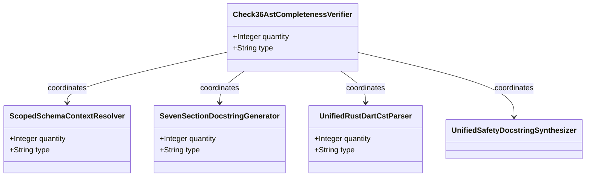
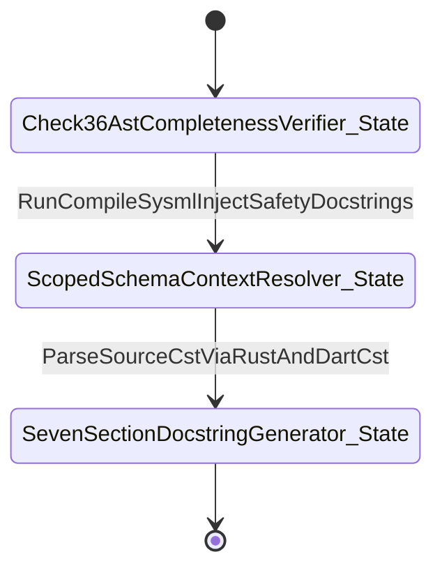

| Attribute | Specification Detail |
| :--- | :--- |
| **Issue ID** | #689 |
| **Title** | Epic 05: BP 05 Unified AST Safety Docstring Synthesizer and Check 36 Verification Blueprint |
| **Type** | epic |
| **Package** | BP_05_Unified_AST_Safety_Docstring_Synthesizer_and_Check_36_Verification_Blueprint |
| **Subsystem** | BP 05 Unified AST Safety Docstring Synthesizer and Check 36 Verification Blueprint |
| **Generation Mode** | subagent |
| **Specification Source** | [schema/model.sysml](../../schema/model.sysml) |

# Epic 05: BP 05 Unified AST Safety Docstring Synthesizer and Check 36 Verification Blueprint

## 1. Context
Subsystem package for `BP_05_Unified_AST_Safety_Docstring_Synthesizer_and_Check_36_Verification_Blueprint` (`REQ-0605`). Enforces:
- **Contract A (100% Normative OMG SysML v2.0 + KerML 1.0 Grammar Coverage)**: Full Definition and Usage symmetry across `package`/`library package`/`standard library package`, `import` (`all`, `::*`, `::**`, filter `[...]`), `metadata def`/`metadata`/`@Metadata`/`#user_keyword` (`#hazard`, `#risk`, `#capability`, `#rt_loop`, `#dal`, `#fls` with backward-compatible legacy `hazard def`/`risk def`/`capability def`), `part def`/`part`, `item def`/`item`, `attribute def`/`attribute`, `enum def`/`enum`, `port def`/`port` (`in`, `out`, `inout`, `~`), `connection def`/`connection`, `interface def`/`interface`, `flow def`/`flow`, `allocation def`/`allocation`, `occurrence def`/`occurrence`, `action def`/`action`, `state def`/`state`, `calc def`/`calc`, `constraint def`/`constraint`, `requirement def`/`requirement`, `concern def`/`concern`, `use case def`/`use case`, `analysis def`/`analysis`, `verification def`/`verification`, `test case def`/`test case`, `interaction def`/`interaction`, `view def`/`view`, `viewpoint def`/`viewpoint`, `rendering def`/`rendering`, `variation`/`variant`, and KerML 1.0 specialization (`:`, `:>`, `:>>`, `::>`, `~`), multiplicity (`[lo..hi]`), and `ISQ`/`SI`/`ScalarValues` libraries with zero 16-construct artificial caps.
- **Contract B (Official Rust Compiler & `rust-analyzer` Crate Stack -- Zero Hand-Rolled Scanners)**: Lossless Rust and Dart CST parsing, docstring synthesis, and Check 36 verification via `ra_ap_syntax` (`ast::HasDocComments`, `ast::HasAttrs`, `ast::Fn`), `ra_ap_text_edit`, `ra_ap_line_index`, `ra_ap_vfs`, `rowan`, `logos`, `salsa`, `ariadne`, `pulldown-cmark`, `syn`, `quote`, and `prettyplease` (`deap_core::rust_cst` and `deap_core::dart_cst`), enforcing `<= 4`-line Tier-B/C `[REQ-*]`/`[FLS: fls_*]` docstrings on internal declarations and explicit `[DOC-TIER: A]` 7-section safety docstrings on `pub` crate entrypoints and `unsafe`/`extern` blocks, with zero hand-rolled string/line/char-by-char scanners.

## 2. Requirements & Checklist
- [ ] #678 - [Feature 21: [BP 05 Unified AST Safety Docstring Synthesizer and Check 36 Verification Blueprint] Check36AstCompletenessVerifier](../features/FEAT-21-Check36AstCompletenessVerifier.md)
- [ ] #676 - [Feature 22: [BP 05 Unified AST Safety Docstring Synthesizer and Check 36 Verification Blueprint] ScopedSchemaContextResolver](../features/FEAT-22-ScopedSchemaContextResolver.md)
- [ ] #677 - [Feature 23: [BP 05 Unified AST Safety Docstring Synthesizer and Check 36 Verification Blueprint] SevenSectionDocstringGenerator](../features/FEAT-23-SevenSectionDocstringGenerator.md)
- [ ] #675 - [Feature 24: [BP 05 Unified AST Safety Docstring Synthesizer and Check 36 Verification Blueprint] UnifiedRustDartCstParser](../features/FEAT-24-UnifiedRustDartCstParser.md)
- [ ] #679 - [Feature 25: [BP 05 Unified AST Safety Docstring Synthesizer and Check 36 Verification Blueprint] UnifiedSafetyDocstringSynthesizer](../features/FEAT-25-UnifiedSafetyDocstringSynthesizer.md)

### Associated Use Cases & User Stories

#### Associated Use Cases
- [ ] #644 - [Use Case 21: Unified Rust and Dart Lexical State Machine Without Magic Offsets](../use-cases/UC-21-Unified_Rust_and_Dart_Lexical_State_Machine_Without_Magic_Offsets.md)
- [ ] #645 - [Use Case 22: Strict Schema Context Resolution and Recursive Part Traversal](../use-cases/UC-22-Strict_Schema_Context_Resolution_and_Recursive_Part_Traversal.md)
- [ ] #646 - [Use Case 23: Scoped mod tests Brace Tracking unsafe extern Classification and Arrow Aware impl Headers](../use-cases/UC-23-Scoped_mod_tests_Brace_Tracking_unsafe_extern_Classification_and_Arrow_Aware_impl_Headers.md)
- [ ] #647 - [Use Case 24: Bit for Bit Idempotency and Fail Closed Check 34 Per Function Normalized Body Uniqueness](../use-cases/UC-24-Bit_for_Bit_Idempotency_and_Fail_Closed_Check_34_Per_Function_Normalized_Body_Uniqueness.md)
- [ ] #648 - [Use Case 25: Dogfood Ingestion and SysML v2 Compilation of REQ 0605](../use-cases/UC-25-Dogfood_Ingestion_and_SysML_v2_Compilation_of_REQ_0605.md)

#### Associated User Stories
- [ ] #720 - [User Story 31: Run Compile Sysml Inject Safety Docstrings](../user-stories/US-31-RunCompileSysmlInjectSafetyDocstrings.md)
- [ ] #721 - [User Story 32: Parse Source Cst Via Rust And Dart Cst](../user-stories/US-32-ParseSourceCstViaRustAndDartCst.md)
- [ ] #722 - [User Story 33: Resolve Schema Context Via Collect All](../user-stories/US-33-ResolveSchemaContextViaCollectAll.md)
- [ ] #723 - [User Story 34: Run Verify Baseline No Domain](../user-stories/US-34-RunVerifyBaselineNoDomain.md)
- [ ] #724 - [User Story 35: Tokenize Rs And Dart Files Using](../user-stories/US-35-TokenizeRsAndDartFilesUsing.md)
- [ ] #725 - [User Story 36: Run Ingest Sysml Schema Blueprint05](../user-stories/US-36-RunIngestSysmlSchemaBlueprint05.md)

## 3. Architecture
Classifiers: `Check36AstCompletenessVerifier`; `ScopedSchemaContextResolver`; `SevenSectionDocstringGenerator`; `UnifiedRustDartCstParser`; `UnifiedSafetyDocstringSynthesizer`.

### 3-Layer Definition of Done (DoD) & Submodule Modularity
- **Layer 1 (Domain State & Data Model)**: Lossless CST/AST representation via `ra_ap_syntax` (`ast::HasDocComments`, `ast::HasAttrs`), `ra_ap_line_index`, `rowan`, `logos`, and `salsa` (`deap_core::sysml_cst`, `deap_core::rust_cst`, `deap_core::dart_cst`) with full OMG SysML v2.0 + KerML 1.0 construct coverage (zero 16-construct caps).
- **Layer 2 (Logic & State Management)**: Scoped schema context resolution (`collect_all_parts` without `.first()` fallback), `ra_ap_text_edit` + `ra_ap_line_index` span-isolated codemods enforcing `<= 4`-line Tier-B/C `[REQ-*]`/`[FLS: fls_*]` docstrings and explicit `[DOC-TIER: A]` entrypoints, and Check 36/Check 34 verification decomposed into `< 380`-SLOC submodules (`./crates/compile-sysml/src/safety_docstrings/`, `./crates/deap-core/src/rust_cst/`, `./crates/deap-core/src/dart_cst/`) with explicit deletion of legacy hand-rolled line/char-by-char scanners (`-800+` SLOC retired).
- **Layer 3 (Presentation & Actuator Interface Binding)**: Deterministic CLI bindings (`compile-sysml --inject-safety-docstrings`, `verify-baseline . --no-domain`, `ingest-sysml`) and `ariadne`/`miette` byte-span diagnostics.

## 4. Operational Considerations
Lifecycle state machines: `BP_05_Unified_AST_Safety_Docstring_Synthesizer_and_Check_36_Verification_Blueprint_LifecycleState` (Initial -> Check36AstCompletenessVerifier_State; Check36AstCompletenessVerifier_State -> ScopedSchemaContextResolver_State on RunCompileSysmlInjectSafetyDocstrings; ScopedSchemaContextResolver_State -> SevenSectionDocstringGenerator_State on ParseSourceCstViaRustAndDartCst; SevenSectionDocstringGenerator_State -> Terminal). Operational actions: `RunCompileSysmlInjectSafetyDocstrings`, `ParseSourceCstViaRustAndDartCst`, `ResolveSchemaContextViaCollectAll`, `RunVerifyBaselineNoDomain`, `TokenizeRsAndDartFilesUsing`, `RunIngestSysmlSchemaBlueprint05`. Interaction sequences: `BP_05_Unified_AST_Safety_Docstring_Synthesizer_and_Check_36_Verification_Blueprint_SequenceInteraction`.

## 5. Security & Governance
Allocated requirements: `REQ-0605 (REQ_0605_BP_05_Unified_AST_Safety_Docstring_Synthesizer_and_Check_36_Verification_Blueprint)`. Enforced invariant constraints: `Invariant_REQ_0605_Under_REQ_0605_and_parametric_constraints_C_DOC_01_through_C_DOC_04_lexical_scanning_schema_context_resolution_and_forward_docstring_injection_satisfy_the_following_linear_complexity_and_idempotency_bounds`. Enforces Ferrocene `criticalup.toml` + `[FLS: fls_*]` paragraph traceability, `<= 4`-line Tier-B/C `[REQ-*]`/`[FLS: fls_*]` docstrings, explicit `[DOC-TIER: A]` entrypoints, and zero hand-rolled lexical scanners.

## 6. Source References
- System Architecture Model: `schema/model.sysml`
- Normative Systems Engineering Standard: ISO/IEC/IEEE 15288:2023 §6.4.3 Architecture Definition Process

Subsystem architectural composition and formal invariants derive from `schema/model.sysml` pursuant to ISO/IEC/IEEE 15288.

## System-Level UML Class Diagram

## System State Machine Diagram

