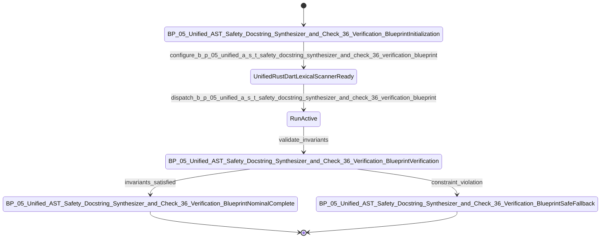

| Attribute | Specification Detail |
| :--- | :--- |
| **Issue ID** | #689 |
| **Title** | Epic 05: BP 05 Unified AST Safety Docstring Synthesizer and Check 36 Verification Blueprint |
| **Type** | epic |
| **Package** | BP_05_Unified_AST_Safety_Docstring_Synthesizer_and_Check_36_Verification_Blueprint |
| **Subsystem** | BP 05 Unified AST Safety Docstring Synthesizer and Check 36 Verification Blueprint |
| **Generation Mode** | subagent |
| **Specification Source** | [schema/model.sysml](../../schema/model.sysml) |

# Epic 05: BP 05 Unified AST Safety Docstring Synthesizer and Check 36 Verification Blueprint

## 1. Context
Subsystem package for BP_05_Unified_AST_Safety_Docstring_Synthesizer_and_Check_36_Verification_Blueprint

## 2. Requirements & Checklist
- [ ] #675 - [Feature 21: [BP 05 Unified AST Safety Docstring Synthesizer and Check 36 Verification Blueprint] UnifiedRustDartLexicalScanner](../features/FEAT-21-UnifiedRustDartLexicalScanner.md) (b_p_05_unified_a_s_t_safety_docstring_synthesizer_and_check_36_verification_blueprint.sysml)
- [ ] #676 - [Feature 22: [BP 05 Unified AST Safety Docstring Synthesizer and Check 36 Verification Blueprint] ScopedSchemaContextResolver](../features/FEAT-22-ScopedSchemaContextResolver.md) (b_p_05_unified_a_s_t_safety_docstring_synthesizer_and_check_36_verification_blueprint.sysml)
- [ ] #677 - [Feature 23: [BP 05 Unified AST Safety Docstring Synthesizer and Check 36 Verification Blueprint] SevenSectionDocstringGenerator](../features/FEAT-23-SevenSectionDocstringGenerator.md) (b_p_05_unified_a_s_t_safety_docstring_synthesizer_and_check_36_verification_blueprint.sysml)
- [ ] #678 - [Feature 24: [BP 05 Unified AST Safety Docstring Synthesizer and Check 36 Verification Blueprint] Check36AstCompletenessVerifier](../features/FEAT-24-Check36AstCompletenessVerifier.md) (b_p_05_unified_a_s_t_safety_docstring_synthesizer_and_check_36_verification_blueprint.sysml)
- [ ] #679 - [Feature 25: [BP 05 Unified AST Safety Docstring Synthesizer and Check 36 Verification Blueprint] UnifiedSafetyDocstringSynthesizer](../features/FEAT-25-UnifiedSafetyDocstringSynthesizer.md) (assert_magic_offset_constant_count_range, assert_lexer_duplication_count_range, assert_false_attribution_count_range, assert_docstring_idempotency_diff_bytes_range)

### Associated Use Cases & User Stories

#### Associated Use Cases
- [ ] #644 - [Use Case 21: UC AC 01 Unified Rust and Dart Lexical State Machine Without Magic Offsets](../use-cases/UC-21-UC_AC_01_Unified_Rust_and_Dart_Lexical_State_Machine_Without_Magic_Offsets.md)
- [ ] #645 - [Use Case 22: UC AC 02 Strict Schema Context Resolution and Recursive Part Traversal](../use-cases/UC-22-UC_AC_02_Strict_Schema_Context_Resolution_and_Recursive_Part_Traversal.md)
- [ ] #646 - [Use Case 23: UC AC 03 Scoped mod tests Brace Tracking unsafe extern Classification and Arrow Aware impl Headers](../use-cases/UC-23-UC_AC_03_Scoped_mod_tests_Brace_Tracking_unsafe_extern_Classification_and_Arrow_Aware_impl_Headers.md)
- [ ] #647 - [Use Case 24: UC AC 04 Bit for Bit Idempotency and Fail Closed Check 34 Per Function Normalized Body Uniqueness](../use-cases/UC-24-UC_AC_04_Bit_for_Bit_Idempotency_and_Fail_Closed_Check_34_Per_Function_Normalized_Body_Uniqueness.md)
- [ ] #648 - [Use Case 25: UC AC 05 Dogfood Ingestion and Sys ML v2 Compilation of REQ 0605](../use-cases/UC-25-UC_AC_05_Dogfood_Ingestion_and_SysML_v2_Compilation_of_REQ_0605.md)

#### Associated User Stories
- [ ] #602 - [User Story 41: Run](../user-stories/US-41-Run.md)
- [ ] #603 - [User Story 42: Scan](../user-stories/US-42-Scan.md)
- [ ] #604 - [User Story 43: Return](../user-stories/US-43-Return.md)
- [ ] #605 - [User Story 44: Resolve](../user-stories/US-44-Resolve.md)
- [ ] #606 - [User Story 45: Write](../user-stories/US-45-Write.md)
- [ ] #607 - [User Story 46: Tokenize](../user-stories/US-46-Tokenize.md)
- [ ] #608 - [User Story 47: Verify item](../user-stories/US-47-Verify_item.md)
- [ ] #609 - [User Story 48: Emit](../user-stories/US-48-Emit.md)

## 3. Architecture
Subsystem structural composition, port allocations, and directional data connectors realized by UnifiedRustDartLexicalScanner.

## 4. Operational Considerations
Deterministic compilation passes, error containment, and provable polynomial complexity execution.

## 5. Security & Governance
Safety-critical invariant satisfaction, formal trace matrix closure, and zero hardcoded domain semantics.

## 6. Source References
- System Architecture Model: `schema/model.sysml`
- Subsystem Specification Model: `schema/subsystems/b_p_05_unified_a_s_t_safety_docstring_synthesizer_and_check_36_verification_blueprint/architecture.sysml`
- Subsystem Requirements Model: `schema/subsystems/b_p_05_unified_a_s_t_safety_docstring_synthesizer_and_check_36_verification_blueprint/requirements.sysml`
- Normative Systems Engineering Standard: ISO/IEC/IEEE 15288:2023 §6.4.3 Architecture Definition Process

Subsystem architectural composition and formal invariants derive from `schema/model.sysml` pursuant to ISO/IEC/IEEE 15288.

## System-Level UML Class Diagram

## System State Machine Diagram

