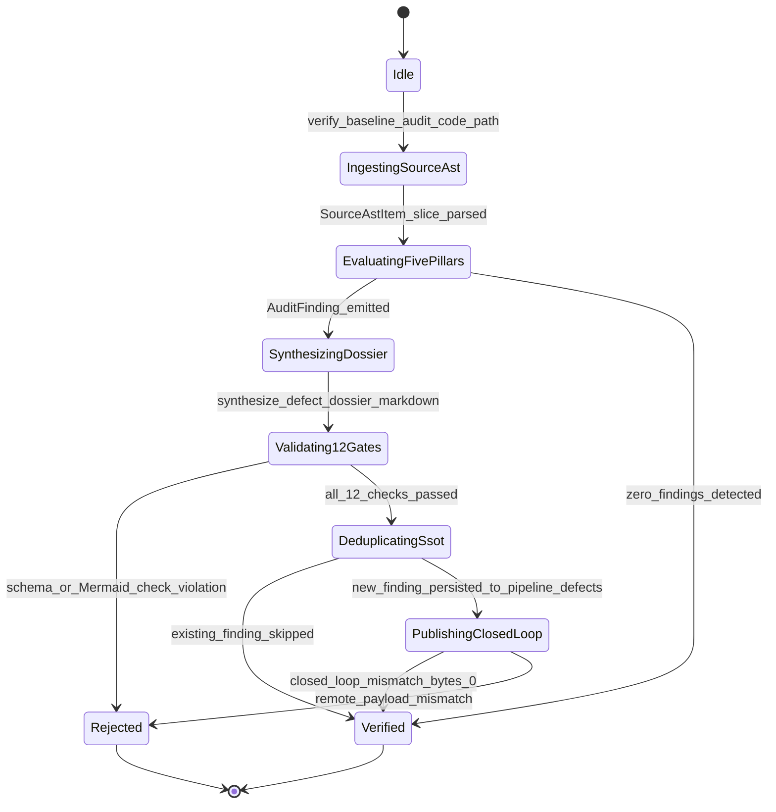

| Attribute | Specification Detail |
| :--- | :--- |
| **Issue ID** | #690 |
| **Title** | Epic 06: BP 06 Deterministic Static 5 Pillar Code Auditor and Defect Dossier Synthesizer Blueprint |
| **Type** | epic |
| **Package** | BP_06_Deterministic_Static_5_Pillar_Code_Auditor_and_Defect_Dossier_Synthesizer_Blueprint |
| **Subsystem** | BP 06 Deterministic Static 5 Pillar Code Auditor and Defect Dossier Synthesizer Blueprint |
| **Generation Mode** | subagent |
| **Specification Source** | [schema/model.sysml](../../schema/model.sysml) |

# Epic 06: BP 06 Deterministic Static 5 Pillar Code Auditor and Defect Dossier Synthesizer Blueprint

## 1. Context
Subsystem package for BP_06_Deterministic_Static_5_Pillar_Code_Auditor_and_Defect_Dossier_Synthesizer_Blueprint

## 2. Requirements & Checklist
- [ ] #680 - [Feature 26: [BP 06 Deterministic Static 5 Pillar Code Auditor and Defect Dossier Synthesizer Blueprint] ClosedLoopDefectPublisherGate](../features/FEAT-26-ClosedLoopDefectPublisherGate.md)
- [ ] #681 - [Feature 27: [BP 06 Deterministic Static 5 Pillar Code Auditor and Defect Dossier Synthesizer Blueprint] DeterministicDossierSynthesizer](../features/FEAT-27-DeterministicDossierSynthesizer.md)
- [ ] #682 - [Feature 28: [BP 06 Deterministic Static 5 Pillar Code Auditor and Defect Dossier Synthesizer Blueprint] DeterministicStaticDefectAuditor](../features/FEAT-28-DeterministicStaticDefectAuditor.md)
- [ ] #683 - [Feature 29: [BP 06 Deterministic Static 5 Pillar Code Auditor and Defect Dossier Synthesizer Blueprint] FivePillarStaticAstAnalyzer](../features/FEAT-29-FivePillarStaticAstAnalyzer.md)
- [ ] #684 - [Feature 30: [BP 06 Deterministic Static 5 Pillar Code Auditor and Defect Dossier Synthesizer Blueprint] MermaidUmlDiagramGenerator](../features/FEAT-30-MermaidUmlDiagramGenerator.md)

### Associated Use Cases & User Stories

#### Associated Use Cases
- [ ] #649 - [Use Case 26: Static Five Pillar AST Defect Detection](../use-cases/UC-26-Static_Five_Pillar_AST_Defect_Detection.md)
- [ ] #650 - [Use Case 27: Deterministic Seven Section Dossier and Mermaid Synthesis](../use-cases/UC-27-Deterministic_Seven_Section_Dossier_and_Mermaid_Synthesis.md)
- [ ] #651 - [Use Case 28: Idempotent Local and Remote SSOT Deduplication](../use-cases/UC-28-Idempotent_Local_and_Remote_SSOT_Deduplication.md)
- [ ] #652 - [Use Case 29: Closed Loop GitHub SSOT Publishing and Byte Parity Verification](../use-cases/UC-29-Closed_Loop_GitHub_SSOT_Publishing_and_Byte_Parity_Verification.md)
- [ ] #653 - [Use Case 30: Fail Closed Rejection on Malformed Dossier Schema Ephemeral Paths or Payload Divergence](../use-cases/UC-30-Fail_Closed_Rejection_on_Malformed_Dossier_Schema_Ephemeral_Paths_or_Payload_Divergence.md)
- [ ] #654 - [Use Case 31: Dogfood SysML v2 Markdown Ingestion and Blueprint Gate Conformance](../use-cases/UC-31-Dogfood_SysML_v2_Markdown_Ingestion_and_Blueprint_Gate_Conformance.md)

#### Associated User Stories
- [ ] #726 - [User Story 37: Verify Baseline Audit Code Path Crates](../user-stories/US-37-VerifyBaselineAuditCodePathCrates.md)
- [ ] #727 - [User Story 38: Parse Rust Source Ast And Parse](../user-stories/US-38-ParseRustSourceAstAndParse.md)
- [ ] #728 - [User Story 39: Evaluate Source File Pillars Across5](../user-stories/US-39-EvaluateSourceFilePillarsAcross5.md)
- [ ] #615 - [User Story 40: synthesize defect dossier markdown](../user-stories/US-40-synthesize_defect_dossier_markdown.md)
- [ ] #617 - [User Story 41: run check defect](../user-stories/US-41-run_check_defect.md)
- [ ] #729 - [User Story 42: Execute12 Check Validate Defect Dossier](../user-stories/US-42-Execute12CheckValidateDefectDossier.md)
- [ ] #730 - [User Story 43: Gh Issue Create Or Gh Issue](../user-stories/US-43-GhIssueCreateOrGhIssue.md)
- [ ] #731 - [User Story 44: Gh Issue View Json Title Body](../user-stories/US-44-GhIssueViewJsonTitleBody.md)

## 3. Architecture
Classifiers: `ClosedLoopDefectPublisherGate` (ports: `in dossierCandidateInPort : String`, `out verifiedReceiptOutPort : String`); `DeterministicDossierSynthesizer` (ports: `in findingInPort : String`, `out dossierMarkdownOutPort : String`); `DeterministicStaticDefectAuditor` (ports: `in TargetSourceAstInputPort : String`, `in GitHubIssueSsotQueryPort : String`, `out DefectDossierArtifactPort : String`, `out ClosedLoopTrackerPublishPort : String`); `FivePillarStaticAstAnalyzer` (ports: `in astStreamInPort : String`, `out findingStreamOutPort : String`); `MermaidUmlDiagramGenerator` (ports: `in umlSpecInPort : String`, `out mermaidBlockOutPort : String`).

## 4. Operational Considerations
Lifecycle state machines: `BP_06_Deterministic_Static_5_Pillar_Code_Auditor_and_Defect_Dossier_Synthesizer_Blueprint_LifecycleState` (Initial -> Idle; Idle -> IngestingSourceAst on verify_baseline_audit_code_path; IngestingSourceAst -> EvaluatingFivePillars on SourceAstItem_slice_parsed; EvaluatingFivePillars -> SynthesizingDossier on AuditFinding_emitted; EvaluatingFivePillars -> Verified on zero_findings_detected; SynthesizingDossier -> Validating12Gates on synthesize_defect_dossier_markdown; Validating12Gates -> Rejected on schema_or_Mermaid_check_violation; Validating12Gates -> DeduplicatingSsot on all_12_checks_passed; DeduplicatingSsot -> Verified on existing_finding_skipped; DeduplicatingSsot -> PublishingClosedLoop on new_finding_persisted_to_pipeline_defects; PublishingClosedLoop -> Verified on closed_loop_mismatch_bytes_0; PublishingClosedLoop -> Rejected on remote_payload_mismatch; Rejected -> Terminal; Verified -> Terminal). Operational actions: `VerifyBaselineAuditCodePathCrates`, `ParseRustSourceAstAndParse`, `EvaluateSourceFilePillarsAcross5`, `synthesize_defect_dossier_markdown`, `run_check_defect`, `Execute12CheckValidateDefectDossier`, `GhIssueCreateOrGhIssue`, `GhIssueViewJsonTitleBody`. Interaction sequences: `BP_06_Deterministic_Static_5_Pillar_Code_Auditor_and_Defect_Dossier_Synthesizer_Blueprint_SequenceInteraction`.

## 5. Security & Governance
Allocated requirements: `REQ-0606 (REQ_0606_BP_06_Deterministic_Static_5_Pillar_Code_Auditor_and_Defect_Dossier_Synthesizer_Blueprint)`. Enforced invariant constraints: `Invariant_REQ_0606_SC_01`, `Invariant_REQ_0606_SC_02`.

## 6. Source References
- System Architecture Model: `schema/model.sysml`
- Normative Systems Engineering Standard: ISO/IEC/IEEE 15288:2023 §6.4.3 Architecture Definition Process

Subsystem architectural composition and formal invariants derive from `schema/model.sysml` pursuant to ISO/IEC/IEEE 15288.

## System-Level UML Class Diagram

## System State Machine Diagram

