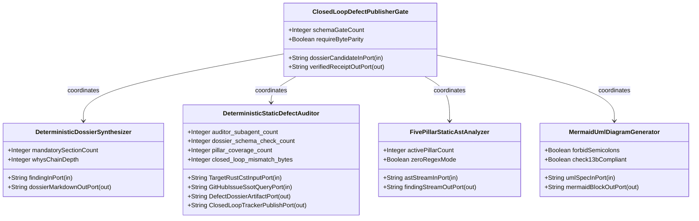
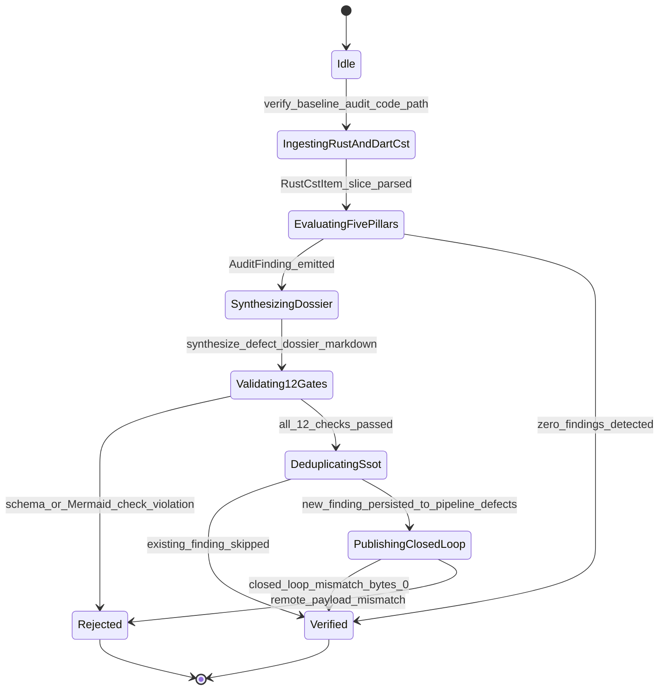

| Attribute | Specification Detail |
| :--- | :--- |
| **Issue ID** | #690 |
| **Title** | Epic 06: BP 06 Deterministic Static 5 Pillar Code Auditor and Defect Dossier Synthesizer Blueprint |
| **Type** | epic |
| **Package** | BP_06_Deterministic_Static_5_Pillar_Code_Auditor_and_Defect_Dossier_Synthesizer_Blueprint |
| **Subsystem** | BP 06 Deterministic Static 5 Pillar Code Auditor and Defect Dossier Synthesizer Blueprint |
| **Generation Mode** | subagent |
| **Specification Source** | [schema/model.sysml](../../schema/model.sysml) |

# Epic 06: BP 06 Deterministic Static 5 Pillar Code Auditor and Defect Dossier Synthesizer Blueprint

## 1. Context
Subsystem package for `BP_06_Deterministic_Static_5_Pillar_Code_Auditor_and_Defect_Dossier_Synthesizer_Blueprint` (**REQ-0606** / `BP-06` / `DEAP-BP-DET-06`). This Epic defines the deterministic static 5-pillar code auditor and 7-section defect dossier synthesizer architecture, replacing ad-hoc subagent guesswork and hand-rolled line/character scanners with a two-stage compiler-grade static analysis and closed-loop GitHub Single Source of Truth (SSOT) publication pipeline:
- **Contract A (100% Normative OMG SysML v2.0 + KerML 1.0 Grammar Coverage)**: Enforces full Definition and Usage symmetry across the entire OMG SysML v2.0 and KerML 1.0 textual grammar with zero 16-construct artificial caps, spanning `package`/`library package`/`standard library package`, `import` (`all`, `::*`, `::**`, filter `[...]`), `metadata def`/`metadata`/`@Metadata`/`#user_keyword` (`#capability`, `#hazard`, `#risk`, `#rt_loop`, `#dal`, `#fls`, with backward-compatible parsing of legacy `capability def`/`hazard def`/`risk def`), `part def`/`part`, `item def`/`item`, `attribute def`/`attribute`, `enum def`/`enum`, `port def`/`port` (`in`, `out`, `inout`, `~` conjugation), `interface def`/`interface`, `connection def`/`connection`, `flow def`/`flow`, `allocation def`/`allocation`, `occurrence def`/`occurrence`, `action def`/`action`, `state def`/`state`, `calc def`/`calc`, `constraint def`/`constraint`, `requirement def`/`requirement`, `concern def`/`concern`, `use case def`/`use case`, `analysis def`/`analysis`, `verification def`/`verification`, `test case def`/`test case`, `interaction def`/`interaction`, `view def`/`view`, `viewpoint def`/`viewpoint`, `rendering def`/`rendering`, `variation`/`variant`, and KerML 1.0 specialization (`:`, `:>`, `:>>`, `::>`, `~`), multiplicities, expressions, and `ISQ`/`SI`/`ScalarValues` standard libraries.
- **Contract B (100% Official Rust Compiler, `ra_ap_syntax`, Stage-2 `Dylint` `rustc_middle::mir` & `deap_core::dart_cst` Stack -- Zero Hand-Rolled Scanners)**:
  1. **Typed Rust CST/AST Pass (`ra_ap_syntax`)**: Parses Rust source files losslessly via `ra_ap_syntax` (`ast::{MatchExpr, MatchArmList, CallExpr, MethodCallExpr, TryExpr, Fn, HasDocComments, HasAttrs}`), `ra_ap_vfs`, `ra_ap_paths`, `ra_ap_line_index`, `ra_ap_text_edit`, `rowan`, `camino`, and `ignore`.
  2. **Stage-2 Isolated `Dylint` MIR Pass (`./lints/deap-dylint-mir/`)**: Evaluates lowered control-flow graphs and type-checked representations via `#![feature(rustc_private)]` and `rustc_middle::mir` (`TyCtxt`) across all 5 correctness risk pillars (`E0601` through `E0605`): (1) partial functions, panics, and unchecked indexing; (2) arithmetic overflow/underflow and non-finite IEEE-754 floating-point operations; (3) silent error discarding and incomplete `MatchExpr`/`SwitchInt` state transitions; (4) unbounded recursion, real-time `#rt_loop` heap allocations, and non-terminating loops; and (5) unsynchronized shared mutable state and FFI boundary violations.
  3. **Isolated Dart CST Pass (`deap_core::dart_cst`)**: Isolates all Dart lexical and concrete syntax tree analysis inside `deap_core::dart_cst` powered by `logos` + `rowan` + `salsa` + `ariadne`.
  4. **Complete Deletion of `source_ast.rs` & Zero Hand-Rolled Scanners**: Permanently deletes `./crates/deap-core/src/source_ast.rs` (`source_ast.rs`) and forbids all hand-rolled string, line-by-line, character-by-character, or regex source scanners.
  5. **Deterministic 7-Section Dossier & Markdown AST Validation**: Synthesizes and validates 7-section defect dossiers in `./.pipeline/defects/` using `pulldown-cmark` and `pulldown-cmark-to-cmark` with 5-step causal `Why ...? Because ...` chains and Check 13B compliant Mermaid UML diagrams (`forbidSemicolons = true`, `check13bCompliant = true`).

## 2. Requirements & Checklist
- [ ] #680 - [Feature 26: [BP 06 Deterministic Static 5 Pillar Code Auditor and Defect Dossier Synthesizer Blueprint] ClosedLoopDefectPublisherGate](../features/FEAT-26-ClosedLoopDefectPublisherGate.md) (enforces 12-check `pulldown-cmark` dossier validation, SSOT deduplication, and zero-byte-discrepancy closed-loop GitHub publication)
- [ ] #681 - [Feature 27: [BP 06 Deterministic Static 5 Pillar Code Auditor and Defect Dossier Synthesizer Blueprint] DeterministicDossierSynthesizer](../features/FEAT-27-DeterministicDossierSynthesizer.md) (synthesizes deterministic 7-section defect dossiers with 5-step `Why ...? Because ...` root-cause chains via `pulldown-cmark-to-cmark`)
- [ ] #682 - [Feature 28: [BP 06 Deterministic Static 5 Pillar Code Auditor and Defect Dossier Synthesizer Blueprint] DeterministicStaticDefectAuditor](../features/FEAT-28-DeterministicStaticDefectAuditor.md) (orchestrates zero-subagent static auditing across `ra_ap_syntax`, `./lints/deap-dylint-mir/` `rustc_middle::mir` `TyCtxt`, and `deap_core::dart_cst` with `source_ast.rs` deleted)
- [ ] #683 - [Feature 29: [BP 06 Deterministic Static 5 Pillar Code Auditor and Defect Dossier Synthesizer Blueprint] FivePillarStaticAstAnalyzer](../features/FEAT-29-FivePillarStaticAstAnalyzer.md) (evaluates all 5 adversarial correctness risk pillars `E0601`--`E0605` using `ra_ap_syntax` typed AST and Stage-2 `Dylint` `rustc_middle::mir` `TyCtxt` with `zeroRegexMode = true`)
- [ ] #684 - [Feature 30: [BP 06 Deterministic Static 5 Pillar Code Auditor and Defect Dossier Synthesizer Blueprint] MermaidUmlDiagramGenerator](../features/FEAT-30-MermaidUmlDiagramGenerator.md) (synthesizes Check 13B Rules E1--E5 compliant Section 4 `sequenceDiagram` and `classDiagram` blocks with `forbidSemicolons = true`)

### Associated Use Cases & User Stories

#### Associated Use Cases
- [ ] #649 - [Use Case 26: Static Five Pillar AST Defect Detection](../use-cases/UC-26-Static_Five_Pillar_AST_Defect_Detection.md) (executes 5-pillar static defect detection across `ra_ap_syntax`, Stage-2 `./lints/deap-dylint-mir/` `rustc_middle::mir` `TyCtxt`, and `deap_core::dart_cst`)
- [ ] #650 - [Use Case 27: Deterministic Seven Section Dossier and Mermaid Synthesis](../use-cases/UC-27-Deterministic_Seven_Section_Dossier_and_Mermaid_Synthesis.md) (synthesizes 7-section defect dossiers and Check 13B compliant Mermaid diagrams from `AuditFinding` records)
- [ ] #651 - [Use Case 28: Idempotent Local and Remote SSOT Deduplication](../use-cases/UC-28-Idempotent_Local_and_Remote_SSOT_Deduplication.md) (deduplicates candidate findings against local `./.pipeline/defects/*.md` files and remote GitHub SSOT issues)
- [ ] #652 - [Use Case 29: Closed Loop GitHub SSOT Publishing and Byte Parity Verification](../use-cases/UC-29-Closed_Loop_GitHub_SSOT_Publishing_and_Byte_Parity_Verification.md) (publishes validated dossiers to GitHub and verifies `closed_loop_mismatch_bytes == 0` after LF normalization)
- [ ] #653 - [Use Case 30: Fail Closed Rejection on Malformed Dossier Schema Ephemeral Paths or Payload Divergence](../use-cases/UC-30-Fail_Closed_Rejection_on_Malformed_Dossier_Schema_Ephemeral_Paths_or_Payload_Divergence.md) (rejects malformed 7-section schemas, ephemeral or host-specific paths, Mermaid violations, or remote payload divergence fail-closed)
- [ ] #654 - [Use Case 31: Dogfood SysML v2 Markdown Ingestion and Blueprint Gate Conformance](../use-cases/UC-31-Dogfood_SysML_v2_Markdown_Ingestion_and_Blueprint_Gate_Conformance.md) (verifies 12-gate blueprint conformance and lossless `deap_core::sysml_cst` roundtrip parity for `BP-06` / `REQ-0606`)

#### Associated User Stories
- [ ] #726 - [User Story 37: Verify Baseline Audit Code Path Crates](../user-stories/US-37-VerifyBaselineAuditCodePathCrates.md) (invokes `VerifyBaselineAuditCodePathCrates` CLI entry point to initiate deterministic static auditing)
- [ ] #727 - [User Story 38: Parse Rust Cst And Parse Dart Cst](../user-stories/US-38-ParseRustCstAndParseDartCst.md) (parses Rust via `ra_ap_syntax` and Dart via isolated `deap_core::dart_cst` (`logos` + `rowan`) with `source_ast.rs` deleted)
- [ ] #728 - [User Story 39: Evaluate Source File Pillars Across5](../user-stories/US-39-EvaluateSourceFilePillarsAcross5.md) (evaluates all 5 correctness risk pillars via `ra_ap_syntax` typed AST and Stage-2 `./lints/deap-dylint-mir/` `rustc_middle::mir` `TyCtxt`)
- [ ] #615 - [User Story 40: synthesize defect dossier markdown](../user-stories/US-40-synthesize_defect_dossier_markdown.md) (synthesizes 7-section Markdown defect dossiers with 5-step `Why ...? Because ...` chains and Check 13B Mermaid diagrams)
- [ ] #617 - [User Story 41: run check defect](../user-stories/US-41-run_check_defect.md) (executes `verify-baseline check-defect` CLI command against candidate `./.pipeline/defects/*.md` dossiers)
- [ ] #729 - [User Story 42: Execute12 Check Validate Defect Dossier](../user-stories/US-42-Execute12CheckValidateDefectDossier.md) (enforces all 12 structural, lexical, and Mermaid E1--E5 validation checks on candidate defect dossiers)
- [ ] #730 - [User Story 43: Gh Issue Create Or Gh Issue](../user-stories/US-43-GhIssueCreateOrGhIssue.md) (publishes or updates validated defect dossiers on the GitHub issue tracker using `--body-file`)
- [ ] #731 - [User Story 44: Gh Issue View Json Title Body](../user-stories/US-44-GhIssueViewJsonTitleBody.md) (fetches live GitHub issue JSON `title,body,url` and verifies zero-byte discrepancy against the local dossier)

## 3. Architecture

### Subsystem Capability Allocations
Formal allocation of SysML v2 `#capability` metadata usages (`metadata def` / `@Metadata` / `#capability`, preserving backward-compatible parsing of legacy `capability def` declarations) mapped to `BP_06_Deterministic_Static_5_Pillar_Code_Auditor_and_Defect_Dossier_Synthesizer_Blueprint`:

| Capability Name | Subsystem Package | Description / Objective |
| :--- | :--- | :--- |
| `Cap_BP06_StaticFivePillarAudit` | `BP_06_Deterministic_Static_5_Pillar_Code_Auditor_and_Defect_Dossier_Synthesizer_Blueprint` | Executes deterministic 5-pillar static defect analysis across Rust (`ra_ap_syntax` typed AST + Stage-2 `./lints/deap-dylint-mir/` `rustc_middle::mir` `TyCtxt`) and Dart (`deap_core::dart_cst` `logos` + `rowan`) with zero hand-rolled scanners and `source_ast.rs` deleted |
| `Cap_BP06_SevenSectionDossierSynthesis` | `BP_06_Deterministic_Static_5_Pillar_Code_Auditor_and_Defect_Dossier_Synthesizer_Blueprint` | Synthesizes deterministic 7-section defect dossiers (`mandatorySectionCount = 7`, `whysChainDepth = 5`) and Check 13B compliant Mermaid UML diagrams (`forbidSemicolons = true`, `check13bCompliant = true`) |
| `Cap_BP06_ClosedLoopDefectPublication` | `BP_06_Deterministic_Static_5_Pillar_Code_Auditor_and_Defect_Dossier_Synthesizer_Blueprint` | Enforces 12-check `pulldown-cmark` dossier validation (`schemaGateCount = 12`), SSOT deduplication, and closed-loop GitHub publication with zero byte discrepancy (`closed_loop_mismatch_bytes = 0`) |

### Classifiers & Boundary Ports
Classifiers: `ClosedLoopDefectPublisherGate` (ports: `in dossierCandidateInPort : String`, `out verifiedReceiptOutPort : String`); `DeterministicDossierSynthesizer` (ports: `in findingInPort : String`, `out dossierMarkdownOutPort : String`); `DeterministicStaticDefectAuditor` (ports: `in TargetRustCstInputPort : String`, `in GitHubIssueSsotQueryPort : String`, `out DefectDossierArtifactPort : String`, `out ClosedLoopTrackerPublishPort : String`); `FivePillarStaticAstAnalyzer` (ports: `in astStreamInPort : String`, `out findingStreamOutPort : String`); `MermaidUmlDiagramGenerator` (ports: `in umlSpecInPort : String`, `out mermaidBlockOutPort : String`).

### 3-Layer Definition of Done (DoD) & Submodule Modularity
- **Layer 1 (Domain State & Data Model)**: Typed AST/MIR finding descriptors (`AuditFinding`, `PillarId`, `DossierSection`), `ra_ap_syntax` syntax nodes, Stage-2 `rustc_middle::mir` (`TyCtxt`) query results, isolated `deap_core::dart_cst` (`logos` + `rowan`) green/red trees, and subsystem attributes (`auditor_subagent_count = 0`, `dossier_schema_check_count = 12`, `pillar_coverage_count = 5`, `closed_loop_mismatch_bytes = 0`, `mandatorySectionCount = 7`, `whysChainDepth = 5`, `activePillarCount = 5`, `zeroRegexMode = true`, `forbidSemicolons = true`, `check13bCompliant = true`, `schemaGateCount = 12`, `requireByteParity = true`).
- **Layer 2 (Logic & State Management)**: Deterministic single-pass `ra_ap_syntax` typed AST and Stage-2 `./lints/deap-dylint-mir/` `rustc_middle::mir` (`TyCtxt`) 5-pillar evaluation, 7-section `pulldown-cmark-to-cmark` dossier synthesis, 12-gate `pulldown-cmark` validation, and SSOT deduplication partitioned into `< 380`-SLOC submodules (`./crates/verify-baseline/src/defect_auditor/`, `./crates/verify-baseline/src/defect_dossier/`, `./lints/deap-dylint-mir/`, and `./crates/deap-core/src/dart_cst/`) with `./crates/deap-core/src/source_ast.rs` (`source_ast.rs`) and all legacy hand-rolled scanners permanently deleted.
- **Layer 3 (Presentation & Actuator Interface Binding)**: CLI subcommands (`./target/release/verify-baseline audit-code` and `./target/release/verify-baseline check-defect`), `ariadne` / `miette` byte-span diagnostics (`E0601`--`E0605`), local `./.pipeline/defects/*.md` artifact persistence, and closed-loop `gh issue create` / `gh issue edit --body-file` / `gh issue view --json title,body,url` byte-parity verification.

## 4. Operational Considerations
Lifecycle state machines: `BP_06_Deterministic_Static_5_Pillar_Code_Auditor_and_Defect_Dossier_Synthesizer_Blueprint_LifecycleState` (`Initial -> Idle`; `Idle -> IngestingRustAndDartCst` on `verify_baseline_audit_code_path`; `IngestingRustAndDartCst -> EvaluatingFivePillars` on `RustCstItem_slice_parsed`; `EvaluatingFivePillars -> SynthesizingDossier` on `AuditFinding_emitted`; `EvaluatingFivePillars -> Verified` on `zero_findings_detected`; `SynthesizingDossier -> Validating12Gates` on `synthesize_defect_dossier_markdown`; `Validating12Gates -> Rejected` on `schema_or_Mermaid_check_violation`; `Validating12Gates -> DeduplicatingSsot` on `all_12_checks_passed`; `DeduplicatingSsot -> Verified` on `existing_finding_skipped`; `DeduplicatingSsot -> PublishingClosedLoop` on `new_finding_persisted_to_pipeline_defects`; `PublishingClosedLoop -> Verified` on `closed_loop_mismatch_bytes_0`; `PublishingClosedLoop -> Rejected` on `remote_payload_mismatch`; `Rejected -> Terminal`; `Verified -> Terminal`). Operational actions: `VerifyBaselineAuditCodePathCrates`, `ParseRustCstAndParseDartCst`, `EvaluateSourceFilePillarsAcross5`, `synthesize_defect_dossier_markdown`, `run_check_defect`, `Execute12CheckValidateDefectDossier`, `GhIssueCreateOrGhIssue`, `GhIssueViewJsonTitleBody`. Interaction sequences: `BP_06_Deterministic_Static_5_Pillar_Code_Auditor_and_Defect_Dossier_Synthesizer_Blueprint_SequenceInteraction`.

## 5. Security & Governance
Allocated requirements: **REQ-0606** (`REQ_0606_BP_06_Deterministic_Static_5_Pillar_Code_Auditor_and_Defect_Dossier_Synthesizer_Blueprint`). Enforced invariant constraints: `Invariant_REQ_0606_SC_01` (`auditor_subagent_count == 0 && dossier_schema_check_count == 12 && pillar_coverage_count == 5`) and `Invariant_REQ_0606_SC_02` (`closed_loop_mismatch_bytes == 0 && zeroRegexMode == true`). Governed by DO-178C Level A, DO-330 TQL-4, ISO 26262 ASIL D, and IEC 61508 SIL 4 tool qualification constraints, enforcing zero hand-rolled scanners, complete deletion of `source_ast.rs`, `< 380`-SLOC submodule modularity, zero Unicode em dashes, and zero hardcoded OS/user/machine paths.

## 6. Source References
- System Architecture Model: `schema/model.sysml`
- Normative Systems Engineering Standard: ISO/IEC/IEEE 15288:2023 §6.4.3 Architecture Definition Process

Subsystem architectural composition and formal invariants derive from `schema/model.sysml` pursuant to ISO/IEC/IEEE 15288.

## System-Level UML Class Diagram

## System State Machine Diagram

