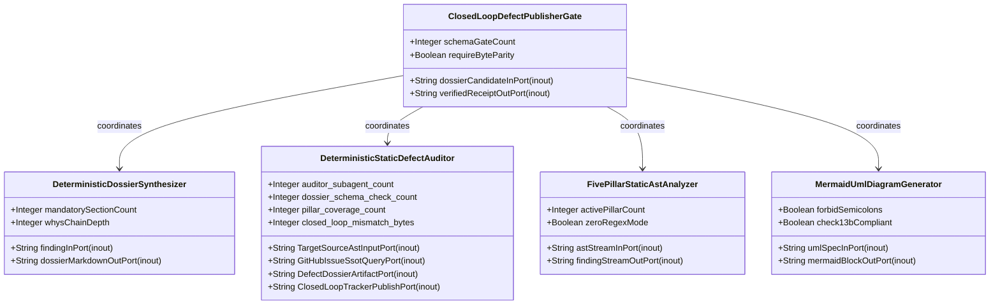
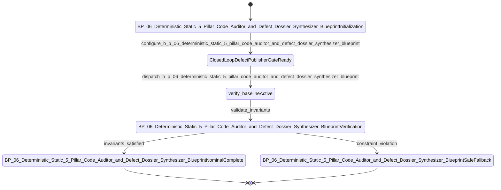

| Attribute | Specification Detail |
| :--- | :--- |
| **Issue ID** | #690 |
| **Title** | Epic 06: BP 06 Deterministic Static 5 Pillar Code Auditor and Defect Dossier Synthesizer Blueprint |
| **Type** | epic |
| **Package** | BP_06_Deterministic_Static_5_Pillar_Code_Auditor_and_Defect_Dossier_Synthesizer_Blueprint |
| **Subsystem** | BP 06 Deterministic Static 5 Pillar Code Auditor and Defect Dossier Synthesizer Blueprint |
| **Generation Mode** | subagent |
| **Specification Source** | [schema/model.sysml](../../schema/model.sysml) |

# Epic 06: BP 06 Deterministic Static 5 Pillar Code Auditor and Defect Dossier Synthesizer Blueprint

## 1. Context
Subsystem package for BP_06_Deterministic_Static_5_Pillar_Code_Auditor_and_Defect_Dossier_Synthesizer_Blueprint

## 2. Requirements & Checklist
- [ ] #680 - [Feature 26: [BP 06 Deterministic Static 5 Pillar Code Auditor and Defect Dossier Synthesizer Blueprint] ClosedLoopDefectPublisherGate](../features/FEAT-26-ClosedLoopDefectPublisherGate.md) (b_p_06_deterministic_static_5_pillar_code_auditor_and_defect_dossier_synthesizer_blueprint.sysml)
- [ ] #681 - [Feature 27: [BP 06 Deterministic Static 5 Pillar Code Auditor and Defect Dossier Synthesizer Blueprint] DeterministicDossierSynthesizer](../features/FEAT-27-DeterministicDossierSynthesizer.md) (b_p_06_deterministic_static_5_pillar_code_auditor_and_defect_dossier_synthesizer_blueprint.sysml)
- [ ] #682 - [Feature 28: [BP 06 Deterministic Static 5 Pillar Code Auditor and Defect Dossier Synthesizer Blueprint] DeterministicStaticDefectAuditor](../features/FEAT-28-DeterministicStaticDefectAuditor.md) (b_p_06_deterministic_static_5_pillar_code_auditor_and_defect_dossier_synthesizer_blueprint.sysml)
- [ ] #683 - [Feature 29: [BP 06 Deterministic Static 5 Pillar Code Auditor and Defect Dossier Synthesizer Blueprint] FivePillarStaticAstAnalyzer](../features/FEAT-29-FivePillarStaticAstAnalyzer.md) (b_p_06_deterministic_static_5_pillar_code_auditor_and_defect_dossier_synthesizer_blueprint.sysml)
- [ ] #684 - [Feature 30: [BP 06 Deterministic Static 5 Pillar Code Auditor and Defect Dossier Synthesizer Blueprint] MermaidUmlDiagramGenerator](../features/FEAT-30-MermaidUmlDiagramGenerator.md) (b_p_06_deterministic_static_5_pillar_code_auditor_and_defect_dossier_synthesizer_blueprint.sysml)

### Associated Use Cases & User Stories

#### Associated Use Cases
- [ ] #649 - [Use Case 26: UC AC 01 Static Five Pillar AST Defect Detection](../use-cases/UC-26-UC_AC_01_Static_Five_Pillar_AST_Defect_Detection.md)
- [ ] #650 - [Use Case 27: UC AC 02 Deterministic Seven Section Dossier and Mermaid Synthesis](../use-cases/UC-27-UC_AC_02_Deterministic_Seven_Section_Dossier_and_Mermaid_Synthesis.md)
- [ ] #651 - [Use Case 28: UC AC 03 Idempotent Local and Remote SSOT Deduplication](../use-cases/UC-28-UC_AC_03_Idempotent_Local_and_Remote_SSOT_Deduplication.md)
- [ ] #652 - [Use Case 29: UC AC 04 Closed Loop Git Hub SSOT Publishing and Byte Parity Verification](../use-cases/UC-29-UC_AC_04_Closed_Loop_GitHub_SSOT_Publishing_and_Byte_Parity_Verification.md)
- [ ] #653 - [Use Case 30: UC AC 05 Fail Closed Rejection on Malformed Dossier Schema Ephemeral Paths or Payload Divergence](../use-cases/UC-30-UC_AC_05_Fail_Closed_Rejection_on_Malformed_Dossier_Schema_Ephemeral_Paths_or_Payload_Divergence.md)
- [ ] #654 - [Use Case 31: UC AC 06 Dogfood Sys ML v2 Markdown Ingestion and Blueprint Gate Conformance](../use-cases/UC-31-UC_AC_06_Dogfood_SysML_v2_Markdown_Ingestion_and_Blueprint_Gate_Conformance.md)

#### Associated User Stories
- [ ] #610 - [User Story 49: verify baseline](../user-stories/US-49-verify_baseline.md)
- [ ] #611 - [User Story 50: parse rust source ast](../user-stories/US-50-parse_rust_source_ast.md)
- [ ] #612 - [User Story 51: Deterministic](../user-stories/US-51-Deterministic.md)
- [ ] #613 - [User Story 52: evaluate source file pillars](../user-stories/US-52-evaluate_source_file_pillars.md)
- [ ] #614 - [User Story 53: Line exact](../user-stories/US-53-Line_exact.md)
- [ ] #615 - [User Story 54: synthesize defect dossier markdown](../user-stories/US-54-synthesize_defect_dossier_markdown.md)
- [ ] #616 - [User Story 55: Compliant](../user-stories/US-55-Compliant.md)
- [ ] #617 - [User Story 56: run check defect](../user-stories/US-56-run_check_defect.md)
- [ ] #618 - [User Story 57: Execute](../user-stories/US-57-Execute.md)
- [ ] #619 - [User Story 58: gh](../user-stories/US-58-gh.md)
- [ ] #620 - [User Story 59: Created](../user-stories/US-59-Created.md)
- [ ] #621 - [User Story 60: Live](../user-stories/US-60-Live.md)
- [ ] #622 - [User Story 61: CLOSED LOOP](../user-stories/US-61-CLOSED_LOOP.md)
- [ ] #623 - [User Story 62: Exit item](../user-stories/US-62-Exit_item.md)

## 3. Architecture
Subsystem structural composition, port allocations, and directional data connectors realized by ClosedLoopDefectPublisherGate.

## 4. Operational Considerations
Deterministic compilation passes, error containment, and provable polynomial complexity execution.

## 5. Security & Governance
Safety-critical invariant satisfaction, formal trace matrix closure, and zero hardcoded domain semantics.

## 6. Source References
- System Architecture Model: `schema/model.sysml`
- Subsystem Specification Model: `schema/subsystems/b_p_06_deterministic_static_5_pillar_code_auditor_and_defect_dossier_synthesizer_blueprint/architecture.sysml`
- Subsystem Requirements Model: `schema/subsystems/b_p_06_deterministic_static_5_pillar_code_auditor_and_defect_dossier_synthesizer_blueprint/requirements.sysml`
- Normative Systems Engineering Standard: ISO/IEC/IEEE 15288:2023 §6.4.3 Architecture Definition Process

Subsystem architectural composition and formal invariants derive from `schema/model.sysml` pursuant to ISO/IEC/IEEE 15288.

## System-Level UML Class Diagram

## System State Machine Diagram

