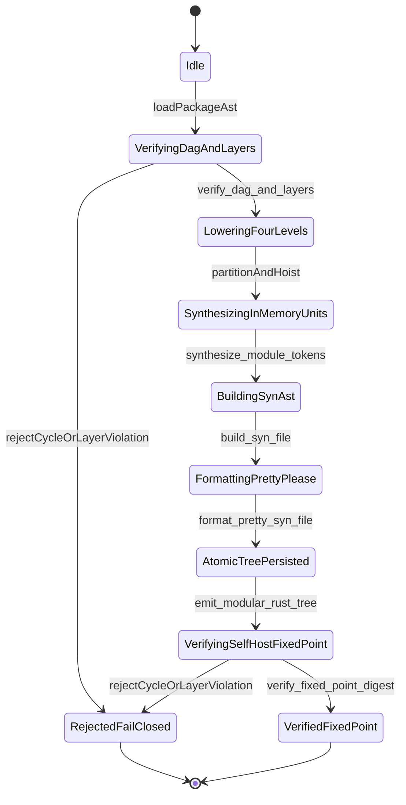

| Attribute | Specification Detail |
| :--- | :--- |
| **Issue ID** | #852 |
| **Title** | Epic 07: BP 07 Self Hosting 4 Level Modular Multi File Code Generator Blueprint |
| **Type** | epic |
| **Package** | BP_07_Self_Hosting_4_Level_Modular_Multi_File_Code_Generator_Blueprint |
| **Subsystem** | BP 07 Self Hosting 4 Level Modular Multi File Code Generator Blueprint |
| **Generation Mode** | subagent |
| **Specification Source** | [schema/model.sysml](../../schema/model.sysml) |

# Epic 07: BP 07 Self Hosting 4 Level Modular Multi File Code Generator Blueprint

## 1. Context
Subsystem package `BP_07_Self_Hosting_4_Level_Modular_Multi_File_Code_Generator_Blueprint` (**REQ-0607** / `BP-07` / `DEAP-BP-DET-07`, UUIDv5 `6ba7b810-9dad-11d1-80b4-00c04fd430c7`, governed by DO-178C Level A, DO-330 TQL-4, ISO 26262 ASIL D, and ECSS-E-ST-40C) specifies the self-hosting 4-level modular multi-file Rust and Dart contract code generator compiler in `./crates/compile-sysml/src/modular_codegen/` and `./crates/deap-core/src/rust_cst/`.

### Normative Contracts & 3-Layer Definition of Done
- **Contract A (100% Normative OMG SysML v2.0 + KerML 1.0 Grammar Coverage -- Zero 16-Construct Caps)**: Enforces full Definition and Usage symmetry across the complete OMG SysML v2.0 and KerML 1.0 textual grammar with zero 16-construct artificial caps, lowering namespaces and metadata (`package`, `library package`, `standard library package`, `import`, `alias`, `doc`, `comment`, `rep`, `dependency`, `metadata def`/`metadata`/`@Metadata`/`#user_keyword` `#hazard`, `#risk`, `#capability`, `#rt_loop`, `#dal`, `#fls` while preserving backward-compatible parsing of legacy `hazard def`/`risk def`/`capability def`), structural and data types (`attribute def`/`attribute`, `enum def`/`enum`, `item def`/`item`, `part def`/`part`, `port def`/`port` `in`/`out`/`inout`/`~`, `connection def`/`connection`, `interface def`/`interface`, `flow def`/`flow`, `allocation def`/`allocation`, `occurrence def`/`occurrence`), behavioral and state constructs (`action def`/`action`, `state def`/`state`), calculations, constraints, and requirements (`calc def`/`calc`, `constraint def`/`constraint`, `requirement def`/`requirement`, `concern def`/`concern`), use cases, analysis, verification, and views (`use case def`/`use case`, `analysis def`/`analysis`, `verification def`/`verification`, `test case def`/`test case`, `interaction def`/`interaction`, `view def`/`view`, `viewpoint def`/`viewpoint`, `rendering def`/`rendering`, `variation`/`variant`), and KerML 1.0 specialization/multiplicity/expressions (`:`, `:>`, `:>>`, `::>`, `~`, `ref`, `abstract`, `readonly`, `derived`, `end`, `default`, `:=`, `[lo..hi]`, `[*]`, `implies`, `xor`, `??`, `->`, `collect`, `select`, `forAll`, `exists`, and `ISQ`/`SI`/`ScalarValues`).
- **Contract B (Official Rust Compiler, CST & Deterministic Fixed-Point Codegen Stack -- Zero Hand-Rolled Scanners)**: Synthesizes modular Rust source trees exclusively via `proc-macro2::TokenStream` + `quote::quote!` + `syn::parse2::<syn::File>` + `prettyplease::unparse(&syn_file)` and verifies parse-clean lossless CST structure via `ra_ap_syntax` (`SourceFile::parse`), backed by `logos` + `rowan` + `salsa` + `ariadne` (`deap_core::sysml_cst` and `deap_core::dart_cst`). Enforces metacircular bootstrap fixed-point identity `SHA-256(Stage 1) == SHA-256(Stage 2)` (`stage_fixed_point_mismatch_files == 0` under `C_MOD_04`), zero runtime LLM/subagent invocations (`runtime_llm_subagent_count == 0` under `C_MOD_05`), zero external `rustfmt` subprocess invocations, zero hand-rolled string/line/char-by-char scanners, and zero `format!` / `push_str` string-concatenation code emitters.
- **3-Layer Definition of Done (DoD) & Submodule Modularity Ratchet**:
  - **Layer 1 (Domain State & Data Model)**: Typed DAG topology, 4-level partitioned AST nodes, `GeneratedTreeManifest` SHA-256 records, and modularity budget parameters (`max_file_lines <= 400`, `max_items_per_file <= 12`, `max_cyclomatic_complexity <= 8`, `stage_fixed_point_mismatch_files == 0`, `runtime_llm_subagent_count == 0`).
  - **Layer 2 (Logic & State Management)**: Iterative zero-recursion Kahn topological sorting and `@Layer` monotonicity verification (`TopologicalLayerDagVerifier`), 4-level AST partitioning and ANF helper hoisting (`FourLevelAstPartitionerAndHoister`), typed `proc-macro2` + `quote` + `syn::File` + `prettyplease` code synthesis and Stage-1 == Stage-2 SHA-256 fixed-point verification (`ModularRustMultiFileEmitter`), and modular `.g.dart` + `<= 80`-LOC barrel facade generation (`ModularFlutterMultiFileEmitter`) inside `< 380` exec SLOC submodules (`./crates/compile-sysml/src/modular_codegen/` and `./crates/deap-core/src/rust_cst/`) with explicit deletion of legacy hand-rolled scanners and monolithic string-concatenation codegen templates in `./crates/compile-sysml/src/driver.rs` (`-450+` SLOC) and `./crates/compile-sysml/src/flutter_codegen.rs` (`-650+` SLOC, `-1,100+` total SLOC retired).
  - **Layer 3 (Presentation & Actuator Interface Binding)**: Transactional staging-directory persistence, CLI entrypoint bindings (`--emit-modular-rust`, `--emit-flutter-contracts`), and structured fail-closed diagnostics (`E0701`--`E0705`) across `package_ast_in`, `rust_tree_out`, `flutter_tree_out`, and `diagnostic_out`.

## 2. Requirements & Checklist
- [ ] #829 - [Feature 31: [BP 07 Self Hosting 4 Level Modular Multi File Code Generator Blueprint] FourLevelAstPartitionerAndHoister](../features/FEAT-31-FourLevelAstPartitionerAndHoister.md) (4-level AST partitioner and ANF branch/stage/transition hoister across full OMG SysML v2.0 + KerML 1.0 grammar)
- [ ] #830 - [Feature 32: [BP 07 Self Hosting 4 Level Modular Multi File Code Generator Blueprint] ModularFlutterMultiFileEmitter](../features/FEAT-32-ModularFlutterMultiFileEmitter.md) (modular multi-file `.g.dart` contract emitter and `<= 80`-LOC barrel facade synthesizer retiring legacy `flutter_codegen.rs` monolith)
- [ ] #831 - [Feature 33: [BP 07 Self Hosting 4 Level Modular Multi File Code Generator Blueprint] ModularRustMultiFileEmitter](../features/FEAT-33-ModularRustMultiFileEmitter.md) (`proc-macro2` + `quote` + `syn::File` + `prettyplease` deterministic Rust multi-file emitter and Stage-1 == Stage-2 SHA-256 fixed-point verifier retiring legacy `driver.rs` string templates)
- [ ] #832 - [Feature 34: [BP 07 Self Hosting 4 Level Modular Multi File Code Generator Blueprint] SelfHostingModularCodegenCompiler](../features/FEAT-34-SelfHostingModularCodegenCompiler.md) (top-level self-hosting modular codegen compiler orchestrating transactional multi-file emission and `C_MOD_01..05` governance)
- [ ] #833 - [Feature 35: [BP 07 Self Hosting 4 Level Modular Multi File Code Generator Blueprint] TopologicalLayerDagVerifier](../features/FEAT-35-TopologicalLayerDagVerifier.md) (iterative zero-recursion Kahn topological sorter and `@Layer` monotonicity verifier enforcing `E0702`/`E0703` fail-closed guards)
- [ ] #857 - [Feature 54: [BP 07 Self Hosting 4 Level Modular Multi File Code Generator Blueprint] ModularityBoundsSpec](../features/FEAT-54-ModularityBoundsSpec.md) (compilation-unit modularity envelope specification enforcing `ValidBoundsEnvelope` across `max_file_lines`, `max_items_per_file`, `max_cyclomatic_complexity`, `max_action_steps_per_stage`, and `max_transitions_per_handler`)
- [ ] #858 - [Feature 55: [BP 07 Self Hosting 4 Level Modular Multi File Code Generator Blueprint] LayerHierarchySpec](../features/FEAT-55-LayerHierarchySpec.md) (4-tier architectural layer hierarchy specification enforcing `NonUpwardLayerImport` across `domain_tier`, `application_tier`, and `presentation_tier`)
- [ ] #859 - [Feature 56: [BP 07 Self Hosting 4 Level Modular Multi File Code Generator Blueprint] CompilationUnitSpec](../features/FEAT-56-CompilationUnitSpec.md) (emitted compilation-unit metadata and budget contract enforcing `UnitObeysBounds` across `relative_path`, `layer_tier`, `item_count`, `line_count`, and `max_function_vg`)
- [ ] #860 - [Feature 57: [BP 07 Self Hosting 4 Level Modular Multi File Code Generator Blueprint] FourLevelLoweringEngineSpec](../features/FEAT-57-FourLevelLoweringEngineSpec.md) (4-level modular lowering engine specification enforcing `LoweringLevelsComplete` across `schema_in`, `graph_out`, `bounds_ref`, and `layer_ref`)
- [ ] #861 - [Feature 58: [BP 07 Self Hosting 4 Level Modular Multi File Code Generator Blueprint] ModularEmitterSuiteSpec](../features/FEAT-58-ModularEmitterSuiteSpec.md) (multi-file Rust and Dart emitter suite specification enforcing `FixedPointBootstrapParity` across `rust_tree_out`, `flutter_tree_out`, and `engine_ref`)

### Associated Use Cases & User Stories

#### Associated Use Cases
- [ ] #761 - [Use Case 32: Fail Closed Rejection on Directed Dependency Cycles and Upward Layer Imports](../use-cases/UC-32-Fail_Closed_Rejection_on_Directed_Dependency_Cycles_and_Upward_Layer_Imports.md) (verifies iterative Kahn cycle detection `E0702` and upward `@Layer` import rejection `E0703` with zero partial writes)
- [ ] #762 - [Use Case 33: Four Level Deterministic Lowering with Typed syn File AST and prettyplease Formatting](../use-cases/UC-33-Four_Level_Deterministic_Lowering_with_Typed_syn_File_AST_and_prettyplease_Formatting.md) (verifies 4-level lowering across full SysML v2.0 + KerML 1.0 ASTs via `proc-macro2` + `quote` + `syn::File` + `prettyplease::unparse`)
- [ ] #763 - [Use Case 34: Metacircular Self Hosting Stage 1 to Stage 2 SHA 256 Fixed Point Identity](../use-cases/UC-34-Metacircular_Self_Hosting_Stage_1_to_Stage_2_SHA_256_Fixed_Point_Identity.md) (verifies metacircular self-hosting `SHA-256(Stage 1) == SHA-256(Stage 2)` fixed-point identity across all emitted units)
- [ ] #764 - [Use Case 35: Modular Multi File Flutter_Contract Emission and Monolith Barrel Decomposition](../use-cases/UC-35-Modular_Multi_File_Flutter_Contract_Emission_and_Monolith_Barrel_Decomposition.md) (verifies per-package `.g.dart` emission, `<= 80`-LOC barrel facades, and `-650+` SLOC deletion in `./crates/compile-sysml/src/flutter_codegen.rs`)
- [ ] #765 - [Use Case 36: Zero String Concatenation Codegen DO 178 C Seven Section Docstring and Clippy Forbid Compliance](../use-cases/UC-36-Zero_String_Concatenation_Codegen_DO_178C_Seven_Section_Docstring_and_Clippy_Forbid_Compliance.md) (verifies zero hand-rolled/string-concatenation emitters, 100% 7-section safety docstrings, `< 380` exec SLOC submodules, and zero Clippy `forbid` violations)
- [ ] #766 - [Use Case 37: Dogfood SysML v2 Blueprint Ingestion and Twelve Gate Closed Loop Conformance](../use-cases/UC-37-Dogfood_SysML_v2_Blueprint_Ingestion_and_Twelve_Gate_Closed_Loop_Conformance.md) (verifies 12-gate blueprint conformance and bijective SysML v2 round-trip compilation for `BP-07`)

#### Associated User Stories
- [ ] #795 - [User Story 45: Verify Dag And Layers](../user-stories/US-45-verify_dag_and_layers.md) (executes iterative Kahn DAG topological sorting and `@Layer` monotonicity verification via `verify_dag_and_layers`)
- [ ] #796 - [User Story 46: Partition And Hoist](../user-stories/US-46-partition_and_hoist.md) (lowers full SysML v2.0 + KerML 1.0 packages across 4 modularity levels via `partition_and_hoist`)
- [ ] #797 - [User Story 47: Synthesize Module Tokens](../user-stories/US-47-synthesize_module_tokens.md) (synthesizes `proc-macro2::TokenStream` units via `quote::quote!` in `synthesize_module_tokens` with zero string concatenation)
- [ ] #798 - [User Story 48: Build Syn File](../user-stories/US-48-build_syn_file.md) (validates synthesized token streams into typed `syn::File` ASTs via `syn::parse2::<syn::File>` in `build_syn_file`)
- [ ] #799 - [User Story 49: Format Pretty Syn File](../user-stories/US-49-format_pretty_syn_file.md) (formats validated `syn::File` ASTs into canonical LF Rust source via `prettyplease::unparse` in `format_pretty_syn_file`)
- [ ] #800 - [User Story 50: Emit Modular Rust Tree](../user-stories/US-50-emit_modular_rust_tree.md) (atomically persists multi-file Rust module trees and `mod.rs` barrels via `emit_modular_rust_tree`)
- [ ] #801 - [User Story 51: emit modular_flutter_tree](../user-stories/US-51-emit_modular_flutter_tree.md) (atomically persists per-package `.g.dart` contracts and `<= 80`-LOC barrel facades via `emit_modular_flutter_tree`)
- [ ] #802 - [User Story 52: Verify Fixed Point Digest](../user-stories/US-52-verify_fixed_point_digest.md) (verifies Stage-1 == Stage-2 SHA-256 fixed-point identity across `GeneratedTreeManifest` digests via `verify_fixed_point_digest`)
- [ ] #862 - [User Story 79: Execute Four Level Lowering Pipeline](../user-stories/US-79-ExecuteFourLevelLoweringPipeline.md) (executes the 12-step 4-level modular lowering pipeline via `ExecuteFourLevelLoweringPipeline`)

## 3. Architecture

### Subsystem Capability Allocations
Formal allocation of SysML v2 `#capability` metadata usages (`metadata def` / `@Metadata` / `#capability`, preserving backward-compatible parsing of legacy `capability def` declarations) mapped to package `BP_07_Self_Hosting_4_Level_Modular_Multi_File_Code_Generator_Blueprint`:

| Capability Name | Subsystem Package | Description / Objective |
| :--- | :--- | :--- |
| `TopologicalLayerDagVerification` | `BP_07_Self_Hosting_4_Level_Modular_Multi_File_Code_Generator_Blueprint` | Executes iterative zero-recursion Kahn DAG topological sorting and strict `@Layer` (`Presentation -> Application -> Domain -> Infrastructure`) monotonicity verification (`E0702`, `E0703`). |
| `FourLevelAstPartitioningAndHoisting` | `BP_07_Self_Hosting_4_Level_Modular_Multi_File_Code_Generator_Blueprint` | Lowers full OMG SysML v2.0 + KerML 1.0 AST hierarchies across 4 modularity levels (Package directories, Classifier facets, Action/State handler chunks, and ANF boolean expression helpers) within `<= 400` LOC, `<= 12` items, and `v(G) <= 8`. |
| `TypedSynQuotePrettypleaseRustEmission` | `BP_07_Self_Hosting_4_Level_Modular_Multi_File_Code_Generator_Blueprint` | Synthesizes multi-file Rust code via `proc-macro2` + `quote::quote!` + `syn::parse2::<syn::File>` + `prettyplease::unparse` and verifies `SHA-256(Stage 1) == SHA-256(Stage 2)` fixed-point identity inside `< 380` exec SLOC submodules while deleting `-450+` SLOC of legacy string templates in `./crates/compile-sysml/src/driver.rs`. |
| `ModularFlutterContractBarrelEmission` | `BP_07_Self_Hosting_4_Level_Modular_Multi_File_Code_Generator_Blueprint` | Emits per-package and per-classifier `.g.dart` contracts with `<= 80`-LOC barrel re-export facades inside `< 380` exec SLOC submodules while deleting `-650+` SLOC of legacy monolithic string emitters in `./crates/compile-sysml/src/flutter_codegen.rs`. |

Classifiers: `FourLevelAstPartitionerAndHoister` (ports: `in validated_ast_in : String`, `out module_graph_out : String`); `ModularFlutterMultiFileEmitter` (ports: `in flutter_module_graph_in : String`, `out flutter_manifest_out : String`); `ModularRustMultiFileEmitter` (ports: `in rust_module_graph_in : String`, `out rust_manifest_out : String`); `SelfHostingModularCodegenCompiler` (ports: `in package_ast_in : String`, `out rust_tree_out : String`, `out flutter_tree_out : String`, `out diagnostic_out : String`); `TopologicalLayerDagVerifier` (ports: `in dependency_edges_in : String`, `out topological_order_out : String`). Package port definitions: `BP_07_ModularCodegenPortDef`. Structural connectors: `BP_07_PartitionerToRustEmitterConnection` (`FourLevelAstPartitionerAndHoister.FourLevelAstPartitionerAndHoister.module_graph_out -> ModularRustMultiFileEmitter.ModularRustMultiFileEmitter.rust_module_graph_in`).

## 4. Operational Considerations
Lifecycle state machines: `BP_07_Self_Hosting_4_Level_Modular_Multi_File_Code_Generator_Blueprint_LifecycleState` (Initial -> Idle; Idle -> VerifyingDagAndLayers on loadPackageAst; VerifyingDagAndLayers -> RejectedFailClosed on rejectCycleOrLayerViolation; VerifyingDagAndLayers -> LoweringFourLevels on verify_dag_and_layers; LoweringFourLevels -> SynthesizingInMemoryUnits on partitionAndHoist; SynthesizingInMemoryUnits -> BuildingSynAst on synthesize_module_tokens; BuildingSynAst -> FormattingPrettyPlease on build_syn_file; FormattingPrettyPlease -> AtomicTreePersisted on format_pretty_syn_file; AtomicTreePersisted -> VerifyingSelfHostFixedPoint on emit_modular_rust_tree; VerifyingSelfHostFixedPoint -> RejectedFailClosed on rejectCycleOrLayerViolation; VerifyingSelfHostFixedPoint -> VerifiedFixedPoint on verify_fixed_point_digest; RejectedFailClosed -> Terminal; VerifiedFixedPoint -> Terminal). Operational actions: `verify_dag_and_layers`, `partition_and_hoist`, `synthesize_module_tokens`, `build_syn_file`, `format_pretty_syn_file`, `emit_modular_rust_tree`, `emit_modular_flutter_tree`, `verify_fixed_point_digest`. Interaction sequences: `BP_07_Self_Hosting_4_Level_Modular_Multi_File_Code_Generator_Blueprint_SequenceInteraction`.

## 5. Security & Governance
Allocated requirements: `REQ-0607 (REQ_0607_BP_07_Self_Hosting_4_Level_Modular_Multi_File_Code_Generator_Blueprint)`. Enforced invariant constraints: `C_MOD_01 (max_file_lines >= 50 and max_file_lines <= 400)`, `C_MOD_02 (max_items_per_file >= 1 and max_items_per_file <= 12)`, `C_MOD_03 (max_cyclomatic_complexity >= 1 and max_cyclomatic_complexity <= 8)`, `C_MOD_04 (stage_fixed_point_mismatch_files >= 0 and stage_fixed_point_mismatch_files <= 0)`, `C_MOD_05 (runtime_llm_subagent_count >= 0 and runtime_llm_subagent_count <= 0)`, `Invariant_REQ_0607_SC_02`, `Invariant_REQ_0607_SC_01`, `Invariant_REQ_0607_SC_04`, `Invariant_REQ_0607_REQ_0607`, `Invariant_REQ_0607_SC_03`.

## 6. Source References
- System Architecture Model: `schema/model.sysml`
- Normative Systems Engineering Standard: ISO/IEC/IEEE 15288:2023 §6.4.3 Architecture Definition Process

Subsystem architectural composition and formal invariants derive from `schema/model.sysml` pursuant to ISO/IEC/IEEE 15288.

## System-Level UML Class Diagram

## System State Machine Diagram

