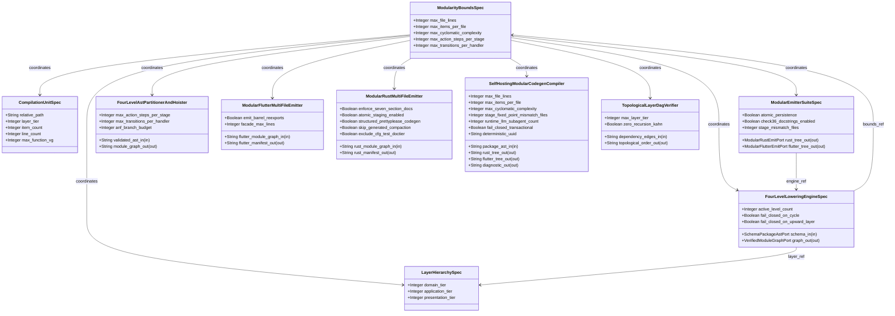
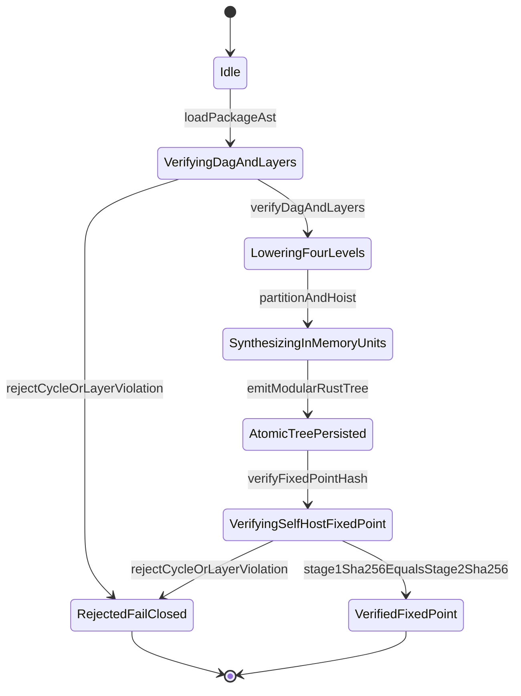

| Attribute | Specification Detail |
| :--- | :--- |
| **Issue ID** | TBD |
| **Title** | Epic 07: BP 07 Self Hosting 4 Level Modular Multi File Code Generator Blueprint |
| **Type** | epic |
| **Package** | BP_07_Self_Hosting_4_Level_Modular_Multi_File_Code_Generator_Blueprint |
| **Subsystem** | BP 07 Self Hosting 4 Level Modular Multi File Code Generator Blueprint |
| **Generation Mode** | subagent |
| **Specification Source** | [schema/model.sysml](../../schema/model.sysml) |

# Epic 07: BP 07 Self Hosting 4 Level Modular Multi File Code Generator Blueprint

## 1. Context
Subsystem package for BP_07_Self_Hosting_4_Level_Modular_Multi_File_Code_Generator_Blueprint

## 2. Requirements & Checklist
- [ ] TBD - [Feature 31: [BP 07 Self Hosting 4 Level Modular Multi File Code Generator Blueprint] ModularityBoundsSpec](../features/FEAT-31-ModularityBoundsSpec.md) (ValidBoundsEnvelope)
- [ ] TBD - [Feature 32: [BP 07 Self Hosting 4 Level Modular Multi File Code Generator Blueprint] LayerHierarchySpec](../features/FEAT-32-LayerHierarchySpec.md) (NonUpwardLayerImport)
- [ ] TBD - [Feature 33: [BP 07 Self Hosting 4 Level Modular Multi File Code Generator Blueprint] CompilationUnitSpec](../features/FEAT-33-CompilationUnitSpec.md) (UnitObeysBounds)
- [ ] TBD - [Feature 34: [BP 07 Self Hosting 4 Level Modular Multi File Code Generator Blueprint] FourLevelLoweringEngineSpec](../features/FEAT-34-FourLevelLoweringEngineSpec.md) (LoweringLevelsComplete)
- [ ] TBD - [Feature 35: [BP 07 Self Hosting 4 Level Modular Multi File Code Generator Blueprint] ModularEmitterSuiteSpec](../features/FEAT-35-ModularEmitterSuiteSpec.md) (FixedPointBootstrapParity)
- [ ] TBD - [Feature 36: [BP 07 Self Hosting 4 Level Modular Multi File Code Generator Blueprint] FourLevelAstPartitionerAndHoister](../features/FEAT-36-FourLevelAstPartitionerAndHoister.md) (b_p_07_self_hosting_4_level_modular_multi_file_code_generator_blueprint.sysml)
- [ ] TBD - [Feature 37: [BP 07 Self Hosting 4 Level Modular Multi File Code Generator Blueprint] ModularFlutterMultiFileEmitter](../features/FEAT-37-ModularFlutterMultiFileEmitter.md) (b_p_07_self_hosting_4_level_modular_multi_file_code_generator_blueprint.sysml)
- [ ] TBD - [Feature 38: [BP 07 Self Hosting 4 Level Modular Multi File Code Generator Blueprint] ModularRustMultiFileEmitter](../features/FEAT-38-ModularRustMultiFileEmitter.md) (b_p_07_self_hosting_4_level_modular_multi_file_code_generator_blueprint.sysml)
- [ ] TBD - [Feature 39: [BP 07 Self Hosting 4 Level Modular Multi File Code Generator Blueprint] SelfHostingModularCodegenCompiler](../features/FEAT-39-SelfHostingModularCodegenCompiler.md) (b_p_07_self_hosting_4_level_modular_multi_file_code_generator_blueprint.sysml)
- [ ] TBD - [Feature 40: [BP 07 Self Hosting 4 Level Modular Multi File Code Generator Blueprint] TopologicalLayerDagVerifier](../features/FEAT-40-TopologicalLayerDagVerifier.md) (b_p_07_self_hosting_4_level_modular_multi_file_code_generator_blueprint.sysml)

### Associated Use Cases & User Stories

#### Associated Use Cases
- [ ] TBD - [Use Case 32: Fail Closed Rejection on Directed Dependency Cycles and Upward Layer Imports](../use-cases/UC-32-Fail_Closed_Rejection_on_Directed_Dependency_Cycles_and_Upward_Layer_Imports.md)
- [ ] TBD - [Use Case 33: Four Level Zero Dead End Deterministic Lowering Within Modularity Bounds](../use-cases/UC-33-Four_Level_Zero_Dead_End_Deterministic_Lowering_Within_Modularity_Bounds.md)
- [ ] TBD - [Use Case 34: Metacircular Self Hosting Stage 1 to Stage 2 SHA 256 Fixed Point Identity](../use-cases/UC-34-Metacircular_Self_Hosting_Stage_1_to_Stage_2_SHA_256_Fixed_Point_Identity.md)
- [ ] TBD - [Use Case 35: Modular Multi File Flutter Contract Emission and Monolith Barrel Decomposition](../use-cases/UC-35-Modular_Multi_File_Flutter_Contract_Emission_and_Monolith_Barrel_Decomposition.md)
- [ ] TBD - [Use Case 36: Zero Regex DO 178 C Seven Section Docstring Clippy Forbid and Audit Code Compliance](../use-cases/UC-36-Zero_Regex_DO_178C_Seven_Section_Docstring_Clippy_Forbid_and_Audit_Code_Compliance.md)
- [ ] TBD - [Use Case 37: Dogfood SysML v2 Blueprint Ingestion and Twelve Gate Closed Loop Conformance](../use-cases/UC-37-Dogfood_SysML_v2_Blueprint_Ingestion_and_Twelve_Gate_Closed_Loop_Conformance.md)

#### Associated User Stories
- [ ] TBD - [User Story 45: verify Dag And Layers](../user-stories/US-45-verifyDagAndLayers.md)
- [ ] TBD - [User Story 46: partition And Hoist](../user-stories/US-46-partitionAndHoist.md)
- [ ] TBD - [User Story 47: emit Modular Rust Tree](../user-stories/US-47-emitModularRustTree.md)
- [ ] TBD - [User Story 48: emit Modular Flutter Tree](../user-stories/US-48-emitModularFlutterTree.md)
- [ ] TBD - [User Story 49: verify Fixed Point Hash](../user-stories/US-49-verifyFixedPointHash.md)
- [ ] TBD - [User Story 50: Execute Four Level Lowering Pipeline](../user-stories/US-50-ExecuteFourLevelLoweringPipeline.md)

## 3. Architecture
Classifiers: `ModularityBoundsSpec`; `LayerHierarchySpec`; `CompilationUnitSpec`; `FourLevelLoweringEngineSpec` (ports: `in schema_in : SchemaPackageAstPort`, `out graph_out : VerifiedModuleGraphPort`); `ModularEmitterSuiteSpec` (ports: `out rust_tree_out : ModularRustEmitPort`, `out flutter_tree_out : ModularFlutterEmitPort`); `FourLevelAstPartitionerAndHoister` (ports: `in validated_ast_in : String`, `out module_graph_out : String`); `ModularFlutterMultiFileEmitter` (ports: `in flutter_module_graph_in : String`, `out flutter_manifest_out : String`); `ModularRustMultiFileEmitter` (ports: `in rust_module_graph_in : String`, `out rust_manifest_out : String`); `SelfHostingModularCodegenCompiler` (ports: `in package_ast_in : String`, `out rust_tree_out : String`, `out flutter_tree_out : String`, `out diagnostic_out : String`); `TopologicalLayerDagVerifier` (ports: `in dependency_edges_in : String`, `out topological_order_out : String`). Package port definitions: `SchemaPackageAstPort`, `VerifiedModuleGraphPort`, `ModularRustEmitPort`, `ModularFlutterEmitPort`.

## 4. Operational Considerations
Lifecycle state machines: `BP_07_Self_Hosting_4_Level_Modular_Multi_File_Code_Generator_Blueprint_LifecycleState` (Initial -> Idle; Idle -> VerifyingDagAndLayers on loadPackageAst; VerifyingDagAndLayers -> RejectedFailClosed on rejectCycleOrLayerViolation; VerifyingDagAndLayers -> LoweringFourLevels on verifyDagAndLayers; LoweringFourLevels -> SynthesizingInMemoryUnits on partitionAndHoist; SynthesizingInMemoryUnits -> AtomicTreePersisted on emitModularRustTree; AtomicTreePersisted -> VerifyingSelfHostFixedPoint on verifyFixedPointHash; VerifyingSelfHostFixedPoint -> RejectedFailClosed on rejectCycleOrLayerViolation; VerifyingSelfHostFixedPoint -> VerifiedFixedPoint on stage1Sha256EqualsStage2Sha256; RejectedFailClosed -> Terminal; VerifiedFixedPoint -> Terminal), `ModularCodegenLifecycle` (Initial -> Idle; Idle -> ResolvingLayers on start_compilation; ResolvingLayers -> VerifyingDag on layers_resolved; VerifyingDag -> PartitioningPackages on dag_verified; VerifyingDag -> AbortedFailClosed on on_cycle_e0702; VerifyingDag -> AbortedFailClosed on on_upward_layer_e0703; PartitioningPackages -> SplittingFacets on packages_partitioned; SplittingFacets -> OutliningBehaviors on facets_split; OutliningBehaviors -> HoistingPredicates on behaviors_outlined; HoistingPredicates -> SynthesizingTree on predicates_hoisted; SynthesizingTree -> VerifyingBounds on tree_synthesized; VerifyingBounds -> PersistingAtomic on bounds_verified; VerifyingBounds -> AbortedFailClosed on on_fixed_point_drift_e0705; PersistingAtomic -> Verified on atomic_commit_succeeded; Verified -> Idle on reset_lifecycle; AbortedFailClosed -> Idle on reset_lifecycle). Operational actions: `verifyDagAndLayers`, `partitionAndHoist`, `emitModularRustTree`, `emitModularFlutterTree`, `verifyFixedPointHash`, `ExecuteFourLevelLoweringPipeline`. Interaction sequences: `BP_07_Self_Hosting_4_Level_Modular_Multi_File_Code_Generator_Blueprint_SequenceInteraction`.

## 5. Security & Governance
Allocated requirements: `REQ-0607 (REQ_0607_BP_07_Self_Hosting_4_Level_Modular_Multi_File_Code_Generator_Blueprint)`. Enforced invariant constraints: `C_MOD_01 (max_file_lines >= 50 and max_file_lines <= 400)`, `C_MOD_02 (max_items_per_file >= 1 and max_items_per_file <= 12)`, `C_MOD_03 (max_cyclomatic_complexity >= 1 and max_cyclomatic_complexity <= 8)`, `C_MOD_04 (stage_fixed_point_mismatch_files >= 0 and stage_fixed_point_mismatch_files <= 0)`, `C_MOD_05 (runtime_llm_subagent_count >= 0 and runtime_llm_subagent_count <= 0)`, `ValidBoundsEnvelope (max_file_lines >= 50 and max_file_lines <= 400 and max_items_per_file >= 1 and max_items_per_file <= 12 and max_cyclomatic_complexity >= 1 and max_cyclomatic_complexity <= 8 and max_action_steps_per_stage >= 1 and max_action_steps_per_stage <= 8 and max_transitions_per_handler >= 1 and max_transitions_per_handler <= 8)`, `NonUpwardLayerImport (importer_tier >= 1 and importer_tier <= 3 and imported_tier >= 1 and imported_tier <= 3 and importer_tier >= imported_tier)`, `UnitObeysBounds (line_count >= 1 and line_count <= max_file_lines and item_count >= 1 and item_count <= max_items_per_file and max_function_vg >= 1 and max_function_vg <= max_cyclomatic_complexity)`, `LoweringLevelsComplete (active_level_count == 4)`, `FixedPointBootstrapParity (stage_mismatch_files == 0)`, `Invariant_REQ_0607_SC_02`, `Invariant_REQ_0607_SC_01`, `Invariant_REQ_0607_REQ_0607`, `Invariant_REQ_0607_SC_03`.

## 6. Source References
- System Architecture Model: `schema/model.sysml`
- Normative Systems Engineering Standard: ISO/IEC/IEEE 15288:2023 §6.4.3 Architecture Definition Process

Subsystem architectural composition and formal invariants derive from `schema/model.sysml` pursuant to ISO/IEC/IEEE 15288.

## System-Level UML Class Diagram

## System State Machine Diagram

