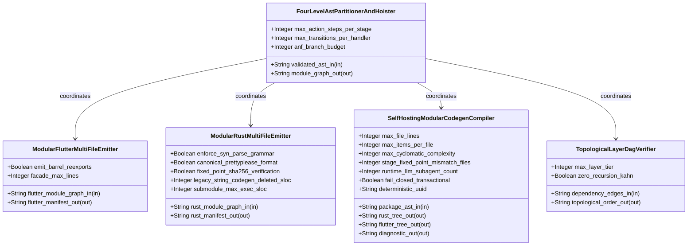
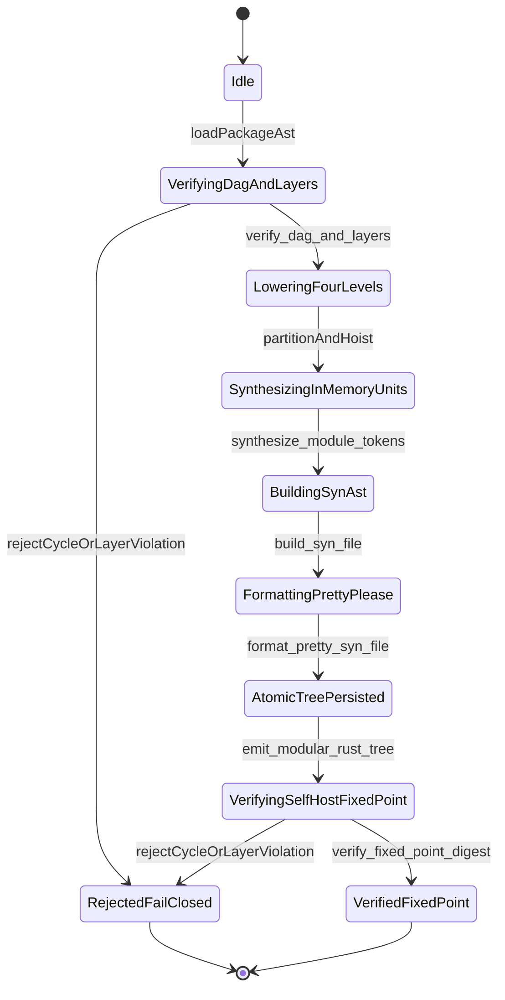

| Attribute | Specification Detail |
| :--- | :--- |
| **Issue ID** | #732 |
| **Title** | Epic 07: BP 07 Self Hosting 4 Level Modular Multi File Code Generator Blueprint |
| **Type** | epic |
| **Package** | BP_07_Self_Hosting_4_Level_Modular_Multi_File_Code_Generator_Blueprint |
| **Subsystem** | BP 07 Self Hosting 4 Level Modular Multi File Code Generator Blueprint |
| **Generation Mode** | subagent |
| **Specification Source** | [schema/model.sysml](../../schema/model.sysml) |

# Epic 07: BP 07 Self Hosting 4 Level Modular Multi File Code Generator Blueprint

## 1. Context
Subsystem package for BP_07_Self_Hosting_4_Level_Modular_Multi_File_Code_Generator_Blueprint

## 2. Requirements & Checklist
- [ ] #737 - [Feature 31: [BP 07 Self Hosting 4 Level Modular Multi File Code Generator Blueprint] FourLevelAstPartitionerAndHoister](../features/FEAT-31-FourLevelAstPartitionerAndHoister.md)
- [ ] #738 - [Feature 32: [BP 07 Self Hosting 4 Level Modular Multi File Code Generator Blueprint] ModularFlutterMultiFileEmitter](../features/FEAT-32-ModularFlutterMultiFileEmitter.md)
- [ ] #739 - [Feature 33: [BP 07 Self Hosting 4 Level Modular Multi File Code Generator Blueprint] ModularRustMultiFileEmitter](../features/FEAT-33-ModularRustMultiFileEmitter.md)
- [ ] #740 - [Feature 34: [BP 07 Self Hosting 4 Level Modular Multi File Code Generator Blueprint] SelfHostingModularCodegenCompiler](../features/FEAT-34-SelfHostingModularCodegenCompiler.md)
- [ ] #741 - [Feature 35: [BP 07 Self Hosting 4 Level Modular Multi File Code Generator Blueprint] TopologicalLayerDagVerifier](../features/FEAT-35-TopologicalLayerDagVerifier.md)

### Associated Use Cases & User Stories

#### Associated Use Cases
- [ ] #760 - [Use Case 32: Fail Closed Rejection on Directed Dependency Cycles and Upward Layer Imports](../use-cases/UC-32-Fail_Closed_Rejection_on_Directed_Dependency_Cycles_and_Upward_Layer_Imports.md)
- [ ] #761 - [Use Case 33: Four Level Deterministic Lowering with Typed syn File AST and prettyplease Formatting](../use-cases/UC-33-Four_Level_Deterministic_Lowering_with_Typed_syn_File_AST_and_prettyplease_Formatting.md)
- [ ] #762 - [Use Case 34: Metacircular Self Hosting Stage 1 to Stage 2 SHA 256 Fixed Point Identity](../use-cases/UC-34-Metacircular_Self_Hosting_Stage_1_to_Stage_2_SHA_256_Fixed_Point_Identity.md)
- [ ] #763 - [Use Case 35: Modular Multi File Flutter_Contract Emission and Monolith Barrel Decomposition](../use-cases/UC-35-Modular_Multi_File_Flutter_Contract_Emission_and_Monolith_Barrel_Decomposition.md)
- [ ] #764 - [Use Case 36: Zero String Concatenation Codegen DO 178 C Seven Section Docstring and Clippy Forbid Compliance](../use-cases/UC-36-Zero_String_Concatenation_Codegen_DO_178C_Seven_Section_Docstring_and_Clippy_Forbid_Compliance.md)
- [ ] #765 - [Use Case 37: Dogfood SysML v2 Blueprint Ingestion and Twelve Gate Closed Loop Conformance](../use-cases/UC-37-Dogfood_SysML_v2_Blueprint_Ingestion_and_Twelve_Gate_Closed_Loop_Conformance.md)

#### Associated User Stories
- [ ] #794 - [User Story 45: verify dag and layers](../user-stories/US-45-verify_dag_and_layers.md)
- [ ] #795 - [User Story 46: partition and hoist](../user-stories/US-46-partition_and_hoist.md)
- [ ] #796 - [User Story 47: synthesize module tokens](../user-stories/US-47-synthesize_module_tokens.md)
- [ ] #797 - [User Story 48: build syn file](../user-stories/US-48-build_syn_file.md)
- [ ] #798 - [User Story 49: format pretty syn file](../user-stories/US-49-format_pretty_syn_file.md)
- [ ] #799 - [User Story 50: emit modular rust tree](../user-stories/US-50-emit_modular_rust_tree.md)
- [ ] #800 - [User Story 51: emit modular_flutter_tree](../user-stories/US-51-emit_modular_flutter_tree.md)
- [ ] #801 - [User Story 52: verify fixed point digest](../user-stories/US-52-verify_fixed_point_digest.md)

## 3. Architecture
Classifiers: `FourLevelAstPartitionerAndHoister` (ports: `in validated_ast_in : String`, `out module_graph_out : String`); `ModularFlutterMultiFileEmitter` (ports: `in flutter_module_graph_in : String`, `out flutter_manifest_out : String`); `ModularRustMultiFileEmitter` (ports: `in rust_module_graph_in : String`, `out rust_manifest_out : String`); `SelfHostingModularCodegenCompiler` (ports: `in package_ast_in : String`, `out rust_tree_out : String`, `out flutter_tree_out : String`, `out diagnostic_out : String`); `TopologicalLayerDagVerifier` (ports: `in dependency_edges_in : String`, `out topological_order_out : String`). Package port definitions: `BP_07_ModularCodegenPortDef`. Structural connectors: `BP_07_PartitionerToRustEmitterConnection` (`FourLevelAstPartitionerAndHoister.FourLevelAstPartitionerAndHoister.module_graph_out -> ModularRustMultiFileEmitter.ModularRustMultiFileEmitter.rust_module_graph_in`).

## 4. Operational Considerations
Lifecycle state machines: `BP_07_Self_Hosting_4_Level_Modular_Multi_File_Code_Generator_Blueprint_LifecycleState` (Initial -> Idle; Idle -> VerifyingDagAndLayers on loadPackageAst; VerifyingDagAndLayers -> RejectedFailClosed on rejectCycleOrLayerViolation; VerifyingDagAndLayers -> LoweringFourLevels on verify_dag_and_layers; LoweringFourLevels -> SynthesizingInMemoryUnits on partitionAndHoist; SynthesizingInMemoryUnits -> BuildingSynAst on synthesize_module_tokens; BuildingSynAst -> FormattingPrettyPlease on build_syn_file; FormattingPrettyPlease -> AtomicTreePersisted on format_pretty_syn_file; AtomicTreePersisted -> VerifyingSelfHostFixedPoint on emit_modular_rust_tree; VerifyingSelfHostFixedPoint -> RejectedFailClosed on rejectCycleOrLayerViolation; VerifyingSelfHostFixedPoint -> VerifiedFixedPoint on verify_fixed_point_digest; RejectedFailClosed -> Terminal; VerifiedFixedPoint -> Terminal). Operational actions: `verify_dag_and_layers`, `partition_and_hoist`, `synthesize_module_tokens`, `build_syn_file`, `format_pretty_syn_file`, `emit_modular_rust_tree`, `emit_modular_flutter_tree`, `verify_fixed_point_digest`. Interaction sequences: `BP_07_Self_Hosting_4_Level_Modular_Multi_File_Code_Generator_Blueprint_SequenceInteraction`.

## 5. Security & Governance
Allocated requirements: `REQ-0607 (REQ_0607_BP_07_Self_Hosting_4_Level_Modular_Multi_File_Code_Generator_Blueprint)`. Enforced invariant constraints: `C_MOD_01 (max_file_lines >= 50 and max_file_lines <= 400)`, `C_MOD_02 (max_items_per_file >= 1 and max_items_per_file <= 12)`, `C_MOD_03 (max_cyclomatic_complexity >= 1 and max_cyclomatic_complexity <= 8)`, `C_MOD_04 (stage_fixed_point_mismatch_files >= 0 and stage_fixed_point_mismatch_files <= 0)`, `C_MOD_05 (runtime_llm_subagent_count >= 0 and runtime_llm_subagent_count <= 0)`, `Invariant_REQ_0607_SC_02`, `Invariant_REQ_0607_SC_01`, `Invariant_REQ_0607_SC_04`, `Invariant_REQ_0607_REQ_0607`, `Invariant_REQ_0607_SC_03`.

## 6. Source References
- System Architecture Model: `schema/model.sysml`
- Normative Systems Engineering Standard: ISO/IEC/IEEE 15288:2023 §6.4.3 Architecture Definition Process

Subsystem architectural composition and formal invariants derive from `schema/model.sysml` pursuant to ISO/IEC/IEEE 15288.

## System-Level UML Class Diagram

## System State Machine Diagram

