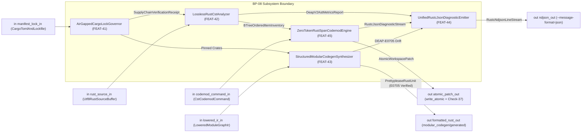
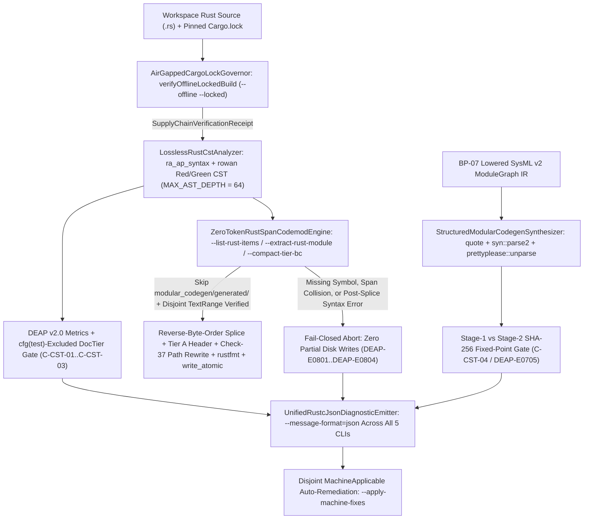
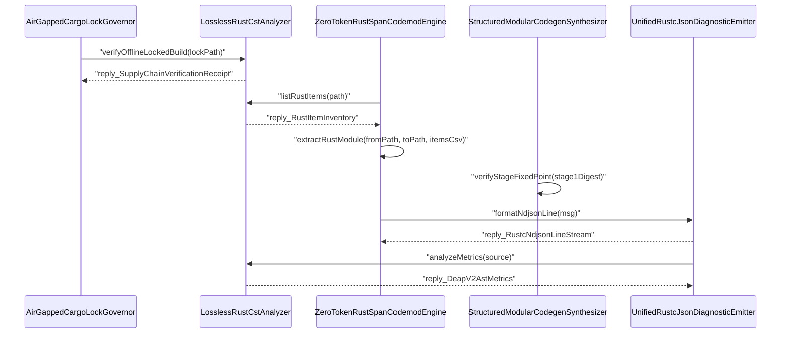
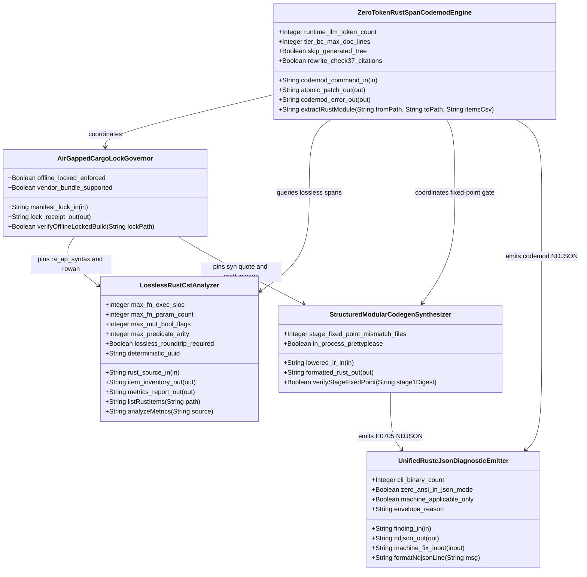
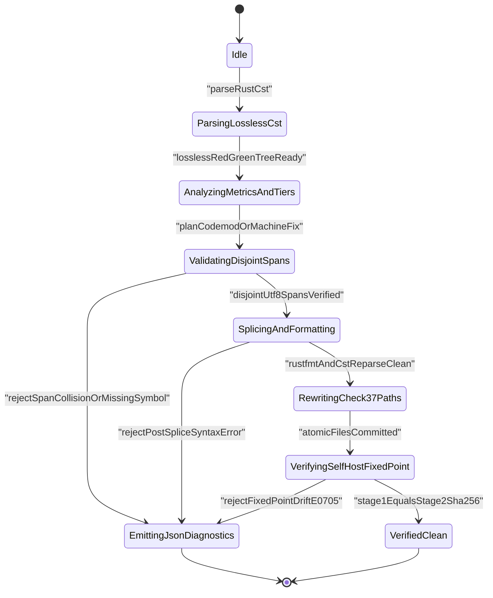

| Attribute | Specification Detail |
| :--- | :--- |
| **Issue ID** | TBD |
| **Title** | Epic 08: BP 08 Lossless Rust CST Codemod Engine and Unified rustc Compatible JSON Diagnostics |
| **Type** | epic |
| **Package** | BP_08_Lossless_Rust_CST_Codemod_Engine_and_Unified_rustc_Compatible_JSON_Diagnostics |
| **Subsystem** | BP 08 Lossless Rust CST Codemod Engine and Unified rustc Compatible JSON Diagnostics |
| **Generation Mode** | subagent |
| **Specification Source** | [schema/model.sysml](../../schema/model.sysml) |

# Epic 08: BP 08 Lossless Rust CST Codemod Engine and Unified rustc Compatible JSON Diagnostics

## 1. Context

`BP_08_Lossless_Rust_CST_Codemod_Engine_and_Unified_rustc_Compatible_JSON_Diagnostics` (**REQ-0608** / `BP-08` / `DEAP-BP-DET-08`, UUIDv5 `6ba7b810-9dad-11d1-80b4-00c04fd430c8`, `Class P` linear syntax-tree traversal and byte-span splicing complexity, governed by DO-178C Level A, DO-330 TQL-4, ISO 26262 ASIL D, ECSS-E-ST-40C, and ISO/IEC/IEEE 15288:2023 Clause 6.4.3) defines the compiler-grade Concrete Syntax Tree (CST) analysis, deterministic zero-token Rust span-codemod, self-hosting modular codegen representation boundary, air-gapped dependency lock governance, and unified `rustc`-compatible machine-readable JSON diagnostic subsystem across the Tier-0 compiler workspace.

This Epic replaces hand-rolled character-by-character and line-by-line Rust lexical delimiter scanners across `crates/deap-core/src/source_ast.rs`, `crates/compile-sysml/src/docstring.rs`, `crates/verify-baseline/src/checks/docstring_gate.rs`, and `crates/verify-baseline/src/audit_code.rs` (while isolating existing Dart `.dart` AST extraction without regression) through four orthogonal architectural pillars:

1. **Lossless Rust Concrete Syntax Tree (`ra_ap_syntax` + `rowan`) & Exact DEAP v2.0 Metrics (`FEAT-42`)**: Parses UTF-8 `.rs` source buffers in `crates/deap-core` into lossless Red/Green syntax trees preserving 100% of whitespace trivia, line and block comments, outer and inner docblocks (`///`, `//!`), Rust attributes (`cfg(test)`, `test`, `rt_loop`, `#![forbid(unsafe_code)]`), visibility qualifiers (`pub`, `pub(crate)`, `pub(super)`, inherited private), typed parameter lists, and exact UTF-8 byte spans (`TextRange`). Computes exact `production_exec_sloc` (excluding `cfg(test)` attribute modules, `test` attribute items, comments, attributes, and blank lines), per-function `exec_sloc` (**C-CST-01** `max_fn_exec_sloc <= 50` within the subsystem `<= 80` exec SLOC modularity ceiling), receiver-excluded `param_count` (**C-CST-02** `max_fn_param_count <= 5` excluding `self`, `&self`, and `&mut self`), mutable boolean local flag count (**C-CST-03** `max_mut_bool_flags == 0`), compound boolean predicate arity (`max_predicate_arity <= 3`), stringly-typed `Result<T, String>` return detection, and `cfg(test)`-excluded `DocTier` (`DocTier::RustTierA` versus `DocTier::RustTierBC`) classification.
2. **Structured Modular Codegen Representation Boundary (`FEAT-43` / `BP-07` Parity)**: Separates trivia-preserving CST byte-span splicing on existing workspace `.rs` files (`ra_ap_syntax` + `rowan`) from newly synthesized SysML v2 modular codegen units lowered via `proc_macro2::TokenStream` (`quote`) -> `syn::parse2` -> `prettyplease::unparse` (`in_process_prettyplease == true`) inside `crates/compile-sysml/src/modular_codegen/mod.rs`, strictly preserving the `BP-07` `E0705` Stage-1 == Stage-2 metacircular SHA-256 fixed-point invariant (**C-CST-04** `stage_fixed_point_mismatch_files == 0`).
3. **Deterministic Zero-LLM-Token Span Codemod Engine (`FEAT-45`)**: Executes `compile-sysml --list-rust-items <PATH>`, `compile-sysml --extract-rust-module --from <MOD> --to  --items <CSV>`, and `compile-sysml --compact-tier-bc <DIR>` with zero runtime LLM tokens (**C-CST-05** `runtime_llm_token_count == 0`), compacting legacy multi-section `DocTier::RustTierBC` docblocks to 2-line `/// 
` + `/// Realises: [REQ-*]` contracts (**C-CST-06** `tier_bc_max_doc_lines == 2`), unconditionally skipping `crates/compile-sysml/src/modular_codegen/generated/`, and atomically rewriting Check-37 crate path citations (`<name>.rs` to `<name>/mod.rs`, as in `crates/deap-core/src/sysml_ast/mod.rs`) across `docs/architecture/blueprints/` and `README.md`.
4. **Unified `rustc`-Compatible NDJSON Diagnostics (`FEAT-44`) & Air-Gapped Lock Governance (`FEAT-41`)**: Unifies `crates/deap-core/src/diagnostics.rs` and all five workspace CLI binaries (`compile-sysml`, `verify-baseline`, `ingest-sysml`, `assemble-conops`, `reconcile-backlog` -- `cli_binary_count == 5`) on single-line zero-ANSI `--message-format=json` (`reason: "compiler-message"`) envelopes and reverse-byte-order disjoint `"MachineApplicable"` `--apply-machine-fixes` transactions, backed by pinned `Cargo.lock` SHA-256 checksums for `--offline --locked` and `cargo vendor` air-gapped reproducibility.

## 2. Requirements & Checklist

### Child Feature Realization Matrix

| Feature ID & Canonical Locator | SysML `part def` Classifier | Owned Attributes & Invariant Bounds | Directional Ports & Protocols | Bound `action def` Operations | Safety & Constraint Obligations | Primary Workspace Targets |
| :--- | :--- | :--- | :--- | :--- | :--- | :--- |
| [FEAT-41](../features/FEAT-41-AirGappedCargoLockGovernor.md) | `AirGappedCargoLockGovernor` | `offline_locked_enforced = true`, `vendor_bundle_supported = true` | `in manifest_lock_in : String` (`CargoTomlAndLockfile`), `out lock_receipt_out : String` (`SupplyChainVerificationReceipt`) | `verifyOfflineLockedBuild` | **SC-05**, **SC-BP08-01**..**SC-BP08-04** (`FM-BP08-001`..`FM-BP08-004`, `DEAP-E0804`) | `Cargo.toml`, `Cargo.lock`, `crates/deap-core/src/diagnostics.rs`, `crates/verify-baseline/src/blueprint_gate.rs` |
| [FEAT-42](../features/FEAT-42-LosslessRustCstAnalyzer.md) | `LosslessRustCstAnalyzer` | `max_fn_exec_sloc = 50` (**C-CST-01**), `max_fn_param_count = 5` (**C-CST-02**), `max_mut_bool_flags = 0` (**C-CST-03**), `max_predicate_arity = 3`, `lossless_roundtrip_required = true`, `deterministic_uuid = "6ba7b810-9dad-11d1-80b4-00c04fd430c8"` | `in rust_source_in : String` (`Utf8RustSourceBuffer`), `out item_inventory_out : String` (`BTreeOrderedItemInventory`), `out metrics_report_out : String` (`DeapV2AstMetricsReport`) | `listRustItems`, `analyzeMetrics` | **SC-01**, **SC-BP08-05**..**SC-BP08-08** (`FM-BP08-005`..`FM-BP08-008`, `DEAP-E0801`..`DEAP-E0804`), **SC-BP07-02** | `crates/deap-core/src/source_ast.rs`, `crates/verify-baseline/src/checks/docstring_gate.rs`, `crates/verify-baseline/src/audit_code.rs` |
| [FEAT-43](../features/FEAT-43-StructuredModularCodegenSynthesizer.md) | `StructuredModularCodegenSynthesizer` | `stage_fixed_point_mismatch_files = 0` (**C-CST-04**), `in_process_prettyplease = true` | `in lowered_ir_in : String` (`LoweredModuleGraphIr`), `out formatted_rust_out : String` (`PrettypleaseRustUnit`) | `verifyStageFixedPoint` | **SC-02**, **SC-BP08-09**..**SC-BP08-12** (`FM-BP08-009`..`FM-BP08-012`, `DEAP-E0705`, `DEAP-E0803`, `DEAP-E0804`), **SC-BP07-17**..**SC-BP07-20**, **SC-BP07-29**..**SC-BP07-36** | `crates/compile-sysml/src/modular_codegen/mod.rs`, `crates/compile-sysml/src/modular_codegen/generated/` |
| [FEAT-44](../features/FEAT-44-UnifiedRustcJsonDiagnosticEmitter.md) | `UnifiedRustcJsonDiagnosticEmitter` | `cli_binary_count = 5`, `zero_ansi_in_json_mode = true`, `machine_applicable_only = true`, `envelope_reason = "compiler-message"` | `in finding_in : String` (`DeapDiagnosticFinding`), `out ndjson_out : String` (`RustcNdjsonLineStream`), `inout machine_fix_inout : String` (`AtomicSpanFixTransaction`) | `formatNdjsonLine` | **SC-04**, **SC-BP08-13**..**SC-BP08-16** (`FM-BP08-013`..`FM-BP08-016`, `DEAP-E0801`..`DEAP-E0804`) | `crates/deap-core/src/diagnostics.rs`, `crates/compile-sysml/src/cli.rs`, `crates/verify-baseline/src/main.rs`, `crates/ingest-sysml/src/main.rs`, `crates/assemble-conops/src/main.rs`, `crates/reconcile-backlog/src/main.rs` |
| [FEAT-45](../features/FEAT-45-ZeroTokenRustSpanCodemodEngine.md) | `ZeroTokenRustSpanCodemodEngine` | `runtime_llm_token_count = 0` (**C-CST-05**), `tier_bc_max_doc_lines = 2` (**C-CST-06**), `skip_generated_tree = true`, `rewrite_check37_citations = true` | `in codemod_command_in : String` (`CstCodemodCommand`), `out atomic_patch_out : String` (`AtomicWorkspacePatch`), `out codemod_error_out : String` (`RustcJsonDiagnosticStream`) | `extractRustModule` | **SC-03**, **SC-BP08-03**, **SC-BP08-04** (`FM-BP08-017`..`FM-BP08-020`, `DEAP-E0801`..`DEAP-E0804`), **SC-BP07-34** | `crates/compile-sysml/src/docstring.rs`, `crates/compile-sysml/src/cli.rs`, `crates/deap-core/src/source_ast.rs`, `README.md` |

### Child Feature Checklist

- [ ] #742 - [Feature 41: BP 08 AirGappedCargoLockGovernor](../features/FEAT-41-AirGappedCargoLockGovernor.md) (Governs reproducible `--offline --locked` dependency resolution, 64-hex-digit `Cargo.lock` SHA-256 package checksum verification, and `cargo vendor` air-gapped supply-chain readiness under **SC-05** and **SC-BP08-01**..**SC-BP08-04**)
- [ ] #742 - [Feature 42: BP 08 LosslessRustCstAnalyzer](../features/FEAT-42-LosslessRustCstAnalyzer.md) (Constructs lossless `ra_ap_syntax` + `rowan` Red/Green syntax trees, enforces `MAX_AST_DEPTH = 64` bounded traversal, extracts `cfg(test)`-excluded DEAP v2.0 AST metrics under **C-CST-01**..**C-CST-03**, and classifies `DocTier::RustTierA` versus `DocTier::RustTierBC` items under **SC-01**)
- [ ] #742 - [Feature 43: BP 08 StructuredModularCodegenSynthesizer](../features/FEAT-43-StructuredModularCodegenSynthesizer.md) (Maintains the `BP-07` structured codegen boundary lowering 4-level SysML v2 `ModuleGraph` IR through `quote` -> `syn::parse2` -> in-process `prettyplease::unparse` to guarantee `E0705` Stage-1 == Stage-2 SHA-256 fixed-point identity under **C-CST-04** and **SC-02**)
- [ ] #742 - [Feature 44: BP 08 UnifiedRustcJsonDiagnosticEmitter](../features/FEAT-44-UnifiedRustcJsonDiagnosticEmitter.md) (Emits single-line zero-ANSI `reason: "compiler-message"` NDJSON diagnostic streams across all 5 workspace CLIs and executes reverse-byte-order disjoint `"MachineApplicable"` `--apply-machine-fixes` transactions under **SC-04**)
- [ ] #742 - [Feature 45: BP 08 ZeroTokenRustSpanCodemodEngine](../features/FEAT-45-ZeroTokenRustSpanCodemodEngine.md) (Executes zero-LLM-token `--list-rust-items`, `--extract-rust-module`, and `--compact-tier-bc` CST byte-span splices under **C-CST-05**..**C-CST-06**, skipping `crates/compile-sysml/src/modular_codegen/generated/` and atomically updating Check-37 path citations under **SC-03**)

### Associated Use Cases & User Stories

#### Associated Use Cases
- [ ] TBD - [Use Case 38: Lossless Red Green CST Roundtrip and Exact DEAP v2 0 AST Metrics Extraction](../use-cases/UC-38-Lossless_Red_Green_CST_Roundtrip_and_Exact_DEAP_v2_0_AST_Metrics_Extraction.md) (Verifies `AC-01` bit-for-bit `rowan` Green-tree byte recovery, `cfg(test)` exclusion, receiver-excluded parameter counts, and `DocTier` classification)
- [ ] TBD - [Use Case 39: Deterministic B Tree Map Item Inventory and Atomic Module Extraction with Check 37 Path Rewriting](../use-cases/UC-39-Deterministic_BTreeMap_Item_Inventory_and_Atomic_Module_Extraction_with_Check_37_Path_Rewriting.md) (Verifies `AC-02` `BTreeMap`-ordered `--list-rust-items` output, `--extract-rust-module` leading-trivia slicing, Tier A `//!` header synthesis, and `<name>.rs` to `<name>/mod.rs` Check-37 citation updates)
- [ ] TBD - [Use Case 40: Fail Closed Rejection on Span Collisions Missing Symbols or Post Splice Syntax Errors](../use-cases/UC-40-Fail_Closed_Rejection_on_Span_Collisions_Missing_Symbols_or_Post_Splice_Syntax_Errors.md) (Verifies `AC-03` zero-partial-write abort and `DEAP-E0801`..`DEAP-E0803` NDJSON emission on missing items, overlapping `TextRange` spans, or post-splice CST errors)
- [ ] TBD - [Use Case 41: Lossless Tier B C Docblock Compaction Skipping Self Hosted Generated Modules](../use-cases/UC-41-Lossless_Tier_B_C_Docblock_Compaction_Skipping_Self_Hosted_Generated_Modules.md) (Verifies `AC-04` 2-line `DocTier::RustTierBC` docstring compaction under **C-CST-06** while preserving `DocTier::RustTierA` and `crates/compile-sysml/src/modular_codegen/generated/` byte-for-byte)
- [ ] TBD - [Use Case 42: Structured Codegen Boundary Preserving Stage 1 to Stage 2 Metacircular SHA 256 Fixed Point](../use-cases/UC-42-Structured_Codegen_Boundary_Preserving_Stage_1_to_Stage_2_Metacircular_SHA_256_Fixed_Point.md) (Verifies `AC-05` `syn` + `quote` + `prettyplease` deterministic AST emission and `E0705` Stage-1 == Stage-2 SHA-256 parity under **C-CST-04**)
- [ ] TBD - [Use Case 43: Unified rustc Compatible Single Line JSON Diagnostics and Machine Applicable Auto Fix Across All Five CLIs](../use-cases/UC-43-Unified_rustc_Compatible_Single_Line_JSON_Diagnostics_and_MachineApplicable_Auto_Fix_Across_All_Five_CLIs.md) (Verifies `AC-06` `--message-format=json` single-line zero-ANSI framing and `--apply-machine-fixes` `"MachineApplicable"` filtering across all 5 CLIs)
- [ ] TBD - [Use Case 44: Air Gapped Offline Cargo Lock Reproducibility and Twelve Gate Blueprint Conformance](../use-cases/UC-44-Air_Gapped_Offline_Cargo_Lock_Reproducibility_and_Twelve_Gate_Blueprint_Conformance.md) (Verifies `AC-07` `--offline --locked` dependency lock verification, `cargo vendor` compatibility, and 12-gate blueprint conformance)

#### Associated User Stories
- [ ] TBD - [User Story 51: verify Offline Locked Build](../user-stories/US-51-verifyOfflineLockedBuild.md) (Binds `action def verifyOfflineLockedBuild` on `AirGappedCargoLockGovernor` to enforce `Cargo.lock` SHA-256 checksum parity prior to CST or CLI execution)
- [ ] TBD - [User Story 52: list Rust Items](../user-stories/US-52-listRustItems.md) (Binds `action def listRustItems` on `LosslessRustCstAnalyzer` to emit deterministic `BTreeMap`-ordered AST item inventories with `TextRange` spans and `DocTier` labels)
- [ ] TBD - [User Story 53: extract Rust Module](../user-stories/US-53-extractRustModule.md) (Binds `action def extractRustModule` on `ZeroTokenRustSpanCodemodEngine` to perform atomic lossless byte-span extraction and Check-37 path citation updates)
- [ ] TBD - [User Story 54: verify Stage Fixed Point](../user-stories/US-54-verifyStageFixedPoint.md) (Binds `action def verifyStageFixedPoint` on `StructuredModularCodegenSynthesizer` to enforce `SHA-256(Stage 1) == SHA-256(Stage 2)` fixed-point identity and emit `DEAP-E0705` on drift)
- [ ] TBD - [User Story 55: format Ndjson Line](../user-stories/US-55-formatNdjsonLine.md) (Binds `action def formatNdjsonLine` on `UnifiedRustcJsonDiagnosticEmitter` to serialize single-line zero-ANSI `reason: "compiler-message"` NDJSON diagnostic envelopes)
- [ ] TBD - [User Story 56: analyze Metrics](../user-stories/US-56-analyzeMetrics.md) (Binds `action def analyzeMetrics` on `LosslessRustCstAnalyzer` to compute `cfg(test)`-excluded `production_exec_sloc`, per-function `exec_sloc`, receiver-excluded `param_count`, mutable boolean counts, predicate arity, and `Result<T, String>` flags)

## 3. Architecture

### Subsystem Capability Allocations

| Capability Name | Subsystem Package | Owning `part def` Classifier | Bound `action def` / Protocol | Description / Objective |
| :--- | :--- | :--- | :--- | :--- |
| `AirGappedSupplyChainLockGovernance` | `BP_08_Lossless_Rust_CST_Codemod_Engine_and_Unified_rustc_Compatible_JSON_Diagnostics` | `AirGappedCargoLockGovernor` (`FEAT-41`) | `verifyOfflineLockedBuild` (`CargoTomlAndLockfile` -> `SupplyChainVerificationReceipt`) | Validates pinned `Cargo.toml` and `Cargo.lock` 64-hex-digit SHA-256 package checksums for zero-network `--offline --locked` and `cargo vendor` builds (**SC-05**). |
| `LosslessRedGreenCstMetricsAndDocTierAnalysis` | `BP_08_Lossless_Rust_CST_Codemod_Engine_and_Unified_rustc_Compatible_JSON_Diagnostics` | `LosslessRustCstAnalyzer` (`FEAT-42`) | `listRustItems`, `analyzeMetrics` (`Utf8RustSourceBuffer` -> `BTreeOrderedItemInventory`, `DeapV2AstMetricsReport`) | Parses `.rs` UTF-8 buffers into `ra_ap_syntax` + `rowan` Red/Green syntax trees (`MAX_AST_DEPTH = 64`), enforcing bit-for-bit round-trip fidelity, `cfg(test)` exclusion, **C-CST-01**..**C-CST-03** metrics, and `DocTier` classification (**SC-01**). |
| `StructuredModularCodegenFixedPointSynthesis` | `BP_08_Lossless_Rust_CST_Codemod_Engine_and_Unified_rustc_Compatible_JSON_Diagnostics` | `StructuredModularCodegenSynthesizer` (`FEAT-43`) | `verifyStageFixedPoint` (`LoweredModuleGraphIr` -> `PrettypleaseRustUnit`) | Lowers 4-level SysML v2 `ModuleGraph` IR via `quote` -> `syn::parse2` -> in-process `prettyplease::unparse`, enforcing `E0705` Stage-1 == Stage-2 SHA-256 fixed-point equivalence (**C-CST-04**, **SC-02**). |
| `UnifiedFiveCliRustcNdjsonAndMachineFix` | `BP_08_Lossless_Rust_CST_Codemod_Engine_and_Unified_rustc_Compatible_JSON_Diagnostics` | `UnifiedRustcJsonDiagnosticEmitter` (`FEAT-44`) | `formatNdjsonLine` (`DeapDiagnosticFinding` -> `RustcNdjsonLineStream`, `AtomicSpanFixTransaction`) | Serializes single-line zero-ANSI `reason: "compiler-message"` NDJSON across all 5 workspace CLIs and applies reverse-byte-order disjoint `"MachineApplicable"` span replacements (**SC-04**). |
| `ZeroTokenDisjointSpanCodemodAndCheck37Rewrite` | `BP_08_Lossless_Rust_CST_Codemod_Engine_and_Unified_rustc_Compatible_JSON_Diagnostics` | `ZeroTokenRustSpanCodemodEngine` (`FEAT-45`) | `extractRustModule` (`CstCodemodCommand` -> `AtomicWorkspacePatch`, `RustcJsonDiagnosticStream`) | Executes zero-LLM-token module extraction, 2-line `DocTier::RustTierBC` docstring compaction skipping `modular_codegen/generated/`, and atomic Check-37 citation updates (**C-CST-05**..**C-CST-06**, **SC-03**). |

### Subsystem Component Definition

### BP-07 AST Representation Boundary & Cross-Subsystem Invariants

`EPIC-08` enforces a strict representation and lifecycle firewall with `BP-07` (`docs/designs/blueprint-07-self-hosting-modular-codegen-compiler.md`) across `crates/deap-core`, `crates/compile-sysml`, and `crates/verify-baseline`:

1. **`syn` / `quote` / `prettyplease` `E0705`-Preserving AST Emission Boundary (`SC-02`, `SC-BP08-09`..`SC-BP08-12`, `SC-BP07-17`..`SC-BP07-20`, `SC-BP07-29`..`SC-BP07-36`)**:
   - **Dual-Engine Separation of Concerns**: `ra_ap_syntax` + `rowan` is strictly scoped to lossless trivia-preserving parsing, AST metric auditing, and exact UTF-8 `TextRange` byte-span splicing on existing workspace `.rs` files. Conversely, `StructuredModularCodegenSynthesizer` (`crates/compile-sysml/src/modular_codegen/mod.rs`) lowers 4-level partitioned SysML v2 `ModuleGraph` IR exclusively through deterministic `BTreeMap`-ordered `proc_macro2::TokenStream` construction (`quote`) -> mandatory `syn::parse2` typed AST validation (bounded by `MAX_AST_DEPTH = 64`) -> in-process `prettyplease::unparse` (`in_process_prettyplease == true`), eliminating external formatter subprocess drift in air-gapped environments.
   - **Pre-Commit Round-Trip & `ModularityBoundsSpec` Re-Verification**: Every `prettyplease`-formatted Rust compilation unit is re-parsed in memory via `syn` to verify AST round-trip idempotence, unique Check-36 7-section DO-178C `doc` outer-attribute headers, and `BP-07` `ModularityBoundsSpec` ceilings (`50 <= max_file_lines <= 400`, `1 <= max_items_per_file <= 12`, `1 <= max_cyclomatic_complexity <= 8`, subsystem function ceiling `<= 80` exec SLOC and CST target `max_fn_exec_sloc <= 50`, and `max_fn_param_count <= 5`) before isolated temp-directory staging and atomic rename (`write_atomic`). Any Stage-1 versus Stage-2 SHA-256 tree mismatch (`stage_fixed_point_mismatch_files != 0`, violating **C-CST-04**) aborts fail-closed via `rejectFixedPointDriftE0705` (`DEAP-E0705`) with zero partial target writes.
2. **`crates/compile-sysml/src/modular_codegen/generated/` Compaction Skip Invariant (`SC-03`, `SC-BP08-10`, `SC-BP08-18`, `SC-BP07-34`, `SC-BP07-36`)**:
   - `ZeroTokenRustSpanCodemodEngine` enforces `skip_generated_tree == true` as an immutable safety invariant. Whenever `compile-sysml --compact-tier-bc <DIR>` traverses a directory tree, canonical path filtering unconditionally skips 100% of files beneath `crates/compile-sysml/src/modular_codegen/generated/`.
   - This isolation firewall guarantees that post-codegen Tier B/C docstring compaction never mutates Check-36 7-section `doc` outer attributes inside committed Stage-1 self-hosted Rust units, preserving bit-for-bit `SHA-256(Stage 1) == SHA-256(Stage 2)` bootstrap parity (`E0705`).
3. **`cfg(test)`-Excluded `DocTier` and Production SLOC Invariant (`SC-01`, `SC-BP08-06`, `SC-BP08-08`, `SC-BP07-02`, `SC-BP07-04`, `SC-BP07-10`, `SC-BP07-34`)**:
   - **Subtree-Scoped Test Exclusion**: `LosslessRustCstAnalyzer` identifies `cfg(test)` attribute `mod` subtrees and `test` attribute callable subtrees directly from `ra_ap_syntax` outer-attribute AST bindings (failing closed on malformed or unbalanced attribute spans) and strips their entire `TextRange` subtrees prior to `production_exec_sloc`, `ModularityBoundsSpec` SLOC accounting, function metric checks (**C-CST-01**..**C-CST-03**), and `DocTier` classification.
   - **Deterministic Production `DocTier` Rules**: Across all non-test production AST items, `RustVisibility::Pub` items classify as `DocTier::RustTierA` (requiring full 7-section DO-178C safety docstrings and `//!` module headers), whereas `RustVisibility::PubCrate`, `RustVisibility::PubSuper`, `RustVisibility::Inherited` private items, and trait-implementation methods classify as `DocTier::RustTierBC` (governed by compacted 2-line `/// 
` + `/// Realises: [REQ-*]` contracts under **C-CST-06** `tier_bc_max_doc_lines == 2`), while preserving operational attributes such as `rt_loop` and excluding `self`, `&self`, and `&mut self` receivers from `param_count`.

### Three-Layer Definition of Done Architecture Contract

| Architectural Layer | Normative Subsystem Realization Contract | Enforced Invariants & Verification Anchors |
| :--- | :--- | :--- |
| **Layer 1: Domain State & Data Model** | Pure, immutable value types and closed algebraic enums in `crates/deap-core` (`ByteSpan`, `DocTier`, `RustVisibility`, `RustAstItemKind`, `RustItemMetrics`, `RustItemInventoryEntry`, `SuggestionApplicability`, `RustcDiagnosticCode`, `RustcDiagnosticSpan`, `RustcDiagnosticChild`, `RustcDiagnosticMessage`, `RustcCompilerMessageEnvelope`, `SpanSpliceEdit`, and typed diagnostic error variants `DEAP-E0705`, `DEAP-E0800`..`DEAP-E0804`). All symbol inventories, module graphs, and Check-37 rewrite maps use deterministic `BTreeMap` and `BTreeSet` containers. | Zero `Result<T, String>` signatures across domain APIs (`returns_result_string == false`); zero `HashMap`/`HashSet` iteration order non-determinism; `#![forbid(unsafe_code)]` enforced across domain modules. |
| **Layer 2: Logic & State Management** | Total, deterministic state transitions implementing `BP_08_Lossless_Rust_CST_Codemod_Engine_and_Unified_rustc_Compatible_JSON_Diagnostics_LifecycleState`. All functions obey the `<= 80` exec SLOC subsystem ceiling and target `max_fn_exec_sloc <= 50` (**C-CST-01**), `max_fn_param_count <= 5` excluding `self`/`&self`/`&mut self` (**C-CST-02**), `max_mut_bool_flags == 0` (**C-CST-03**), and `max_predicate_arity <= 3`. All `ra_ap_syntax`, `rowan`, and `syn` tree walks enforce `MAX_AST_DEPTH = 64`. Buffer slicing uses fallible `.get(start..end)` with `str::is_char_boundary` checks; span deltas, line-offset binary-search tables, and counters use `checked_add`, `checked_sub`, and `saturating_add`/`saturating_sub`. | Bit-for-bit `rowan` Green-tree round-trip equality (**SC-01**); pairwise disjoint reverse-byte-order `TextRange` splicing and zero-error `SourceFile::parse` post-splice gate (**SC-03**); staged `write_atomic` temp-and-rename multi-file commits with zero partial writes on failure. |
| **Layer 3: Presentation & CLI / `--message-format=json` NDJSON Interface Binding** | Unified CLI presentation surface across all 5 workspace binaries (`compile-sysml`, `verify-baseline`, `ingest-sysml`, `assemble-conops`, `reconcile-backlog` -- `cli_binary_count == 5`) exposing `--message-format=json` and `--apply-machine-fixes`, plus `compile-sysml` codemod flags `--list-rust-items <PATH>`, `--extract-rust-module --from <MOD> --to  --items <CSV>`, and `--compact-tier-bc <DIR>`. Emits line-atomic single-line `rustc`-compatible `reason: "compiler-message"` NDJSON records to stdout. | Zero embedded `0x0A` newline bytes inside serialized JSON records and zero `0x1B` ANSI escape bytes (`zero_ansi_in_json_mode == true`, **SC-04**); `--apply-machine-fixes` applies strictly disjoint `"MachineApplicable"` child spans (`machine_applicable_only == true`) while leaving `"MaybeIncorrect"` spans untouched. |

### End-to-End CST Codemod and Unified NDJSON Pipeline

### Inter-Component Sequence Topology

## System-Level UML Class Diagram

## State Machine Definitions

`BP_08_Lossless_Rust_CST_Codemod_Engine_and_Unified_rustc_Compatible_JSON_Diagnostics_LifecycleState` governs deterministic single-pass CST parsing, metric and `DocTier` classification, disjoint UTF-8 byte-span verification, reverse-byte-order splicing, Check-37 repository citation rewriting, and `BP-07` Stage-1 == Stage-2 SHA-256 fixed-point verification:

| Source State | Trigger / Event | Guard Condition | Target State | Fail-Closed / Transactional Guarantee |
| :--- | :--- | :--- | :--- | :--- |
| `Initial` | System initialization | Immutable `Cargo.lock` receipt ready | `Idle` | Zero mutable global state; workspace thresholds locked. |
| `Idle` | `parseRustCst` | Valid UTF-8 `Utf8RustSourceBuffer` on `rust_source_in` | `ParsingLosslessCst` | Bounded iterative CST construction (`MAX_AST_DEPTH = 64`). |
| `ParsingLosslessCst` | `losslessRedGreenTreeReady` | Root `rowan` `GreenNode` bytes equal input UTF-8 buffer bit-for-bit | `AnalyzingMetricsAndTiers` | Subtree-scoped `cfg(test)` exclusion sealed before metric accumulation. |
| `AnalyzingMetricsAndTiers` | `planCodemodOrMachineFix` | `BTreeMap` item inventory and `DocTier` snapshot finalized | `ValidatingDisjointSpans` | `modular_codegen/generated/` paths filtered when `skip_generated_tree == true`. |
| `ValidatingDisjointSpans` | `rejectSpanCollisionOrMissingSymbol` | Missing symbol (`DEAP-E0801`) or overlapping/non-UTF-8 `TextRange` (`DEAP-E0802`) | `EmittingJsonDiagnostics` | Aborts in memory before any disk mutation occurs. |
| `ValidatingDisjointSpans` | `disjointUtf8SpansVerified` | `0 <= a_i <= b_i <= len`, `is_char_boundary`, and `b_i <= a_{i+1}` for all edits | `SplicingAndFormatting` | Applies edits strictly in reverse byte order via fallible `.get()` slicing. |
| `SplicingAndFormatting` | `rejectPostSpliceSyntaxError` | Post-splice `SourceFile::parse` reports `errors().len() > 0` (`DEAP-E0803`) | `EmittingJsonDiagnostics` | Discards staged in-memory buffers with zero partial target writes. |
| `SplicingAndFormatting` | `rustfmtAndCstReparseClean` | Post-splice CST error count equals `0` and `Realises: [REQ-*]` retained | `RewritingCheck37Paths` | Stages formatted `<name>/mod.rs`, `<name>/.rs`, and Check-37 `.md` updates. |
| `RewritingCheck37Paths` | `atomicFilesCommitted` | Staged temp-and-rename `write_atomic` succeeds across `.rs` and `.md` targets | `VerifyingSelfHostFixedPoint` | Blueprints under `docs/architecture/blueprints/` and `README.md` synchronized atomically. |
| `VerifyingSelfHostFixedPoint` | `rejectFixedPointDriftE0705` | `stage_fixed_point_mismatch_files > 0` (`DEAP-E0705`) | `EmittingJsonDiagnostics` | Rejects `syn`/`quote`/`prettyplease` fixed-point drift fail-closed. |
| `VerifyingSelfHostFixedPoint` | `stage1EqualsStage2Sha256` | `SHA-256(Stage 1) == SHA-256(Stage 2)` (`stage_fixed_point_mismatch_files == 0`) | `VerifiedClean` | Full workspace CST, Check-37, and metacircular parity verified (`exit 0`). |
| `EmittingJsonDiagnostics` | Terminal flush | Line-atomic stdout lock flushes zero-ANSI single-line `compiler-message` NDJSON | `Terminal` | Process terminates fail-closed with non-zero exit code (`1`). |
| `VerifiedClean` | Terminal completion | Zero error-level diagnostics remaining | `Terminal` | Process terminates cleanly with exit code `0`. |

## System State Machine Diagram

## 4. Operational Considerations

### Deterministic CLI & Transactional Execution Surface

| CLI Flag / Operational Mode | Binary Scope | Deterministic Execution & Atomic Persistence Contract | Exit Codes & NDJSON Diagnostics |
| :--- | :--- | :--- | :--- |
| `--list-rust-items <PATH>` | `compile-sysml` (`crates/compile-sysml/src/cli.rs`) | Parses `.rs` file or canonicalized symlink-free directory via `LosslessRustCstAnalyzer` (`MAX_AST_DEPTH = 64`), emitting a `BTreeMap`-ordered inventory (`kind`, `name`, `visibility`, `byte_range`, `line_range`, `exec_sloc`, `param_count`, `doc_tier`). | `0` on valid inventory emission; `1` with single-line `DEAP-E0800` on I/O or UTF-8 failure. |
| `--extract-rust-module --from <MOD> --to  --items <CSV>` | `compile-sysml` (`crates/compile-sysml/src/cli.rs`) | Slices exact lossless CST byte ranges (including leading `///` docblocks and outer `Attr` attributes) into `` with a compliant Tier A `//!` module header and `use super::*;`, injects `mod ; pub use ::*;` into `<MOD>`, rewrites Check-37 path citations from `<name>.rs` to `<name>/mod.rs` (matching `crates/deap-core/src/sysml_ast/mod.rs`) across `docs/architecture/blueprints/` and `README.md`, formats via `rustfmt`, re-parses CST (`errors == 0`), and commits via `write_atomic`. | `0` on atomic multi-file commit; `1` on missing symbol (`DEAP-E0801`), overlapping `TextRange` (`DEAP-E0802`), or post-splice syntax error (`DEAP-E0803`) with zero partial writes. |
| `--compact-tier-bc <DIR>` | `compile-sysml` (`crates/compile-sysml/src/cli.rs`, `crates/compile-sysml/src/docstring.rs`) | Compacts legacy multi-section docblocks on `DocTier::RustTierBC` items down to 2-line `/// 
` + `/// Realises: [REQ-*]` contracts (**C-CST-06** `tier_bc_max_doc_lines == 2`), preserving 100% of executable tokens, `DocTier::RustTierA` items, `cfg(test)` blocks, and `crates/compile-sysml/src/modular_codegen/generated/` files (`skip_generated_tree == true`). | `0` on idempotent atomic compaction; `1` on post-splice CST syntax error (`DEAP-E0803`) or missing `Realises:` traceability binding (`DEAP-E0804`). |
| `--message-format=json` & `--apply-machine-fixes` | `compile-sysml`, `verify-baseline`, `ingest-sysml`, `assemble-conops`, `reconcile-backlog` | Serializes every diagnostic as a single-line `reason: "compiler-message"` JSON record free of internal `0x0A` newlines and `0x1B` ANSI escapes under an exclusive stdout lock; `--apply-machine-fixes` filters strictly for `"MachineApplicable"` child spans (`machine_applicable_only == true`), applies reverse-byte-order splices, re-verifies CST syntax, and persists atomically. | `0` when zero error-level diagnostics remain after verified fixes; `1` when unfixed errors, `DEAP-E0802` span collisions, or `DEAP-E0803` post-splice syntax errors occur. |

### Epic Given-When-Then Acceptance Criteria

#### AC-01: Lossless Red-Green CST Roundtrip and Exact DEAP v2.0 AST Metrics Extraction
- **Given**: A Rust `.rs` fixture containing outer and inner docblocks (`///`, `//!`), inline and block comments, raw string literals containing braces, `rt_loop`-annotated operational items and `cfg(test)` test modules with `test`-annotated functions, methods taking `&self` and `&mut self`, a function declaring `let mut flag: bool = false`, a 4-clause compound boolean predicate exceeding `max_predicate_arity = 3`, a `pub fn` returning `Result<usize, String>`, and a `pub(crate) fn` helper, paired with a second fixture containing an incomplete trailing expression.
- **When**: `LosslessRustCstAnalyzer` parses both fixtures into `ra_ap_syntax` + `rowan` Red/Green syntax trees within `MAX_AST_DEPTH = 64` and executes `analyzeMetrics` and `listRustItems`.
- **Then**: Root `SyntaxNode` byte projection equals the input UTF-8 buffer byte-for-byte on both complete and partially incomplete fixtures (`lossless_roundtrip_required == true`), `cfg(test)` modules and `test` items are excluded from `production_exec_sloc` and `DocTier` rules, `self`/`&self`/`&mut self` receivers are excluded from `param_count` (**C-CST-02**), mutable boolean flags (**C-CST-03**), compound predicate arity, and `Result<T, String>` return types are reported at exact UTF-8 `TextRange` offsets, and `pub` API items classify as `DocTier::RustTierA` while private, `pub(crate)`, `pub(super)`, and trait-implementation items classify as `DocTier::RustTierBC`.

#### AC-02: Deterministic BTreeMap Item Inventory and Atomic Module Extraction with Check-37 Path Rewriting
- **Given**: An isolated temporary workspace fixture containing a Rust module `<name>.rs` cited in `docs/architecture/blueprints/` and `README.md`, with multiple top-level structs and functions carrying leading `///` docblocks and outer `derive(...)` attributes.
- **When**: `compile-sysml --list-rust-items <name>.rs` is executed followed by transitioning `<name>.rs` to `<name>/mod.rs` and running `compile-sysml --extract-rust-module --from <name>/mod.rs --to <name>/.rs --items <ItemA,ItemB>`.
- **Then**: `--list-rust-items` emits a deterministic `BTreeMap`-ordered inventory (`kind`, `name`, `visibility`, `byte_range`, `line_range`, `exec_sloc`, `param_count`, `doc_tier`), `--extract-rust-module` slices exact lossless CST byte ranges (including leading docblocks and outer attributes) into `<name>/.rs` with a Tier A `//!` header and `use super::*;`, injects `mod ; pub use ::*;` into `<name>/mod.rs`, atomically rewrites Check-37 path citations from `<name>.rs` to `<name>/mod.rs` across `docs/architecture/blueprints/` and `README.md`, formats via `rustfmt`, re-verifies zero CST parse errors, and exits `0` with `runtime_llm_token_count == 0` (**C-CST-05**).

#### AC-03: Fail-Closed Rejection on Span Collisions, Missing Symbols, or Post-Splice Syntax Errors
- **Given**: An `--extract-rust-module` or `--apply-machine-fixes` invocation targeting either an overlapping pair of `TextRange` byte intervals, a non-existent AST item identifier, a mid-codepoint non-UTF-8 byte offset, or a replacement payload that introduces a post-splice CST syntax error.
- **When**: `ZeroTokenRustSpanCodemodEngine` or `UnifiedRustcJsonDiagnosticEmitter` evaluates the proposed `SpanSpliceEdit` batch.
- **Then**: Execution aborts fail-closed with exit code `1`, emits a single-line zero-ANSI `reason: "compiler-message"` NDJSON diagnostic (`DEAP-E0801` missing item, `DEAP-E0802` overlapping or invalid UTF-8 span boundary, or `DEAP-E0803` post-splice CST syntax error), and leaves 100% of `.rs` and `.md` files on disk untouched.

#### AC-04: Lossless Tier B/C Docblock Compaction Skipping Self-Hosted Generated Modules
- **Given**: A Rust directory tree containing `DocTier::RustTierA` `pub` items with 7-section DO-178C safety docstrings, `DocTier::RustTierBC` private and `pub(crate)` items carrying multi-section docblocks with `Realises: [REQ-*]` bindings, `cfg(test)` unit-test modules, and the self-hosted `crates/compile-sysml/src/modular_codegen/generated/` subtree.
- **When**: `compile-sysml --compact-tier-bc <DIR>` executes across the directory tree.
- **Then**: Multi-section docblocks on `DocTier::RustTierBC` items outside `crates/compile-sysml/src/modular_codegen/generated/` are losslessly compacted to 2-line `/// 
` + `/// Realises: [REQ-*]` contracts (**C-CST-06** `tier_bc_max_doc_lines == 2`) without altering any non-trivia executable tokens or attributes, while 100% of `DocTier::RustTierA` items and 100% of files under `crates/compile-sysml/src/modular_codegen/generated/` remain byte-for-byte identical.

#### AC-05: Structured Codegen Boundary Preserving Stage-1 to Stage-2 Metacircular SHA-256 Fixed Point (`E0705`)
- **Given**: Lowered 4-level SysML v2 `ModuleGraph` IR compiled through `quote` -> `syn::parse2` -> in-process `prettyplease::unparse` (`in_process_prettyplease == true`) inside `crates/compile-sysml/src/modular_codegen/mod.rs`.
- **When**: Stage-1 generated units under `crates/compile-sysml/src/modular_codegen/generated/` are re-emitted into an isolated Stage-2 staging directory and audited via `verifyStageFixedPoint`.
- **Then**: `SHA-256(Stage 1) == SHA-256(Stage 2)` holds across every generated relative path (**C-CST-04** `stage_fixed_point_mismatch_files == 0`), whereas any injected AST ordering, docstring, or formatting divergence aborts fail-closed with diagnostic code `DEAP-E0705` (`E0705`) and zero partial target writes.

#### AC-06: Unified `rustc`-Compatible Single-Line JSON Diagnostics and `MachineApplicable` Auto-Fix Across All Five CLIs
- **Given**: Validation findings triggered across `compile-sysml`, `verify-baseline`, `ingest-sysml`, `assemble-conops`, and `reconcile-backlog` (`cli_binary_count == 5`) invoked with `--message-format=json`, including diagnostics carrying both `"MachineApplicable"` and `"MaybeIncorrect"` child replacement spans.
- **When**: Standard output is parsed line-by-line as NDJSON and `--apply-machine-fixes` is invoked on the target workspace fixture.
- **Then**: Every CLI emits strictly single-line JSON records with `reason: "compiler-message"`, `message.code.code` prefixed with `"DEAP-E"`, exact UTF-8 `byte_start`/`byte_end` and 1-indexed `line_start`/`line_end` coordinates, zero internal `0x0A` newlines, and zero `0x1B` ANSI escape sequences; `--apply-machine-fixes` applies 100% of disjoint `"MachineApplicable"` edits in reverse byte order while leaving `"MaybeIncorrect"` spans unmodified.

#### AC-07: Air-Gapped Offline `Cargo.lock` Reproducibility and Twelve-Gate Blueprint Conformance
- **Given**: Workspace `Cargo.toml` and `Cargo.lock` pinning exact crate versions and 64-hex-digit SHA-256 checksums for `ra_ap_syntax`, `rowan`, `syn`, `proc-macro2`, `quote`, and `prettyplease` alongside `docs/designs/blueprint-08-rust-analyzer-cst-refactoring-and-json-diagnostics.md`.
- **When**: `AirGappedCargoLockGovernor` executes `verifyOfflineLockedBuild` under `--offline --locked` resolution and `verify-baseline check-blueprint` audits `docs/designs/blueprint-08-rust-analyzer-cst-refactoring-and-json-diagnostics.md`.
- **Then**: Zero-network locked dependency resolution (`cargo vendor`-compatible) succeeds with `SupplyChainVerificationReceipt`, and all 12 mechanical blueprint verification gates pass with exit code `0`.

## 5. Security & Governance

### Formal Constraint & Invariant Envelope (`REQ-0608`)

| Constraint ID | SysML Attribute | Min | Max | Engineering Unit | Normative AST Expression |
| :--- | :--- | :--- | :--- | :--- | :--- |
| **C-CST-01** (`C_CST_01`) | `max_fn_exec_sloc` | `1` | `50` | `SLOC` | `max_fn_exec_sloc >= 1 and max_fn_exec_sloc <= 50` (within subsystem `<= 80` exec SLOC ceiling) |
| **C-CST-02** (`C_CST_02`) | `max_fn_param_count` | `0` | `5` | `params` | `max_fn_param_count >= 0 and max_fn_param_count <= 5` (excluding `self`, `&self`, `&mut self`) |
| **C-CST-03** (`C_CST_03`) | `max_mut_bool_flags` | `0` | `0` | `flags` | `max_mut_bool_flags >= 0 and max_mut_bool_flags <= 0` |
| **C-CST-04** (`C_CST_04`) | `stage_fixed_point_mismatch_files` | `0` | `0` | `files` | `stage_fixed_point_mismatch_files >= 0 and stage_fixed_point_mismatch_files <= 0` |
| **C-CST-05** (`C_CST_05`) | `runtime_llm_token_count` | `0` | `0` | `tokens` | `runtime_llm_token_count >= 0 and runtime_llm_token_count <= 0` |
| **C-CST-06** (`C_CST_06`) | `tier_bc_max_doc_lines` | `2` | `2` | `lines` | `tier_bc_max_doc_lines >= 2 and tier_bc_max_doc_lines <= 2` |

#### Mathematical Formulations of Lossless CST, Disjoint Span Splicing, Fixed-Point Parity, and NDJSON Complexity

**1. Lossless Red/Green Full-Fidelity Roundtrip & `cfg(test)`-Excluded Metric Projection (`Invariant_REQ_0608_SC_01` / **SC-01**)**:

$$
\begin{aligned}
\operatorname{Lossless}(S) &\iff \bigoplus_{i=1}^{k} \operatorname{bytes}(t_i) = S \land \sum_{i=1}^{k} \lvert \operatorname{range}(t_i) \rvert = \lvert S \rvert \\
\operatorname{ProductionExecSloc}(S) &= \lvert \{ \ell \in \operatorname{Lines}(S) \mid \exists t \in \tau(T_{\text{red}}(S) \setminus T_{\text{test}}), \quad \operatorname{kind}(t) \notin \mathcal{K}_{\text{trivia}} \land \ell \cap \operatorname{lines}(t) \neq \emptyset \} \rvert \\
\forall f \in \operatorname{Fns}(T_{\text{red}}(S) \setminus T_{\text{test}}), \quad \operatorname{ExecSloc}(f) &\le N_{\text{sloc}} \land \lvert \operatorname{Params}(f) \setminus \mathcal{R}_{\text{self}} \rvert \le N_{\text{param}} \land \operatorname{MutBools}(f) = N_{\text{flag}}
\end{aligned}
$$

- Parameter Definitions & Engineering Units:
- $S$: Input UTF-8 `.rs` source buffer of byte length $\lvert S \rvert$ (`bytes`).
- $T_{\text{red}}(S)$: Root `ra_ap_syntax` + `rowan` Red/Green concrete syntax tree with ordered leaf token sequence $\tau(T_{\text{red}}(S)) = (t_1, \dots, t_k)$ traversed within `MAX_AST_DEPTH = 64` (`levels`).
- $T_{\text{test}}$: Set of CST subtrees governed by outer `cfg(test)` or `test` attributes excluded from production SLOC and `DocTier` enforcement.
- $\mathcal{K}_{\text{trivia}}$: Non-executable trivia token kinds (whitespace, line/block comments, docblocks, and attribute tokens).
- $\mathcal{R}_{\text{self}}$: Method receiver set $\{ \text{self}, \&\text{self}, \&\text{mut self} \}$ excluded from formal parameter arity.
- $N_{\text{sloc}}$: Per-function executable line bound (`max_fn_exec_sloc = 50` `SLOC` under **C-CST-01**; hard subsystem ceiling `80` `SLOC`).
- $N_{\text{param}}$: Maximum receiver-excluded formal parameter count (`max_fn_param_count = 5` `params` under **C-CST-02**).
- $N_{\text{flag}}$: Permitted mutable boolean local flag count (`max_mut_bool_flags = 0` `flags` under **C-CST-03**).

**2. Structured `BP-07` Codegen Boundary & Stage-1 == Stage-2 Metacircular Fixed-Point Identity (`Invariant_REQ_0608_SC_02` / **SC-02**)**:

$$
\begin{aligned}
\operatorname{Emit}_{\text{modular}}(M) &= \operatorname{unparse}(\operatorname{parse2}(\operatorname{quote}(M))) \\
H_{256}(\mathcal{T}_{\text{Stage1}}) &= H_{256}(\mathcal{T}_{\text{Stage2}}) \iff \Delta_{\text{mismatch}}(\mathcal{T}_{\text{Stage1}}, \mathcal{T}_{\text{Stage2}}) = N_{\text{drift}}
\end{aligned}
$$

- Parameter Definitions & Engineering Units:
- $M$: Lowered 4-level SysML v2 `ModuleGraph` descriptor keyed in deterministic `BTreeMap` lexical order.
- $\operatorname{quote}(M)$, $\operatorname{parse2}(\cdot)$, $\operatorname{unparse}(\cdot)$: In-process `quote` `TokenStream` synthesis, `syn::parse2` typed AST validation (`MAX_AST_DEPTH = 64`), and `prettyplease::unparse` deterministic Rust formatting (`in_process_prettyplease = true`).
- $H_{256}(\mathcal{T}_{\text{Stage1}})$, $H_{256}(\mathcal{T}_{\text{Stage2}})$: Aggregate SHA-256 tree manifests across Stage-1 (`crates/compile-sysml/src/modular_codegen/generated/`, protected by `skip_generated_tree = true`) and Stage-2 self-hosted compilation units.
- $\Delta_{\text{mismatch}}$ and $N_{\text{drift}}$: Count of mismatched generated files (`stage_fixed_point_mismatch_files = 0` `files` under **C-CST-04**; breaches emit `DEAP-E0705`).

**3. Pairwise Disjoint UTF-8 Byte-Span Splicing & Post-Splice CST Soundness (`Invariant_REQ_0608_SC_03` / **SC-03**)**:

$$
\begin{aligned}
\operatorname{DisjointValid}(S, \mathcal{E}) &\iff \forall i \in \{1, \dots, m\}, \quad 0 \le a_i \le b_i \le \lvert S \rvert \land \operatorname{charBoundary}(S, a_i) \land \operatorname{charBoundary}(S, b_i) \\
&\land \forall i \in \{1, \dots, m - 1\}, \quad b_i \le a_{i+1} \\
\operatorname{AdmissibleCommit}(S, \mathcal{E}) &\iff \operatorname{DisjointValid}(S, \mathcal{E}) \land \lvert \operatorname{errors}(\operatorname{parse}(\operatorname{Splice}(S, \mathcal{E}))) \rvert = 0
\end{aligned}
$$

- Parameter Definitions & Engineering Units:
- $\mathcal{E} = (([a_1, b_1), r_1), \dots, ([a_m, b_m), r_m))$: Byte-ascending sequence of $m$ `SpanSpliceEdit` intervals (`byte_start` $a_i$, `byte_end` $b_i$ in UTF-8 `bytes`) and replacement payloads $r_i$.
- $\operatorname{charBoundary}(S, x)$: Predicate asserting `str::is_char_boundary(x)` on UTF-8 buffer $S$ (`DEAP-E0802` on breach).
- $\operatorname{Splice}(S, \mathcal{E})$: Reverse-byte-order linear buffer reconstruction via fallible `.get()` slicing and `checked_add`/`checked_sub` capacity accounting.
- $\operatorname{errors}(\operatorname{parse}(\cdot))$: Post-splice `ra_ap_syntax::SourceFile::parse` syntax error set required to have cardinality `0` prior to `write_atomic` persistence (`DEAP-E0803` on breach).

**4. Single-Line Zero-ANSI NDJSON Framing & `Class P` Zero-Token Complexity (`Invariant_REQ_0608_SC_04_REQ_0608` / **SC-04**)**:

$$
\begin{aligned}
\forall d_j \in \mathcal{D}_{\text{json}}, \quad \operatorname{byteCount}(\operatorname{encode}(d_j), B_{\text{LF}}) &= 0 \land \operatorname{byteCount}(\operatorname{encode}(d_j), B_{\text{ESC}}) = 0 \\
T_{\text{cst}}(N, M) &= O(N + M \log M), \quad S_{\text{cst}}(N, M) = O(N + M), \quad K_{\text{LLM}} = N_{\text{tok}}
\end{aligned}
$$

- Parameter Definitions & Engineering Units:
- $\mathcal{D}_{\text{json}}$: Stream of serialized `RustcCompilerMessageEnvelope` objects emitted across all `cli_binary_count = 5` `binaries` under `--message-format=json`.
- $B_{\text{LF}}$ and $B_{\text{ESC}}$: Forbidden internal newline byte (`0x0A`) and ANSI escape byte (`0x1B`) within each encoded NDJSON record (`zero_ansi_in_json_mode = true`).
- $N$ and $M$: Input `.rs` buffer length (`bytes`) and extracted AST item / span edit count (`items`).
- $T_{\text{cst}}(N, M)$ and $S_{\text{cst}}(N, M)$: Deterministic polynomial time and linear space bounds across CST parsing, `O(N)` line-table construction, `BTreeMap` indexing, and span sorting.
- $K_{\text{LLM}}$ and $N_{\text{tok}}$: Runtime LLM token consumption (`runtime_llm_token_count = 0` `tokens` under **C-CST-05**).

### STPA & FMECA Safety Obligations (`SC-BP08-*` & `SC-BP07-*` Boundary Guards)

| Safety Obligation ID | Cataloged Failure Modes (`docs/research/FAILURE_MODE_REGISTRY.md`) | Failure Dimension | Owning Classifier (`FEAT-*`) | Diagnostic Code | Normative Fail-Closed Mitigation Contract |
| :--- | :--- | :--- | :--- | :--- | :--- |
| **SC-BP08-01**..**SC-BP08-04** | `FM-BP08-001`..`FM-BP08-004` | `(1)` Input, `(2)` Ordering, `(3)` Resource, `(4)` Output | `AirGappedCargoLockGovernor` (`FEAT-41`) | `DEAP-E0804` | Enforce immutable `offline_locked_enforced == true` and `vendor_bundle_supported == true`, verify 64-hex-digit `Cargo.lock` SHA-256 checksums via bounded cycle-safe `checked_add` traversal before CST/CLI dispatch, and emit `SupplyChainVerificationReceipt` or single-line zero-ANSI NDJSON atomically. |
| **SC-BP08-05** | `FM-BP08-005` | `(1)` Input/Boundary & Malformed Syntax | `LosslessRustCstAnalyzer` (`FEAT-42`) | `DEAP-E0803` | Validate strict UTF-8 `Utf8RustSourceBuffer` input, `lossless_roundtrip_required == true`, canonical UUIDv5, **C-CST-01**..**C-CST-03** bounds, and `max_predicate_arity == 3`, failing closed on `SourceFile::parse` syntax errors or `GreenNode` byte mismatch. |
| **SC-BP08-06** & **SC-BP07-02** | `FM-BP08-006`, `FM-BP07-002`, `FM-BP07-010` | `(2)` State/Concurrency & Ordering | `LosslessRustCstAnalyzer` (`FEAT-42`) | `DEAP-E0801`, `DEAP-E0702` | Gate `AnalyzingMetricsAndTiers` behind `losslessRedGreenTreeReady`, enforce span-paired `cfg(test)` and `test` attribute exclusion from `production_exec_sloc` and `DocTier` rules, strip `self`/`&self`/`&mut self` receivers, and store inventories in `BTreeMap` order. |
| **SC-BP08-07** | `FM-BP08-007` | `(3)` Resource/Depth/Arithmetic Exhaustion | `LosslessRustCstAnalyzer` (`FEAT-42`) | `DEAP-E0804` | Enforce iterative/bounded CST traversal capped at `MAX_AST_DEPTH = 64` and `checked_add`/`checked_sub` / `saturating_*` arithmetic across `TextRange` offsets, SLOC, parameter, mutable boolean, and predicate-arity counters. |
| **SC-BP08-08** | `FM-BP08-008` | `(4)` Output/Serialization & Partial-Write Integrity | `LosslessRustCstAnalyzer` (`FEAT-42`) | `DEAP-E0802` | Assert bit-for-bit root `rowan` `GreenNode` byte equality against `rust_source_in` and UTF-8 `is_char_boundary` outer-attribute/docblock `TextRange` completeness before emitting `BTreeOrderedItemInventory` and `DeapV2AstMetricsReport`. |
| **SC-BP08-09**..**SC-BP08-12** & **SC-BP07-17**..**SC-BP07-20**, **SC-BP07-29**..**SC-BP07-36** | `FM-BP08-009`..`FM-BP08-012`, `FM-BP07-017`..`FM-BP07-020`, `FM-BP07-029`..`FM-BP07-036` | `(1)` Input, `(2)` Ordering, `(3)` Resource, `(4)` Output | `StructuredModularCodegenSynthesizer` (`FEAT-43`) | `DEAP-E0705`, `DEAP-E0803`, `DEAP-E0804` | Confine generated paths inside `crates/compile-sysml/src/modular_codegen/generated/`, key `ModuleGraph` symbols in `BTreeMap` order through `quote` -> `syn::parse2` (`MAX_AST_DEPTH = 64`) -> in-process `prettyplease::unparse`, preserve `modular_codegen/generated/` compaction-skip isolation, re-verify `ModularityBoundsSpec` and `SHA-256(Stage 1) == SHA-256(Stage 2)` (`stage_fixed_point_mismatch_files == 0`) in temp staging before `write_atomic`, and emit single-line `DEAP-E0705` on drift. |
| **SC-BP08-13**..**SC-BP08-16** | `FM-BP08-013`..`FM-BP08-016` | `(1)` Input, `(2)` Ordering, `(3)` Resource, `(4)` Output | `UnifiedRustcJsonDiagnosticEmitter` (`FEAT-44`) | `DEAP-E0801`..`DEAP-E0804` | Enforce `cli_binary_count == 5`, `envelope_reason == "compiler-message"`, `zero_ansi_in_json_mode == true`, `machine_applicable_only == true`, `"DEAP-E"` prefixes, `O(N)` line-start binary-search tables, reverse-byte-order disjoint `"MachineApplicable"` splicing, post-splice CST zero-error re-parse, atomic temp-file rename, and exclusive line-atomic stdout serialization free of `0x0A` and `0x1B` bytes. |
| **SC-BP08-03**, **SC-BP08-04** & **SC-BP07-34** | `FM-BP08-017`..`FM-BP08-020`, `FM-BP07-034` | `(1)` Input, `(2)` Ordering, `(3)` Resource, `(4)` Output | `ZeroTokenRustSpanCodemodEngine` (`FEAT-45`) | `DEAP-E0801`..`DEAP-E0804` | Enforce canonical symlink-free workspace paths, **C-CST-05** (`runtime_llm_token_count == 0`), **C-CST-06** (`tier_bc_max_doc_lines == 2`), `skip_generated_tree == true` on `modular_codegen/generated/`, `rewrite_check37_citations == true`, `O(N + M log M)` time and `O(N + M)` space bounds, `SourceFile::parse` zero-error re-verification, 2-line `/// Realises: [REQ-*]` retention, and staged multi-file `write_atomic` commit across `.rs` modules, `docs/architecture/blueprints/`, and `README.md`. |

### Supply-Chain, Memory-Safety & Determinism Governance

- **Domain Memory Safety**: All CST analysis, span-codemod, and NDJSON diagnostic modules in `crates/deap-core` enforce `#![forbid(unsafe_code)]` alongside workspace Clippy `"forbid"` lints (`Cargo.toml`), prohibiting `.unwrap()`, `.expect()`, and unchecked slice indexing in production execution paths.
- **Air-Gapped Reproducibility**: `Cargo.toml` and `Cargo.lock` pin exact MSRV-compatible versions and SHA-256 package checksums for `ra_ap_syntax`, `rowan`, `syn`, `proc-macro2`, `quote`, and `prettyplease`, guaranteeing deterministic `--offline --locked` builds and `cargo vendor` source-bundle parity for DO-330 TQL-4 qualification runners.

## Specification Context

Derived directly from SysML v2 package `BP_08_Lossless_Rust_CST_Codemod_Engine_and_Unified_rustc_Compatible_JSON_Diagnostics` (`schema/model.sysml` and `docs/designs/blueprint-08-rust-analyzer-cst-refactoring-and-json-diagnostics.sysml`) and normative design blueprint `docs/designs/blueprint-08-rust-analyzer-cst-refactoring-and-json-diagnostics.md`:

- **Allocated Requirement**: `REQ-0608` (`REQ_0608_BP_08_Lossless_Rust_CST_Codemod_Engine_and_Unified_rustc_Compatible_JSON_Diagnostics`, UUIDv5 `6ba7b810-9dad-11d1-80b4-00c04fd430c8`, Complexity `Class P`, Governing Standards IEEE 29148-2018 / RFC 2119 / ISO/IEC/IEEE 15288:2023 / DO-178C Level A / DO-330 TQL-4 / ISO 26262 ASIL D / ECSS-E-ST-40C).
- **Structural Classifiers (`part def`)**: `AirGappedCargoLockGovernor` (`FEAT-41`), `LosslessRustCstAnalyzer` (`FEAT-42`), `StructuredModularCodegenSynthesizer` (`FEAT-43`), `UnifiedRustcJsonDiagnosticEmitter` (`FEAT-44`), and `ZeroTokenRustSpanCodemodEngine` (`FEAT-45`).
- **Behavioral Operations (`action def`), Lifecycle (`state def`), and Interactions (`interaction def`)**: `verifyOfflineLockedBuild`, `listRustItems`, `extractRustModule`, `verifyStageFixedPoint`, `formatNdjsonLine`, `analyzeMetrics`; `BP_08_Lossless_Rust_CST_Codemod_Engine_and_Unified_rustc_Compatible_JSON_Diagnostics_LifecycleState`; `BP_08_Lossless_Rust_CST_Codemod_Engine_and_Unified_rustc_Compatible_JSON_Diagnostics_SequenceInteraction`.
- **Enforced AST Constraints**: `C_CST_01` (`1 <= max_fn_exec_sloc <= 50`), `C_CST_02` (`0 <= max_fn_param_count <= 5`), `C_CST_03` (`max_mut_bool_flags == 0`), `C_CST_04` (`stage_fixed_point_mismatch_files == 0`), `C_CST_05` (`runtime_llm_token_count == 0`), `C_CST_06` (`tier_bc_max_doc_lines == 2`), `Invariant_REQ_0608_SC_01`, `Invariant_REQ_0608_SC_02`, `Invariant_REQ_0608_SC_03`, and `Invariant_REQ_0608_SC_04_REQ_0608`.

## 6. Source References
- System Architecture Model: [schema/model.sysml](../../schema/model.sysml) (`package BP_08_Lossless_Rust_CST_Codemod_Engine_and_Unified_rustc_Compatible_JSON_Diagnostics`)
- Component Failure Mode Registry: [docs/research/FAILURE_MODE_REGISTRY.md](../research/FAILURE_MODE_REGISTRY.md) (`FM-BP08-001`..`FM-BP08-020` and `FM-BP07-001`..`FM-BP07-040`)
- Normative Engineering Design Blueprints: `docs/designs/blueprint-08-rust-analyzer-cst-refactoring-and-json-diagnostics.md`, `docs/designs/blueprint-08-rust-analyzer-cst-refactoring-and-json-diagnostics.sysml`, and `docs/designs/blueprint-07-self-hosting-modular-codegen-compiler.md` (`REQ-0608` / `BP-08` and `REQ-0607` / `BP-07` `E0705` Fixed-Point Boundary)
- Workspace Implementation & Check-37 Crate Anchors: `Cargo.toml`, `Cargo.lock`, `README.md`, `crates/deap-core/src/source_ast.rs`, `crates/deap-core/src/diagnostics.rs`, `crates/deap-core/src/sysml_ast/mod.rs`, `crates/compile-sysml/src/docstring.rs`, `crates/compile-sysml/src/modular_codegen/mod.rs`, `crates/compile-sysml/src/cli.rs`, `crates/verify-baseline/src/checks/docstring_gate.rs`, `crates/verify-baseline/src/audit_code.rs`, `crates/verify-baseline/src/blueprint_gate.rs`, `crates/verify-baseline/src/main.rs`, `crates/ingest-sysml/src/main.rs`, `crates/assemble-conops/src/main.rs`, and `crates/reconcile-backlog/src/main.rs`
- Normative Systems Engineering Standard: ISO/IEC/IEEE 15288:2023 Clause 6.4.3 Architecture Definition Process, ISO/IEC/IEEE 29148:2018, RTCA DO-178C Level A, RTCA DO-330 TQL-4, ISO 26262 ASIL D, and ECSS-E-ST-40C

Subsystem architectural composition and formal invariants derive from `schema/model.sysml` pursuant to ISO/IEC/IEEE 15288.
