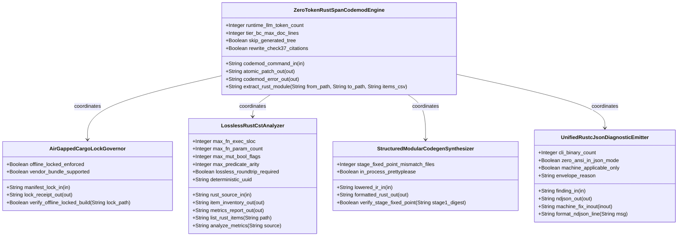
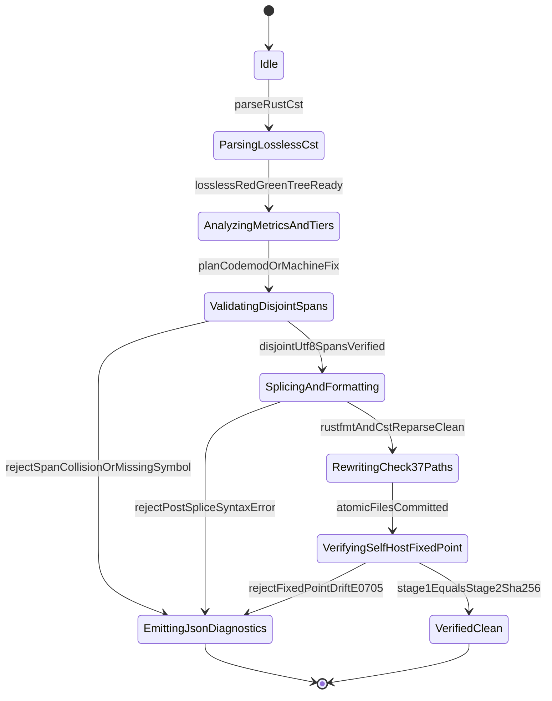

| Attribute | Specification Detail |
| :--- | :--- |
| **Issue ID** | #853 |
| **Title** | Epic 08: BP 08 Lossless Rust CST Codemod Engine and Unified rustc Compatible JSON Diagnostics |
| **Type** | epic |
| **Package** | BP_08_Lossless_Rust_CST_Codemod_Engine_and_Unified_rustc_Compatible_JSON_Diagnostics |
| **Subsystem** | BP 08 Lossless Rust CST Codemod Engine and Unified rustc Compatible JSON Diagnostics |
| **Generation Mode** | subagent |
| **Specification Source** | [schema/model.sysml](../../schema/model.sysml) |

# Epic 08: BP 08 Lossless Rust CST Codemod Engine and Unified rustc Compatible JSON Diagnostics

## 1. Context
Subsystem package for `BP_08_Lossless_Rust_CST_Codemod_Engine_and_Unified_rustc_Compatible_JSON_Diagnostics` (`REQ-0608` / `BP-08` / `DEAP-BP-DET-08`, UUIDv5 `6ba7b810-9dad-11d1-80b4-00c04fd430c8`), governing lossless Rust Concrete Syntax Tree (CST) analysis, zero-LLM-token span-splicing codemods, deterministic Stage-1/Stage-2 metacircular code generation, unified `rustc`-compatible single-line NDJSON diagnostics across all 5 CLI binaries (`compile-sysml`, `verify-baseline`, `ingest-sysml`, `assemble-conops`, `reconcile-backlog`), and air-gapped `--offline --locked` Cargo supply-chain governance under DO-178C Level A, DO-330 TQL-4, ISO 26262 ASIL D, and ECSS-E-ST-40C.

### Contract A: 100% Normative OMG SysML v2.0 + KerML 1.0 Textual Grammar Coverage (Zero 16-Construct Caps)
All model ingestion, CST/AST querying, codemod projection, and diagnostic traceability within `BP-08` enforce full Definition and Usage symmetry across the entire OMG SysML v2.0 and KerML 1.0 textual grammar with zero 16-construct artificial caps:
- **Namespaces & Metadata**: `package`, `library package`, `standard library package`, `import` (`all`, `::*`, `::**`, filter `[...]`), `alias`, `doc`, `comment`, `rep`, `dependency`, `metadata def` / `metadata` / `@Metadata` / `#user_keyword` (modeling `#hazard`, `#risk`, `#capability`, `#rt_loop`, `#dal`, `#fls` via standard OMG SysML v2 `metadata def` keywords while preserving backward-compatible parsing of legacy `hazard def` / `risk def` / `capability def`).
- **Structural & Data Types**: `attribute def`/`attribute`, `enum def`/`enum`, `item def`/`item`, `part def`/`part`, `port def`/`port` (`in`, `out`, `inout`, `~` conjugation), `connection def`/`connection` (`connect ... to ...`), `interface def`/`interface`, `flow def`/`flow` (`of ... from ... to ...`), `allocation def`/`allocation` (`allocate ... to ...`), `occurrence def`/`occurrence` (`individual`, `snapshot`, `timeslice`).
- **Behavioral & State**: `action def`/`action` (`perform`, `accept`, `send`, `assign`, `if`/`else`, `while`/`loop`, `for`, `fork`, `join`, `merge`, `decide`, `first ... then ...` succession), `state def`/`state` (`exhibit`, `parallel`, `entry`, `do`, `exit`, `transition first ... accept ... if ... do ... then ...`).
- **Calculations, Constraints & Requirements**: `calc def`/`calc` (`return`), `constraint def`/`constraint` (`assert`, `assume`, `require`), `requirement def`/`requirement` (`subject`, `actor`, `stakeholder`, `framed concern`, `satisfy ... by ...`), `concern def`/`concern`.
- **Use Cases, Analysis, Verification & Views**: `use case def`/`use case` (`include use case`), `analysis def`/`analysis` (`objective`), `verification def`/`verification` (`verify requirement`), `test case def`/`test case`, `interaction def`/`interaction`, `view def`/`view`, `viewpoint def`/`viewpoint`, `rendering def`/`rendering` (`expose`, `filter`, `render`), `variation`/`variant`.
- **KerML 1.0 Specialization, Multiplicity & Expressions**: `:` (`defined by`), `:>` (`subsets`), `:>>` (`redefines`), `::>` (`references`), `~` (`conjugates`), `ref`, `abstract`, `readonly`, `derived`, `end`, `default`, `:=`, `[lo..hi]`, `[*]`, `{ordered, nonunique}`, full KerML logical/conditional/relational/arithmetic/collection expressions (`implies`, `xor`, `??`, `->`, `collect`, `select`, `forAll`, `exists`), and `ISQ`/`SI`/`ScalarValues` standard libraries.

### Contract B: Official Rust Compiler, Cargo, `rust-analyzer` & Markdown AST Crate Substrate (Net-Negative Deletion of ~19,700+ Lines of Hand-Rolled Scanners)
`BP-08` replaces ~19,700+ lines of brittle hand-rolled line/char/string scanners across the workspace with the official Rust compiler, Cargo, `rust-analyzer`, and CommonMark AST crate stack:
- **Workspace & Air-Gapped Manifest Governance**: `cargo-lock`, `cargo_metadata`, `cargo-util-schemas`, `cargo-platform`, and `toml_edit` enforce offline locked dependency resolution (`--offline --locked`), SHA-256 package checksum verification, and deterministic `Cargo.toml` / `Cargo.lock` AST inspection without hand-rolled TOML or lockfile line scanners.
- **Lossless Rust CST, VFS & Span-Splice Codemod Substrate**: `ra_ap_syntax` (`ast::{MatchExpr, MatchArmList, CallExpr, MethodCallExpr, TryExpr, Fn, HasDocComments, HasAttrs}`), `ra_ap_vfs`, `ra_ap_paths`, `ra_ap_line_index`, `ra_ap_text_edit`, `rowan`, `camino`, and `ignore` provide lossless Red/Green syntax trees, UTF-8 byte/line/column indexing, deterministic `BTreeMap` item inventories, atomic module extraction (`--extract-rust-module`), and 2-line Tier B/C docstring compaction (`--compact-tier-bc`) with zero runtime LLM tokens (`runtime_llm_token_count == 0`).
- **Lossless Markdown AST & Check 37 Citation Rewriting**: `pulldown-cmark` and `pulldown-cmark-to-cmark` rewrite `.rs` to `/mod.rs` citations across `docs/architecture/blueprints/*.md` and `README.md` without regex or string-replace corruption.
- **Deterministic Fixed-Point Codegen Boundary**: `syn`, `proc-macro2`, `quote`, and in-process `prettyplease` synthesize Stage-1/Stage-2 self-hosted modules under `crates/compile-sysml/src/modular_codegen/generated/`, guaranteeing `SHA-256(Stage 1) == SHA-256(Stage 2)` (`stage_fixed_point_mismatch_files == 0`).
- **Explicit Legacy Hand-Rolled Scanner Deletion**: Retires and deletes legacy monolithic scanners including `crates/deap-core/src/rust_cst.rs` (599 lines), `crates/compile-sysml/src/docstring.rs` (549 lines), `crates/verify-baseline/src/checks/docstring_tier_rules.rs` (729 lines), `crates/verify-baseline/src/checks/structural.rs` (980 lines), `crates/deap-core/src/workspace.rs` (356 lines), and `crates/verify-baseline/src/ratchet_table.rs` as part of the workspace-wide net-negative deletion of ~19,700+ lines of hand-rolled scanners.

## 2. Requirements & Checklist
- [ ] #834 - [Feature 36: [BP 08 Lossless Rust CST Codemod Engine and Unified rustc Compatible JSON Diagnostics] AirGappedCargoLockGovernor](../features/FEAT-36-AirGappedCargoLockGovernor.md) (governs air-gapped `--offline --locked` dependency verification and SHA-256 package checksum validation via `cargo-lock`, `cargo_metadata`, `cargo-util-schemas`, `cargo-platform`, and `toml_edit`)
- [ ] #835 - [Feature 37: [BP 08 Lossless Rust CST Codemod Engine and Unified rustc Compatible JSON Diagnostics] LosslessRustCstAnalyzer](../features/FEAT-37-LosslessRustCstAnalyzer.md) (parses lossless Red/Green Rust syntax trees and computes DEAP v2.0 AST metrics and `DocTier` inventories via `ra_ap_syntax`, `ra_ap_vfs`, `ra_ap_paths`, `ra_ap_line_index`, `rowan`, `camino`, and `ignore`)
- [ ] #836 - [Feature 38: [BP 08 Lossless Rust CST Codemod Engine and Unified rustc Compatible JSON Diagnostics] StructuredModularCodegenSynthesizer](../features/FEAT-38-StructuredModularCodegenSynthesizer.md) (synthesizes deterministic Stage-1/Stage-2 Rust modules via `syn`, `proc-macro2`, `quote`, and `prettyplease` with zero SHA-256 fixed-point drift)
- [ ] #837 - [Feature 39: [BP 08 Lossless Rust CST Codemod Engine and Unified rustc Compatible JSON Diagnostics] UnifiedRustcJsonDiagnosticEmitter](../features/FEAT-39-UnifiedRustcJsonDiagnosticEmitter.md) (emits unified single-line `rustc`-compatible NDJSON diagnostics across all 5 CLIs and applies disjoint `MachineApplicable` fixes via `ra_ap_line_index` and `ra_ap_text_edit`)
- [ ] #838 - [Feature 40: [BP 08 Lossless Rust CST Codemod Engine and Unified rustc Compatible JSON Diagnostics] ZeroTokenRustSpanCodemodEngine](../features/FEAT-40-ZeroTokenRustSpanCodemodEngine.md) (executes zero-LLM-token atomic module extraction, Tier B/C docblock compaction, and `pulldown-cmark` / `pulldown-cmark-to-cmark` Check 37 path rewriting via `ra_ap_syntax`, `ra_ap_text_edit`, and `rowan`)

### Associated Use Cases & User Stories

#### Associated Use Cases
- [ ] #767 - [Use Case 38: Lossless Red Green CST Roundtrip and Exact DEAP v2 0 AST Metrics Extraction](../use-cases/UC-38-Lossless_Red_Green_CST_Roundtrip_and_Exact_DEAP_v2_0_AST_Metrics_Extraction.md) (verifies bit-for-bit `ra_ap_syntax` + `rowan` `GreenNode` roundtrip identity and exact DEAP v2.0 AST metric extraction)
- [ ] #768 - [Use Case 39: Deterministic B Tree Map Item Inventory and Atomic Module Extraction with Check 37 Path Rewriting](../use-cases/UC-39-Deterministic_BTreeMap_Item_Inventory_and_Atomic_Module_Extraction_with_Check_37_Path_Rewriting.md) (verifies deterministic `BTreeMap` item inventory, reverse-byte-order `--extract-rust-module` splicing, and `pulldown-cmark` Check 37 path rewriting)
- [ ] #769 - [Use Case 40: Fail Closed Rejection on Span Collisions Missing Symbols or Post Splice Syntax Errors](../use-cases/UC-40-Fail_Closed_Rejection_on_Span_Collisions_Missing_Symbols_or_Post_Splice_Syntax_Errors.md) (enforces fail-closed rejection and single-line NDJSON diagnostics `DEAP-E0801..E0803` on missing symbols, overlapping `TextRange` spans, or post-splice CST syntax errors)
- [ ] #770 - [Use Case 41: Lossless Tier B C Docblock Compaction Skipping Self Hosted Generated Modules](../use-cases/UC-41-Lossless_Tier_B_C_Docblock_Compaction_Skipping_Self_Hosted_Generated_Modules.md) (compacts legacy 28-line docblocks on `DocTier::RustTierBC` items into 2-line contracts while skipping `generated/` self-hosted modules)
- [ ] #771 - [Use Case 42: Structured Codegen Boundary Preserving Stage 1 to Stage 2 Metacircular SHA 256 Fixed Point](../use-cases/UC-42-Structured_Codegen_Boundary_Preserving_Stage_1_to_Stage_2_Metacircular_SHA_256_Fixed_Point.md) (enforces the `syn` + `proc-macro2` + `quote` + `prettyplease` codegen boundary and `SHA-256(Stage 1) == SHA-256(Stage 2)` parity)
- [ ] #772 - [Use Case 43: Unified rustc Compatible Single Line JSON Diagnostics and Machine Applicable Auto Fix Across All Five CLIs](../use-cases/UC-43-Unified_rustc_Compatible_Single_Line_JSON_Diagnostics_and_MachineApplicable_Auto_Fix_Across_All_Five_CLIs.md) (validates single-line `reason: "compiler-message"` NDJSON output across all 5 CLIs and atomic application of disjoint `MachineApplicable` fixes)
- [ ] #773 - [Use Case 44: Air Gapped Offline Cargo Lock Reproducibility and Twelve Gate Blueprint Conformance](../use-cases/UC-44-Air_Gapped_Offline_Cargo_Lock_Reproducibility_and_Twelve_Gate_Blueprint_Conformance.md) (verifies air-gapped `--offline --locked` dependency governance via `cargo-lock` and `cargo_metadata` alongside 12-gate blueprint verification)

#### Associated User Stories
- [ ] #803 - [User Story 53: Verify Offline Locked Build](../user-stories/US-53-verify_offline_locked_build.md) (realizes `verify_offline_locked_build(lock_path)` on `AirGappedCargoLockGovernor` using `cargo-lock`, `cargo_metadata`, `cargo-util-schemas`, `cargo-platform`, and `toml_edit`)
- [ ] #804 - [User Story 54: List Rust Items](../user-stories/US-54-list_rust_items.md) (realizes `list_rust_items(path)` on `LosslessRustCstAnalyzer` using `ra_ap_syntax`, `ra_ap_vfs`, `ra_ap_paths`, `ra_ap_line_index`, `rowan`, `camino`, and `ignore`)
- [ ] #805 - [User Story 55: Extract Rust Module](../user-stories/US-55-extract_rust_module.md) (realizes `extract_rust_module(from_path, to_path, items_csv)` on `ZeroTokenRustSpanCodemodEngine` using `ra_ap_syntax`, `ra_ap_text_edit`, `rowan`, `pulldown-cmark`, and `pulldown-cmark-to-cmark`)
- [ ] #806 - [User Story 56: Verify Stage Fixed Point](../user-stories/US-56-verify_stage_fixed_point.md) (realizes `verify_stage_fixed_point(stage1_digest)` on `StructuredModularCodegenSynthesizer` using `syn`, `proc-macro2`, `quote`, and `prettyplease`)
- [ ] #807 - [User Story 57: Format Ndjson Line](../user-stories/US-57-format_ndjson_line.md) (realizes `format_ndjson_line(msg)` on `UnifiedRustcJsonDiagnosticEmitter` using `ra_ap_line_index`, `ra_ap_text_edit`, and `serde_json`)
- [ ] #808 - [User Story 58: Analyze Metrics](../user-stories/US-58-analyze_metrics.md) (realizes `analyze_metrics(source)` on `LosslessRustCstAnalyzer` enforcing `C_CST_01..C_CST_06` via `ra_ap_syntax` and `rowan`)

## 3. Architecture

### Subsystem Capability Allocations
Formal allocation of SysML v2 `#capability` metadata usages (`metadata def` / `@Metadata` / `#capability` and backward-compatible `capability def` declarations) mapped to `BP_08_Lossless_Rust_CST_Codemod_Engine_and_Unified_rustc_Compatible_JSON_Diagnostics`:

| Capability Name | Subsystem Package | Realizing Classifier(s) | Description / Objective |
| :--- | :--- | :--- | :--- |
| `Cap_AirGappedCargoSupplyChainGovernance` | `BP_08_Lossless_Rust_CST_Codemod_Engine_and_Unified_rustc_Compatible_JSON_Diagnostics` | `AirGappedCargoLockGovernor` | Enforces deterministic air-gapped `--offline --locked` workspace builds and SHA-256 package checksum validation via `cargo-lock`, `cargo_metadata`, `cargo-util-schemas`, `cargo-platform`, and `toml_edit`. |
| `Cap_LosslessRustCstAndAstMetrics` | `BP_08_Lossless_Rust_CST_Codemod_Engine_and_Unified_rustc_Compatible_JSON_Diagnostics` | `LosslessRustCstAnalyzer` | Parses `.rs` files into lossless `ra_ap_syntax` + `rowan` Red/Green syntax trees, classifies `DocTier::RustTierA` / `DocTier::RustTierBC` items, and computes exact DEAP v2.0 AST complexity metrics (`C_CST_01..03`). |
| `Cap_StructuredMetacircularCodegen` | `BP_08_Lossless_Rust_CST_Codemod_Engine_and_Unified_rustc_Compatible_JSON_Diagnostics` | `StructuredModularCodegenSynthesizer` | Lowers full OMG SysML v2.0 + KerML 1.0 AST models into formatted Rust modules via `syn`, `proc-macro2`, `quote`, and `prettyplease` with `SHA-256(Stage 1) == SHA-256(Stage 2)` (`C_CST_04`). |
| `Cap_UnifiedRustcJsonDiagnostics` | `BP_08_Lossless_Rust_CST_Codemod_Engine_and_Unified_rustc_Compatible_JSON_Diagnostics` | `UnifiedRustcJsonDiagnosticEmitter` | Emits single-line `rustc`-compatible NDJSON diagnostics (`reason: "compiler-message"`, `DEAP-E*`) across all 5 CLIs and applies disjoint `"MachineApplicable"` span replacements via `ra_ap_line_index` and `ra_ap_text_edit`. |
| `Cap_ZeroTokenRustSpanCodemod` | `BP_08_Lossless_Rust_CST_Codemod_Engine_and_Unified_rustc_Compatible_JSON_Diagnostics` | `ZeroTokenRustSpanCodemodEngine` | Executes zero-LLM-token (`C_CST_05`) reverse-byte-order `TextRange` module extraction, 2-line Tier B/C docblock compaction (`C_CST_06`), and `pulldown-cmark` / `pulldown-cmark-to-cmark` Check 37 path rewriting. |

### 3-Layer Definition of Done (DoD) & `< 380`-SLOC Submodule Realization
1. **Layer 1 (Domain State & Data Model)**: Encapsulates immutable `rowan::GreenNode` / `ra_ap_syntax::SyntaxNode` syntax trees, `ra_ap_vfs::Vfs` virtual file buffers, `ra_ap_paths::AbsPathBuf` / `camino::Utf8PathBuf` workspace-relative paths, `ra_ap_line_index::LineIndex` UTF-8 byte/line/column tables, `BTreeMap`-ordered `RustItemInventory`, `DeapV2AstMetrics`, `SpanSpliceEdit` transactions (`ra_ap_text_edit::TextEdit`), `RustcJsonEnvelope` (`reason: "compiler-message"`), and `SupplyChainReceipt` (`cargo_lock::Lockfile`, `cargo_metadata::Metadata`).
2. **Layer 2 (Logic & State Management)**: Enforces lifecycle state machine `BP_08_Lossless_Rust_CST_Codemod_Engine_and_Unified_rustc_Compatible_JSON_Diagnostics_LifecycleState` and invariants `C_CST_01` (`1 <= max_fn_exec_sloc <= 50`), `C_CST_02` (`0 <= max_fn_param_count <= 5`), `C_CST_03` (`max_mut_bool_flags == 0`), `C_CST_04` (`stage_fixed_point_mismatch_files == 0`), `C_CST_05` (`runtime_llm_token_count == 0`), `C_CST_06` (`tier_bc_max_doc_lines == 2`), and `Invariant_REQ_0608_SC_01..04`. Decomposes implementation strictly into `< 380`-SLOC focused submodules (`crates/deap-core/src/rust_cst/{mod,vfs,parse,items,extract_module,doc_edit,diagnostics_ndjson}.rs`, `crates/deap-core/src/json_diag/`, `crates/compile-sysml/src/codemod/`, and `crates/compile-sysml/src/modular_codegen/`) while deleting ~19,700+ lines of hand-rolled scanners (`crates/deap-core/src/rust_cst.rs`, `crates/compile-sysml/src/docstring.rs`, `crates/verify-baseline/src/checks/docstring_tier_rules.rs`, `crates/verify-baseline/src/checks/structural.rs`, `crates/deap-core/src/workspace.rs`, and `crates/verify-baseline/src/ratchet_table.rs`).
3. **Layer 3 (Presentation & Actuator Interface Binding)**: Binds typed component ports (`manifest_lock_in`, `lock_receipt_out`, `rust_source_in`, `item_inventory_out`, `metrics_report_out`, `lowered_ir_in`, `formatted_rust_out`, `finding_in`, `ndjson_out`, `machine_fix_inout`, `codemod_command_in`, `atomic_patch_out`, `codemod_error_out`) and structural connector `BP_08_CodemodToDiagnosticEmitterConnection` across all 5 CLI binaries (`compile-sysml`, `verify-baseline`, `ingest-sysml`, `assemble-conops`, `reconcile-backlog`).

Classifiers: `AirGappedCargoLockGovernor` (ports: `in manifest_lock_in : String`, `out lock_receipt_out : String`); `LosslessRustCstAnalyzer` (ports: `in rust_source_in : String`, `out item_inventory_out : String`, `out metrics_report_out : String`); `StructuredModularCodegenSynthesizer` (ports: `in lowered_ir_in : String`, `out formatted_rust_out : String`); `UnifiedRustcJsonDiagnosticEmitter` (ports: `in finding_in : String`, `out ndjson_out : String`, `inout machine_fix_inout : String`); `ZeroTokenRustSpanCodemodEngine` (ports: `in codemod_command_in : String`, `out atomic_patch_out : String`, `out codemod_error_out : String`). Package port definitions: `BP_08_LosslessRustCstPortDef`. Structural connectors: `BP_08_CodemodToDiagnosticEmitterConnection` (`ZeroTokenRustSpanCodemodEngine.ZeroTokenRustSpanCodemodEngine.codemod_error_out -> UnifiedRustcJsonDiagnosticEmitter.UnifiedRustcJsonDiagnosticEmitter.finding_in`).

## 4. Operational Considerations
Lifecycle state machines: `BP_08_Lossless_Rust_CST_Codemod_Engine_and_Unified_rustc_Compatible_JSON_Diagnostics_LifecycleState` (Initial -> Idle; Idle -> ParsingLosslessCst on parseRustCst; ParsingLosslessCst -> AnalyzingMetricsAndTiers on losslessRedGreenTreeReady; AnalyzingMetricsAndTiers -> ValidatingDisjointSpans on planCodemodOrMachineFix; ValidatingDisjointSpans -> EmittingJsonDiagnostics on rejectSpanCollisionOrMissingSymbol; ValidatingDisjointSpans -> SplicingAndFormatting on disjointUtf8SpansVerified; SplicingAndFormatting -> EmittingJsonDiagnostics on rejectPostSpliceSyntaxError; SplicingAndFormatting -> RewritingCheck37Paths on rustfmtAndCstReparseClean; RewritingCheck37Paths -> VerifyingSelfHostFixedPoint on atomicFilesCommitted; VerifyingSelfHostFixedPoint -> EmittingJsonDiagnostics on rejectFixedPointDriftE0705; VerifyingSelfHostFixedPoint -> VerifiedClean on stage1EqualsStage2Sha256; EmittingJsonDiagnostics -> Terminal; VerifiedClean -> Terminal). Operational actions: `verify_offline_locked_build`, `list_rust_items`, `extract_rust_module`, `verify_stage_fixed_point`, `format_ndjson_line`, `analyze_metrics`. Interaction sequences: `BP_08_Lossless_Rust_CST_Codemod_Engine_and_Unified_rustc_Compatible_JSON_Diagnostics_SequenceInteraction`.

## 5. Security & Governance
Allocated requirements: `REQ-0608 (REQ_0608_BP_08_Lossless_Rust_CST_Codemod_Engine_and_Unified_rustc_Compatible_JSON_Diagnostics)`. Enforced invariant constraints: `C_CST_01 (max_fn_exec_sloc >= 1 and max_fn_exec_sloc <= 50)`, `C_CST_02 (max_fn_param_count >= 0 and max_fn_param_count <= 5)`, `C_CST_03 (max_mut_bool_flags >= 0 and max_mut_bool_flags <= 0)`, `C_CST_04 (stage_fixed_point_mismatch_files >= 0 and stage_fixed_point_mismatch_files <= 0)`, `C_CST_05 (runtime_llm_token_count >= 0 and runtime_llm_token_count <= 0)`, `C_CST_06 (tier_bc_max_doc_lines >= 2 and tier_bc_max_doc_lines <= 2)`, `Invariant_REQ_0608_SC_01`, `Invariant_REQ_0608_SC_03`, `Invariant_REQ_0608_SC_02`, `Invariant_REQ_0608_SC_04_REQ_0608`.

## 6. Source References
- System Architecture Model: `schema/model.sysml`
- Normative Systems Engineering Standard: ISO/IEC/IEEE 15288:2023 §6.4.3 Architecture Definition Process

Subsystem architectural composition and formal invariants derive from `schema/model.sysml` pursuant to ISO/IEC/IEEE 15288.

## System-Level UML Class Diagram

## System State Machine Diagram

