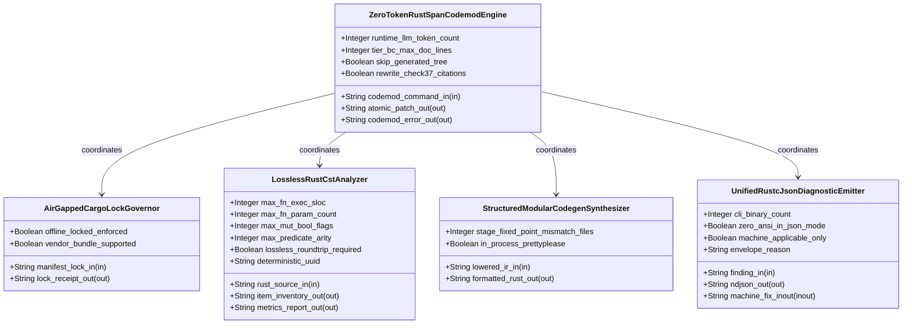
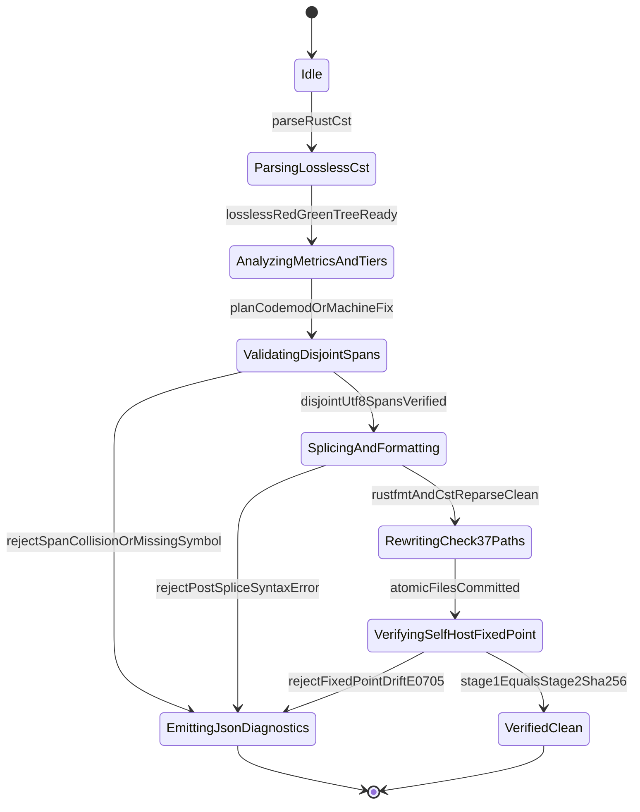

| Attribute | Specification Detail |
| :--- | :--- |
| **Issue ID** | TBD |
| **Title** | Epic 08: BP 08 Lossless Rust CST Codemod Engine and Unified rustc Compatible JSON Diagnostics |
| **Type** | epic |
| **Package** | BP_08_Lossless_Rust_CST_Codemod_Engine_and_Unified_rustc_Compatible_JSON_Diagnostics |
| **Subsystem** | BP 08 Lossless Rust CST Codemod Engine and Unified rustc Compatible JSON Diagnostics |
| **Generation Mode** | subagent |
| **Specification Source** | [schema/model.sysml](../../schema/model.sysml) |

# Epic 08: BP 08 Lossless Rust CST Codemod Engine and Unified rustc Compatible JSON Diagnostics

## 1. Context
Subsystem package for BP_08_Lossless_Rust_CST_Codemod_Engine_and_Unified_rustc_Compatible_JSON_Diagnostics

## 2. Requirements & Checklist
- [ ] TBD - [Feature 41: [BP 08 Lossless Rust CST Codemod Engine and Unified rustc Compatible JSON Diagnostics] AirGappedCargoLockGovernor](../features/FEAT-41-AirGappedCargoLockGovernor.md) (b_p_08_lossless_rust_c_s_t_codemod_engine_and_unified_rustc_compatible_j_s_o_n_diagnostics.sysml)
- [ ] TBD - [Feature 42: [BP 08 Lossless Rust CST Codemod Engine and Unified rustc Compatible JSON Diagnostics] LosslessRustCstAnalyzer](../features/FEAT-42-LosslessRustCstAnalyzer.md) (b_p_08_lossless_rust_c_s_t_codemod_engine_and_unified_rustc_compatible_j_s_o_n_diagnostics.sysml)
- [ ] TBD - [Feature 43: [BP 08 Lossless Rust CST Codemod Engine and Unified rustc Compatible JSON Diagnostics] StructuredModularCodegenSynthesizer](../features/FEAT-43-StructuredModularCodegenSynthesizer.md) (b_p_08_lossless_rust_c_s_t_codemod_engine_and_unified_rustc_compatible_j_s_o_n_diagnostics.sysml)
- [ ] TBD - [Feature 44: [BP 08 Lossless Rust CST Codemod Engine and Unified rustc Compatible JSON Diagnostics] UnifiedRustcJsonDiagnosticEmitter](../features/FEAT-44-UnifiedRustcJsonDiagnosticEmitter.md) (b_p_08_lossless_rust_c_s_t_codemod_engine_and_unified_rustc_compatible_j_s_o_n_diagnostics.sysml)
- [ ] TBD - [Feature 45: [BP 08 Lossless Rust CST Codemod Engine and Unified rustc Compatible JSON Diagnostics] ZeroTokenRustSpanCodemodEngine](../features/FEAT-45-ZeroTokenRustSpanCodemodEngine.md) (b_p_08_lossless_rust_c_s_t_codemod_engine_and_unified_rustc_compatible_j_s_o_n_diagnostics.sysml)

### Associated Use Cases & User Stories

#### Associated Use Cases
- [ ] TBD - [Use Case 38: Lossless Red Green CST Roundtrip and Exact DEAP v2 0 AST Metrics Extraction](../use-cases/UC-38-Lossless_Red_Green_CST_Roundtrip_and_Exact_DEAP_v2_0_AST_Metrics_Extraction.md)
- [ ] TBD - [Use Case 39: Deterministic B Tree Map Item Inventory and Atomic Module Extraction with Check 37 Path Rewriting](../use-cases/UC-39-Deterministic_BTreeMap_Item_Inventory_and_Atomic_Module_Extraction_with_Check_37_Path_Rewriting.md)
- [ ] TBD - [Use Case 40: Fail Closed Rejection on Span Collisions Missing Symbols or Post Splice Syntax Errors](../use-cases/UC-40-Fail_Closed_Rejection_on_Span_Collisions_Missing_Symbols_or_Post_Splice_Syntax_Errors.md)
- [ ] TBD - [Use Case 41: Lossless Tier B C Docblock Compaction Skipping Self Hosted Generated Modules](../use-cases/UC-41-Lossless_Tier_B_C_Docblock_Compaction_Skipping_Self_Hosted_Generated_Modules.md)
- [ ] TBD - [Use Case 42: Structured Codegen Boundary Preserving Stage 1 to Stage 2 Metacircular SHA 256 Fixed Point](../use-cases/UC-42-Structured_Codegen_Boundary_Preserving_Stage_1_to_Stage_2_Metacircular_SHA_256_Fixed_Point.md)
- [ ] TBD - [Use Case 43: Unified rustc Compatible Single Line JSON Diagnostics and Machine Applicable Auto Fix Across All Five CLIs](../use-cases/UC-43-Unified_rustc_Compatible_Single_Line_JSON_Diagnostics_and_MachineApplicable_Auto_Fix_Across_All_Five_CLIs.md)
- [ ] TBD - [Use Case 44: Air Gapped Offline Cargo Lock Reproducibility and Twelve Gate Blueprint Conformance](../use-cases/UC-44-Air_Gapped_Offline_Cargo_Lock_Reproducibility_and_Twelve_Gate_Blueprint_Conformance.md)

#### Associated User Stories
- [ ] TBD - [User Story 51: verify Offline Locked Build](../user-stories/US-51-verifyOfflineLockedBuild.md)
- [ ] TBD - [User Story 52: list Rust Items](../user-stories/US-52-listRustItems.md)
- [ ] TBD - [User Story 53: extract Rust Module](../user-stories/US-53-extractRustModule.md)
- [ ] TBD - [User Story 54: verify Stage Fixed Point](../user-stories/US-54-verifyStageFixedPoint.md)
- [ ] TBD - [User Story 55: format Ndjson Line](../user-stories/US-55-formatNdjsonLine.md)
- [ ] TBD - [User Story 56: analyze Metrics](../user-stories/US-56-analyzeMetrics.md)

## 3. Architecture
Classifiers: `AirGappedCargoLockGovernor` (ports: `in manifest_lock_in : String`, `out lock_receipt_out : String`); `LosslessRustCstAnalyzer` (ports: `in rust_source_in : String`, `out item_inventory_out : String`, `out metrics_report_out : String`); `StructuredModularCodegenSynthesizer` (ports: `in lowered_ir_in : String`, `out formatted_rust_out : String`); `UnifiedRustcJsonDiagnosticEmitter` (ports: `in finding_in : String`, `out ndjson_out : String`, `inout machine_fix_inout : String`); `ZeroTokenRustSpanCodemodEngine` (ports: `in codemod_command_in : String`, `out atomic_patch_out : String`, `out codemod_error_out : String`).

## 4. Operational Considerations
Lifecycle state machines: `BP_08_Lossless_Rust_CST_Codemod_Engine_and_Unified_rustc_Compatible_JSON_Diagnostics_LifecycleState` (Initial -> Idle; Idle -> ParsingLosslessCst on parseRustCst; ParsingLosslessCst -> AnalyzingMetricsAndTiers on losslessRedGreenTreeReady; AnalyzingMetricsAndTiers -> ValidatingDisjointSpans on planCodemodOrMachineFix; ValidatingDisjointSpans -> EmittingJsonDiagnostics on rejectSpanCollisionOrMissingSymbol; ValidatingDisjointSpans -> SplicingAndFormatting on disjointUtf8SpansVerified; SplicingAndFormatting -> EmittingJsonDiagnostics on rejectPostSpliceSyntaxError; SplicingAndFormatting -> RewritingCheck37Paths on rustfmtAndCstReparseClean; RewritingCheck37Paths -> VerifyingSelfHostFixedPoint on atomicFilesCommitted; VerifyingSelfHostFixedPoint -> EmittingJsonDiagnostics on rejectFixedPointDriftE0705; VerifyingSelfHostFixedPoint -> VerifiedClean on stage1EqualsStage2Sha256; EmittingJsonDiagnostics -> Terminal; VerifiedClean -> Terminal). Operational actions: `verifyOfflineLockedBuild`, `listRustItems`, `extractRustModule`, `verifyStageFixedPoint`, `formatNdjsonLine`, `analyzeMetrics`. Interaction sequences: `BP_08_Lossless_Rust_CST_Codemod_Engine_and_Unified_rustc_Compatible_JSON_Diagnostics_SequenceInteraction`.

## 5. Security & Governance
Allocated requirements: `REQ-0608 (REQ_0608_BP_08_Lossless_Rust_CST_Codemod_Engine_and_Unified_rustc_Compatible_JSON_Diagnostics)`. Enforced invariant constraints: `C_CST_01 (max_fn_exec_sloc >= 1 and max_fn_exec_sloc <= 50)`, `C_CST_02 (max_fn_param_count >= 0 and max_fn_param_count <= 5)`, `C_CST_03 (max_mut_bool_flags >= 0 and max_mut_bool_flags <= 0)`, `C_CST_04 (stage_fixed_point_mismatch_files >= 0 and stage_fixed_point_mismatch_files <= 0)`, `C_CST_05 (runtime_llm_token_count >= 0 and runtime_llm_token_count <= 0)`, `C_CST_06 (tier_bc_max_doc_lines >= 2 and tier_bc_max_doc_lines <= 2)`, `Invariant_REQ_0608_SC_01`, `Invariant_REQ_0608_SC_03`, `Invariant_REQ_0608_SC_02`, `Invariant_REQ_0608_SC_04_REQ_0608`.

## 6. Source References
- System Architecture Model: `schema/model.sysml`
- Normative Systems Engineering Standard: ISO/IEC/IEEE 15288:2023 §6.4.3 Architecture Definition Process

Subsystem architectural composition and formal invariants derive from `schema/model.sysml` pursuant to ISO/IEC/IEEE 15288.

## System-Level UML Class Diagram

## System State Machine Diagram

