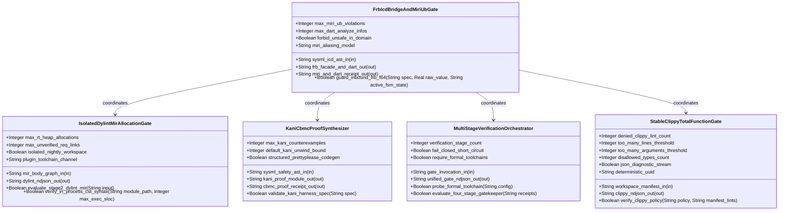
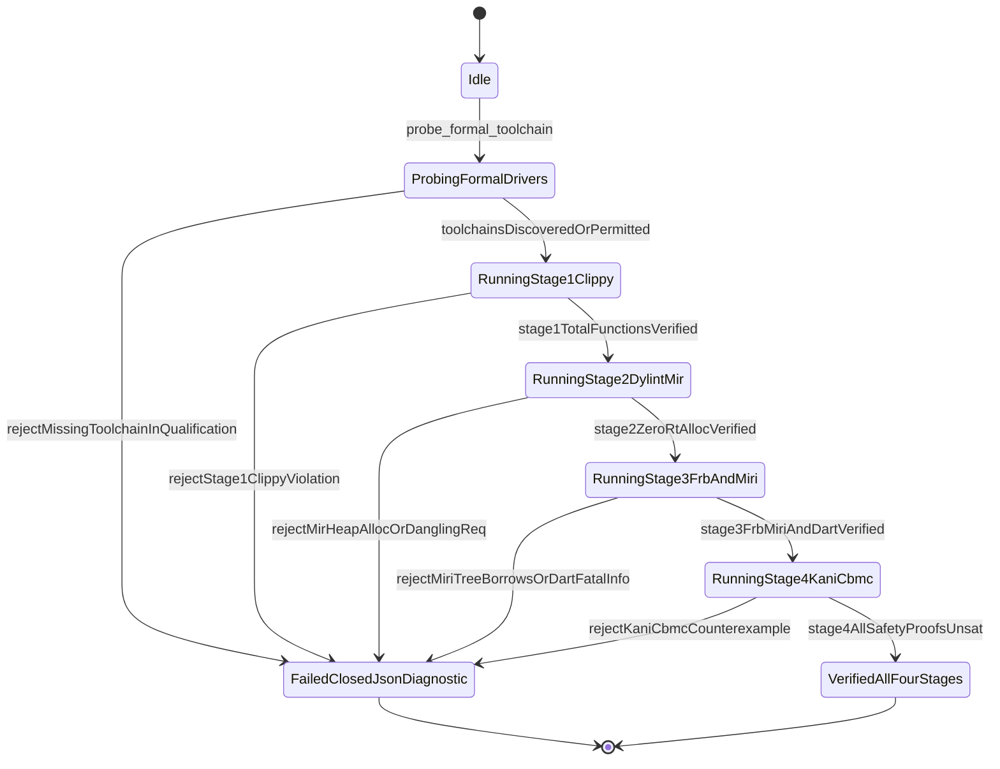

| Attribute | Specification Detail |
| :--- | :--- |
| **Issue ID** | #734 |
| **Title** | Epic 09: BP 09 Multi Stage Compiler and Formal Verification Gatekeeper |
| **Type** | epic |
| **Package** | BP_09_Multi_Stage_Compiler_and_Formal_Verification_Gatekeeper |
| **Subsystem** | BP 09 Multi Stage Compiler and Formal Verification Gatekeeper |
| **Generation Mode** | subagent |
| **Specification Source** | [schema/model.sysml](../../schema/model.sysml) |

# Epic 09: BP 09 Multi Stage Compiler and Formal Verification Gatekeeper

## 1. Context
Subsystem package `BP_09_Multi_Stage_Compiler_and_Formal_Verification_Gatekeeper` (**REQ-0609** / `BP-09` / `DEAP-BP-DET-09`, UUIDv5 `6ba7b810-9dad-11d1-80b4-00c04fd430c9`) specifies the deterministic Cross-Platform 5-Stage Compiler and Formal Verification Gatekeeper governing total-function static analysis, isolated MIR zero-allocation proofs, `flutter_rust_bridge` FFI boundary safety with Miri Tree Borrows abstract-machine verification, Kani CBMC symbolic model-checking proof synthesis, and Ferrocene safety qualification readiness.

### Contract A: 100% Normative OMG SysML v2.0 + KerML 1.0 Textual Grammar Coverage
All verification input ingestion, requirement digest validation, port/state/constraint lowering, and proof synthesis across `BP_09_Multi_Stage_Compiler_and_Formal_Verification_Gatekeeper` enforce full Definition and Usage symmetry across the entire normative OMG SysML v2.0 and KerML 1.0 textual grammar with zero 16-construct artificial caps:
- **Namespaces & Metadata**: `package`, `library package`, `standard library package`, `import` (`all`, `::*`, `::**`, filter `[...]`), `alias`, `doc`, `comment`, `rep`, `dependency`, `metadata def` / `metadata` / `@Metadata` / `#user_keyword` (modeling `#hazard`, `#risk`, `#capability`, `#rt_loop`, `#dal`, `#fls` via standard OMG SysML v2 `metadata def` keywords while preserving backward-compatible parsing of legacy `hazard def` / `risk def` / `capability def`).
- **Structural & Data Types**: `attribute def`/`attribute`, `enum def`/`enum`, `item def`/`item`, `part def`/`part`, `port def`/`port` (`in`, `out`, `inout`, `~` conjugation), `connection def`/`connection` (`connect ... to ...`), `interface def`/`interface`, `flow def`/`flow` (`of ... from ... to ...`), `allocation def`/`allocation` (`allocate ... to ...`), `occurrence def`/`occurrence` (`individual`, `snapshot`, `timeslice`).
- **Behavioral & State**: `action def`/`action` (`perform`, `accept`, `send`, `assign`, `if`/`else`, `while`/`loop`, `for`, `fork`, `join`, `merge`, `decide`, `first ... then ...` succession), `state def`/`state` (`exhibit`, `parallel`, `entry`, `do`, `exit`, `transition first ... accept ... if ... do ... then ...`).
- **Calculations, Constraints & Requirements**: `calc def`/`calc` (`return`), `constraint def`/`constraint` (`assert`, `assume`, `require`), `requirement def`/`requirement` (`subject`, `actor`, `stakeholder`, `framed concern`, `satisfy ... by ...`), `concern def`/`concern`.
- **Use Cases, Analysis, Verification & Views**: `use case def`/`use case` (`include use case`), `analysis def`/`analysis` (`objective`), `verification def`/`verification` (`verify requirement`), `test case def`/`test case`, `interaction def`/`interaction`, `view def`/`view`, `viewpoint def`/`viewpoint`, `rendering def`/`rendering` (`expose`, `filter`, `render`), `variation`/`variant`.
- **KerML 1.0 Specialization, Multiplicity & Expressions**: `:` (`defined by`), `:>` (`subsets`), `:>>` (`redefines`), `::>` (`references`), `~` (`conjugates`), `ref`, `abstract`, `readonly`, `derived`, `end`, `default`, `:=`, `[lo..hi]`, `[*]`, `{ordered, nonunique}`, full KerML logical/conditional/relational/arithmetic/collection expressions (`implies`, `xor`, `??`, `->`, `collect`, `select`, `forAll`, `exists`), and `ISQ`/`SI`/`ScalarValues` standard libraries.

### Contract B: 100% Official Rust Compiler, Cargo, `rust-analyzer` & Formal Verification Stack (Zero Hand-Rolled Scanners)
All verification stages and code synthesis components operate strictly over the official Rust compiler and `rust-analyzer` crate stack with zero hand-rolled string, line, or character-by-character scanners:
- **Stage 1 -- Universal Stable Clippy Total-Function & Manifest Gate (`StableClippyTotalFunctionGate`)**: Parses workspace `Cargo.toml` (`[workspace.lints.clippy]`) and `clippy.toml` (`too-many-lines-threshold = 80`, `too-many-arguments-threshold = 5`, `disallowed-types`) via `cargo_metadata`, `cargo-lock`, `cargo-util-schemas`, `cargo-platform`, and `toml_edit`, and executes `cargo clippy --workspace --all-targets --message-format=json` paired with lossless `ra_ap_syntax` (`SourceFile::parse`, `Edition::Edition2024`) CST verification.
- **Stage 2 -- Isolated Nightly Dylint MIR Zero-Allocation & Requirement Gate (`IsolatedDylintMirAllocationGate`)**: Executes inside an isolated standalone nightly plugin workspace at `./lints/deap-dylint-mir/` (`#![feature(rustc_private)]`, `rustc_lint`, `rustc_middle::mir`) explicitly excluded from the root stable `Cargo.toml` workspace members so stable `cargo check --workspace --offline --locked` never links `rustc_private`. Traverses lowered `rustc_middle::mir::Body` basic-block call and drop terminators over `#rt_loop` / `@RtLoop` control loops (`max_rt_heap_allocations == 0`) and cross-checks `#[realises("REQ-*")]` / `/// Realises: (REQ-*)` `DefId` bindings against compiled SysML `.digest.json` inventories (`max_unverified_req_links == 0`).
- **Stage 3 -- `flutter_rust_bridge` FFI Boundary Guard & Miri Tree Borrows Gate (`FrbIcdBridgeAndMiriUbGate`)**: Synthesizes `#![forbid(unsafe_code)]` pure domain modules, isolated `flutter_rust_bridge` FFI boundary facades with total IEEE 754 `is_finite()`, closed `[min..max]` interval, and `state def` operational mode preconditions (`guard_inbound_frb_f64`), validates Dart bindings via `deap_core::dart_cst` (`logos` + `rowan`) and `dart analyze --fatal-infos`, and executes `cargo +nightly miri test` with `MIRIFLAGS="-Zmiri-tree-borrows"` (`max_miri_ub_violations == 0`).
- **Stage 4 -- Deterministic Kani CBMC Proof Synthesis (`KaniCbmcProofSynthesizer`)**: Lowers SysML v2.0 + KerML 1.0 `constraint def`, `port def`, `state def`, and STPA `UCA-*` / `SC-*` invariants into byte-deterministic `#[cfg(kani)]` `#[kani::proof]` and `#[kani::unwind(N)]` proof modules via `syn` + `proc-macro2` + `quote` + `prettyplease` (zero raw `format!` string-template harness concatenation) and verifies `max_kani_counterexamples == 0` under `cargo kani`.
- **Stage 5 & Cross-Platform Runtime `PATH` Discovery (`MultiStageVerificationOrchestrator`)**: Coordinates Stages 1--4 into Stage 5 Ferrocene qualification (`criticalup.toml` + `[FLS: fls_*]` + `symbol-report`/`blanket` MC/DC + 3-Ring DAL-A..E partitioning) using dynamic runtime `PATH`, `CARGO_HOME`, and `RUSTUP_HOME` discovery (`std::env::consts::{DLL_PREFIX, DLL_SUFFIX, EXE_SUFFIX}`, `camino::Utf8Path`) across macOS, Linux, and Windows with zero hardcoded host paths.

## 2. Requirements & Checklist
- [ ] #747 - [Feature 41: [BP 09 Multi Stage Compiler and Formal Verification Gatekeeper] FrbIcdBridgeAndMiriUbGate](../features/FEAT-41-FrbIcdBridgeAndMiriUbGate.md) (Realizes Stage 3 `flutter_rust_bridge` FFI boundary guard synthesis, `#![forbid(unsafe_code)]` domain isolation, `dart analyze --fatal-infos`, and Miri `-Zmiri-tree-borrows` abstract-machine UB verification)
- [ ] #748 - [Feature 42: [BP 09 Multi Stage Compiler and Formal Verification Gatekeeper] IsolatedDylintMirAllocationGate](../features/FEAT-42-IsolatedDylintMirAllocationGate.md) (Realizes Stage 2 isolated nightly `./lints/deap-dylint-mir/` `rustc_middle::mir::Body` transitive zero-allocation verification on `#rt_loop` functions and `REQ-*` SysML digest binding checks)
- [ ] #749 - [Feature 43: [BP 09 Multi Stage Compiler and Formal Verification Gatekeeper] KaniCbmcProofSynthesizer](../features/FEAT-43-KaniCbmcProofSynthesizer.md) (Realizes Stage 4 deterministic `#[cfg(kani)]` `#[kani::proof]` and `#[kani::unwind(N)]` harness synthesis via `syn` + `proc-macro2` + `quote` + `prettyplease` and CBMC `UNSAT` proof verification)
- [ ] #750 - [Feature 44: [BP 09 Multi Stage Compiler and Formal Verification Gatekeeper] MultiStageVerificationOrchestrator](../features/FEAT-44-MultiStageVerificationOrchestrator.md) (Realizes cross-platform runtime `PATH` driver discovery, fail-closed 5-stage orchestration short-circuiting, and unified single-line NDJSON diagnostic emission)
- [ ] #751 - [Feature 45: [BP 09 Multi Stage Compiler and Formal Verification Gatekeeper] StableClippyTotalFunctionGate](../features/FEAT-45-StableClippyTotalFunctionGate.md) (Realizes Stage 1 `Cargo.toml` and `clippy.toml` policy validation via `cargo_metadata` and `toml_edit` and universal stable `cargo clippy --workspace --all-targets --message-format=json` total-function enforcement)

### Associated Use Cases & User Stories

#### Associated Use Cases
- [ ] #773 - [Use Case 45: Stage 1 Universal Stable Clippy Total Function and clippy toml Threshold Enforcement](../use-cases/UC-45-Stage_1_Universal_Stable_Clippy_Total_Function_and_clippy_toml_Threshold_Enforcement.md) (Verifies Stage 1 total-function, arithmetic, cast, unsafe-doc, and `clippy.toml` complexity/disallowed-type enforcement with fail-closed `DEAP-E0900` diagnostics)
- [ ] #774 - [Use Case 46: Stage 2 Isolated Nightly Dylint MIR Zero Allocation Proof on Real Time Control Loops](../use-cases/UC-46-Stage_2_Isolated_Nightly_Dylint_MIR_Zero_Allocation_Proof_on_Real_Time_Control_Loops.md) (Verifies Stage 2 excluded `./lints/deap-dylint-mir/` transitive `rustc_middle::mir::Body` zero-allocation proofs over `#rt_loop` call graphs with fail-closed `DEAP-E0901` diagnostics)
- [ ] #775 - [Use Case 47: Stage 2 Compile Time MIR Requirement Binding Verification Against Active SysML Digests](../use-cases/UC-47-Stage_2_Compile_Time_MIR_Requirement_Binding_Verification_Against_Active_SysML_Digests.md) (Verifies Stage 2 compile-time HIR/MIR `DefId` `REQ-*` traceability against compiled SysML `.digest.json` inventories with fail-closed `DEAP-E0902` diagnostics)
- [ ] #776 - [Use Case 48: Stage 3 Deterministic flutter_rust_bridge FFI Synthesis with Fail Closed ICD Boundary Guards](../use-cases/UC-48-Stage_3_Deterministic_flutter_rust_bridge_FFI_Synthesis_with_Fail_Closed_ICD_Boundary_Guards.md) (Verifies Stage 3 `#![forbid(unsafe_code)]` domain synthesis, `flutter_rust_bridge` inbound `f64`/state guards, and `dart analyze --fatal-infos` with fail-closed `DEAP-E0903` diagnostics)
- [ ] #777 - [Use Case 49: Stage 3 Miri Tree Borrows Abstract Machine Undefined Behavior Rejection on FFI and Ring Buffer Bridges](../use-cases/UC-49-Stage_3_Miri_Tree_Borrows_Abstract_Machine_Undefined_Behavior_Rejection_on_FFI_and_Ring_Buffer_Bridges.md) (Verifies Stage 3 `cargo +nightly miri test` under `-Zmiri-tree-borrows` across FFI marshaling and lock-free SPSC ring-buffer bridges with fail-closed `DEAP-E0903` diagnostics)
- [ ] #778 - [Use Case 50: Stage 4 Deterministic Kani CBMC Proof Synthesis and STPA Unsafe Control Action Falsification](../use-cases/UC-50-Stage_4_Deterministic_Kani_CBMC_Proof_Synthesis_and_STPA_Unsafe_Control_Action_Falsification.md) (Verifies Stage 4 `syn` + `proc-macro2` + `quote` + `prettyplease` `#[kani::proof]` synthesis and CBMC STPA `UCA-*` falsification checks with fail-closed `DEAP-E0904` diagnostics)
- [ ] #779 - [Use Case 51: Cross Platform Toolchain Discovery Modular Submodule Layout and Fail Closed Qualification Gate](../use-cases/UC-51-Cross_Platform_Toolchain_Discovery_Modular_Submodule_Layout_and_Fail_Closed_Qualification_Gate.md) (Verifies cross-platform runtime `PATH` driver discovery, `< 380`-SLOC submodule modularity via `ra_ap_syntax`, and `--require-formal-toolchains` fail-closed `DEAP-E0905` qualification)

#### Associated User Stories
- [ ] #808 - [User Story 59: probe formal toolchain](../user-stories/US-59-probe_formal_toolchain.md) (Probes cross-platform formal verification toolchains dynamically via runtime `PATH` and `std::env::consts` without hardcoded host paths)
- [ ] #809 - [User Story 60: verify clippy policy](../user-stories/US-60-verify_clippy_policy.md) (Validates workspace `Cargo.toml` and `clippy.toml` total-function and threshold policies via `cargo_metadata` and `toml_edit`)
- [ ] #810 - [User Story 61: evaluate stage2 dylint mir](../user-stories/US-61-evaluate_stage2_dylint_mir.md) (Evaluates Stage 2 excluded `./lints/deap-dylint-mir/` MIR basic-block zero-allocation and `REQ-*` digest bindings)
- [ ] #811 - [User Story 62: verify in process cst syntax](../user-stories/US-62-verify_in_process_cst_syntax.md) (Enforces lossless `ra_ap_syntax` CST parse integrity and `< 380` executable SLOC submodule ceilings with zero hand-rolled scanners)
- [ ] #812 - [User Story 63: guard inbound frb f64](../user-stories/US-63-guard_inbound_frb_f64.md) (Enforces Stage 3 `flutter_rust_bridge` inbound IEEE 754 finiteness, closed `[min..max]` range, and FSM state precondition guards)
- [ ] #813 - [User Story 64: validate kani harness spec](../user-stories/US-64-validate_kani_harness_spec.md) (Validates and synthesizes Stage 4 `#[kani::proof]` and `#[kani::unwind(N)]` harnesses via `syn` + `proc-macro2` + `quote` + `prettyplease`)
- [ ] #814 - [User Story 65: evaluate four stage gatekeeper](../user-stories/US-65-evaluate_four_stage_gatekeeper.md) (Orchestrates end-to-end multi-stage formal verification receipts with fail-closed short-circuiting and Stage 5 Ferrocene readiness)

## 3. Architecture

### Subsystem Capability Allocations
Formal allocation of SysML v2 `#capability` metadata usages (`metadata def` / `@Metadata` / `#capability` and backward-compatible `capability def` declarations) mapped to `BP_09_Multi_Stage_Compiler_and_Formal_Verification_Gatekeeper`:

| Capability Name | Subsystem Package | Description / Objective |
| :--- | :--- | :--- |
| `Cap_BP09_Stage1StableClippyGate` | `BP_09_Multi_Stage_Compiler_and_Formal_Verification_Gatekeeper` | Enforces 14 total-function Clippy lints and `clippy.toml` cognitive/structural thresholds (`C_VER_01`, `C_VER_02`) via `cargo_metadata` + `toml_edit` |
| `Cap_BP09_Stage2IsolatedDylintMirGate` | `BP_09_Multi_Stage_Compiler_and_Formal_Verification_Gatekeeper` | Proves zero heap allocations (`C_VER_03`) in `#rt_loop` control loops and 100% `REQ-*` SysML digest resolution inside excluded `./lints/deap-dylint-mir/` |
| `Cap_BP09_Stage3FrbAndMiriTreeBorrowsGate` | `BP_09_Multi_Stage_Compiler_and_Formal_Verification_Gatekeeper` | Synthesizes `#![forbid(unsafe_code)]` domain crates and `flutter_rust_bridge` ICD guards and proves zero UB (`C_VER_04`) under Miri `-Zmiri-tree-borrows` |
| `Cap_BP09_Stage4KaniCbmcProofSynthesis` | `BP_09_Multi_Stage_Compiler_and_Formal_Verification_Gatekeeper` | Synthesizes byte-deterministic `#[kani::proof]` harnesses (`C_VER_05`, `C_VER_06`) via `syn` + `proc-macro2` + `quote` + `prettyplease` |
| `Cap_BP09_CrossPlatformOrchestration` | `BP_09_Multi_Stage_Compiler_and_Formal_Verification_Gatekeeper` | Discovers formal drivers dynamically via runtime `PATH` (`C_VER_08`) and enforces `< 380`-SLOC submodules (`C_VER_07`) via `ra_ap_syntax` |

### Architectural Realization (3-Layer Definition of Done)
- **Layer 1 (Domain State & Data Model)**: Encapsulates typed verification policy, stage receipts, and AST/MIR/CBMC state models across `StableClippyTotalFunctionGate`, `IsolatedDylintMirAllocationGate`, `FrbIcdBridgeAndMiriUbGate`, `KaniCbmcProofSynthesizer`, and `MultiStageVerificationOrchestrator` with full Contract A OMG SysML v2.0 + KerML 1.0 Definition and Usage symmetry.
- **Layer 2 (Logic & State Management)**: Enforces deterministic state transitions (`BP_09_Multi_Stage_Compiler_and_Formal_Verification_Gatekeeper_LifecycleState`) and invariants `C_VER_01`..`C_VER_08` and `Invariant_REQ_0609_SC_01`..`Invariant_REQ_0609_SC_05` inside `< 380`-SLOC submodules (`./crates/verify-baseline/src/formal_gates/`, `./crates/compile-sysml/src/kani_synth/`, `./crates/compile-sysml/src/frb_guard/`, and excluded `./lints/deap-dylint-mir/`) while explicitly deleting legacy hand-rolled string/line/char-by-char scanners and raw string-template harness emitters.
- **Layer 3 (Presentation & Actuator Interface Binding)**: Binds typed ingress/egress ports (`workspace_manifest_in`, `clippy_ndjson_out`, `mir_body_graph_in`, `dylint_ndjson_out`, `sysml_icd_ast_in`, `frb_facade_and_dart_out`, `miri_and_dart_receipt_out`, `sysml_safety_ast_in`, `kani_proof_module_out`, `cbmc_proof_receipt_out`, `gate_invocation_in`, `unified_gate_ndjson_out`) and connector `BP_09_ClippyToOrchestratorConnection` to single-line NDJSON diagnostic streams (`DEAP-E0900`..`DEAP-E0905`).

Classifiers: `FrbIcdBridgeAndMiriUbGate` (ports: `in sysml_icd_ast_in : String`, `out frb_facade_and_dart_out : String`, `out miri_and_dart_receipt_out : String`); `IsolatedDylintMirAllocationGate` (ports: `in mir_body_graph_in : String`, `out dylint_ndjson_out : String`); `KaniCbmcProofSynthesizer` (ports: `in sysml_safety_ast_in : String`, `out kani_proof_module_out : String`, `out cbmc_proof_receipt_out : String`); `MultiStageVerificationOrchestrator` (ports: `in gate_invocation_in : String`, `out unified_gate_ndjson_out : String`); `StableClippyTotalFunctionGate` (ports: `in workspace_manifest_in : String`, `out clippy_ndjson_out : String`). Package port definitions: `BP_09_FormalVerificationPortDef`. Structural connectors: `BP_09_ClippyToOrchestratorConnection` (`StableClippyTotalFunctionGate.StableClippyTotalFunctionGate.clippy_ndjson_out -> MultiStageVerificationOrchestrator.MultiStageVerificationOrchestrator.gate_invocation_in`).

## 4. Operational Considerations
Lifecycle state machines: `BP_09_Multi_Stage_Compiler_and_Formal_Verification_Gatekeeper_LifecycleState` (`Initial -> Idle`; `Idle -> ProbingFormalDrivers` on `probe_formal_toolchain`; `ProbingFormalDrivers -> RunningStage1Clippy` on `toolchainsDiscoveredOrPermitted`; `ProbingFormalDrivers -> FailedClosedJsonDiagnostic` on `rejectMissingToolchainInQualification`; `RunningStage1Clippy -> FailedClosedJsonDiagnostic` on `rejectStage1ClippyViolation`; `RunningStage1Clippy -> RunningStage2DylintMir` on `stage1TotalFunctionsVerified`; `RunningStage2DylintMir -> FailedClosedJsonDiagnostic` on `rejectMirHeapAllocOrDanglingReq`; `RunningStage2DylintMir -> RunningStage3FrbAndMiri` on `stage2ZeroRtAllocVerified`; `RunningStage3FrbAndMiri -> FailedClosedJsonDiagnostic` on `rejectMiriTreeBorrowsOrDartFatalInfo`; `RunningStage3FrbAndMiri -> RunningStage4KaniCbmc` on `stage3FrbMiriAndDartVerified`; `RunningStage4KaniCbmc -> FailedClosedJsonDiagnostic` on `rejectKaniCbmcCounterexample`; `RunningStage4KaniCbmc -> VerifiedAllFourStages` on `stage4AllSafetyProofsUnsat`; `FailedClosedJsonDiagnostic -> Terminal`; `VerifiedAllFourStages -> Terminal`). Operational actions: `probe_formal_toolchain`, `verify_clippy_policy`, `evaluate_stage2_dylint_mir`, `verify_in_process_cst_syntax`, `guard_inbound_frb_f64`, `validate_kani_harness_spec`, `evaluate_four_stage_gatekeeper`. Interaction sequences: `BP_09_Multi_Stage_Compiler_and_Formal_Verification_Gatekeeper_SequenceInteraction`.

## 5. Security & Governance
Allocated requirements: `REQ-0609 (REQ_0609_BP_09_Multi_Stage_Compiler_and_Formal_Verification_Gatekeeper)`. Enforced invariant constraints: `C_VER_01 (too_many_lines_threshold >= 1 and too_many_lines_threshold <= 80)`, `C_VER_02 (too_many_arguments_threshold >= 0 and too_many_arguments_threshold <= 5)`, `C_VER_03 (max_rt_heap_allocations >= 0 and max_rt_heap_allocations <= 0)`, `C_VER_04 (max_miri_ub_violations >= 0 and max_miri_ub_violations <= 0)`, `C_VER_05 (max_kani_counterexamples >= 0 and max_kani_counterexamples <= 0)`, `C_VER_06 (default_kani_unwind_bound >= 1 and default_kani_unwind_bound <= 64)`, `C_VER_07 (max_module_exec_sloc >= 1 and max_module_exec_sloc <= 380)`, `C_VER_08 (min_toolchain_discovery_probes >= 1 and min_toolchain_discovery_probes <= 3)`, `Invariant_REQ_0609_SC_01`, `Invariant_REQ_0609_SC_02`, `Invariant_REQ_0609_SC_03`, `Invariant_REQ_0609_SC_04`, `Invariant_REQ_0609_SC_05`.

## 6. Source References
- System Architecture Model: `schema/model.sysml`
- Engineering Design Blueprint: `./docs/designs/blueprint-09-clippy-dylint-miri-kani-formal-verification-gate.md`
- Normative Systems Engineering Standard: ISO/IEC/IEEE 15288:2023 §6.4.3 Architecture Definition Process

Subsystem architectural composition and formal invariants derive from `schema/model.sysml` pursuant to ISO/IEC/IEEE 15288.

## System-Level UML Class Diagram

## System State Machine Diagram

