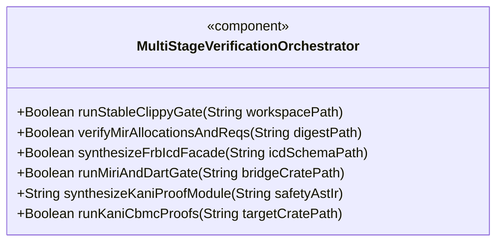
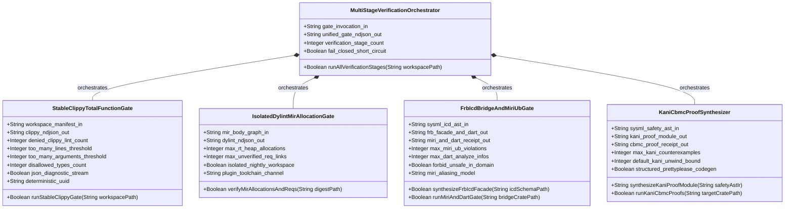
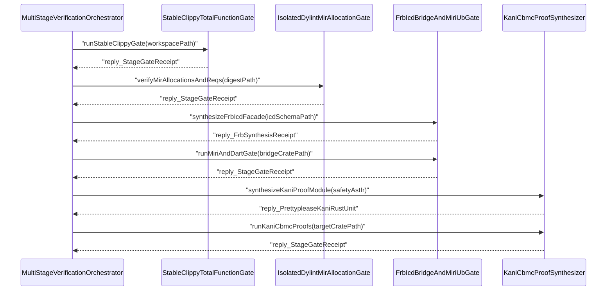

| Attribute | Specification Detail |
| :--- | :--- |
| **Issue ID** | TBD |
| **Title** | Epic 09: BP 09 Multi Stage Compiler and Formal Verification Gatekeeper |
| **Type** | epic |
| **Package** | BP_09_Multi_Stage_Compiler_and_Formal_Verification_Gatekeeper |
| **Subsystem** | BP 09 Multi Stage Compiler and Formal Verification Gatekeeper |
| **Generation Mode** | subagent |
| **Specification Source** | [schema/model.sysml](../../schema/model.sysml) |

# Epic 09: BP 09 Multi Stage Compiler and Formal Verification Gatekeeper

## 1. Context

`BP_09_Multi_Stage_Compiler_and_Formal_Verification_Gatekeeper` (**REQ-0609** / `BP-09` / `DEAP-BP-DET-09`, deterministic UUIDv5 `6ba7b810-9dad-11d1-80b4-00c04fd430c9`, `Class P` static HIR/THIR/MIR linear pass complexity paired with bounded CBMC state-space unwinding) defines the compiler-native formal verification and FFI boundary-guard subsystem across Tier-0 compiler crates (`crates/deap-core/src/lib.rs`, `crates/compile-sysml/src/modular_codegen/mod.rs`, `crates/verify-baseline/src/audit_code.rs`) and schema-lowered Rust compilation targets. Rather than relying on heuristic text scanning to detect partial functions, hidden real-time heap allocations, cross-language pointer-aliasing hazards, or reachable arithmetic and state-machine faults, `BP-09` couples SysML v2 AST lowering (`crates/deap-core/src/sysml_ast/mod.rs`) to four progressive compiler verification gates emitting single-line `--message-format=json` NDJSON diagnostics (`DEAP-E0900`..`DEAP-E0905`).

### Phased Delivery Scoping: Track-1 Immediate Gate vs. Wave-2 Deferred Stages

Execution of **Epic 09** is partitioned into an immediate **Track-1** baseline hardening deliverable on stable Rust and a **Wave-2** formal verification and FFI synthesis expansion:

1. **Track-1 Immediate Deliverable -- Stage-1 Universal Stable Clippy Total-Function Gate (`FEAT-50` `StableClippyTotalFunctionGate`)**:
   - **14-Lint `[workspace.lints.clippy]` Denial Table**: Enforces `denied_clippy_lint_count = 14` mandatory `deny` (or `forbid`) lint entries in root `Cargo.toml` (`unwrap_used`, `expect_used`, `panic`, `todo`, `unimplemented`, `unreachable`, `indexing_slicing`, `arithmetic_side_effects`, `cast_possible_truncation`, `cast_sign_loss`, `undocumented_unsafe_blocks`, `too_many_lines`, `too_many_arguments`, and `fn_params_excessive_bools`), paired with `[workspace.lints.rust]` `unsafe_code = "forbid"` (`#![forbid(unsafe_code)]`) across pure compiler and domain crates, mandatory `lints.workspace = true` inheritance in every workspace member manifest, and zero unauthorized `#![allow(...)]` or item-level `allow(...)` lint-suppression attributes.
   - **Root `clippy.toml` Structural & Determinism Thresholds**: Enforces `too-many-lines-threshold = 80` (**C_VER_01**: `1 <= too_many_lines_threshold <= 80` executable HIR lines per function), `too-many-arguments-threshold = 5` (**C_VER_02**: `0 <= too_many_arguments_threshold <= 5` callable parameters, alongside `<= 3` boolean parameters under `fn_params_excessive_bools`), and `disallowed-types` (`disallowed_types_count >= 3`) banning randomized-seed hash containers (`std::collections::HashMap`, `std::collections::HashSet`) and backtracking NFA pattern-matching engine types in favor of deterministic `std::collections::BTreeMap`, `std::collections::BTreeSet`, and linear structural token parsers.
   - **`Cargo.lock` `--offline --locked` Supply-Chain Immutability & NDJSON Streaming**: Executes `cargo clippy --workspace --all-targets --offline --locked --message-format=json` over tracked, byte-immutable `Cargo.lock` manifests, binds incremental target-cache fingerprints to the combined SHA-256 digest of `Cargo.toml`, `Cargo.lock`, and `clippy.toml`, and streams span-filtered single-line `RustcCompilerMessageNdjson` (`DEAP-E0900`) diagnostics on `clippy_ndjson_out`.
2. **Wave-2 Explicitly Deferred Deliverables -- Stages 2-4 & Full Multi-Stage Orchestration (`FEAT-47`, `FEAT-46`, `FEAT-48`, `FEAT-49`)**:
   - **Stage 2 (`FEAT-47` `IsolatedDylintMirAllocationGate` -- Deferred to Wave-2)**: Standalone `nightly-pinned` `rustc_lint` and `rustc_middle::mir::Body` Dylint plugin workspace isolated from root stable `Cargo.toml` (`isolated_nightly_workspace = true`), proving `max_rt_heap_allocations = 0` (**C_VER_03**, `DEAP-E0901`) across transitive `TerminatorKind::Call` and `TerminatorKind::Drop` edges reachable from `rt_loop`-annotated entrypoints and verifying `realises("REQ-*")` `DefId` bindings (`max_unverified_req_links = 0`, `DEAP-E0902`) against compiled `.digest.json` inventories.
   - **Stage 3 (`FEAT-46` `FrbIcdBridgeAndMiriUbGate` -- Deferred to Wave-2)**: Cross-language FRB FFI boundary facade and strongly-typed HMI binding synthesis from `ICD_01` and `ICD_02` `port def` and `item flow` contracts, preserving `#![forbid(unsafe_code)]` (`forbid_unsafe_in_domain = true`) across pure domain crates, wrapping inbound HMI calls in fail-closed `[min..max]`, IEEE-754 finiteness, and `state def` operational-mode guards (`DEAP-E0903`), and gating isolated `// SAFETY:` bridge modules under `cargo +nightly miri test` with `MIRIFLAGS="-Zmiri-tree-borrows"` (`max_miri_ub_violations = 0`, **C_VER_04**) plus static HMI binding analysis (`max_dart_analyze_infos = 0`).
   - **Stage 4 (`FEAT-48` `KaniCbmcProofSynthesizer` -- Deferred to Wave-2)**: Byte-deterministic `cfg(kani)` CBMC bounded model-checking harness synthesis via `syn`, `quote`, and `prettyplease` (`structured_prettyplease_codegen = true`), lowering SysML `constraint def`, `port def` `[min..max]` intervals, `state def` transition tables, and STPA unsafe control action negations into `kani::proof` and `kani::unwind(N)` (`default_kani_unwind_bound = 16` within **C_VER_06** `1..=64`) harnesses proving `max_kani_counterexamples = 0` (**C_VER_05**, `DEAP-E0904`).
   - **Full 4-Stage Pipeline Coordinator (`FEAT-49` `MultiStageVerificationOrchestrator` -- Deferred to Wave-2)**: Sequential 4-stage lifecycle orchestration (`verification_stage_count = 4`, `fail_closed_short_circuit = true`, `DEAP-E0905`) uniting Track-1 Stage 1 with Wave-2 Stages 2-4 behind short-circuit failure halting and consolidated `unified_gate_ndjson_out` receipts.

## 2. Requirements & Checklist
- [ ] #742 - [Feature 50: BP-09 StableClippyTotalFunctionGate](../features/FEAT-50-StableClippyTotalFunctionGate.md) (Track-1 immediate Stage-1 deliverable enforcing the 14-lint `[workspace.lints.clippy]` `deny` table, `clippy.toml` `80`-SLOC/`5`-arg/`disallowed-types` thresholds, `Cargo.lock` `--offline --locked` supply-chain rules, and `DEAP-E0900` NDJSON streaming)
- [ ] #742 - [Feature 47: BP-09 IsolatedDylintMirAllocationGate](../features/FEAT-47-IsolatedDylintMirAllocationGate.md) (Wave-2 deferred Stage-2 isolated nightly Dylint MIR call-graph verifier proving zero transitive heap allocations on `rt_loop` paths and validating `realises("REQ-*")` `DefId` links against `.digest.json` via `DEAP-E0901` and `DEAP-E0902`)
- [ ] #742 - [Feature 46: BP-09 FrbIcdBridgeAndMiriUbGate](../features/FEAT-46-FrbIcdBridgeAndMiriUbGate.md) (Wave-2 deferred Stage-3 FRB FFI boundary facade synthesizer enforcing `#![forbid(unsafe_code)]` domain isolation, fail-closed `ICD_01`/`ICD_02` interval/finiteness/FSM guards, and Miri `-Zmiri-tree-borrows` UB rejection via `DEAP-E0903`)
- [ ] #742 - [Feature 48: BP-09 KaniCbmcProofSynthesizer](../features/FEAT-48-KaniCbmcProofSynthesizer.md) (Wave-2 deferred Stage-4 deterministic `cfg(kani)` CBMC bounded model-checking proof synthesizer lowering SysML constraints, port intervals, state transitions, and STPA invariants via `syn`, `quote`, and `prettyplease` with `DEAP-E0904` receipts)
- [ ] #742 - [Feature 49: BP-09 MultiStageVerificationOrchestrator](../features/FEAT-49-MultiStageVerificationOrchestrator.md) (Wave-2 deferred full 4-stage fail-closed verification orchestrator coordinating Stages 1-4 with short-circuit halting and unified `RustcCompilerMessageNdjson` reporting via `DEAP-E0905`)

### Child Feature Realization & Wave-Scoping Matrix (`FEAT-46..50`)

| Feature ID | SysML AST `part def` | Verification Stage | Delivery Scope | Enforced Constraints & Invariants | Bound Actions & Ports | Diagnostics & Failure Modes |
| :--- | :--- | :--- | :--- | :--- | :--- | :--- |
| [FEAT-50](../features/FEAT-50-StableClippyTotalFunctionGate.md) | `StableClippyTotalFunctionGate` | Stage 1: Stable HIR/THIR Total-Function Gate | **Track-1 (Immediate)** | `C_VER_01` (`1..=80` lines), `C_VER_02` (`0..=5` args), `denied_clippy_lint_count = 14`, `disallowed_types_count >= 3`, `Cargo.lock` `--offline --locked`, `Invariant_REQ_0609_SC_01` | `runStableClippyGate`; `in workspace_manifest_in`, `out clippy_ndjson_out` | `DEAP-E0900`; `FM-BP09-017`..`FM-BP09-020` |
| [FEAT-47](../features/FEAT-47-IsolatedDylintMirAllocationGate.md) | `IsolatedDylintMirAllocationGate` | Stage 2: Isolated Nightly Dylint MIR Gate | **Wave-2 (Deferred)** | `C_VER_03` (`max_rt_heap_allocations = 0`), `max_unverified_req_links = 0`, `isolated_nightly_workspace = true`, `Invariant_REQ_0609_SC_02` | `verifyMirAllocationsAndReqs`; `in mir_body_graph_in`, `out dylint_ndjson_out` | `DEAP-E0901`, `DEAP-E0902`; `FM-BP09-005`..`FM-BP09-008` |
| [FEAT-46](../features/FEAT-46-FrbIcdBridgeAndMiriUbGate.md) | `FrbIcdBridgeAndMiriUbGate` | Stage 3: FRB FFI Synthesis & Miri UB Gate | **Wave-2 (Deferred)** | `C_VER_04` (`max_miri_ub_violations = 0`), `max_dart_analyze_infos = 0`, `forbid_unsafe_in_domain = true`, `-Zmiri-tree-borrows`, `Invariant_REQ_0609_SC_03` | `synthesizeFrbIcdFacade`, `runMiriAndDartGate`; `in sysml_icd_ast_in`, `out frb_facade_and_dart_out`, `out miri_and_dart_receipt_out` | `DEAP-E0903`; `FM-BP09-001`..`FM-BP09-004` |
| [FEAT-48](../features/FEAT-48-KaniCbmcProofSynthesizer.md) | `KaniCbmcProofSynthesizer` | Stage 4: Kani CBMC Model-Checking Gate | **Wave-2 (Deferred)** | `C_VER_05` (`max_kani_counterexamples = 0`), `C_VER_06` (`1..=64` unwind, default `16`), `structured_prettyplease_codegen = true`, `Invariant_REQ_0609_SC_04` | `synthesizeKaniProofModule`, `runKaniCbmcProofs`; `in sysml_safety_ast_in`, `out kani_proof_module_out`, `out cbmc_proof_receipt_out` | `DEAP-E0904`; `FM-BP09-009`..`FM-BP09-012` |
| [FEAT-49](../features/FEAT-49-MultiStageVerificationOrchestrator.md) | `MultiStageVerificationOrchestrator` | Stages 1-4: Fail-Closed Pipeline Coordinator | **Wave-2 (Deferred)** | `verification_stage_count = 4`, `fail_closed_short_circuit = true`, `Cargo.lock` `--offline --locked` preservation across all stages | `runAllVerificationStages`; `in gate_invocation_in`, `out unified_gate_ndjson_out` | `DEAP-E0900`..`DEAP-E0905`; `FM-BP09-013`..`FM-BP09-016` |

### Associated Use Cases & User Stories

#### Associated Use Cases
- [ ] TBD - [Use Case 45: Stage 1 Universal Stable Clippy Total Function and clippy toml Threshold Enforcement](../use-cases/UC-45-Stage_1_Universal_Stable_Clippy_Total_Function_and_clippy_toml_Threshold_Enforcement.md) (Track-1 Stage-1 total-function lint and `clippy.toml` structural threshold verification scenario for `FEAT-50`)
- [ ] TBD - [Use Case 46: Stage 2 Isolated Nightly Dylint MIR Zero Allocation Proof on Real Time Control Loops](../use-cases/UC-46-Stage_2_Isolated_Nightly_Dylint_MIR_Zero_Allocation_Proof_on_Real_Time_Control_Loops.md) (Wave-2 Stage-2 transitive MIR call-graph zero-allocation proof scenario on `rt_loop` functions for `FEAT-47`)
- [ ] TBD - [Use Case 47: Stage 2 Compile Time MIR Requirement Binding Verification Against Active SysML Digests](../use-cases/UC-47-Stage_2_Compile_Time_MIR_Requirement_Binding_Verification_Against_Active_SysML_Digests.md) (Wave-2 Stage-2 `realises("REQ-*")` `DefId` digest cross-check scenario for `FEAT-47`)
- [ ] TBD - [Use Case 48: Stage 3 Deterministic FRB FFI Synthesis with Fail Closed ICD Boundary Guards](../use-cases/UC-48-Stage_3_Deterministic_flutter_rust_bridge_FFI_Synthesis_with_Fail_Closed_ICD_Boundary_Guards.md) (Wave-2 Stage-3 cross-language FRB FFI boundary facade and fail-closed ICD range/state guard synthesis scenario for `FEAT-46`)
- [ ] TBD - [Use Case 49: Stage 3 Miri Tree Borrows Abstract Machine Undefined Behavior Rejection on FFI and Ring Buffer Bridges](../use-cases/UC-49-Stage_3_Miri_Tree_Borrows_Abstract_Machine_Undefined_Behavior_Rejection_on_FFI_and_Ring_Buffer_Bridges.md) (Wave-2 Stage-3 Miri `-Zmiri-tree-borrows` pointer-provenance and SPSC ring-buffer UB rejection scenario for `FEAT-46`)
- [ ] TBD - [Use Case 50: Stage 4 Deterministic Kani CBMC Proof Synthesis and STPA Unsafe Control Action Falsification](../use-cases/UC-50-Stage_4_Deterministic_Kani_CBMC_Proof_Synthesis_and_STPA_Unsafe_Control_Action_Falsification.md) (Wave-2 Stage-4 `kani::proof` CBMC harness synthesis and STPA unsafe control action falsification scenario for `FEAT-48`)
- [ ] TBD - [Use Case 51: Fail Closed Four Stage Orchestration and Twelve Gate Blueprint Bijective SysML Persistence](../use-cases/UC-51-Fail_Closed_Four_Stage_Orchestration_and_Twelve_Gate_Blueprint_Bijective_SysML_Persistence.md) (Wave-2 4-stage short-circuit orchestration and 12-gate bijective `.sysml` persistence scenario for `FEAT-49`)

#### Associated User Stories
- [ ] TBD - [User Story 57: run Stable Clippy Gate](../user-stories/US-57-runStableClippyGate.md) (Track-1 `runStableClippyGate` execution binding for `StableClippyTotalFunctionGate` in `FEAT-50`)
- [ ] TBD - [User Story 58: verify Mir Allocations And Reqs](../user-stories/US-58-verifyMirAllocationsAndReqs.md) (Wave-2 `verifyMirAllocationsAndReqs` execution binding for `IsolatedDylintMirAllocationGate` in `FEAT-47`)
- [ ] TBD - [User Story 59: synthesize Frb Icd Facade](../user-stories/US-59-synthesizeFrbIcdFacade.md) (Wave-2 `synthesizeFrbIcdFacade` FFI boundary codegen binding for `FrbIcdBridgeAndMiriUbGate` in `FEAT-46`)
- [ ] TBD - [User Story 60: run Miri And Dart Gate](../user-stories/US-60-runMiriAndDartGate.md) (Wave-2 `runMiriAndDartGate` Tree Borrows and static HMI binding verification for `FrbIcdBridgeAndMiriUbGate` in `FEAT-46`)
- [ ] TBD - [User Story 61: synthesize Kani Proof Module](../user-stories/US-61-synthesizeKaniProofModule.md) (Wave-2 `synthesizeKaniProofModule` `cfg(kani)` AST emission binding for `KaniCbmcProofSynthesizer` in `FEAT-48`)
- [ ] TBD - [User Story 62: run Kani Cbmc Proofs](../user-stories/US-62-runKaniCbmcProofs.md) (Wave-2 `runKaniCbmcProofs` CBMC model-checking execution binding for `KaniCbmcProofSynthesizer` in `FEAT-48`)

## 3. Architecture

### Subsystem Capability Allocations

Formal allocation of SysML v2 `action def` operational capabilities declared in `BP_09_Multi_Stage_Compiler_and_Formal_Verification_Gatekeeper`:

| Capability / Action Name | Owning `part def` Classifier | Delivery Wave | Objective & Typed Operational Contract |
| :--- | :--- | :--- | :--- |
| `runStableClippyGate` | `StableClippyTotalFunctionGate` (`FEAT-50`) | **Track-1** | Validates `Cargo.toml` (14 denied `[workspace.lints.clippy]` lints + `lints.workspace = true`), `clippy.toml` (`80`-SLOC, `5`-arg, `disallowed-types`), and `Cargo.lock`, then runs `cargo clippy --workspace --all-targets --offline --locked --message-format=json` emitting `DEAP-E0900` NDJSON records. |
| `verifyMirAllocationsAndReqs` | `IsolatedDylintMirAllocationGate` (`FEAT-47`) | **Wave-2** | Executes isolated `nightly-pinned` Dylint `rustc_middle::mir::Body` call/drop-glue traversal proving `0` heap allocations on `rt_loop` paths (`DEAP-E0901`) and `0` dangling `realises("REQ-*")` `DefId` links against `.digest.json` (`DEAP-E0902`). |
| `synthesizeFrbIcdFacade` | `FrbIcdBridgeAndMiriUbGate` (`FEAT-46`) | **Wave-2** | Lowers `ICD_01` and `ICD_02` `port def` and `item flow` AST contracts into `#![forbid(unsafe_code)]` domain crates and guarded FRB FFI boundary facades rejecting non-finite, out-of-range, or illegal-FSM-state inputs with `DEAP-E0903`. |
| `runMiriAndDartGate` | `FrbIcdBridgeAndMiriUbGate` (`FEAT-46`) | **Wave-2** | Executes `cargo +nightly miri test` under `MIRIFLAGS="-Zmiri-tree-borrows"` across FFI marshaling and lock-free SPSC ring-buffer bridges (`0` UB, `0` leaks) paired with static HMI DTO analysis (`0` fatal infos). |
| `synthesizeKaniProofModule` | `KaniCbmcProofSynthesizer` (`FEAT-48`) | **Wave-2** | Synthesizes byte-deterministic `cfg(kani)` verification units via `syn`, `quote`, and `prettyplease` containing `kani::proof` and `kani::unwind(N)` harnesses derived from SysML `constraint def`, `port def`, `state def`, and STPA invariants. |
| `runKaniCbmcProofs` | `KaniCbmcProofSynthesizer` (`FEAT-48`) | **Wave-2** | Runs `cargo kani` CBMC bounded model checking with mandatory unwinding assertions enabled, requiring `UNSAT` counterexample queries (`0` property failures) or failing closed with `DEAP-E0904`. |

### Subsystem Component Definition

### Mathematical Formulations of Formal Verification Gate Invariants

1. **Invariant `Invariant_REQ_0609_SC_01` (Track-1 Stage-1 Stable HIR/THIR Total-Function & Structural Complexity Soundness -- **SC-01**)**:

$$
\begin{aligned}
\text{StageOnePass}(\mathcal{W}) &\iff \forall C \in \mathcal{W}, \quad \forall \ell \in \mathcal{L}_{\text{deny}}, \quad \text{Violations}_{\ell}(C) = \emptyset \land \text{Types}(C) \cap \mathcal{T}_{\text{banned}} = \emptyset \\
\forall f \in \text{Fns}(\mathcal{W}), \quad \text{Lines}_{\text{HIR}}(f) &\le L_{\max} \land \lvert \text{Args}_{\text{HIR}}(f) \rvert \le A_{\max} \land \text{BoolParams}_{\text{HIR}}(f) \le B_{\max}
\end{aligned}
$$

- Parameter Definitions & Engineering Units:
  - $\mathcal{W}$: Target upstream or downstream Rust workspace crate set evaluated under `--offline --locked` `Cargo.lock` immutability.
  - $\mathcal{L}_{\text{deny}}$: Mandatory `14`-lint `[workspace.lints.clippy]` denial set (`denied_clippy_lint_count = 14` lints: `unwrap_used`, `expect_used`, `panic`, `todo`, `unimplemented`, `unreachable`, `indexing_slicing`, `arithmetic_side_effects`, `cast_possible_truncation`, `cast_sign_loss`, `undocumented_unsafe_blocks`, `too_many_lines`, `too_many_arguments`, `fn_params_excessive_bools`).
  - $\mathcal{T}_{\text{banned}}$: Root `clippy.toml` `disallowed-types` set (`disallowed_types_count >= 3` types) banning `std::collections::HashMap`, `std::collections::HashSet`, and backtracking NFA pattern-matching engine types.
  - $L_{\max}$: Maximum executable HIR function body threshold (`too_many_lines_threshold = 80` lines, bounded by **C_VER_01** `1..=80` lines).
  - $A_{\max}$: Maximum callable parameter count threshold (`too_many_arguments_threshold = 5` params, bounded by **C_VER_02** `0..=5` params).
  - $B_{\max}$: Maximum boolean parameter count per function signature (`3` boolean params under `fn_params_excessive_bools`).

2. **Invariant `Invariant_REQ_0609_SC_02` (Wave-2 Stage-2 Isolated MIR Transitive Zero-Allocation & Requirement Traceability -- **SC-02**)**:

$$
\begin{aligned}
\text{ZeroRtHeap}(G_{\text{MIR}}) &\iff \forall f_{\text{rt}} \in V_{\text{rtLoop}}, \quad \mathcal{R}^*(f_{\text{rt}}) \cap \mathcal{A}_{\text{heap}} = \emptyset \\
\text{TraceableMIR}(V_{\text{def}}, \mathcal{Q}_{\text{sysml}}) &\iff \forall d \in V_{\text{def}}, \quad \text{Realises}(d) \neq \emptyset \implies \text{Realises}(d) \subseteq \mathcal{Q}_{\text{sysml}}
\end{aligned}
$$

- Parameter Definitions & Engineering Units:
  - $G_{\text{MIR}} = (V_{\text{def}}, E_{\text{term}})$: Directed inter-procedural call and drop-glue graph extracted from `rustc_middle::mir::Body` terminators in the isolated `nightly-pinned` Dylint workspace.
  - $V_{\text{rtLoop}} \subseteq V_{\text{def}}$: Set of real-time control entrypoints carrying the `rt_loop` attribute.
  - $\mathcal{R}^*(f_{\text{rt}})$: Reflexive transitive callee closure reachable from $f_{\text{rt}}$, bounded by **C_VER_03** (`max_rt_heap_allocations = 0` allocs).
  - $\mathcal{A}_{\text{heap}}$: Forbidden heap-allocation and dynamic drop-deallocation symbol family (`exchange_malloc`, `__rust_alloc`, `__rust_realloc`, `__rust_dealloc`, `RawVec::grow`, `Box::new`, `fmt::format`).
  - $\mathcal{Q}_{\text{sysml}}$: Active SysML v2 requirement identifier set loaded from SHA-256-verified `.digest.json` (`max_unverified_req_links = 0` links).

3. **Invariant `Invariant_REQ_0609_SC_03` (Wave-2 Stage-3 FFI Boundary Total Guard Projection & Miri Tree Borrows Safety -- **SC-03**)**:

$$
\begin{aligned}
G_p(u, s) &\iff \text{isFinite}(u) \land (p_{\min} \le u \le p_{\max}) \land (s \in S_p) \\
\text{StageThreePass}(\mathcal{W}_{\text{domain}}, \mathcal{B}_{\text{FFI}}) &\iff \text{UnsafeBlocks}(\mathcal{W}_{\text{domain}}) = 0 \land \forall \sigma \in \text{Traces}_{\text{Miri}}(\mathcal{B}_{\text{FFI}}), \quad \text{UB}_{\text{TreeBorrows}}(\sigma) = 0
\end{aligned}
$$

- Parameter Definitions & Engineering Units:
  - $G_p(u, s)$: Total inbound FFI boundary guard predicate for port $p$ evaluating raw scalar input $u$, finite bounds $[p_{\min}, p_{\max}]$ from `ICD_01`/`ICD_02`, and admissible `state def` operational mode set $S_p$. Inputs failing $G_p(u, s)$ return typed `DEAP-E0903` errors before reaching domain transitions.
  - $\mathcal{W}_{\text{domain}}$: Pure domain and lowering crates enforcing `#![forbid(unsafe_code)]` (`forbid_unsafe_in_domain = true`, `0` unsafe blocks).
  - $\mathcal{B}_{\text{FFI}}$: Isolated FRB FFI marshaling and lock-free SPSC ring-buffer bridge crate verified under `MIRIFLAGS="-Zmiri-tree-borrows"` (**C_VER_04**: `max_miri_ub_violations = 0` violations) and static HMI DTO analysis (`max_dart_analyze_infos = 0` diagnostics).

4. **Invariant `Invariant_REQ_0609_SC_04` (Wave-2 Stage-4 Kani CBMC Verification Condition & STPA Non-Occurrence Proof -- **SC-04**)**:

$$
\begin{aligned}
\text{VC}_f(x) &\equiv \text{Pre}_{\text{sysml}}(x) \implies \Big( \neg \text{Panic}_N(f, x) \land \neg \text{ArithOverflow}_N(f, x) \land \neg \text{OutOfBounds}_N(f, x) \land \text{Post}_{\text{sysml}}(x, f(x)) \land \bigwedge_{j=1}^{m} \neg \text{UCA}_j(x, f(x)) \Big) \\
\text{StageFourPass}(f, N) &\iff \text{SAT}\big(\exists x \in \Sigma_{\text{CBMC}}, \quad \neg \text{VC}_f(x)\big) = \text{UNSAT}
\end{aligned}
$$

- Parameter Definitions & Engineering Units:
  - $\text{VC}_f(x)$: Bounded verification condition synthesized into `cfg(kani)` harnesses for target function $f$ over symbolic CBMC input space $\Sigma_{\text{CBMC}}$.
  - $N$: Deterministic loop unwinding ceiling emitted into `kani::unwind(N)` (`default_kani_unwind_bound = 16` iterations, bounded by **C_VER_06** `1..=64` iterations), enforcing **C_VER_05** (`max_kani_counterexamples = 0` counterexamples).
  - $\text{UCA}_j(x, f(x))$: Lowered STPA unsafe control action predicates negated across all $m$ safety constraints bound to $f$.

### 3-Layer Definition of Done Realization Contract

Every child Feature (`FEAT-46..50`) and Track-1 / Wave-2 micro-task under **Epic 09** must close all three architectural realization layers:

1. **Layer 1 -- Domain State & Data Model**:
   - Define strongly-typed domain configuration, receipt, and structured error enums (`VerificationStage`, `Stage1ClippyPolicy`, `Stage1PolicyError`, `MirHeapAllocationKind`, `MirRtAllocationViolation`, `DylintMirGateError`, `FrbIcdPortGuardSpec`, `FrbBoundaryError`, `KaniSymbolicBound`, `KaniProofHarnessSpec`, `KaniHarnessError`, `StageGateReceipt`, and `GatekeeperError`) in `crates/deap-core/src/diagnostics.rs`, `crates/deap-core/src/error.rs`, and `crates/deap-core/src/sysml_ast/mod.rs`.
   - Enforce **zero `Result<T, String>`** across all production domain and verification APIs; every failure branch carries a typed variant mapping deterministically to `DEAP-E0900`..`DEAP-E0905`.
   - Store all lint tables, `disallowed-types` replacement maps, `DefId` requirement bindings, and admissible `state def` sets exclusively in deterministic `std::collections::BTreeMap` and `std::collections::BTreeSet` containers.
2. **Layer 2 -- Logic & State Management**:
   - Implement all manifest validators, span filters, AST/MIR walkers, and stage transition handlers in `crates/verify-baseline/src/audit_code.rs`, `crates/verify-baseline/src/runner.rs`, and `crates/compile-sysml/src/modular_codegen/mod.rs` as total functions obeying `<= 80` executable SLOC (`C_VER_01`), `<= 5` parameters (`C_VER_02`), and `<= 3` boolean parameters (`fn_params_excessive_bools`), excluding `cfg(test)` module scopes and `test`-annotated unit-test blocks from production SLOC tallies.
   - Bound all recursive AST, JSON diagnostic tree, and call-graph traversals by `MAX_AST_DEPTH = 64` (matching `C_VER_06` `1..=64` unwinding ceilings) via iterative worklists with `BTreeSet` cycle guards.
   - Replace direct slice/array indexing with fallible `.get()` lookups (`indexing_slicing = "deny"`), replace unchecked `+`, `-`, and `*` operations with `checked_add`, `checked_sub`, `saturating_add`, and `saturating_sub` (`arithmetic_side_effects = "deny"`), and eliminate all `.unwrap()`, `.expect()`, `panic!`, `todo!`, `unimplemented!`, and `unreachable!` calls.
3. **Layer 3 -- Presentation & CLI / `--message-format=json` NDJSON Interface Binding**:
   - Bind Stage-1 Track-1 verification and Wave-2 multi-stage execution into CLI subcommands and baseline runners in `crates/verify-baseline/src/runner.rs` and `crates/compile-sysml/src/cli.rs`, invoking `cargo clippy --workspace --all-targets --offline --locked --message-format=json` with bounded single-line `BufRead` framing.
   - Resolve primary and macro-expansion call-site spans to workspace-relative crate paths, serialize every finding as ANSI-free (`0x1B`-free) single-line `rustc`-compatible `RustcCompilerMessageNdjson` (`reason: "compiler-message"`, `DEAP-E0900`..`DEAP-E0905`) on `clippy_ndjson_out` and `unified_gate_ndjson_out`, and enforce fail-closed non-zero exit codes whenever either subprocess exit status or filtered `compiler-message` error count is non-zero.

## System-Level UML Class Diagram

## State Machine Definitions

`BP_09_Multi_Stage_Compiler_and_Formal_Verification_Gatekeeper_LifecycleState` governs deterministic fail-closed progression across verification stages (`Idle`, `RunningStage1Clippy`, `RunningStage2DylintMir`, `RunningStage3FrbAndMiri`, `RunningStage4KaniCbmc`, `VerifiedAllFourStages`, and `FailedClosedJsonDiagnostic`) coordinated by `BP_09_Multi_Stage_Compiler_and_Formal_Verification_Gatekeeper_SequenceInteraction`. During **Track-1**, execution activates `Idle -> RunningStage1Clippy` via `runStableClippyGate`, transitioning immediately to `FailedClosedJsonDiagnostic` on `rejectStage1ClippyViolation` (`DEAP-E0900`) or sealing `stage1TotalFunctionsVerified` upon zero-violation `--offline --locked` Clippy completion. **Wave-2** activates downstream transitions through `RunningStage2DylintMir`, `RunningStage3FrbAndMiri`, `RunningStage4KaniCbmc`, and `VerifiedAllFourStages`.

## System State Machine Diagram

```mermaid
stateDiagram-v2
    [*] --> Idle
    Idle --> RunningStage1Clippy : "runAllVerificationStages"
    RunningStage1Clippy --> FailedClosedJsonDiagnostic : "rejectStage1ClippyViolation"
    RunningStage1Clippy --> RunningStage2DylintMir : "stage1TotalFunctionsVerified"
    RunningStage2DylintMir --> FailedClosedJsonDiagnostic : "rejectMirHeapAllocOrDanglingReq"
    RunningStage2DylintMir --> RunningStage3FrbAndMiri : "stage2ZeroRtAllocVerified"
    RunningStage3FrbAndMiri --> FailedClosedJsonDiagnostic : "rejectMiriTreeBorrowsOrDartFatalInfo"
    RunningStage3FrbAndMiri --> RunningStage4KaniCbmc : "stage3FrbMiriAndDartVerified"
    RunningStage4KaniCbmc --> FailedClosedJsonDiagnostic : "rejectKaniCbmcCounterexample"
    RunningStage4KaniCbmc --> VerifiedAllFourStages : "stage4AllSafetyProofsUnsat"
    FailedClosedJsonDiagnostic --> [*]
    VerifiedAllFourStages --> [*]
```

## 4. Operational Considerations

- **Track-1 Stage-1 Cache Invalidation & Lock Isolation (`FM-BP09-017`..`FM-BP09-020`)**: `StableClippyTotalFunctionGate` validates `CargoAndClippyTomlBundle` inputs prior to subprocess invocation, hashing `Cargo.toml`, `Cargo.lock`, and `clippy.toml` together so edits to `too-many-lines-threshold = 80`, `too-many-arguments-threshold = 5`, `disallowed-types`, or `[workspace.lints.clippy]` never reuse stale incremental Clippy fingerprints. Subprocess output is read line-by-line with bounded JSON depth (`MAX_AST_DEPTH = 64`), preserving primary spans, lint codes, and machine-applicable replacement suggestions while rejecting non-zero `rustc` exits even when zero `clippy::*` codes were emitted.
- **Wave-2 Toolchain Decoupling & Atomic Emission (`FM-BP09-001`..`FM-BP09-016`)**: `IsolatedDylintMirAllocationGate` resides in a standalone `nightly-pinned` plugin workspace with isolated build target directories so root stable `Cargo.toml` and `Cargo.lock` never couple to `rustc_private`. Wave-2 Stage-3 (`FrbIcdBridgeAndMiriUbGate`) and Stage-4 (`KaniCbmcProofSynthesizer`) stage all generated Rust facades, HMI DTO contracts, and `prettyplease`-formatted `cfg(kani)` modules in memory with `syn` round-trip validation before atomic temp-and-rename persistence, preserving `E0705` Stage-1 == Stage-2 SHA-256 fixed-point determinism and zero partial writes on failure.

## 5. Security & Governance

- **Allocated Requirement**: **REQ-0609** (`REQ_0609_BP_09_Multi_Stage_Compiler_and_Formal_Verification_Gatekeeper`), governed by ISO/IEC/IEEE 15288:2023 Clause 6.4.3, ISO/IEC/IEEE 29148:2018, DO-178C Level A, DO-330 TQL-4, DO-333 Formal Methods Supplement, ISO 26262 ASIL D, and ECSS-E-ST-40C.
- **Formal Constraint Bounds**:
  - `C_VER_01`: `too_many_lines_threshold >= 1 and too_many_lines_threshold <= 80` (`unit: lines`; Track-1 canonical value `80`).
  - `C_VER_02`: `too_many_arguments_threshold >= 0 and too_many_arguments_threshold <= 5` (`unit: params`; Track-1 canonical value `5`).
  - `C_VER_03`: `max_rt_heap_allocations >= 0 and max_rt_heap_allocations <= 0` (`unit: allocs`; Wave-2 canonical value `0`).
  - `C_VER_04`: `max_miri_ub_violations >= 0 and max_miri_ub_violations <= 0` (`unit: violations`; Wave-2 canonical value `0`).
  - `C_VER_05`: `max_kani_counterexamples >= 0 and max_kani_counterexamples <= 0` (`unit: counterexamples`; Wave-2 canonical value `0`).
  - `C_VER_06`: `default_kani_unwind_bound >= 1 and default_kani_unwind_bound <= 64` (`unit: iterations`; Wave-2 canonical default `16`).
- **Supply-Chain & Memory-Safety Governance**:
  - **Air-Gapped Lockfile Integrity**: Both Track-1 Clippy and Wave-2 verification invocations require tracked `Cargo.lock` presence and pass `--offline --locked`, prohibiting network registry fetches or silent lockfile mutation (`FM-BP09-013`, `FM-BP09-016`).
  - **Unsafe Code Isolation & Anti-Bypass Governance**: Pure Tier-0 compiler and generated domain crates enforce `#![forbid(unsafe_code)]` (`unsafe_code = "forbid"`), member manifests must inherit `lints.workspace = true` without unauthorized `#![allow(...)]` or item-level `allow(...)` overrides (`FM-BP09-017`), and Wave-2 isolated FFI/ring-buffer bridge modules require `#![deny(unsafe_code)]` paired with `undocumented_unsafe_blocks = "deny"` and Miri `-Zmiri-tree-borrows` verification (`FM-BP09-001`..`FM-BP09-004`).

## Specification Context

Normative SysML v2 package declarations extracted from `BP_09_Multi_Stage_Compiler_and_Formal_Verification_Gatekeeper` (`schema/model.sysml` and `docs/designs/blueprint-09-clippy-dylint-miri-kani-formal-verification-gate.sysml`):

- **Subsystem Package**: `package BP_09_Multi_Stage_Compiler_and_Formal_Verification_Gatekeeper` (`Blueprint_ID = "BP-09"`, `Requirement_ID = "REQ-0609"`, `Specification_Source = "Cargo.toml:12-25"`, `deterministic_uuid = "6ba7b810-9dad-11d1-80b4-00c04fd430c9"`).
- **Structural Classifiers (`part def`)**: `StableClippyTotalFunctionGate` (`FEAT-50`, Track-1 immediate gate), `IsolatedDylintMirAllocationGate` (`FEAT-47`, Wave-2 deferred), `FrbIcdBridgeAndMiriUbGate` (`FEAT-46`, Wave-2 deferred), `KaniCbmcProofSynthesizer` (`FEAT-48`, Wave-2 deferred), and `MultiStageVerificationOrchestrator` (`FEAT-49`, Wave-2 deferred).
- **Operational Capabilities (`action def`)**: `runStableClippyGate`, `verifyMirAllocationsAndReqs`, `synthesizeFrbIcdFacade`, `runMiriAndDartGate`, `synthesizeKaniProofModule`, and `runKaniCbmcProofs`.
- **Required Invariants (`constraint def`)**: `Invariant_REQ_0609_SC_01`, `Invariant_REQ_0609_SC_02`, `Invariant_REQ_0609_SC_03`, and `Invariant_REQ_0609_SC_04` paired with `assert constraint` bounds `C_VER_01`..`C_VER_06`.

## 6. Source References
- System Architecture Model: `schema/model.sysml` (`package BP_09_Multi_Stage_Compiler_and_Formal_Verification_Gatekeeper`)
- Structural Schema: [schema/model.sysml](../../schema/model.sysml)
- Engineering Blueprint Metamodel: `docs/designs/blueprint-09-clippy-dylint-miri-kani-formal-verification-gate.sysml` and `docs/designs/blueprint-09-clippy-dylint-miri-kani-formal-verification-gate.md` (Clauses 1-7)
- Pre-STPA Failure Mode Registry: [docs/research/FAILURE_MODE_REGISTRY.md](../research/FAILURE_MODE_REGISTRY.md) (`FM-BP09-001`..`FM-BP09-020`)
- Workspace Manifest & Lint Baseline: `Cargo.toml` (`[workspace.lints.rust]` and `[workspace.lints.clippy]`), `Cargo.lock`, `clippy.toml`
- Tier-0 Compiler Crate Realization Targets: `crates/deap-core/src/lib.rs`, `crates/deap-core/src/diagnostics.rs`, `crates/deap-core/src/error.rs`, `crates/deap-core/src/sysml_ast/mod.rs`, `crates/compile-sysml/src/modular_codegen/mod.rs`, `crates/compile-sysml/src/cli.rs`, `crates/verify-baseline/src/audit_code.rs`, `crates/verify-baseline/src/blueprint_gate.rs`, `crates/verify-baseline/src/runner.rs`
- Normative Systems Engineering Standards: ISO/IEC/IEEE 15288:2023 Clause 6.4.3 Architecture Definition Process, ISO/IEC/IEEE 29148:2018, DO-178C Level A, DO-330 TQL-4, DO-333 Formal Methods Supplement

Subsystem architectural composition and formal invariants derive from `schema/model.sysml` pursuant to ISO/IEC/IEEE 15288.
