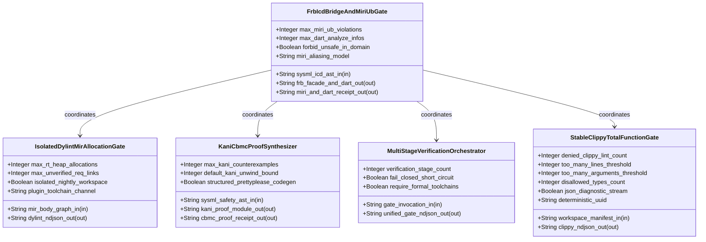
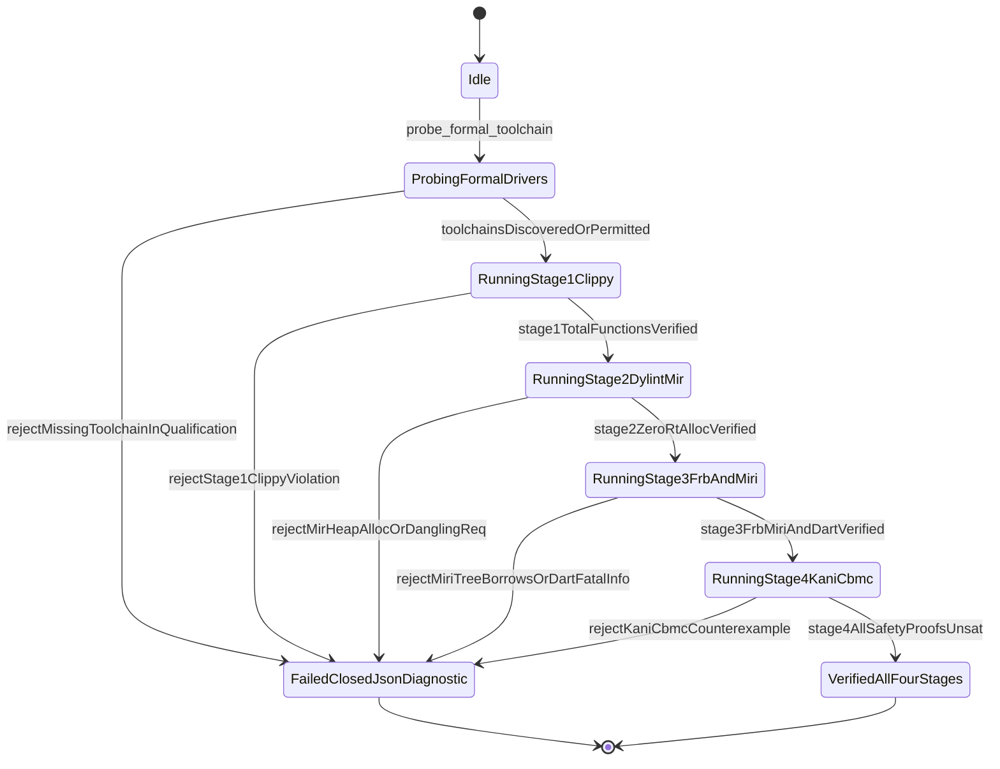

| Attribute | Specification Detail |
| :--- | :--- |
| **Issue ID** | #734 |
| **Title** | Epic 09: BP 09 Multi Stage Compiler and Formal Verification Gatekeeper |
| **Type** | epic |
| **Package** | BP_09_Multi_Stage_Compiler_and_Formal_Verification_Gatekeeper |
| **Subsystem** | BP 09 Multi Stage Compiler and Formal Verification Gatekeeper |
| **Generation Mode** | subagent |
| **Specification Source** | [schema/model.sysml](../../schema/model.sysml) |

# Epic 09: BP 09 Multi Stage Compiler and Formal Verification Gatekeeper

## 1. Context
Subsystem package for BP_09_Multi_Stage_Compiler_and_Formal_Verification_Gatekeeper

## 2. Requirements & Checklist
- [ ] #747 - [Feature 41: [BP 09 Multi Stage Compiler and Formal Verification Gatekeeper] FrbIcdBridgeAndMiriUbGate](../features/FEAT-41-FrbIcdBridgeAndMiriUbGate.md)
- [ ] #748 - [Feature 42: [BP 09 Multi Stage Compiler and Formal Verification Gatekeeper] IsolatedDylintMirAllocationGate](../features/FEAT-42-IsolatedDylintMirAllocationGate.md)
- [ ] #749 - [Feature 43: [BP 09 Multi Stage Compiler and Formal Verification Gatekeeper] KaniCbmcProofSynthesizer](../features/FEAT-43-KaniCbmcProofSynthesizer.md)
- [ ] #750 - [Feature 44: [BP 09 Multi Stage Compiler and Formal Verification Gatekeeper] MultiStageVerificationOrchestrator](../features/FEAT-44-MultiStageVerificationOrchestrator.md)
- [ ] #751 - [Feature 45: [BP 09 Multi Stage Compiler and Formal Verification Gatekeeper] StableClippyTotalFunctionGate](../features/FEAT-45-StableClippyTotalFunctionGate.md)

### Associated Use Cases & User Stories

#### Associated Use Cases
- [ ] #773 - [Use Case 45: Stage 1 Universal Stable Clippy Total Function and clippy toml Threshold Enforcement](../use-cases/UC-45-Stage_1_Universal_Stable_Clippy_Total_Function_and_clippy_toml_Threshold_Enforcement.md)
- [ ] #774 - [Use Case 46: Stage 2 Isolated Nightly Dylint MIR Zero Allocation Proof on Real Time Control Loops](../use-cases/UC-46-Stage_2_Isolated_Nightly_Dylint_MIR_Zero_Allocation_Proof_on_Real_Time_Control_Loops.md)
- [ ] #775 - [Use Case 47: Stage 2 Compile Time MIR Requirement Binding Verification Against Active SysML Digests](../use-cases/UC-47-Stage_2_Compile_Time_MIR_Requirement_Binding_Verification_Against_Active_SysML_Digests.md)
- [ ] #776 - [Use Case 48: Stage 3 Deterministic flutter_rust_bridge FFI Synthesis with Fail Closed ICD Boundary Guards](../use-cases/UC-48-Stage_3_Deterministic_flutter_rust_bridge_FFI_Synthesis_with_Fail_Closed_ICD_Boundary_Guards.md)
- [ ] #777 - [Use Case 49: Stage 3 Miri Tree Borrows Abstract Machine Undefined Behavior Rejection on FFI and Ring Buffer Bridges](../use-cases/UC-49-Stage_3_Miri_Tree_Borrows_Abstract_Machine_Undefined_Behavior_Rejection_on_FFI_and_Ring_Buffer_Bridges.md)
- [ ] #778 - [Use Case 50: Stage 4 Deterministic Kani CBMC Proof Synthesis and STPA Unsafe Control Action Falsification](../use-cases/UC-50-Stage_4_Deterministic_Kani_CBMC_Proof_Synthesis_and_STPA_Unsafe_Control_Action_Falsification.md)
- [ ] #779 - [Use Case 51: Cross Platform Toolchain Discovery Modular Submodule Layout and Fail Closed Qualification Gate](../use-cases/UC-51-Cross_Platform_Toolchain_Discovery_Modular_Submodule_Layout_and_Fail_Closed_Qualification_Gate.md)

#### Associated User Stories
- [ ] #808 - [User Story 59: probe formal toolchain](../user-stories/US-59-probe_formal_toolchain.md)
- [ ] #809 - [User Story 60: verify clippy policy](../user-stories/US-60-verify_clippy_policy.md)
- [ ] #810 - [User Story 61: evaluate stage2 dylint mir](../user-stories/US-61-evaluate_stage2_dylint_mir.md)
- [ ] #811 - [User Story 62: verify in process cst syntax](../user-stories/US-62-verify_in_process_cst_syntax.md)
- [ ] #812 - [User Story 63: guard inbound frb f64](../user-stories/US-63-guard_inbound_frb_f64.md)
- [ ] #813 - [User Story 64: validate kani harness spec](../user-stories/US-64-validate_kani_harness_spec.md)
- [ ] #814 - [User Story 65: evaluate four stage gatekeeper](../user-stories/US-65-evaluate_four_stage_gatekeeper.md)

## 3. Architecture
Classifiers: `FrbIcdBridgeAndMiriUbGate` (ports: `in sysml_icd_ast_in : String`, `out frb_facade_and_dart_out : String`, `out miri_and_dart_receipt_out : String`); `IsolatedDylintMirAllocationGate` (ports: `in mir_body_graph_in : String`, `out dylint_ndjson_out : String`); `KaniCbmcProofSynthesizer` (ports: `in sysml_safety_ast_in : String`, `out kani_proof_module_out : String`, `out cbmc_proof_receipt_out : String`); `MultiStageVerificationOrchestrator` (ports: `in gate_invocation_in : String`, `out unified_gate_ndjson_out : String`); `StableClippyTotalFunctionGate` (ports: `in workspace_manifest_in : String`, `out clippy_ndjson_out : String`). Package port definitions: `BP_09_FormalVerificationPortDef`. Structural connectors: `BP_09_ClippyToOrchestratorConnection` (`StableClippyTotalFunctionGate.StableClippyTotalFunctionGate.clippy_ndjson_out -> MultiStageVerificationOrchestrator.MultiStageVerificationOrchestrator.gate_invocation_in`).

## 4. Operational Considerations
Lifecycle state machines: `BP_09_Multi_Stage_Compiler_and_Formal_Verification_Gatekeeper_LifecycleState` (Initial -> Idle; Idle -> ProbingFormalDrivers on probe_formal_toolchain; ProbingFormalDrivers -> RunningStage1Clippy on toolchainsDiscoveredOrPermitted; ProbingFormalDrivers -> FailedClosedJsonDiagnostic on rejectMissingToolchainInQualification; RunningStage1Clippy -> FailedClosedJsonDiagnostic on rejectStage1ClippyViolation; RunningStage1Clippy -> RunningStage2DylintMir on stage1TotalFunctionsVerified; RunningStage2DylintMir -> FailedClosedJsonDiagnostic on rejectMirHeapAllocOrDanglingReq; RunningStage2DylintMir -> RunningStage3FrbAndMiri on stage2ZeroRtAllocVerified; RunningStage3FrbAndMiri -> FailedClosedJsonDiagnostic on rejectMiriTreeBorrowsOrDartFatalInfo; RunningStage3FrbAndMiri -> RunningStage4KaniCbmc on stage3FrbMiriAndDartVerified; RunningStage4KaniCbmc -> FailedClosedJsonDiagnostic on rejectKaniCbmcCounterexample; RunningStage4KaniCbmc -> VerifiedAllFourStages on stage4AllSafetyProofsUnsat; FailedClosedJsonDiagnostic -> Terminal; VerifiedAllFourStages -> Terminal). Operational actions: `probe_formal_toolchain`, `verify_clippy_policy`, `evaluate_stage2_dylint_mir`, `verify_in_process_cst_syntax`, `guard_inbound_frb_f64`, `validate_kani_harness_spec`, `evaluate_four_stage_gatekeeper`. Interaction sequences: `BP_09_Multi_Stage_Compiler_and_Formal_Verification_Gatekeeper_SequenceInteraction`.

## 5. Security & Governance
Allocated requirements: `REQ-0609 (REQ_0609_BP_09_Multi_Stage_Compiler_and_Formal_Verification_Gatekeeper)`. Enforced invariant constraints: `C_VER_01 (too_many_lines_threshold >= 1 and too_many_lines_threshold <= 80)`, `C_VER_02 (too_many_arguments_threshold >= 0 and too_many_arguments_threshold <= 5)`, `C_VER_03 (max_rt_heap_allocations >= 0 and max_rt_heap_allocations <= 0)`, `C_VER_04 (max_miri_ub_violations >= 0 and max_miri_ub_violations <= 0)`, `C_VER_05 (max_kani_counterexamples >= 0 and max_kani_counterexamples <= 0)`, `C_VER_06 (default_kani_unwind_bound >= 1 and default_kani_unwind_bound <= 64)`, `C_VER_07 (max_module_exec_sloc >= 1 and max_module_exec_sloc <= 380)`, `C_VER_08 (min_toolchain_discovery_probes >= 1 and min_toolchain_discovery_probes <= 3)`, `Invariant_REQ_0609_SC_01`, `Invariant_REQ_0609_SC_02`, `Invariant_REQ_0609_SC_03`, `Invariant_REQ_0609_SC_04`, `Invariant_REQ_0609_SC_05`.

## 6. Source References
- System Architecture Model: `schema/model.sysml`
- Normative Systems Engineering Standard: ISO/IEC/IEEE 15288:2023 §6.4.3 Architecture Definition Process

Subsystem architectural composition and formal invariants derive from `schema/model.sysml` pursuant to ISO/IEC/IEEE 15288.

## System-Level UML Class Diagram

## System State Machine Diagram

