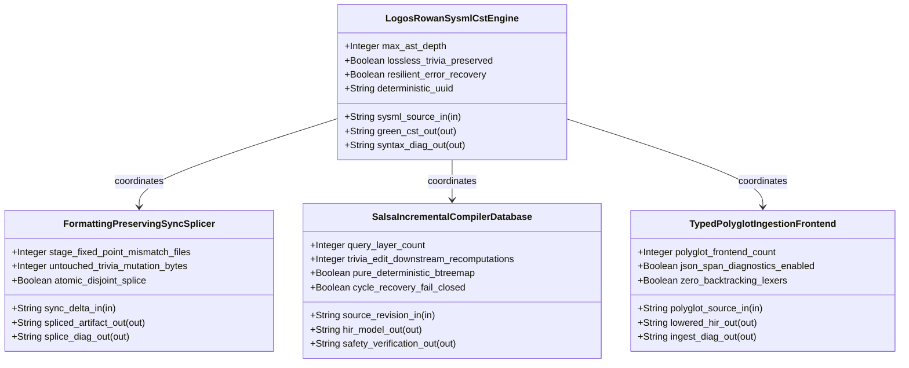
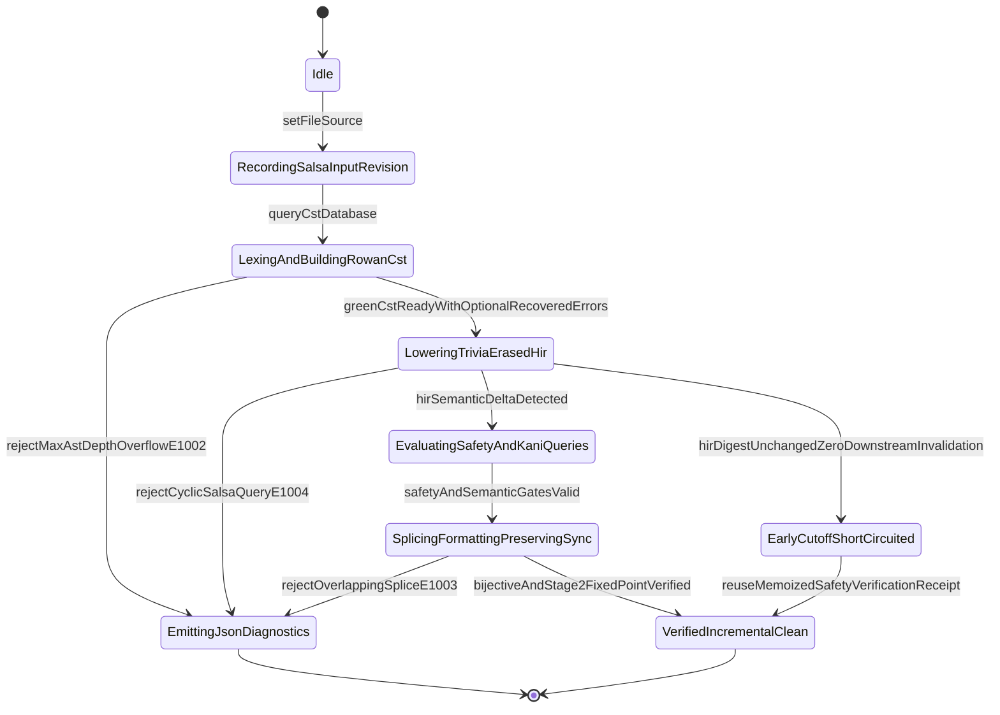

| Attribute | Specification Detail |
| :--- | :--- |
| **Issue ID** | TBD |
| **Title** | Epic 10: BP 10 Incremental Lossless SysML v2 and Polyglot Compiler Engine |
| **Type** | epic |
| **Package** | BP_10_Incremental_Lossless_SysML_v2_and_Polyglot_Compiler_Engine |
| **Subsystem** | BP 10 Incremental Lossless SysML v2 and Polyglot Compiler Engine |
| **Generation Mode** | subagent |
| **Specification Source** | [schema/model.sysml](../../schema/model.sysml) |

# Epic 10: BP 10 Incremental Lossless SysML v2 and Polyglot Compiler Engine

## 1. Context
Subsystem package for BP_10_Incremental_Lossless_SysML_v2_and_Polyglot_Compiler_Engine

## 2. Requirements & Checklist
- [ ] TBD - [Feature 51: [BP 10 Incremental Lossless SysML v2 and Polyglot Compiler Engine] FormattingPreservingSyncSplicer](../features/FEAT-51-FormattingPreservingSyncSplicer.md) (b_p_10_incremental_lossless_sys_m_l_v2_and_polyglot_compiler_engine.sysml)
- [ ] TBD - [Feature 52: [BP 10 Incremental Lossless SysML v2 and Polyglot Compiler Engine] LogosRowanSysmlCstEngine](../features/FEAT-52-LogosRowanSysmlCstEngine.md) (b_p_10_incremental_lossless_sys_m_l_v2_and_polyglot_compiler_engine.sysml)
- [ ] TBD - [Feature 53: [BP 10 Incremental Lossless SysML v2 and Polyglot Compiler Engine] SalsaIncrementalCompilerDatabase](../features/FEAT-53-SalsaIncrementalCompilerDatabase.md) (b_p_10_incremental_lossless_sys_m_l_v2_and_polyglot_compiler_engine.sysml)
- [ ] TBD - [Feature 54: [BP 10 Incremental Lossless SysML v2 and Polyglot Compiler Engine] TypedPolyglotIngestionFrontend](../features/FEAT-54-TypedPolyglotIngestionFrontend.md) (b_p_10_incremental_lossless_sys_m_l_v2_and_polyglot_compiler_engine.sysml)

### Associated Use Cases & User Stories

#### Associated Use Cases
- [ ] TBD - [Use Case 52: Lossless logos and rowan Concrete Syntax Tree Full Fidelity Roundtrip and Trivia Preservation](../use-cases/UC-52-Lossless_logos_and_rowan_Concrete_Syntax_Tree_Full_Fidelity_Roundtrip_and_Trivia_Preservation.md)
- [ ] TBD - [Use Case 53: Resilient Error Recovery Parsing on Incomplete Syntax and Fail Closed MAX AST DEPTH Guard](../use-cases/UC-53-Resilient_Error_Recovery_Parsing_on_Incomplete_Syntax_and_Fail_Closed_MAX_AST_DEPTH_Guard.md)
- [ ] TBD - [Use Case 54: Formatting Preserving Bidirectional CST Splicing Across Forward and Reverse Sync](../use-cases/UC-54-Formatting_Preserving_Bidirectional_CST_Splicing_Across_Forward_and_Reverse_Sync.md)
- [ ] TBD - [Use Case 55: Salsa Early Cutoff Durability Preventing Downstream Recomputations on Trivia Edits](../use-cases/UC-55-Salsa_Early_Cutoff_Durability_Preventing_Downstream_Recomputations_on_Trivia_Edits.md)
- [ ] TBD - [Use Case 56: Fail Closed Salsa Cycle Detection and Referential Integrity Verification](../use-cases/UC-56-Fail_Closed_Salsa_Cycle_Detection_and_Referential_Integrity_Verification.md)
- [ ] TBD - [Use Case 57: Typed CST Lowering and Unified JSON Span Diagnostics Across All Five Polyglot Frontends](../use-cases/UC-57-Typed_CST_Lowering_and_Unified_JSON_Span_Diagnostics_Across_All_Five_Polyglot_Frontends.md)
- [ ] TBD - [Use Case 58: Twelve Gate Blueprint Verification and Baseline Cleanliness Gate Conformance](../use-cases/UC-58-Twelve_Gate_Blueprint_Verification_and_Baseline_Cleanliness_Gate_Conformance.md)

#### Associated User Stories
- [ ] TBD - [User Story 63: ingest Polyglot To Hir](../user-stories/US-63-ingestPolyglotToHir.md)
- [ ] TBD - [User Story 64: parse Lossless Sysml Cst](../user-stories/US-64-parseLosslessSysmlCst.md)
- [ ] TBD - [User Story 65: evaluate Safety And Early Cutoff](../user-stories/US-65-evaluateSafetyAndEarlyCutoff.md)
- [ ] TBD - [User Story 66: compute Bidirectional Splice](../user-stories/US-66-computeBidirectionalSplice.md)
- [ ] TBD - [User Story 67: verify Post Splice Cst](../user-stories/US-67-verifyPostSpliceCst.md)

## 3. Architecture
Classifiers: `FormattingPreservingSyncSplicer` (ports: `in sync_delta_in : String`, `out spliced_artifact_out : String`, `out splice_diag_out : String`); `LogosRowanSysmlCstEngine` (ports: `in sysml_source_in : String`, `out green_cst_out : String`, `out syntax_diag_out : String`); `SalsaIncrementalCompilerDatabase` (ports: `in source_revision_in : String`, `out hir_model_out : String`, `out safety_verification_out : String`); `TypedPolyglotIngestionFrontend` (ports: `in polyglot_source_in : String`, `out lowered_hir_out : String`, `out ingest_diag_out : String`).

## 4. Operational Considerations
Lifecycle state machines: `BP_10_Incremental_Lossless_SysML_v2_and_Polyglot_Compiler_Engine_LifecycleState` (Initial -> Idle; Idle -> RecordingSalsaInputRevision on setFileSource; RecordingSalsaInputRevision -> LexingAndBuildingRowanCst on queryCstDatabase; LexingAndBuildingRowanCst -> EmittingJsonDiagnostics on rejectMaxAstDepthOverflowE1002; LexingAndBuildingRowanCst -> LoweringTriviaErasedHir on greenCstReadyWithOptionalRecoveredErrors; LoweringTriviaErasedHir -> EmittingJsonDiagnostics on rejectCyclicSalsaQueryE1004; LoweringTriviaErasedHir -> EarlyCutoffShortCircuited on hirDigestUnchangedZeroDownstreamInvalidation; LoweringTriviaErasedHir -> EvaluatingSafetyAndKaniQueries on hirSemanticDeltaDetected; EvaluatingSafetyAndKaniQueries -> SplicingFormattingPreservingSync on safetyAndSemanticGatesValid; SplicingFormattingPreservingSync -> EmittingJsonDiagnostics on rejectOverlappingSpliceE1003; SplicingFormattingPreservingSync -> VerifiedIncrementalClean on bijectiveAndStage2FixedPointVerified; EarlyCutoffShortCircuited -> VerifiedIncrementalClean on reuseMemoizedSafetyVerificationReceipt; EmittingJsonDiagnostics -> Terminal; VerifiedIncrementalClean -> Terminal). Operational actions: `ingestPolyglotToHir`, `parseLosslessSysmlCst`, `evaluateSafetyAndEarlyCutoff`, `computeBidirectionalSplice`, `verifyPostSpliceCst`. Interaction sequences: `BP_10_Incremental_Lossless_SysML_v2_and_Polyglot_Compiler_Engine_SequenceInteraction`.

## 5. Security & Governance
Allocated requirements: `REQ-0610 (REQ_0610_BP_10_Incremental_Lossless_SysML_v2_and_Polyglot_Compiler_Engine)`. Enforced invariant constraints: `C_INC_01 (max_ast_depth >= 1 and max_ast_depth <= 64)`, `C_INC_02 (untouched_trivia_mutation_bytes >= 0 and untouched_trivia_mutation_bytes <= 0)`, `C_INC_03 (stage_fixed_point_mismatch_files >= 0 and stage_fixed_point_mismatch_files <= 0)`, `C_INC_04 (query_layer_count >= 4 and query_layer_count <= 4)`, `C_INC_05 (trivia_edit_downstream_recomputations >= 0 and trivia_edit_downstream_recomputations <= 0)`, `C_INC_06 (polyglot_frontend_count >= 5 and polyglot_frontend_count <= 5)`, `Invariant_REQ_0610_SC_01`, `Invariant_REQ_0610_SC_02`, `Invariant_REQ_0610_SC_03_Incremental_Complexity`, `Invariant_REQ_0610_SC_04`.

## 6. Source References
- System Architecture Model: `schema/model.sysml`
- Normative Systems Engineering Standard: ISO/IEC/IEEE 15288:2023 §6.4.3 Architecture Definition Process

Subsystem architectural composition and formal invariants derive from `schema/model.sysml` pursuant to ISO/IEC/IEEE 15288.

## System-Level UML Class Diagram

## System State Machine Diagram

