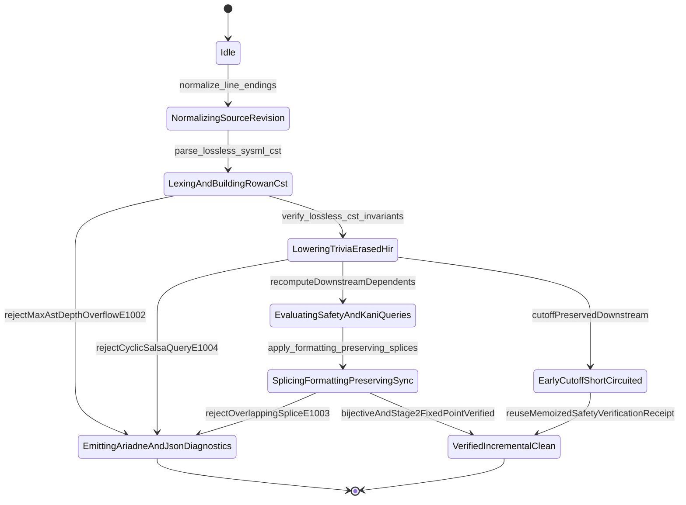

| Attribute | Specification Detail |
| :--- | :--- |
| **Issue ID** | #735 |
| **Title** | Epic 10: BP 10 Incremental Lossless SysML v2 and Polyglot Compiler Engine |
| **Type** | epic |
| **Package** | BP_10_Incremental_Lossless_SysML_v2_and_Polyglot_Compiler_Engine |
| **Subsystem** | BP 10 Incremental Lossless SysML v2 and Polyglot Compiler Engine |
| **Generation Mode** | subagent |
| **Specification Source** | [schema/model.sysml](../../schema/model.sysml) |

# Epic 10: BP 10 Incremental Lossless SysML v2 and Polyglot Compiler Engine

## 1. Context
Subsystem package `BP_10_Incremental_Lossless_SysML_v2_and_Polyglot_Compiler_Engine` (**REQ-0610** / `BP-10` / `DEAP-BP-DET-10`) specifies the incremental, lossless OMG SysML v2.0 + KerML 1.0 and polyglot Concrete Syntax Tree (CST) compiler engine.

- **Contract A (100% Normative OMG SysML v2.0 + KerML 1.0 Grammar Coverage, Zero 16-Construct Caps)**: Enforces full Definition and Usage symmetry across 100% of normative OMG SysML v2.0 and KerML 1.0 textual grammar clauses with zero 16-construct artificial caps, covering:
  - *Namespaces & Metadata*: `package`, `library package`, `standard library package`, `import` (`all`, `::*`, `::**`, filter `[...]`), `alias`, `comment`/`doc`/`rep`, `dependency`, and `metadata def` / `metadata` / `@` / `#` user-defined keyword extensions (modeling `#hazard`, `#risk`, `#capability`, `#rt_loop`, `#dal`, `#fls` via standard OMG SysML v2 `metadata def` keywords while preserving backward-compatible parsing of legacy `hazard def` / `risk def` / `capability def`).
  - *Structural & Data Types*: `attribute def`/`attribute`, `enum def`/`enum`, `item def`/`item`, `part def`/`part`, `port def`/`port` (with `~` conjugation and `in`, `out`, `inout`), `connection def`/`connection` (`connect ... to ...`), `interface def`/`interface`, `flow def`/`flow`/`succession` (`of ... from ... to ...`), `allocation def`/`allocation`/`allocate` (`allocate ... to ...`), and `occurrence def`/`occurrence`/`individual`/`snapshot`/`timeslice`.
  - *Behavioral & State*: `action def`/`action` (`perform`, `accept`, `send`, `assign`, `if`/`else`, `while`/`loop`, `for`, `fork`, `join`, `merge`, `decide`, `first ... then ...` succession) and `state def`/`state`/`exhibit` (`parallel`, `entry`, `do`, `exit`, `transition first ... accept ... if ... do ... then ...`).
  - *Calculations, Constraints & Requirements*: `calc def`/`calc` (`return`), `constraint def`/`constraint` (`assert`, `assume`, `require`), `requirement def`/`requirement` (`subject`, `actor`, `stakeholder`, `framed concern`, `satisfy ... by ...`), and `concern def`/`concern`.
  - *Use Cases, Analysis, Verification & Views*: `use case def`/`use case` (`include use case`), `analysis def`/`analysis` (`objective`), `verification def`/`verification` (`verify`), `test case def`/`test case`, `interaction def`/`interaction`, `view def`/`view`, `viewpoint def`/`viewpoint`, `rendering def`/`rendering` (`expose`, `filter`, `render`), and `variation`/`variant`.
  - *KerML 1.0 Specialization, Multiplicity & Expressions*: `:` (`defined by`), `:>` (`subsets`), `:>>` (`redefines`), `::>` (`references`), `~` (conjugation), `ref`, `abstract`, `readonly`, `derived`, `end`, `default`, `:=`, multiplicity `[lo..hi]` / `[*]` / `{ordered, nonunique}`, full KerML operator expressions (`implies`, `xor`, `??`, `->`, `collect`, `select`, `forAll`, `exists`), and `ISQ`/`SI`/`ScalarValues` standard library imports.
- **Contract B (Official Rust Compiler, `salsa` Incremental Query DB & Polyglot CST Ingestion Stack, Zero Hand-Rolled Scanners)**: Implements a demand-driven 4-layer `salsa` incremental compiler (`SourceDatabase`, `CstDatabase`, `HirDatabase`, `SafetyVerificationDatabase` in `compile_sysml::salsa_db`) and lossless polyglot CST ingestion using `logos` + `rowan` + `salsa` + `ariadne` (`deap_core::sysml_cst`), `ra_ap_syntax` for Rust source CSTs, `deap_core::dart_cst` for Dart CSTs, typed `serde_json` ASTs for OpenAPI/JSON-Schema, `logos` + `rowan` CSTs for OMG IDL and IETF YANG in `ingest_sysml::cst::{idl_cst, yang_cst}`, `pulldown-cmark` + `pulldown-cmark-to-cmark` for lossless Markdown AST manipulation, and `syn` + `proc-macro2` + `quote` + `prettyplease` for deterministic fixed-point codegen, with zero hand-rolled string/line/char-by-char scanners and zero `#![feature(rustc_private)]` across `./crates/*`.
- **3-Layer Definition of Done (DoD) & Submodule Modularity (`< 380` SLOC)**: Closes all 3 architectural layers (Layer 1: Domain State & Data Model, Layer 2: Logic & State Management, Layer 3: Presentation & Actuator Interface Binding) inside `< 380` executable-SLOC submodules (`./crates/deap-core/src/sysml_cst/`, `./crates/compile-sysml/src/salsa_db/`, `./crates/ingest-sysml/src/cst/`) while enforcing explicit deletion and retirement of legacy hand-rolled scanners (`./crates/deap-core/src/sysml_ast/mod.rs` `-2,400+` SLOC, `./crates/compile-sysml/src/parser.rs` `-1,100+` SLOC, and `./crates/ingest-sysml/src/extractors.rs` `-900+` SLOC).

## 2. Requirements & Checklist
- [ ] #752 - [Feature 46: [BP 10 Incremental Lossless SysML v2 and Polyglot Compiler Engine] FormattingPreservingSyncSplicer](../features/FEAT-46-FormattingPreservingSyncSplicer.md) (realizes atomic disjoint `Utf8TextRange` CST splicing and zero untouched-trivia mutation across forward and reverse sync)
- [ ] #753 - [Feature 47: [BP 10 Incremental Lossless SysML v2 and Polyglot Compiler Engine] LogosRowanSysmlCstEngine](../features/FEAT-47-LogosRowanSysmlCstEngine.md) (realizes `logos` + `rowan` lossless Red/Green CST lexing and parsing across 100% of OMG SysML v2.0 + KerML 1.0 with zero 16-construct caps)
- [ ] #754 - [Feature 48: [BP 10 Incremental Lossless SysML v2 and Polyglot Compiler Engine] SalsaIncrementalCompilerDatabase](../features/FEAT-48-SalsaIncrementalCompilerDatabase.md) (realizes the 4-layer `salsa` incremental query database with trivia-erased HIR early cutoff and fail-closed cycle recovery)
- [ ] #755 - [Feature 49: [BP 10 Incremental Lossless SysML v2 and Polyglot Compiler Engine] TypedPolyglotIngestionFrontend](../features/FEAT-49-TypedPolyglotIngestionFrontend.md) (realizes typed polyglot CST/AST ingestion via `ra_ap_syntax`, `deap_core::dart_cst`, `serde_json`, and `ingest_sysml::cst::{idl_cst, yang_cst}` with zero hand-rolled scanners)

### Associated Use Cases & User Stories

#### Associated Use Cases
- [ ] #780 - [Use Case 52: Lossless logos and rowan Concrete Syntax Tree Full Fidelity Roundtrip and Cross Platform CRLF Normalization](../use-cases/UC-52-Lossless_logos_and_rowan_Concrete_Syntax_Tree_Full_Fidelity_Roundtrip_and_Cross_Platform_CRLF_Normalization.md) (verifies lossless `rowan::GreenNode` byte-for-byte roundtrip and cross-platform CRLF-to-LF normalization)
- [ ] #781 - [Use Case 53: Resilient Error Recovery Parsing MAX AST DEPTH Guard and Deterministic Ariadne Byte Span Diagnostics](../use-cases/UC-53-Resilient_Error_Recovery_Parsing_MAX_AST_DEPTH_Guard_and_Deterministic_Ariadne_Byte_Span_Diagnostics.md) (verifies `ErrorNode` recovery, `MAX_AST_DEPTH = 64` guard `C_INC_01`, and `DEAP-E1001`/`DEAP-E1002` `ariadne` + NDJSON diagnostics)
- [ ] #782 - [Use Case 54: Formatting Preserving Bidirectional CST Splicing Across Forward and Reverse Sync](../use-cases/UC-54-Formatting_Preserving_Bidirectional_CST_Splicing_Across_Forward_and_Reverse_Sync.md) (verifies disjoint `Utf8TextRange` CST splicing with `untouched_trivia_mutation_bytes == 0` `C_INC_02` and `DEAP-E1003` overlap rejection)
- [ ] #783 - [Use Case 55: Salsa Early Cutoff Durability Preventing Downstream Recomputations on Trivia Edits](../use-cases/UC-55-Salsa_Early_Cutoff_Durability_Preventing_Downstream_Recomputations_on_Trivia_Edits.md) (verifies 4-layer `salsa` early cutoff with `trivia_edit_downstream_recomputations == 0` `C_INC_05`)
- [ ] #784 - [Use Case 56: Fail Closed Salsa Cycle Detection and Net Negative Legacy Cst Parser Retirement](../use-cases/UC-56-Fail_Closed_Salsa_Cycle_Detection_and_Net_Negative_Legacy_Cst_Parser_Retirement.md) (verifies fail-closed `DEAP-E1004` `salsa` cycle recovery and explicit deletion of `-4,400+` SLOC of legacy hand-rolled parsers into `< 380` SLOC submodules)
- [ ] #785 - [Use Case 57: Cohesive Typed Polyglot CST AST Lowering with Zero rustc private and Exact Byte Span Diagnostics](../use-cases/UC-57-Cohesive_Typed_Polyglot_CST_AST_Lowering_with_Zero_rustc_private_and_Exact_Byte_Span_Diagnostics.md) (verifies 6-frontend polyglot CST/AST lowering via `ra_ap_syntax`, `deap_core::dart_cst`, `serde_json`, `ingest_sysml::cst::{idl_cst, yang_cst}`, and `pulldown-cmark` with `DEAP-E1005` diagnostics)
- [ ] #786 - [Use Case 58: Twelve Gate Blueprint Verification and Baseline Cleanliness Gate Conformance](../use-cases/UC-58-Twelve_Gate_Blueprint_Verification_and_Baseline_Cleanliness_Gate_Conformance.md) (verifies 12-gate blueprint verification and workspace baseline cleanliness conformance)

#### Associated User Stories
- [ ] #815 - [User Story 66: resolve polyglot backend](../user-stories/US-66-resolve_polyglot_backend.md) (binds deterministic polyglot CST/AST backend dispatch across `ra_ap_syntax`, `deap_core::dart_cst`, `serde_json`, `ingest_sysml::cst::{idl_cst, yang_cst}`, and `pulldown-cmark`)
- [ ] #816 - [User Story 67: normalize line endings](../user-stories/US-67-normalize_line_endings.md) (binds deterministic CRLF-to-LF source normalization prior to `logos` DFA lexing)
- [ ] #817 - [User Story 68: parse lossless sysml cst](../user-stories/US-68-parse_lossless_sysml_cst.md) (binds lossless `logos` + `rowan` CST parsing across 100% of OMG SysML v2.0 + KerML 1.0 grammar constructs)
- [ ] #818 - [User Story 69: verify lossless cst invariants](../user-stories/US-69-verify_lossless_cst_invariants.md) (binds byte-for-byte `GreenNode` roundtrip and `MAX_AST_DEPTH <= 64` invariant verification)
- [ ] #819 - [User Story 70: evaluate hir early cutoff](../user-stories/US-70-evaluate_hir_early_cutoff.md) (binds trivia-erased `HirPackageSummary` equality comparison and `salsa` early-cutoff memoization)
- [ ] #820 - [User Story 71: apply formatting preserving splices](../user-stories/US-71-apply_formatting_preserving_splices.md) (binds pairwise-disjoint `Utf8TextRange` CST subtree splicing with zero untouched trivia mutation)
- [ ] #821 - [User Story 72: render ariadne diagnostic](../user-stories/US-72-render_ariadne_diagnostic.md) (binds deterministic ANSI-free `ariadne` byte-span rendering and `--message-format=json` NDJSON emission)

## 3. Architecture
Classifiers: `FormattingPreservingSyncSplicer` (ports: `in sync_delta_in : String`, `out spliced_artifact_out : String`, `out splice_diag_out : String`); `LogosRowanSysmlCstEngine` (ports: `in sysml_source_in : String`, `out green_cst_out : String`, `out syntax_diag_out : String`); `SalsaIncrementalCompilerDatabase` (ports: `in source_revision_in : String`, `out hir_model_out : String`, `out safety_verification_out : String`); `TypedPolyglotIngestionFrontend` (ports: `in polyglot_source_in : String`, `out lowered_hir_out : String`, `out ingest_diag_out : String`). Package port definitions: `BP_10_IncrementalCstPortDef`. Structural connectors: `BP_10_PolyglotToSalsaDbConnection` (`TypedPolyglotIngestionFrontend.TypedPolyglotIngestionFrontend.lowered_hir_out -> SalsaIncrementalCompilerDatabase.SalsaIncrementalCompilerDatabase.source_revision_in`).

### Subsystem Capability Allocations
| Capability Name | Subsystem Package | Description / Objective |
| :--- | :--- | :--- |
| `#capability` `LosslessSysmlV2AndKermlCstCompilation` | `BP_10_Incremental_Lossless_SysML_v2_and_Polyglot_Compiler_Engine` | Parses 100% of normative OMG SysML v2.0 and KerML 1.0 Definition and Usage constructs into lossless `logos` + `rowan` Red/Green CSTs with zero 16-construct caps and backward-compatible `#hazard`/`#risk`/`#capability`/`#rt_loop`/`#dal`/`#fls` metadata parsing. |
| `#capability` `SalsaEarlyCutoffIncrementalEvaluation` | `BP_10_Incremental_Lossless_SysML_v2_and_Polyglot_Compiler_Engine` | Executes 4-layer demand-driven `salsa` queries (`SourceDatabase`, `CstDatabase`, `HirDatabase`, `SafetyVerificationDatabase`) with trivia-erased `HirPackageSummary` early cutoff (`C_INC_05`) and fail-closed cycle recovery (`DEAP-E1004`). |
| `#capability` `TypedPolyglotCstIngestionAndSplicing` | `BP_10_Incremental_Lossless_SysML_v2_and_Polyglot_Compiler_Engine` | Lowers Rust (`ra_ap_syntax`), Dart (`deap_core::dart_cst`), OpenAPI/JSON-Schema (`serde_json`), OMG IDL and IETF YANG (`ingest_sysml::cst::{idl_cst, yang_cst}`), and Markdown (`pulldown-cmark` + `pulldown-cmark-to-cmark`) into canonical HIR and splices CST ranges with zero untouched trivia mutation (`C_INC_02`). |

### 3-Layer Definition of Done (DoD) & Submodule Modularity (`< 380` SLOC)
- **Layer 1 (Domain State & Data Model)**: Encapsulates immutable `rowan::GreenNode` / `SysmlSyntaxNode` CSTs, `HirPackageSummary`, `HirSourceMap`, `Utf8TextRange` splice intervals, and deterministic `BTreeMap`/`BTreeSet` query tables across `LogosRowanSysmlCstEngine`, `SalsaIncrementalCompilerDatabase`, `FormattingPreservingSyncSplicer`, and `TypedPolyglotIngestionFrontend`.
- **Layer 2 (Logic & State Management)**: Enforces linear-time `logos` DFA lexing, recursive-descent `rowan` CST parsing bounded by `MAX_AST_DEPTH = 64` (`C_INC_01`), trivia-erased HIR early cutoff (`C_INC_04`, `C_INC_05`), fail-closed `salsa` cycle recovery (`DEAP-E1004`), and disjoint `Utf8TextRange` CST splicing (`C_INC_02`, `C_INC_03`) inside `< 380` executable-SLOC submodules (`./crates/deap-core/src/sysml_cst/`, `./crates/compile-sysml/src/salsa_db/`, `./crates/ingest-sysml/src/cst/`) while explicitly deleting legacy hand-rolled scanners (`./crates/deap-core/src/sysml_ast/mod.rs` `-2,400+` SLOC, `./crates/compile-sysml/src/parser.rs` `-1,100+` SLOC, `./crates/ingest-sysml/src/extractors.rs` `-900+` SLOC).
- **Layer 3 (Presentation & Actuator Interface Binding)**: Binds ingress/egress ports (`sysml_source_in`, `green_cst_out`, `syntax_diag_out`, `source_revision_in`, `hir_model_out`, `safety_verification_out`, `sync_delta_in`, `spliced_artifact_out`, `splice_diag_out`, `polyglot_source_in`, `lowered_hir_out`, `ingest_diag_out`) to deterministic ANSI-free `ariadne` byte-span reports and single-line `--message-format=json` NDJSON diagnostics (`DEAP-E1001..E1005`).

## 4. Operational Considerations
Lifecycle state machines: `BP_10_Incremental_Lossless_SysML_v2_and_Polyglot_Compiler_Engine_LifecycleState` (Initial -> Idle; Idle -> NormalizingSourceRevision on normalize_line_endings; NormalizingSourceRevision -> LexingAndBuildingRowanCst on parse_lossless_sysml_cst; LexingAndBuildingRowanCst -> EmittingAriadneAndJsonDiagnostics on rejectMaxAstDepthOverflowE1002; LexingAndBuildingRowanCst -> LoweringTriviaErasedHir on verify_lossless_cst_invariants; LoweringTriviaErasedHir -> EmittingAriadneAndJsonDiagnostics on rejectCyclicSalsaQueryE1004; LoweringTriviaErasedHir -> EarlyCutoffShortCircuited on cutoffPreservedDownstream; LoweringTriviaErasedHir -> EvaluatingSafetyAndKaniQueries on recomputeDownstreamDependents; EvaluatingSafetyAndKaniQueries -> SplicingFormattingPreservingSync on apply_formatting_preserving_splices; SplicingFormattingPreservingSync -> EmittingAriadneAndJsonDiagnostics on rejectOverlappingSpliceE1003; SplicingFormattingPreservingSync -> VerifiedIncrementalClean on bijectiveAndStage2FixedPointVerified; EarlyCutoffShortCircuited -> VerifiedIncrementalClean on reuseMemoizedSafetyVerificationReceipt; EmittingAriadneAndJsonDiagnostics -> Terminal; VerifiedIncrementalClean -> Terminal). Operational actions: `resolve_polyglot_backend`, `normalize_line_endings`, `parse_lossless_sysml_cst`, `verify_lossless_cst_invariants`, `evaluate_hir_early_cutoff`, `apply_formatting_preserving_splices`, `render_ariadne_diagnostic`. Interaction sequences: `BP_10_Incremental_Lossless_SysML_v2_and_Polyglot_Compiler_Engine_SequenceInteraction`.

## 5. Security & Governance
Allocated requirements: `REQ-0610 (REQ_0610_BP_10_Incremental_Lossless_SysML_v2_and_Polyglot_Compiler_Engine)`. Enforced invariant constraints: `C_INC_01 (max_ast_depth >= 1 and max_ast_depth <= 64)`, `C_INC_02 (untouched_trivia_mutation_bytes >= 0 and untouched_trivia_mutation_bytes <= 0)`, `C_INC_03 (stage_fixed_point_mismatch_files >= 0 and stage_fixed_point_mismatch_files <= 0)`, `C_INC_04 (query_layer_count >= 4 and query_layer_count <= 4)`, `C_INC_05 (trivia_edit_downstream_recomputations >= 0 and trivia_edit_downstream_recomputations <= 0)`, `C_INC_06 (polyglot_frontend_count >= 6 and polyglot_frontend_count <= 6)`, `C_INC_07 (rustc_private_feature_count >= 0 and rustc_private_feature_count <= 0)`, `Invariant_REQ_0610_SC_01`, `Invariant_REQ_0610_SC_02`, `Invariant_REQ_0610_SC_03_Incremental_Complexity`, `Invariant_REQ_0610_SC_04`. Governance gates enforce Contract A (100% OMG SysML v2.0 + KerML 1.0 grammar coverage with zero 16-construct caps), Contract B (100% official crate stack across `logos`, `rowan`, `salsa`, `ariadne`, `ra_ap_syntax`, `deap_core::dart_cst`, `serde_json`, `ingest_sysml::cst::{idl_cst, yang_cst}`, `pulldown-cmark`, `syn`, `quote`, `prettyplease` with zero hand-rolled scanners and `rustc_private_feature_count == 0` under `./crates/*`), and `< 380`-SLOC submodule modularity with explicit legacy hand-rolled scanner deletion.

## 6. Source References
- System Architecture Model: `schema/model.sysml`
- Normative Systems Engineering Standard: ISO/IEC/IEEE 15288:2023 §6.4.3 Architecture Definition Process

Subsystem architectural composition and formal invariants derive from `schema/model.sysml` pursuant to ISO/IEC/IEEE 15288.

## System-Level UML Class Diagram

## System State Machine Diagram

