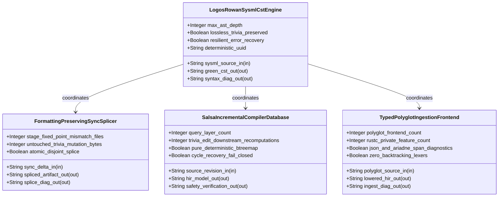
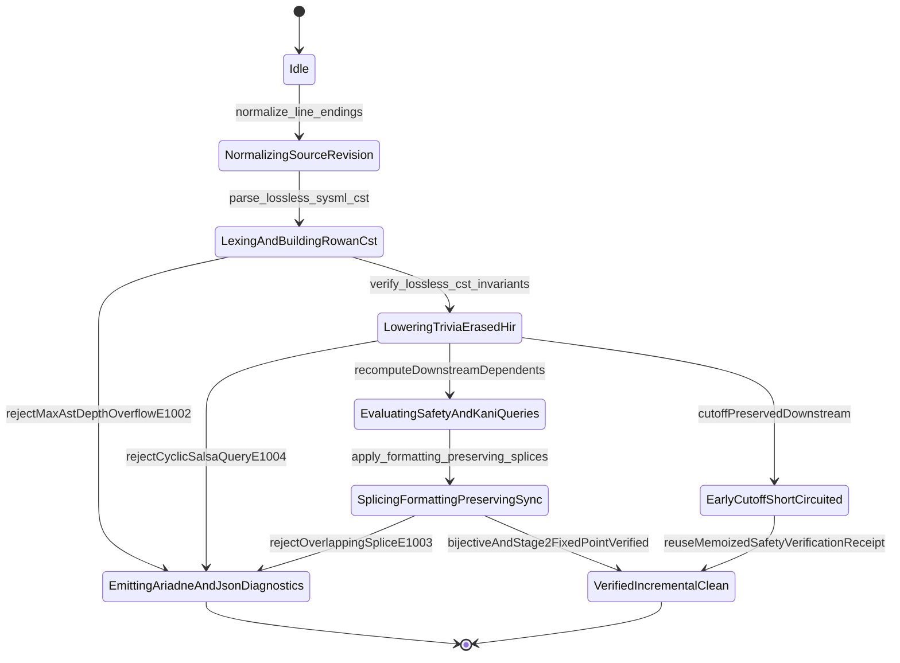

| Attribute | Specification Detail |
| :--- | :--- |
| **Issue ID** | #735 |
| **Title** | Epic 10: BP 10 Incremental Lossless SysML v2 and Polyglot Compiler Engine |
| **Type** | epic |
| **Package** | BP_10_Incremental_Lossless_SysML_v2_and_Polyglot_Compiler_Engine |
| **Subsystem** | BP 10 Incremental Lossless SysML v2 and Polyglot Compiler Engine |
| **Generation Mode** | subagent |
| **Specification Source** | [schema/model.sysml](../../schema/model.sysml) |

# Epic 10: BP 10 Incremental Lossless SysML v2 and Polyglot Compiler Engine

## 1. Context
Subsystem package for BP_10_Incremental_Lossless_SysML_v2_and_Polyglot_Compiler_Engine

## 2. Requirements & Checklist
- [ ] #752 - [Feature 46: [BP 10 Incremental Lossless SysML v2 and Polyglot Compiler Engine] FormattingPreservingSyncSplicer](../features/FEAT-46-FormattingPreservingSyncSplicer.md)
- [ ] #753 - [Feature 47: [BP 10 Incremental Lossless SysML v2 and Polyglot Compiler Engine] LogosRowanSysmlCstEngine](../features/FEAT-47-LogosRowanSysmlCstEngine.md)
- [ ] #754 - [Feature 48: [BP 10 Incremental Lossless SysML v2 and Polyglot Compiler Engine] SalsaIncrementalCompilerDatabase](../features/FEAT-48-SalsaIncrementalCompilerDatabase.md)
- [ ] #755 - [Feature 49: [BP 10 Incremental Lossless SysML v2 and Polyglot Compiler Engine] TypedPolyglotIngestionFrontend](../features/FEAT-49-TypedPolyglotIngestionFrontend.md)

### Associated Use Cases & User Stories

#### Associated Use Cases
- [ ] #780 - [Use Case 52: Lossless logos and rowan Concrete Syntax Tree Full Fidelity Roundtrip and Cross Platform CRLF Normalization](../use-cases/UC-52-Lossless_logos_and_rowan_Concrete_Syntax_Tree_Full_Fidelity_Roundtrip_and_Cross_Platform_CRLF_Normalization.md)
- [ ] #781 - [Use Case 53: Resilient Error Recovery Parsing MAX AST DEPTH Guard and Deterministic Ariadne Byte Span Diagnostics](../use-cases/UC-53-Resilient_Error_Recovery_Parsing_MAX_AST_DEPTH_Guard_and_Deterministic_Ariadne_Byte_Span_Diagnostics.md)
- [ ] #782 - [Use Case 54: Formatting Preserving Bidirectional CST Splicing Across Forward and Reverse Sync](../use-cases/UC-54-Formatting_Preserving_Bidirectional_CST_Splicing_Across_Forward_and_Reverse_Sync.md)
- [ ] #783 - [Use Case 55: Salsa Early Cutoff Durability Preventing Downstream Recomputations on Trivia Edits](../use-cases/UC-55-Salsa_Early_Cutoff_Durability_Preventing_Downstream_Recomputations_on_Trivia_Edits.md)
- [ ] #784 - [Use Case 56: Fail Closed Salsa Cycle Detection and Net Negative Legacy Cst Parser Retirement](../use-cases/UC-56-Fail_Closed_Salsa_Cycle_Detection_and_Net_Negative_Legacy_Cst_Parser_Retirement.md)
- [ ] #785 - [Use Case 57: Cohesive Typed Polyglot CST AST Lowering with Zero rustc private and Exact Byte Span Diagnostics](../use-cases/UC-57-Cohesive_Typed_Polyglot_CST_AST_Lowering_with_Zero_rustc_private_and_Exact_Byte_Span_Diagnostics.md)
- [ ] #786 - [Use Case 58: Twelve Gate Blueprint Verification and Baseline Cleanliness Gate Conformance](../use-cases/UC-58-Twelve_Gate_Blueprint_Verification_and_Baseline_Cleanliness_Gate_Conformance.md)

#### Associated User Stories
- [ ] #815 - [User Story 66: resolve polyglot backend](../user-stories/US-66-resolve_polyglot_backend.md)
- [ ] #816 - [User Story 67: normalize line endings](../user-stories/US-67-normalize_line_endings.md)
- [ ] #817 - [User Story 68: parse lossless sysml cst](../user-stories/US-68-parse_lossless_sysml_cst.md)
- [ ] #818 - [User Story 69: verify lossless cst invariants](../user-stories/US-69-verify_lossless_cst_invariants.md)
- [ ] #819 - [User Story 70: evaluate hir early cutoff](../user-stories/US-70-evaluate_hir_early_cutoff.md)
- [ ] #820 - [User Story 71: apply formatting preserving splices](../user-stories/US-71-apply_formatting_preserving_splices.md)
- [ ] #821 - [User Story 72: render ariadne diagnostic](../user-stories/US-72-render_ariadne_diagnostic.md)

## 3. Architecture
Classifiers: `FormattingPreservingSyncSplicer` (ports: `in sync_delta_in : String`, `out spliced_artifact_out : String`, `out splice_diag_out : String`); `LogosRowanSysmlCstEngine` (ports: `in sysml_source_in : String`, `out green_cst_out : String`, `out syntax_diag_out : String`); `SalsaIncrementalCompilerDatabase` (ports: `in source_revision_in : String`, `out hir_model_out : String`, `out safety_verification_out : String`); `TypedPolyglotIngestionFrontend` (ports: `in polyglot_source_in : String`, `out lowered_hir_out : String`, `out ingest_diag_out : String`). Package port definitions: `BP_10_IncrementalCstPortDef`. Structural connectors: `BP_10_PolyglotToSalsaDbConnection` (`TypedPolyglotIngestionFrontend.TypedPolyglotIngestionFrontend.lowered_hir_out -> SalsaIncrementalCompilerDatabase.SalsaIncrementalCompilerDatabase.source_revision_in`).

## 4. Operational Considerations
Lifecycle state machines: `BP_10_Incremental_Lossless_SysML_v2_and_Polyglot_Compiler_Engine_LifecycleState` (Initial -> Idle; Idle -> NormalizingSourceRevision on normalize_line_endings; NormalizingSourceRevision -> LexingAndBuildingRowanCst on parse_lossless_sysml_cst; LexingAndBuildingRowanCst -> EmittingAriadneAndJsonDiagnostics on rejectMaxAstDepthOverflowE1002; LexingAndBuildingRowanCst -> LoweringTriviaErasedHir on verify_lossless_cst_invariants; LoweringTriviaErasedHir -> EmittingAriadneAndJsonDiagnostics on rejectCyclicSalsaQueryE1004; LoweringTriviaErasedHir -> EarlyCutoffShortCircuited on cutoffPreservedDownstream; LoweringTriviaErasedHir -> EvaluatingSafetyAndKaniQueries on recomputeDownstreamDependents; EvaluatingSafetyAndKaniQueries -> SplicingFormattingPreservingSync on apply_formatting_preserving_splices; SplicingFormattingPreservingSync -> EmittingAriadneAndJsonDiagnostics on rejectOverlappingSpliceE1003; SplicingFormattingPreservingSync -> VerifiedIncrementalClean on bijectiveAndStage2FixedPointVerified; EarlyCutoffShortCircuited -> VerifiedIncrementalClean on reuseMemoizedSafetyVerificationReceipt; EmittingAriadneAndJsonDiagnostics -> Terminal; VerifiedIncrementalClean -> Terminal). Operational actions: `resolve_polyglot_backend`, `normalize_line_endings`, `parse_lossless_sysml_cst`, `verify_lossless_cst_invariants`, `evaluate_hir_early_cutoff`, `apply_formatting_preserving_splices`, `render_ariadne_diagnostic`. Interaction sequences: `BP_10_Incremental_Lossless_SysML_v2_and_Polyglot_Compiler_Engine_SequenceInteraction`.

## 5. Security & Governance
Allocated requirements: `REQ-0610 (REQ_0610_BP_10_Incremental_Lossless_SysML_v2_and_Polyglot_Compiler_Engine)`. Enforced invariant constraints: `C_INC_01 (max_ast_depth >= 1 and max_ast_depth <= 64)`, `C_INC_02 (untouched_trivia_mutation_bytes >= 0 and untouched_trivia_mutation_bytes <= 0)`, `C_INC_03 (stage_fixed_point_mismatch_files >= 0 and stage_fixed_point_mismatch_files <= 0)`, `C_INC_04 (query_layer_count >= 4 and query_layer_count <= 4)`, `C_INC_05 (trivia_edit_downstream_recomputations >= 0 and trivia_edit_downstream_recomputations <= 0)`, `C_INC_06 (polyglot_frontend_count >= 6 and polyglot_frontend_count <= 6)`, `C_INC_07 (rustc_private_feature_count >= 0 and rustc_private_feature_count <= 0)`, `Invariant_REQ_0610_SC_01`, `Invariant_REQ_0610_SC_02`, `Invariant_REQ_0610_SC_03_Incremental_Complexity`, `Invariant_REQ_0610_SC_04`.

## 6. Source References
- System Architecture Model: `schema/model.sysml`
- Normative Systems Engineering Standard: ISO/IEC/IEEE 15288:2023 §6.4.3 Architecture Definition Process

Subsystem architectural composition and formal invariants derive from `schema/model.sysml` pursuant to ISO/IEC/IEEE 15288.

## System-Level UML Class Diagram

## System State Machine Diagram

