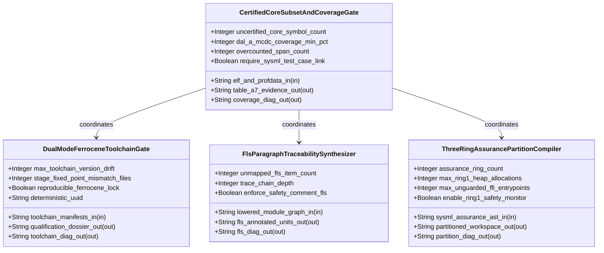
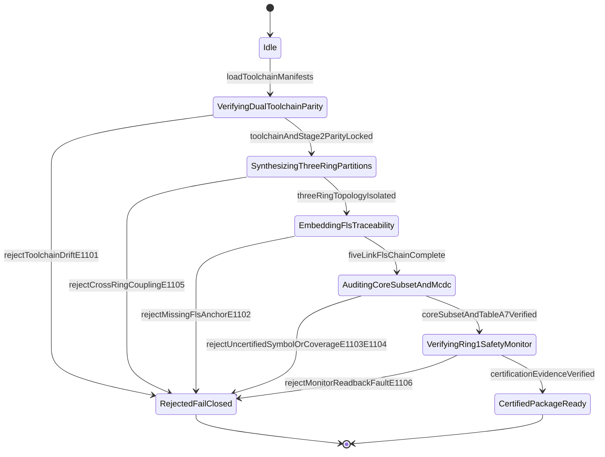

| Attribute | Specification Detail |
| :--- | :--- |
| **Issue ID** | TBD |
| **Title** | Epic 11: BP 11 Ferrocene Qualified Toolchain FLS Traceability Structural Coverage and 3 Ring Rust Flutter DO 178 C DO 330 Certification Architecture |
| **Type** | epic |
| **Package** | BP_11_Ferrocene_Qualified_Toolchain_FLS_Traceability_Structural_Coverage_and_3_Ring_Rust_Flutter_DO_178C_DO_330_Certification_Architecture |
| **Subsystem** | BP 11 Ferrocene Qualified Toolchain FLS Traceability Structural Coverage and 3 Ring Rust Flutter DO 178 C DO 330 Certification Architecture |
| **Generation Mode** | subagent |
| **Specification Source** | [schema/model.sysml](../../schema/model.sysml) |

# Epic 11: BP 11 Ferrocene Qualified Toolchain FLS Traceability Structural Coverage and 3 Ring Rust Flutter DO 178 C DO 330 Certification Architecture

## 1. Context
Subsystem package for BP_11_Ferrocene_Qualified_Toolchain_FLS_Traceability_Structural_Coverage_and_3_Ring_Rust_Flutter_DO_178C_DO_330_Certification_Architecture

## 2. Requirements & Checklist
- [ ] TBD - [Feature 55: [BP 11 Ferrocene Qualified Toolchain FLS Traceability Structural Coverage and 3 Ring Rust Flutter DO 178 C DO 330 Certification Architecture] CertifiedCoreSubsetAndCoverageGate](../features/FEAT-55-CertifiedCoreSubsetAndCoverageGate.md) (b_p_11_ferrocene_qualified_toolchain_f_l_s_traceability_structural_coverage_and_3_ring_rust_flutter_d_o_178_c_d_o_330_certification_architecture.sysml)
- [ ] TBD - [Feature 56: [BP 11 Ferrocene Qualified Toolchain FLS Traceability Structural Coverage and 3 Ring Rust Flutter DO 178 C DO 330 Certification Architecture] DualModeFerroceneToolchainGate](../features/FEAT-56-DualModeFerroceneToolchainGate.md) (b_p_11_ferrocene_qualified_toolchain_f_l_s_traceability_structural_coverage_and_3_ring_rust_flutter_d_o_178_c_d_o_330_certification_architecture.sysml)
- [ ] TBD - [Feature 57: [BP 11 Ferrocene Qualified Toolchain FLS Traceability Structural Coverage and 3 Ring Rust Flutter DO 178 C DO 330 Certification Architecture] FlsParagraphTraceabilitySynthesizer](../features/FEAT-57-FlsParagraphTraceabilitySynthesizer.md) (b_p_11_ferrocene_qualified_toolchain_f_l_s_traceability_structural_coverage_and_3_ring_rust_flutter_d_o_178_c_d_o_330_certification_architecture.sysml)
- [ ] TBD - [Feature 58: [BP 11 Ferrocene Qualified Toolchain FLS Traceability Structural Coverage and 3 Ring Rust Flutter DO 178 C DO 330 Certification Architecture] ThreeRingAssurancePartitionCompiler](../features/FEAT-58-ThreeRingAssurancePartitionCompiler.md) (b_p_11_ferrocene_qualified_toolchain_f_l_s_traceability_structural_coverage_and_3_ring_rust_flutter_d_o_178_c_d_o_330_certification_architecture.sysml)

### Associated Use Cases & User Stories

#### Associated Use Cases
- [ ] TBD - [Use Case 59: Dual Mode criticalup toml and rust toolchain toml Parity and DO 330 Stage 2 Fixed Point Qualification](../use-cases/UC-59-Dual_Mode_criticalup_toml_and_rust_toolchain_toml_Parity_and_DO_330_Stage_2_Fixed_Point_Qualification.md)
- [ ] TBD - [Use Case 60: End to End FLS Normative Paragraph Traceability Emission and Fail Closed Orphan Detection](../use-cases/UC-60-End_to_End_FLS_Normative_Paragraph_Traceability_Emission_and_Fail_Closed_Orphan_Detection.md)
- [ ] TBD - [Use Case 61: Certified core Library Subset Symbol Report Gate Rejecting std alloc and Dynamic Formatting Symbols](../use-cases/UC-61-Certified_core_Library_Subset_Symbol_Report_Gate_Rejecting_std_alloc_and_Dynamic_Formatting_Symbols.md)
- [ ] TBD - [Use Case 62: Zero Overcount Structural and MC DC Coverage Verification Mapped to SysML Verification Cases](../use-cases/UC-62-Zero_Overcount_Structural_and_MC_DC_Coverage_Verification_Mapped_to_SysML_Verification_Cases.md)
- [ ] TBD - [Use Case 63: Schema Driven 3 Ring Workspace Partitioning and Ring 2 Miri Guarded FFI Precondition Enforcement](../use-cases/UC-63-Schema_Driven_3_Ring_Workspace_Partitioning_and_Ring_2_Miri_Guarded_FFI_Precondition_Enforcement.md)
- [ ] TBD - [Use Case 64: Ring 1 Challenge Response Command Interlock and Telemetry Frame Digest Readback Safety Monitor Against Ring 3 Faults](../use-cases/UC-64-Ring_1_Challenge_Response_Command_Interlock_and_TelemetryFrame_Digest_Readback_SafetyMonitor_Against_Ring_3_Faults.md)
- [ ] TBD - [Use Case 65: Twelve Gate Blueprint Verification and Upstream Baseline Cleanliness Conformance](../use-cases/UC-65-Twelve_Gate_Blueprint_Verification_and_Upstream_Baseline_Cleanliness_Conformance.md)

#### Associated User Stories
- [ ] TBD - [User Story 68: verify Toolchain And Stage Parity](../user-stories/US-68-verifyToolchainAndStageParity.md)
- [ ] TBD - [User Story 69: synthesize Three Ring Workspace](../user-stories/US-69-synthesizeThreeRingWorkspace.md)
- [ ] TBD - [User Story 70: attach And Audit Fls Traceability](../user-stories/US-70-attachAndAuditFlsTraceability.md)
- [ ] TBD - [User Story 71: audit Core Subset And Mcdc Coverage](../user-stories/US-71-auditCoreSubsetAndMcdcCoverage.md)
- [ ] TBD - [User Story 72: verify Ring Boundaries And Monitor](../user-stories/US-72-verifyRingBoundariesAndMonitor.md)

## 3. Architecture
Classifiers: `CertifiedCoreSubsetAndCoverageGate` (ports: `in elf_and_profdata_in : String`, `out table_a7_evidence_out : String`, `out coverage_diag_out : String`); `DualModeFerroceneToolchainGate` (ports: `in toolchain_manifests_in : String`, `out qualification_dossier_out : String`, `out toolchain_diag_out : String`); `FlsParagraphTraceabilitySynthesizer` (ports: `in lowered_module_graph_in : String`, `out fls_annotated_units_out : String`, `out fls_diag_out : String`); `ThreeRingAssurancePartitionCompiler` (ports: `in sysml_assurance_ast_in : String`, `out partitioned_workspace_out : String`, `out partition_diag_out : String`).

## 4. Operational Considerations
Lifecycle state machines: `BP_11_Ferrocene_Qualified_Toolchain_FLS_Traceability_Structural_Coverage_and_3_Ring_Rust_Flutter_DO_178C_DO_330_Certification_Architecture_LifecycleState` (Initial -> Idle; Idle -> VerifyingDualToolchainParity on loadToolchainManifests; VerifyingDualToolchainParity -> RejectedFailClosed on rejectToolchainDriftE1101; VerifyingDualToolchainParity -> SynthesizingThreeRingPartitions on toolchainAndStage2ParityLocked; SynthesizingThreeRingPartitions -> RejectedFailClosed on rejectCrossRingCouplingE1105; SynthesizingThreeRingPartitions -> EmbeddingFlsTraceability on threeRingTopologyIsolated; EmbeddingFlsTraceability -> RejectedFailClosed on rejectMissingFlsAnchorE1102; EmbeddingFlsTraceability -> AuditingCoreSubsetAndMcdc on fiveLinkFlsChainComplete; AuditingCoreSubsetAndMcdc -> RejectedFailClosed on rejectUncertifiedSymbolOrCoverageE1103E1104; AuditingCoreSubsetAndMcdc -> VerifyingRing1SafetyMonitor on coreSubsetAndTableA7Verified; VerifyingRing1SafetyMonitor -> RejectedFailClosed on rejectMonitorReadbackFaultE1106; VerifyingRing1SafetyMonitor -> CertifiedPackageReady on certificationEvidenceVerified; RejectedFailClosed -> Terminal; CertifiedPackageReady -> Terminal). Operational actions: `verifyToolchainAndStageParity`, `synthesizeThreeRingWorkspace`, `attachAndAuditFlsTraceability`, `auditCoreSubsetAndMcdcCoverage`, `verifyRingBoundariesAndMonitor`. Interaction sequences: `BP_11_Ferrocene_Qualified_Toolchain_FLS_Traceability_Structural_Coverage_and_3_Ring_Rust_Flutter_DO_178C_DO_330_Certification_Architecture_SequenceInteraction`.

## 5. Security & Governance
Allocated requirements: `REQ-0611 (REQ_0611_BP_11_Ferrocene_Qualified_Toolchain_FLS_Traceability_Structural_Coverage_and_3_Ring_Rust_Flutter_DO_178C)`. Enforced invariant constraints: `C_CERT_01 (max_toolchain_version_drift >= 0 and max_toolchain_version_drift <= 0)`, `C_CERT_02 (stage_fixed_point_mismatch_files >= 0 and stage_fixed_point_mismatch_files <= 0)`, `C_CERT_03 (unmapped_fls_item_count >= 0 and unmapped_fls_item_count <= 0)`, `C_CERT_04 (uncertified_core_symbol_count >= 0 and uncertified_core_symbol_count <= 0)`, `C_CERT_05 (dal_a_mcdc_coverage_min_pct >= 100 and dal_a_mcdc_coverage_min_pct <= 100)`, `C_CERT_06 (assurance_ring_count >= 3 and assurance_ring_count <= 3)`, `Invariant_REQ_0611_SC_01`, `Invariant_REQ_0611_SC_02`, `Invariant_REQ_0611_SC_03`, `Invariant_REQ_0611_SC_04`.

## 6. Source References
- System Architecture Model: `schema/model.sysml`
- Normative Systems Engineering Standard: ISO/IEC/IEEE 15288:2023 §6.4.3 Architecture Definition Process

Subsystem architectural composition and formal invariants derive from `schema/model.sysml` pursuant to ISO/IEC/IEEE 15288.

## System-Level UML Class Diagram

## System State Machine Diagram

