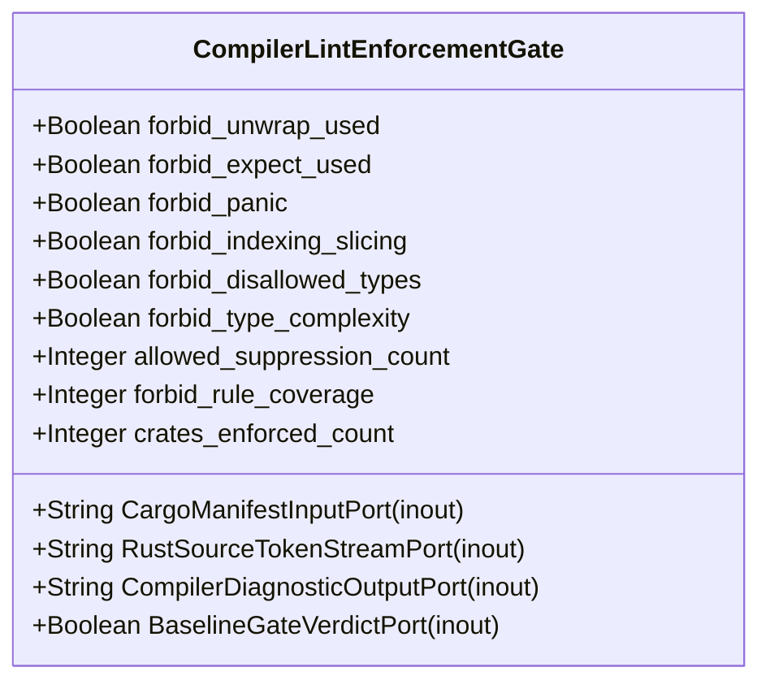

| Attribute | Specification Detail |
| :--- | :--- |
| **Issue ID** | #655 |
| **Title** | Feature 01: [BP 01 Compiler Enforced Forbid Lint Gate and Zero Suppression AST Architecture Blueprint] CompilerLintEnforcementGate |
| **Type** | feature |
| **Parent Epic** | [EPIC-01-BP_01_Compiler_Enforced_Forbid_Lint_Gate_and_Zero_Suppression_AST_Architecture_Blueprint](../epics/EPIC-01-BP_01_Compiler_Enforced_Forbid_Lint_Gate_and_Zero_Suppression_AST_Architecture_Blueprint.md) |
| **Interface Type** | Physical / Structural / Internal Bus |
| **Schema Containers** | `BP_01_Compiler_Enforced_Forbid_Lint_Gate_and_Zero_Suppression_AST_Architecture_Blueprint::CompilerLintEnforcementGate` |
| **Generation Mode** | subagent |
| **Specification Source** | [schema/subsystems/b_p_01_compiler_enforced_forbid_lint_gate_and_zero_suppression_a_s_t_architecture_blueprint/architecture.sysml](../../schema/subsystems/b_p_01_compiler_enforced_forbid_lint_gate_and_zero_suppression_a_s_t_architecture_blueprint/architecture.sysml) |

# Feature 01: [BP 01 Compiler Enforced Forbid Lint Gate and Zero Suppression AST Architecture Blueprint] CompilerLintEnforcementGate

## UML Class Diagram



## Interface Requirements
### 1. Test Data Shape
```json
{
  "$schema": "https://json-schema.org/draft/2020-12/schema",
  "title": "CompilerLintEnforcementGatePayloadSchema",
  "type": "object",
  "properties": {
    "part": {
      "type": "string",
      "const": "CompilerLintEnforcementGate"
    },
    "status": {
      "type": "string",
      "enum": ["nominal", "degraded", "fault"]
    },
    "forbid_unwrap_used": {
      "type": "boolean",
      "description": "Subsystem attribute forbid_unwrap_used"
    },
    "forbid_expect_used": {
      "type": "boolean",
      "description": "Subsystem attribute forbid_expect_used"
    },
    "forbid_panic": {
      "type": "boolean",
      "description": "Subsystem attribute forbid_panic"
    },
    "forbid_indexing_slicing": {
      "type": "boolean",
      "description": "Subsystem attribute forbid_indexing_slicing"
    },
    "forbid_disallowed_types": {
      "type": "boolean",
      "description": "Subsystem attribute forbid_disallowed_types"
    },
    "forbid_type_complexity": {
      "type": "boolean",
      "description": "Subsystem attribute forbid_type_complexity"
    },
    "allowed_suppression_count": {
      "type": "integer",
      "description": "Subsystem attribute allowed_suppression_count"
    },
    "forbid_rule_coverage": {
      "type": "integer",
      "description": "Subsystem attribute forbid_rule_coverage"
    },
    "crates_enforced_count": {
      "type": "integer",
      "description": "Subsystem attribute crates_enforced_count"
    },
    "CargoManifestInputPort": {
      "type": "object",
      "properties": {
        "direction": { "type": "string", "const": "inout" },
        "port_type": { "type": "string", "const": "String" }
      },
      "required": ["direction", "port_type"]
    },
    "RustSourceTokenStreamPort": {
      "type": "object",
      "properties": {
        "direction": { "type": "string", "const": "inout" },
        "port_type": { "type": "string", "const": "String" }
      },
      "required": ["direction", "port_type"]
    },
    "CompilerDiagnosticOutputPort": {
      "type": "object",
      "properties": {
        "direction": { "type": "string", "const": "inout" },
        "port_type": { "type": "string", "const": "String" }
      },
      "required": ["direction", "port_type"]
    },
    "BaselineGateVerdictPort": {
      "type": "object",
      "properties": {
        "direction": { "type": "string", "const": "inout" },
        "port_type": { "type": "string", "const": "Boolean" }
      },
      "required": ["direction", "port_type"]
    }
  },
  "required": [
    "part",
    "status",
    "forbid_unwrap_used",
    "forbid_expect_used",
    "forbid_panic",
    "forbid_indexing_slicing",
    "forbid_disallowed_types",
    "forbid_type_complexity",
    "allowed_suppression_count",
    "forbid_rule_coverage",
    "crates_enforced_count",
    "CargoManifestInputPort",
    "RustSourceTokenStreamPort",
    "CompilerDiagnosticOutputPort",
    "BaselineGateVerdictPort"
  ],
  "additionalProperties": false
}
```

### 2. Validation & Constraints
Formal constraints and invariant guarantees enforced by CompilerLintEnforcementGate.

### 3. Visual Layout & Arrangement
Logical layout, viewport containment, and container structure for CompilerLintEnforcementGate conforming to platform design tokens. Container boundaries enforce @container isolation rules.

### 4. Interactive Flow & States
Operational lifecycle events and discrete state transitions for CompilerLintEnforcementGate.

### Layer 1: Domain State & Signal Model
Domain state vector representing CompilerLintEnforcementGate status, AST references, and typed signal models.

### Layer 2: Logic & Safety State Management
Deterministic state machine solver and safety monitor logic for CompilerLintEnforcementGate.

### Layer 3: Presentation & Actuator Interface Binding
Presentation interface binding and diagnostic event routing for CompilerLintEnforcementGate.

### Associated Use Cases & User Stories

#### Associated Use Cases
- [ ] #624 - [Use Case 01: UC AC 01 Rustc E0453 Hard Rejection of Inner and Outer Clippy Allow Attributes](https://github.com/gintatkinson/DEAP01-spec-core/blob/main/.pipeline/upstream/docs/use-cases/UC-01-UC_AC_01_Rustc_E0453_Hard_Rejection_of_Inner_and_Outer_Clippy_Allow_Attributes.md)
- [ ] #625 - [Use Case 02: UC AC 02 Check 34 Multi Line Whitespace Insensitive Suppression Rejection](https://github.com/gintatkinson/DEAP01-spec-core/blob/main/.pipeline/upstream/docs/use-cases/UC-02-UC_AC_02_Check_34_Multi_Line_Whitespace_Insensitive_Suppression_Rejection.md)
- [ ] #626 - [Use Case 03: UC AC 03 Unconditional Test Target Enforcement Without Conditional Exemption](https://github.com/gintatkinson/DEAP01-spec-core/blob/main/.pipeline/upstream/docs/use-cases/UC-03-UC_AC_03_Unconditional_Test_Target_Enforcement_Without_Conditional_Exemption.md)
- [ ] #627 - [Use Case 04: UC AC 04 Semantic Type Alias Replacement for Type Complexity](https://github.com/gintatkinson/DEAP01-spec-core/blob/main/.pipeline/upstream/docs/use-cases/UC-04-UC_AC_04_Semantic_Type_Alias_Replacement_for_Type_Complexity.md)
- [ ] #628 - [Use Case 05: UC AC 05 Dogfood Ingestion and Sys ML v2 Compilation of REQ 0601](https://github.com/gintatkinson/DEAP01-spec-core/blob/main/.pipeline/upstream/docs/use-cases/UC-05-UC_AC_05_Dogfood_Ingestion_and_SysML_v2_Compilation_of_REQ_0601.md)

#### Associated User Stories
- [ ] #562 - [User Story 01: Execute](https://github.com/gintatkinson/DEAP01-spec-core/blob/main/.pipeline/upstream/docs/user-stories/US-01-Execute.md)
- [ ] #563 - [User Story 02: Read](https://github.com/gintatkinson/DEAP01-spec-core/blob/main/.pipeline/upstream/docs/user-stories/US-02-Read.md)
- [ ] #564 - [User Story 03: Return](https://github.com/gintatkinson/DEAP01-spec-core/blob/main/.pipeline/upstream/docs/user-stories/US-03-Return.md)
- [ ] #565 - [User Story 04: Emit](https://github.com/gintatkinson/DEAP01-spec-core/blob/main/.pipeline/upstream/docs/user-stories/US-04-Emit.md)
- [ ] #566 - [User Story 05: Run](https://github.com/gintatkinson/DEAP01-spec-core/blob/main/.pipeline/upstream/docs/user-stories/US-05-Run.md)
- [ ] #567 - [User Story 06: check compiler ast purity](https://github.com/gintatkinson/DEAP01-spec-core/blob/main/.pipeline/upstream/docs/user-stories/US-06-check_compiler_ast_purity.md)
- [ ] #568 - [User Story 07: mask literals and comments](https://github.com/gintatkinson/DEAP01-spec-core/blob/main/.pipeline/upstream/docs/user-stories/US-07-mask_literals_and_comments.md)
- [ ] #569 - [User Story 08: Masked](https://github.com/gintatkinson/DEAP01-spec-core/blob/main/.pipeline/upstream/docs/user-stories/US-08-Masked.md)
- [ ] #570 - [User Story 09: contains direct range slice](https://github.com/gintatkinson/DEAP01-spec-core/blob/main/.pipeline/upstream/docs/user-stories/US-09-contains_direct_range_slice.md)
- [ ] #571 - [User Story 10: audit fail closed io patterns](https://github.com/gintatkinson/DEAP01-spec-core/blob/main/.pipeline/upstream/docs/user-stories/US-10-audit_fail_closed_io_patterns.md)
- [ ] #572 - [User Story 11: audit test integrity and anti gaming](https://github.com/gintatkinson/DEAP01-spec-core/blob/main/.pipeline/upstream/docs/user-stories/US-11-audit_test_integrity_and_anti_gaming.md)
- [ ] #573 - [User Story 12: C PURITY 03](https://github.com/gintatkinson/DEAP01-spec-core/blob/main/.pipeline/upstream/docs/user-stories/US-12-C_PURITY_03.md)
- [ ] #574 - [User Story 13: audit ssot symbol deduplication](https://github.com/gintatkinson/DEAP01-spec-core/blob/main/.pipeline/upstream/docs/user-stories/US-13-audit_ssot_symbol_deduplication.md)
- [ ] #575 - [User Story 14: C PURITY 04](https://github.com/gintatkinson/DEAP01-spec-core/blob/main/.pipeline/upstream/docs/user-stories/US-14-C_PURITY_04.md)
- [ ] #576 - [User Story 15: Sorted](https://github.com/gintatkinson/DEAP01-spec-core/blob/main/.pipeline/upstream/docs/user-stories/US-15-Sorted.md)
- [ ] #577 - [User Story 16: scan all](https://github.com/gintatkinson/DEAP01-spec-core/blob/main/.pipeline/upstream/docs/user-stories/US-16-scan_all.md)
- [ ] #578 - [User Story 17: Vec](https://github.com/gintatkinson/DEAP01-spec-core/blob/main/.pipeline/upstream/docs/user-stories/US-17-Vec.md)
- [ ] #579 - [User Story 18: parse package or file](https://github.com/gintatkinson/DEAP01-spec-core/blob/main/.pipeline/upstream/docs/user-stories/US-18-parse_package_or_file.md)
- [ ] #580 - [User Story 19: parse type expr](https://github.com/gintatkinson/DEAP01-spec-core/blob/main/.pipeline/upstream/docs/user-stories/US-19-parse_type_expr.md)
- [ ] #581 - [User Story 20: Canonical](https://github.com/gintatkinson/DEAP01-spec-core/blob/main/.pipeline/upstream/docs/user-stories/US-20-Canonical.md)
- [ ] #582 - [User Story 21: verify bijective ast roundtrip](https://github.com/gintatkinson/DEAP01-spec-core/blob/main/.pipeline/upstream/docs/user-stories/US-21-verify_bijective_ast_roundtrip.md)
- [ ] #583 - [User Story 22: ast orig to sysml](https://github.com/gintatkinson/DEAP01-spec-core/blob/main/.pipeline/upstream/docs/user-stories/US-22-ast_orig_to_sysml.md)
- [ ] #584 - [User Story 23: Reparsed](https://github.com/gintatkinson/DEAP01-spec-core/blob/main/.pipeline/upstream/docs/user-stories/US-23-Reparsed.md)
- [ ] #585 - [User Story 24: Assert item](https://github.com/gintatkinson/DEAP01-spec-core/blob/main/.pipeline/upstream/docs/user-stories/US-24-Assert_item.md)
- [ ] #586 - [User Story 25: Ok](https://github.com/gintatkinson/DEAP01-spec-core/blob/main/.pipeline/upstream/docs/user-stories/US-25-Ok.md)
- [ ] #587 - [User Story 26: compile sysml](https://github.com/gintatkinson/DEAP01-spec-core/blob/main/.pipeline/upstream/docs/user-stories/US-26-compile_sysml.md)
- [ ] #588 - [User Story 27: Resolve](https://github.com/gintatkinson/DEAP01-spec-core/blob/main/.pipeline/upstream/docs/user-stories/US-27-Resolve.md)
- [ ] #589 - [User Story 28: Bind](https://github.com/gintatkinson/DEAP01-spec-core/blob/main/.pipeline/upstream/docs/user-stories/US-28-Bind.md)
- [ ] #590 - [User Story 29: Emit](https://github.com/gintatkinson/DEAP01-spec-core/blob/main/.pipeline/upstream/docs/user-stories/US-29-Emit.md)
- [ ] #591 - [User Story 30: Epics](https://github.com/gintatkinson/DEAP01-spec-core/blob/main/.pipeline/upstream/docs/user-stories/US-30-Epics.md)
- [ ] #592 - [User Story 31: Project](https://github.com/gintatkinson/DEAP01-spec-core/blob/main/.pipeline/upstream/docs/user-stories/US-31-Project.md)
- [ ] #593 - [User Story 32: ICD 01](https://github.com/gintatkinson/DEAP01-spec-core/blob/main/.pipeline/upstream/docs/user-stories/US-32-ICD_01.md)
- [ ] #594 - [User Story 33: Synthesize](https://github.com/gintatkinson/DEAP01-spec-core/blob/main/.pipeline/upstream/docs/user-stories/US-33-Synthesize.md)
- [ ] #595 - [User Story 34: WBS 01 03](https://github.com/gintatkinson/DEAP01-spec-core/blob/main/.pipeline/upstream/docs/user-stories/US-34-WBS_01_03.md)
- [ ] #596 - [User Story 35: reconcile backlog](https://github.com/gintatkinson/DEAP01-spec-core/blob/main/.pipeline/upstream/docs/user-stories/US-35-reconcile_backlog.md)
- [ ] #597 - [User Story 36: Parse](https://github.com/gintatkinson/DEAP01-spec-core/blob/main/.pipeline/upstream/docs/user-stories/US-36-Parse.md)
- [ ] #598 - [User Story 37: Reconcile](https://github.com/gintatkinson/DEAP01-spec-core/blob/main/.pipeline/upstream/docs/user-stories/US-37-Reconcile.md)
- [ ] #599 - [User Story 38: Zero](https://github.com/gintatkinson/DEAP01-spec-core/blob/main/.pipeline/upstream/docs/user-stories/US-38-Zero.md)
- [ ] #600 - [User Story 39: Merge](https://github.com/gintatkinson/DEAP01-spec-core/blob/main/.pipeline/upstream/docs/user-stories/US-39-Merge.md)
- [ ] #601 - [User Story 40: Bit identical](https://github.com/gintatkinson/DEAP01-spec-core/blob/main/.pipeline/upstream/docs/user-stories/US-40-Bit_identical.md)
- [ ] #602 - [User Story 41: Run](https://github.com/gintatkinson/DEAP01-spec-core/blob/main/.pipeline/upstream/docs/user-stories/US-41-Run.md)
- [ ] #603 - [User Story 42: Scan](https://github.com/gintatkinson/DEAP01-spec-core/blob/main/.pipeline/upstream/docs/user-stories/US-42-Scan.md)
- [ ] #604 - [User Story 43: Return](https://github.com/gintatkinson/DEAP01-spec-core/blob/main/.pipeline/upstream/docs/user-stories/US-43-Return.md)
- [ ] #605 - [User Story 44: Resolve](https://github.com/gintatkinson/DEAP01-spec-core/blob/main/.pipeline/upstream/docs/user-stories/US-44-Resolve.md)
- [ ] #606 - [User Story 45: Write](https://github.com/gintatkinson/DEAP01-spec-core/blob/main/.pipeline/upstream/docs/user-stories/US-45-Write.md)
- [ ] #607 - [User Story 46: Tokenize](https://github.com/gintatkinson/DEAP01-spec-core/blob/main/.pipeline/upstream/docs/user-stories/US-46-Tokenize.md)
- [ ] #608 - [User Story 47: Verify item](https://github.com/gintatkinson/DEAP01-spec-core/blob/main/.pipeline/upstream/docs/user-stories/US-47-Verify_item.md)
- [ ] #609 - [User Story 48: Emit](https://github.com/gintatkinson/DEAP01-spec-core/blob/main/.pipeline/upstream/docs/user-stories/US-48-Emit.md)
- [ ] #610 - [User Story 49: verify baseline](https://github.com/gintatkinson/DEAP01-spec-core/blob/main/.pipeline/upstream/docs/user-stories/US-49-verify_baseline.md)
- [ ] #611 - [User Story 50: parse rust source ast](https://github.com/gintatkinson/DEAP01-spec-core/blob/main/.pipeline/upstream/docs/user-stories/US-50-parse_rust_source_ast.md)
- [ ] #612 - [User Story 51: Deterministic](https://github.com/gintatkinson/DEAP01-spec-core/blob/main/.pipeline/upstream/docs/user-stories/US-51-Deterministic.md)
- [ ] #613 - [User Story 52: evaluate source file pillars](https://github.com/gintatkinson/DEAP01-spec-core/blob/main/.pipeline/upstream/docs/user-stories/US-52-evaluate_source_file_pillars.md)
- [ ] #614 - [User Story 53: Line exact](https://github.com/gintatkinson/DEAP01-spec-core/blob/main/.pipeline/upstream/docs/user-stories/US-53-Line_exact.md)
- [ ] #615 - [User Story 54: synthesize defect dossier markdown](https://github.com/gintatkinson/DEAP01-spec-core/blob/main/.pipeline/upstream/docs/user-stories/US-54-synthesize_defect_dossier_markdown.md)
- [ ] #616 - [User Story 55: Compliant](https://github.com/gintatkinson/DEAP01-spec-core/blob/main/.pipeline/upstream/docs/user-stories/US-55-Compliant.md)
- [ ] #617 - [User Story 56: run check defect](https://github.com/gintatkinson/DEAP01-spec-core/blob/main/.pipeline/upstream/docs/user-stories/US-56-run_check_defect.md)
- [ ] #618 - [User Story 57: Execute](https://github.com/gintatkinson/DEAP01-spec-core/blob/main/.pipeline/upstream/docs/user-stories/US-57-Execute.md)
- [ ] #619 - [User Story 58: gh](https://github.com/gintatkinson/DEAP01-spec-core/blob/main/.pipeline/upstream/docs/user-stories/US-58-gh.md)
- [ ] #620 - [User Story 59: Created](https://github.com/gintatkinson/DEAP01-spec-core/blob/main/.pipeline/upstream/docs/user-stories/US-59-Created.md)
- [ ] #621 - [User Story 60: Live](https://github.com/gintatkinson/DEAP01-spec-core/blob/main/.pipeline/upstream/docs/user-stories/US-60-Live.md)
- [ ] #622 - [User Story 61: CLOSED LOOP](https://github.com/gintatkinson/DEAP01-spec-core/blob/main/.pipeline/upstream/docs/user-stories/US-61-CLOSED_LOOP.md)
- [ ] #623 - [User Story 62: Exit item](https://github.com/gintatkinson/DEAP01-spec-core/blob/main/.pipeline/upstream/docs/user-stories/US-62-Exit_item.md)

## Acceptance Criteria (BDD)
- [ ] AC-01: Given nominal CompilerLintEnforcementGate domain state, When command or input signals are received, Then updates internal state and signal outputs within declared bounds.
- [ ] AC-02: Given operational state, When CompilerLintEnforcementGate evaluates constraint 'Invariant_REQ_0601_C_LINT_03', Then asserts invariant satisfaction without violation.
- [ ] AC-03: Given operational state, When CompilerLintEnforcementGate evaluates constraint 'Invariant_REQ_0601_FormalInvariant', Then asserts invariant satisfaction without violation.
- [ ] AC-04: Given malformed input signals or boundary condition violation, When CompilerLintEnforcementGate error handling is invoked, Then transitions safely to failsafe fallback state without corruption.

## Source References
Formal component specifications and normative systems engineering requirements:
- Subsystem Requirements: `schema/subsystems/b_p_01_compiler_enforced_forbid_lint_gate_and_zero_suppression_a_s_t_architecture_blueprint/requirements.sysml`
- Subsystem Architecture: `schema/subsystems/b_p_01_compiler_enforced_forbid_lint_gate_and_zero_suppression_a_s_t_architecture_blueprint/architecture.sysml`
- Normative Systems Engineering Standard: ISO/IEC/IEEE 15288:2023 §6.4.3 Architecture Definition Process

Component behavior and interface definitions derive from `schema/model.sysml` pursuant to ISO/IEC/IEEE 15288.
