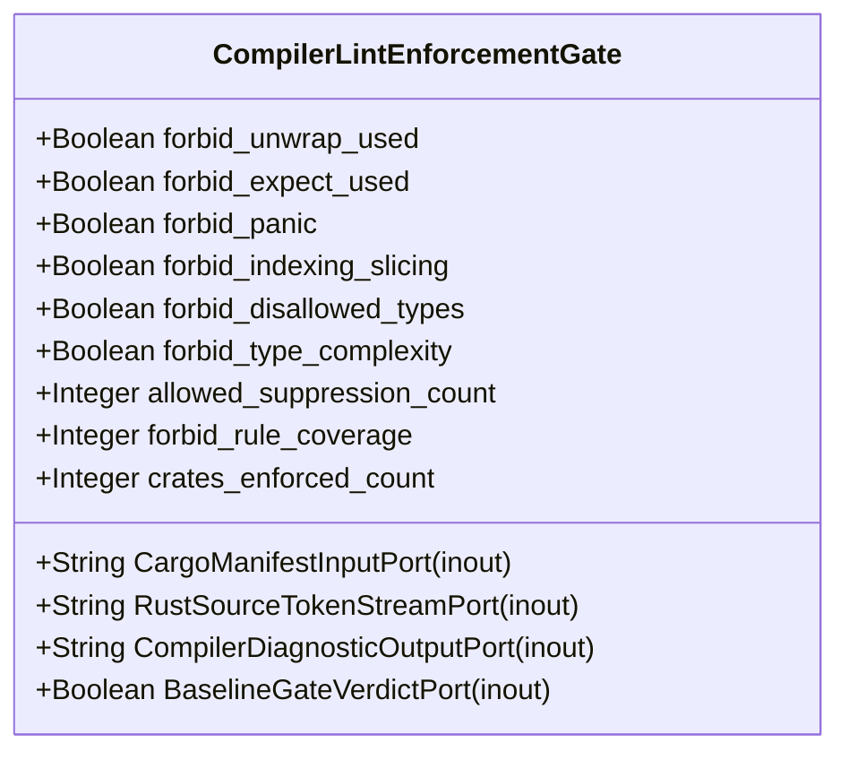

| Attribute | Specification Detail |
| :--- | :--- |
| **Issue ID** | #655 |
| **Title** | Feature 01: [BP 01 Compiler Enforced Forbid Lint Gate and Zero Suppression AST Architecture Blueprint] CompilerLintEnforcementGate |
| **Type** | feature |
| **Parent Epic** | [EPIC-01-BP_01_Compiler_Enforced_Forbid_Lint_Gate_and_Zero_Suppression_AST_Architecture_Blueprint](../epics/EPIC-01-BP_01_Compiler_Enforced_Forbid_Lint_Gate_and_Zero_Suppression_AST_Architecture_Blueprint.md) |
| **Interface Type** | Physical / Structural / Internal Bus |
| **Schema Containers** | `BP_01_Compiler_Enforced_Forbid_Lint_Gate_and_Zero_Suppression_AST_Architecture_Blueprint::CompilerLintEnforcementGate` |
| **Generation Mode** | subagent |
| **Specification Source** | [schema/model.sysml](../../schema/model.sysml) |

# Feature 01: [BP 01 Compiler Enforced Forbid Lint Gate and Zero Suppression AST Architecture Blueprint] CompilerLintEnforcementGate

## UML Class Diagram



## Interface Requirements
### 1. Test Data Shape
```json
{
  "$schema": "https://json-schema.org/draft/2020-12/schema",
  "title": "CompilerLintEnforcementGatePayloadSchema",
  "type": "object",
  "properties": {
    "part": {
      "type": "string",
      "const": "CompilerLintEnforcementGate"
    },
    "status": {
      "type": "string",
      "enum": ["nominal", "degraded", "fault"]
    },
    "forbid_unwrap_used": {
      "type": "boolean",
      "description": "Subsystem attribute forbid_unwrap_used"
    },
    "forbid_expect_used": {
      "type": "boolean",
      "description": "Subsystem attribute forbid_expect_used"
    },
    "forbid_panic": {
      "type": "boolean",
      "description": "Subsystem attribute forbid_panic"
    },
    "forbid_indexing_slicing": {
      "type": "boolean",
      "description": "Subsystem attribute forbid_indexing_slicing"
    },
    "forbid_disallowed_types": {
      "type": "boolean",
      "description": "Subsystem attribute forbid_disallowed_types"
    },
    "forbid_type_complexity": {
      "type": "boolean",
      "description": "Subsystem attribute forbid_type_complexity"
    },
    "allowed_suppression_count": {
      "type": "integer",
      "description": "Subsystem attribute allowed_suppression_count"
    },
    "forbid_rule_coverage": {
      "type": "integer",
      "description": "Subsystem attribute forbid_rule_coverage"
    },
    "crates_enforced_count": {
      "type": "integer",
      "description": "Subsystem attribute crates_enforced_count"
    },
    "CargoManifestInputPort": {
      "type": "object",
      "properties": {
        "direction": { "type": "string", "const": "inout" },
        "port_type": { "type": "string", "const": "String" }
      },
      "required": ["direction", "port_type"]
    },
    "RustSourceTokenStreamPort": {
      "type": "object",
      "properties": {
        "direction": { "type": "string", "const": "inout" },
        "port_type": { "type": "string", "const": "String" }
      },
      "required": ["direction", "port_type"]
    },
    "CompilerDiagnosticOutputPort": {
      "type": "object",
      "properties": {
        "direction": { "type": "string", "const": "inout" },
        "port_type": { "type": "string", "const": "String" }
      },
      "required": ["direction", "port_type"]
    },
    "BaselineGateVerdictPort": {
      "type": "object",
      "properties": {
        "direction": { "type": "string", "const": "inout" },
        "port_type": { "type": "string", "const": "Boolean" }
      },
      "required": ["direction", "port_type"]
    }
  },
  "required": [
    "part",
    "status",
    "forbid_unwrap_used",
    "forbid_expect_used",
    "forbid_panic",
    "forbid_indexing_slicing",
    "forbid_disallowed_types",
    "forbid_type_complexity",
    "allowed_suppression_count",
    "forbid_rule_coverage",
    "crates_enforced_count",
    "CargoManifestInputPort",
    "RustSourceTokenStreamPort",
    "CompilerDiagnosticOutputPort",
    "BaselineGateVerdictPort"
  ],
  "additionalProperties": false
}
```

### 2. Validation & Constraints
Formal constraints and invariant guarantees enforced by CompilerLintEnforcementGate.

### 3. Visual Layout & Arrangement
Logical layout, viewport containment, and container structure for CompilerLintEnforcementGate conforming to platform design tokens. Container boundaries enforce @container isolation rules.

### 4. Interactive Flow & States
Operational lifecycle events and discrete state transitions for CompilerLintEnforcementGate.

### Layer 1: Domain State & Signal Model
Domain state vector representing CompilerLintEnforcementGate status, AST references, and typed signal models.

### Layer 2: Logic & Safety State Management
Deterministic state machine solver and safety monitor logic for CompilerLintEnforcementGate.

### Layer 3: Presentation & Actuator Interface Binding
Presentation interface binding and diagnostic event routing for CompilerLintEnforcementGate.

### Associated Use Cases & User Stories

#### Associated Use Cases
- [ ] #624 - [Use Case 01: Rustc E0453 Hard Rejection of Inner and Outer Clippy Allow Attributes](../use-cases/UC-01-Rustc_E0453_Hard_Rejection_of_Inner_and_Outer_Clippy_Allow_Attributes.md)
- [ ] #625 - [Use Case 02: Check 34 Multi Line Whitespace Insensitive Suppression Rejection](../use-cases/UC-02-Check_34_Multi_Line_Whitespace_Insensitive_Suppression_Rejection.md)
- [ ] #626 - [Use Case 03: Unconditional Test Target Enforcement Without Conditional Exemption](../use-cases/UC-03-Unconditional_Test_Target_Enforcement_Without_Conditional_Exemption.md)
- [ ] #627 - [Use Case 04: Semantic Type Alias Replacement for Type Complexity](../use-cases/UC-04-Semantic_Type_Alias_Replacement_for_Type_Complexity.md)
- [ ] #628 - [Use Case 05: Dogfood Ingestion and Sys ML v2 Compilation of REQ 0601](../use-cases/UC-05-Dogfood_Ingestion_and_SysML_v2_Compilation_of_REQ_0601.md)

#### Associated User Stories
- [ ] #562 - [User Story 01: [CompilerLintEnforcementGate] Execute](../user-stories/US-01-Execute.md)
- [ ] #563 - [User Story 02: Read](../user-stories/US-02-Read.md)
- [ ] #564 - [User Story 03: [CompilerLintEnforcementGate] Return](../user-stories/US-03-Return.md)
- [ ] #565 - [User Story 04: [CompilerLintEnforcementGate] Emit](../user-stories/US-04-Emit.md)
- [ ] #566 - [User Story 05: [CompilerLintEnforcementGate] Run](../user-stories/US-05-Run.md)

## Acceptance Criteria (BDD)
- [ ] AC-01: Given nominal CompilerLintEnforcementGate domain state, When command or input signals are received, Then updates internal state and signal outputs within declared bounds.
- [ ] AC-02: Given operational state, When CompilerLintEnforcementGate evaluates constraint 'Invariant_REQ_0601_C_LINT_03', Then asserts invariant satisfaction without violation.
- [ ] AC-03: Given operational state, When CompilerLintEnforcementGate evaluates constraint 'Invariant_REQ_0601_FormalInvariant', Then asserts invariant satisfaction without violation.
- [ ] AC-04: Given malformed input signals or boundary condition violation, When CompilerLintEnforcementGate error handling is invoked, Then transitions safely to failsafe fallback state without corruption.

## Source References
Formal component specifications and normative systems engineering requirements:
- System Architecture Model: `schema/model.sysml`
- Normative Systems Engineering Standard: ISO/IEC/IEEE 15288:2023 §6.4.3 Architecture Definition Process

Component behavior and interface definitions derive from `schema/model.sysml` pursuant to ISO/IEC/IEEE 15288.
