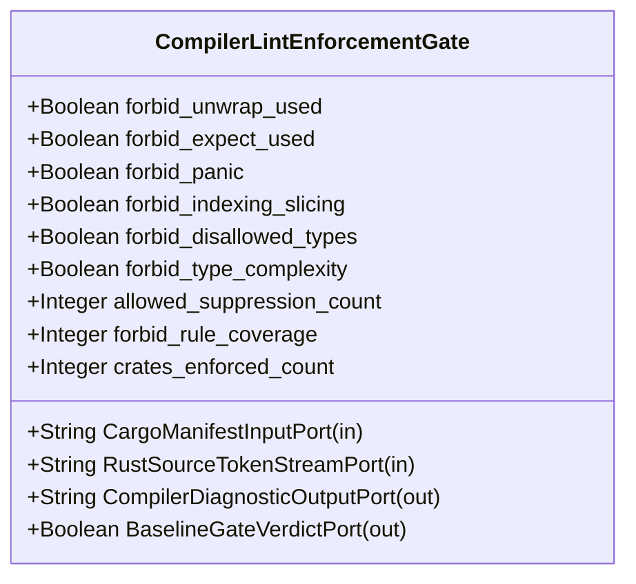

| Attribute | Specification Detail |
| :--- | :--- |
| **Issue ID** | #655 |
| **Title** | Feature 01: [BP 01 Compiler Enforced Forbid Lint Gate and Zero Suppression AST Architecture Blueprint] CompilerLintEnforcementGate |
| **Type** | feature |
| **Parent Epic** | [EPIC-01-BP_01_Compiler_Enforced_Forbid_Lint_Gate_and_Zero_Suppression_AST_Architecture_Blueprint](../epics/EPIC-01-BP_01_Compiler_Enforced_Forbid_Lint_Gate_and_Zero_Suppression_AST_Architecture_Blueprint.md) |
| **Interface Type** | Physical / Structural / Internal Bus |
| **Schema Containers** | `BP_01_Compiler_Enforced_Forbid_Lint_Gate_and_Zero_Suppression_AST_Architecture_Blueprint::CompilerLintEnforcementGate` |
| **Generation Mode** | subagent |
| **Specification Source** | [schema/model.sysml](../../schema/model.sysml) |

# Feature 01: [BP 01 Compiler Enforced Forbid Lint Gate and Zero Suppression AST Architecture Blueprint] CompilerLintEnforcementGate

## UML Class Diagram



## Interface Requirements
### 1. Test Data Shape
```json
{
  "$schema": "https://json-schema.org/draft/2020-12/schema",
  "title": "CompilerLintEnforcementGatePayloadSchema",
  "type": "object",
  "properties": {
    "part": {
      "type": "string",
      "const": "CompilerLintEnforcementGate"
    },
    "status": {
      "type": "string",
      "enum": ["nominal", "degraded", "fault"]
    },
    "forbid_unwrap_used": {
      "type": "boolean",
      "x-sysml-type": "Boolean",
      "description": "Declared attribute forbid_unwrap_used (Boolean)",
      "default": true
    },
    "forbid_expect_used": {
      "type": "boolean",
      "x-sysml-type": "Boolean",
      "description": "Configures `clippy::expect_used = \"forbid\"` across the workspace [unit: flag]",
      "default": true
    },
    "forbid_panic": {
      "type": "boolean",
      "x-sysml-type": "Boolean",
      "description": "Configures `clippy::panic = \"forbid\"` across the workspace [unit: flag]",
      "default": true
    },
    "forbid_indexing_slicing": {
      "type": "boolean",
      "x-sysml-type": "Boolean",
      "description": "Configures `clippy::indexing_slicing = \"forbid\"` across the workspace [unit: flag]",
      "default": true
    },
    "forbid_disallowed_types": {
      "type": "boolean",
      "x-sysml-type": "Boolean",
      "description": "Configures `clippy::disallowed_types = \"forbid\"` across the workspace [unit: flag]",
      "default": true
    },
    "forbid_type_complexity": {
      "type": "boolean",
      "x-sysml-type": "Boolean",
      "description": "Configures `clippy::type_complexity = \"forbid\"` across the workspace [unit: flag]",
      "default": true
    },
    "allowed_suppression_count": {
      "type": "integer",
      "x-sysml-type": "Integer",
      "description": "Maximum permitted `allow(clippy::` attribute occurrences across `crates/` [unit: count]",
      "default": 0
    },
    "forbid_rule_coverage": {
      "type": "integer",
      "x-sysml-type": "Integer",
      "description": "Percentage of workspace safety lints enforced at `forbid` level (**C-LINT-02**) [unit: percent]",
      "default": 100
    },
    "crates_enforced_count": {
      "type": "integer",
      "x-sysml-type": "Integer",
      "description": "Number of workspace member crates inheriting `[lints] workspace = true` (**C-LINT-03**) [unit: count]",
      "default": 6
    },
    "CargoManifestInputPort": {
      "type": "object",
      "properties": {
        "direction": { "type": "string", "const": "in" },
        "port_type": { "type": "string", "const": "String" }
      },
      "required": ["direction", "port_type"]
    },
    "RustSourceTokenStreamPort": {
      "type": "object",
      "properties": {
        "direction": { "type": "string", "const": "in" },
        "port_type": { "type": "string", "const": "String" }
      },
      "required": ["direction", "port_type"]
    },
    "CompilerDiagnosticOutputPort": {
      "type": "object",
      "properties": {
        "direction": { "type": "string", "const": "out" },
        "port_type": { "type": "string", "const": "String" }
      },
      "required": ["direction", "port_type"]
    },
    "BaselineGateVerdictPort": {
      "type": "object",
      "properties": {
        "direction": { "type": "string", "const": "out" },
        "port_type": { "type": "string", "const": "Boolean" }
      },
      "required": ["direction", "port_type"]
    }
  },
  "required": [
    "part",
    "status",
    "CargoManifestInputPort",
    "RustSourceTokenStreamPort",
    "CompilerDiagnosticOutputPort",
    "BaselineGateVerdictPort"
  ],
  "additionalProperties": false
}
```

### 2. Validation & Constraints
Declared structural attributes, boundary ports, invariants, and allocated requirements for classifier `CompilerLintEnforcementGate`:

| AST Member Kind | Identifier | Declared Type / Direction | Default / Invariant Contract |
| :--- | :--- | :--- | :--- |
| Attribute | `forbid_unwrap_used` | `Boolean` | Default `true` |
| Attribute | `forbid_expect_used` | `Boolean` | Default `true` |
| Attribute | `forbid_panic` | `Boolean` | Default `true` |
| Attribute | `forbid_indexing_slicing` | `Boolean` | Default `true` |
| Attribute | `forbid_disallowed_types` | `Boolean` | Default `true` |
| Attribute | `forbid_type_complexity` | `Boolean` | Default `true` |
| Attribute | `allowed_suppression_count` | `Integer` | Default `0` |
| Attribute | `forbid_rule_coverage` | `Integer` | Default `100` |
| Attribute | `crates_enforced_count` | `Integer` | Default `6` |
| Port | `CargoManifestInputPort` | `in String` | Boundary interface contract |
| Port | `RustSourceTokenStreamPort` | `in String` | Boundary interface contract |
| Port | `CompilerDiagnosticOutputPort` | `out String` | Boundary interface contract |
| Port | `BaselineGateVerdictPort` | `out Boolean` | Boundary interface contract |
| Constraint | `Invariant_REQ_0601_C_LINT_03` | Invariant (`REQ-0601 (REQ_0601_BP_01_Compiler_Enforced_Forbid_Lint_Gate_and_Zero_Suppression_AST_Architecture_Blueprint)`) | Declared structural invariant |
| Constraint | `Invariant_REQ_0601_FormalInvariant` | Invariant (`REQ-0601 (REQ_0601_BP_01_Compiler_Enforced_Forbid_Lint_Gate_and_Zero_Suppression_AST_Architecture_Blueprint)`) | Declared structural invariant |
| Requirement | `REQ-0601 (REQ_0601_BP_01_Compiler_Enforced_Forbid_Lint_Gate_and_Zero_Suppression_AST_Architecture_Blueprint)` | Allocated Requirement | The Digital Engineering Agent Platform (DEAP) specification and verification compiler (CompilerLintEnforcementGate, legacy blueprint reference DEAP-BP-DET-01, UUIDv5 6ba7b810-9dad-11d1-80b4-00c04fd430c1, Complexity Class P, diagnostic bindings **E0453**, **E0100**, **E0304**, governed by DO-178C |

```sysml
constraint Invariant_REQ_0601_C_LINT_03 {}
constraint Invariant_REQ_0601_FormalInvariant {}
```

### 3. Visual Layout & Arrangement
Structural composition and boundary topology for classifier `CompilerLintEnforcementGate` organize no nested subparts declared in schema paired with boundary ports `in CargoManifestInputPort : String`, `in RustSourceTokenStreamPort : String`, `out CompilerDiagnosticOutputPort : String`, `out BaselineGateVerdictPort : Boolean`.

### 4. Interactive Flow & States
Operational lifecycle events and discrete state transitions for CompilerLintEnforcementGate.

### Layer 1: Domain State & Signal Model
Classifier `CompilerLintEnforcementGate` encapsulates typed domain state attributes `forbid_unwrap_used : Boolean`, `forbid_expect_used : Boolean`, `forbid_panic : Boolean`, `forbid_indexing_slicing : Boolean`, `forbid_disallowed_types : Boolean`, `forbid_type_complexity : Boolean`, `allowed_suppression_count : Integer`, `forbid_rule_coverage : Integer`, `crates_enforced_count : Integer` alongside operational lifecycle status.

### Layer 2: Logic & Safety State Management
Classifier `CompilerLintEnforcementGate` governs stateless structural transition evaluation enforcing invariant obligations `Invariant_REQ_0601_C_LINT_03`, `Invariant_REQ_0601_FormalInvariant`.

### Layer 3: Presentation & Actuator Interface Binding
Classifier `CompilerLintEnforcementGate` binds external and behavioral interfaces across port `in CargoManifestInputPort : String`, port `in RustSourceTokenStreamPort : String`, port `out CompilerDiagnosticOutputPort : String`, port `out BaselineGateVerdictPort : Boolean`.

### Associated Use Cases & User Stories

#### Associated Use Cases
- [ ] #624 - [Use Case 01: Rustc E0453 Hard Rejection of Inner and Outer Clippy Allow Attributes](../use-cases/UC-01-Rustc_E0453_Hard_Rejection_of_Inner_and_Outer_Clippy_Allow_Attributes.md)
- [ ] #625 - [Use Case 02: Check 34 Multi Line Whitespace Insensitive Suppression Rejection](../use-cases/UC-02-Check_34_Multi_Line_Whitespace_Insensitive_Suppression_Rejection.md)
- [ ] #626 - [Use Case 03: Unconditional Test Target Enforcement Without Conditional Exemption](../use-cases/UC-03-Unconditional_Test_Target_Enforcement_Without_Conditional_Exemption.md)
- [ ] #627 - [Use Case 04: Semantic Type Alias Replacement for Type Complexity](../use-cases/UC-04-Semantic_Type_Alias_Replacement_for_Type_Complexity.md)
- [ ] #628 - [Use Case 05: Dogfood Ingestion and SysML v2 Compilation of REQ 0601](../use-cases/UC-05-Dogfood_Ingestion_and_SysML_v2_Compilation_of_REQ_0601.md)

#### Associated User Stories
- [ ] #700 - [User Story 01: Execute Cargo Clippy Workspace All Targets](../user-stories/US-01-ExecuteCargoClippyWorkspaceAllTargets.md)
- [ ] #701 - [User Story 02: Read Workspace Lints Clippy Forbid Table](../user-stories/US-02-ReadWorkspaceLintsClippyForbidTable.md)
- [ ] #702 - [User Story 03: Execute Verify Baseline No Domain](../user-stories/US-03-ExecuteVerifyBaselineNoDomain.md)
- [ ] #703 - [User Story 04: Run Scan Clippy Allow Tokens On](../user-stories/US-04-RunScanClippyAllowTokensOn.md)
- [ ] #704 - [User Story 05: Execute Ingest Sysml Schema Blueprint01](../user-stories/US-05-ExecuteIngestSysmlSchemaBlueprint01.md)

## Acceptance Criteria (BDD)
- [ ] AC-01: Given valid `CompilerLintEnforcementGate` inputs satisfying `Invariant_REQ_0601_C_LINT_03` [Req `REQ-0601 (REQ_0601_BP_01_Compiler_Enforced_Forbid_Lint_Gate_and_Zero_Suppression_AST_Architecture_Blueprint)`], When `CompilerLintEnforcementGate` evaluates invariant `Invariant_REQ_0601_C_LINT_03`, Then the invariant holds and verified state is committed.
- [ ] AC-02: Given boundary inputs that violate `Invariant_REQ_0601_C_LINT_03` [Req `REQ-0601 (REQ_0601_BP_01_Compiler_Enforced_Forbid_Lint_Gate_and_Zero_Suppression_AST_Architecture_Blueprint)`], When `CompilerLintEnforcementGate` evaluates invariant `Invariant_REQ_0601_C_LINT_03`, Then `CompilerLintEnforcementGate` rejects the invalid transition and routes a diagnostic via diagnostic port `CompilerDiagnosticOutputPort`.
- [ ] AC-03: Given valid `CompilerLintEnforcementGate` inputs satisfying `Invariant_REQ_0601_FormalInvariant` [Req `REQ-0601 (REQ_0601_BP_01_Compiler_Enforced_Forbid_Lint_Gate_and_Zero_Suppression_AST_Architecture_Blueprint)`], When `CompilerLintEnforcementGate` evaluates invariant `Invariant_REQ_0601_FormalInvariant`, Then the invariant holds and verified state is committed.
- [ ] AC-04: Given boundary inputs that violate `Invariant_REQ_0601_FormalInvariant` [Req `REQ-0601 (REQ_0601_BP_01_Compiler_Enforced_Forbid_Lint_Gate_and_Zero_Suppression_AST_Architecture_Blueprint)`], When `CompilerLintEnforcementGate` evaluates invariant `Invariant_REQ_0601_FormalInvariant`, Then `CompilerLintEnforcementGate` rejects the invalid transition and routes a diagnostic via diagnostic port `CompilerDiagnosticOutputPort`.
- [ ] AC-05: Given nominal typed values for `forbid_unwrap_used` (`Boolean`), `forbid_expect_used` (`Boolean`), `forbid_panic` (`Boolean`), `forbid_indexing_slicing` (`Boolean`), `forbid_disallowed_types` (`Boolean`), `forbid_type_complexity` (`Boolean`), `allowed_suppression_count` (`Integer`), `forbid_rule_coverage` (`Integer`), `crates_enforced_count` (`Integer`) across `CargoManifestInputPort` (`in String`), `RustSourceTokenStreamPort` (`in String`), `CompilerDiagnosticOutputPort` (`out String`), `BaselineGateVerdictPort` (`out Boolean`), When `CompilerLintEnforcementGate` executes structural interface processing, Then state and output ports conform to declared schema types.
- [ ] AC-06: Given malformed input frames across `forbid_unwrap_used` (`Boolean`), `forbid_expect_used` (`Boolean`), `forbid_panic` (`Boolean`), `forbid_indexing_slicing` (`Boolean`), `forbid_disallowed_types` (`Boolean`), `forbid_type_complexity` (`Boolean`), `allowed_suppression_count` (`Integer`), `forbid_rule_coverage` (`Integer`), `crates_enforced_count` (`Integer`) or `CargoManifestInputPort` (`in String`), `RustSourceTokenStreamPort` (`in String`), `CompilerDiagnosticOutputPort` (`out String`), `BaselineGateVerdictPort` (`out Boolean`), When `CompilerLintEnforcementGate` boundary validation executes, Then `CompilerLintEnforcementGate` rejects the malformed input via diagnostic port `CompilerDiagnosticOutputPort`.

## Source References
Formal component specifications and normative systems engineering requirements:
- System Architecture Model: `schema/model.sysml`
- Normative Systems Engineering Standard: ISO/IEC/IEEE 15288:2023 §6.4.3 Architecture Definition Process

Component behavior and interface definitions derive from `schema/model.sysml` pursuant to ISO/IEC/IEEE 15288.
