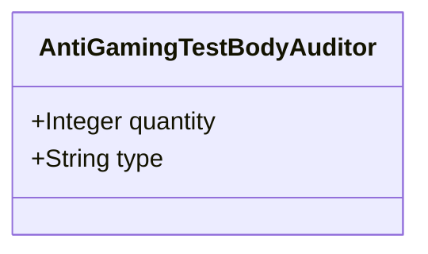

| Attribute | Specification Detail |
| :--- | :--- |
| **Issue ID** | #662 |
| **Title** | Feature 06: [BP 02 Check 34 AST Purity Fail Closed IO and Anti Gaming Test Gate Blueprint] AntiGamingTestBodyAuditor |
| **Type** | feature |
| **Parent Epic** | [EPIC-02-BP_02_Check_34_AST_Purity_Fail_Closed_IO_and_Anti_Gaming_Test_Gate_Blueprint](../epics/EPIC-02-BP_02_Check_34_AST_Purity_Fail_Closed_IO_and_Anti_Gaming_Test_Gate_Blueprint.md) |
| **Interface Type** | Physical / Structural / Internal Bus |
| **Schema Containers** | `BP_02_Check_34_AST_Purity_Fail_Closed_IO_and_Anti_Gaming_Test_Gate_Blueprint::AntiGamingTestBodyAuditor` |
| **Generation Mode** | subagent |
| **Specification Source** | [schema/model.sysml](../../schema/model.sysml) |

# Feature 06: [BP 02 Check 34 AST Purity Fail Closed IO and Anti Gaming Test Gate Blueprint] AntiGamingTestBodyAuditor

## UML Class Diagram



## Interface Requirements
### 1. Test Data Shape
```json
{
  "$schema": "https://json-schema.org/draft/2020-12/schema",
  "title": "AntiGamingTestBodyAuditorPayloadSchema",
  "type": "object",
  "properties": {
    "part": {
      "type": "string",
      "const": "AntiGamingTestBodyAuditor"
    },
    "status": {
      "type": "string",
      "enum": ["nominal", "degraded", "fault"]
    },
    "quantity": {
      "type": "integer",
      "x-sysml-type": "Integer",
      "description": "Declared attribute quantity (Integer)",
      "default": 1
    },
    "type": {
      "type": "string",
      "x-sysml-type": "String",
      "description": "Declared attribute type (String)",
      "default": "Subcomponent"
    }
  },
  "required": [
    "part",
    "status"
  ],
  "additionalProperties": false
}
```

### 2. Validation & Constraints
Declared structural attributes, boundary ports, invariants, and allocated requirements for classifier `AntiGamingTestBodyAuditor`:

| AST Member Kind | Identifier | Declared Type / Direction | Default / Invariant Contract |
| :--- | :--- | :--- | :--- |
| Attribute | `quantity` | `Integer` | Default `1` |
| Attribute | `type` | `String` | Default `"Subcomponent"` |
| Constraint | `Invariant_REQ_0602_SC_01` | Invariant (`REQ-0602 (REQ_0602_BP_02_Check_34_AST_Purity_Fail_Closed_IO_and_Anti_Gaming_Test_Gate_Blueprint)`) | Declared structural invariant |
| Constraint | `Invariant_REQ_0602_SC_02` | Invariant (`REQ-0602 (REQ_0602_BP_02_Check_34_AST_Purity_Fail_Closed_IO_and_Anti_Gaming_Test_Gate_Blueprint)`) | Declared structural invariant |
| Requirement | `REQ-0602 (REQ_0602_BP_02_Check_34_AST_Purity_Fail_Closed_IO_and_Anti_Gaming_Test_Gate_Blueprint)` | Allocated Requirement | During iterative compiler hardening across the Digital Engineering Agent Platform (DEAP) specification core (DEAP01-spec-core), delegating self-audit unit tests and structural safety checks to LLM subagents produced systematic test gaming, narrow literal checks, and fail-open error handling. Under Contract A (full OMG SysML v2.0 + KerML 1.0 grammar coverage, zero 16-construct caps) and Contract B (`ra_ap_syntax` typed `ast::{MatchExpr, MatchArmList, CallExpr, MethodCallExpr, TryExpr}` I/O purity + `cargo_metadata`, `cargo-lock`, `cargo-util-schemas`, `cargo-platform`, `toml_edit`, zero hand-rolled scanner mandates), `AntiGamingTestBodyAuditor` enforces non-vacuous test AST verification and `< 380`-SLOC submodule modularity. |

```sysml
constraint Invariant_REQ_0602_SC_01 {}
constraint Invariant_REQ_0602_SC_02 {}
```

### 3. Visual Layout & Arrangement
Structural composition and boundary topology for classifier `AntiGamingTestBodyAuditor` organize no nested subparts declared in schema paired with no external boundary ports declared in schema, decomposed into `< 380`-SLOC submodules under `./crates/verify-baseline/src/ast_purity/` with explicit deletion of legacy hand-rolled string and line scanners.

### 4. Interactive Flow & States
Operational lifecycle events and discrete state transitions for `AntiGamingTestBodyAuditor` across `BP_02_Check_34_AST_Purity_Fail_Closed_IO_and_Anti_Gaming_Test_Gate_Blueprint_LifecycleState`.

### Layer 1: Domain State & Signal Model
Classifier `AntiGamingTestBodyAuditor` encapsulates typed domain state attributes `quantity : Integer`, `type : String` alongside operational lifecycle status, lossless `ra_ap_syntax` (`ast::{MatchExpr, MatchArmList, CallExpr, MethodCallExpr, TryExpr, Fn, HasDocComments, HasAttrs}`) CST nodes, `cargo_metadata` / `cargo-lock` / `cargo-util-schemas` / `cargo-platform` / `toml_edit` workspace metadata, and full OMG SysML v2.0 + KerML 1.0 grammar AST projections (zero 16-construct caps).

### Layer 2: Logic & Safety State Management
Classifier `AntiGamingTestBodyAuditor` governs stateless structural transition evaluation enforcing invariant obligations `Invariant_REQ_0602_SC_01`, `Invariant_REQ_0602_SC_02` via typed `ra_ap_syntax` AST traversal (`ast::{MatchExpr, MatchArmList, CallExpr, MethodCallExpr, TryExpr}`) with zero hand-rolled scanners, targeting `< 380`-SLOC submodules and explicit legacy hand-rolled scanner deletion.

### Layer 3: Presentation & Actuator Interface Binding
Classifier `AntiGamingTestBodyAuditor` exposes an internal structural boundary coupled to `Check34AstPurityAndAntiGamingGate` via `BP_02_AuditorToPurityGateConnection`, routing `ariadne` / `miette` diagnostics for vacuous `outer test` bodies, `std::mem::size_of` tautologies, conditional `.exists()` skips, and non-RAII `std::env::temp_dir()` paths.

### Associated Use Cases & User Stories

#### Associated Use Cases
- [ ] #629 - [Use Case 06: General Direct Range Slice Indexing Rejection](../use-cases/UC-06-General_Direct_Range_Slice_Indexing_Rejection.md)
- [ ] #630 - [Use Case 07: Fail Closed Filesystem and Walk Dir Enforcement](../use-cases/UC-07-Fail_Closed_Filesystem_and_WalkDir_Enforcement.md)
- [ ] #631 - [Use Case 08: Anti Gaming Test Body AST Enforcement](../use-cases/UC-08-Anti_Gaming_Test_Body_AST_Enforcement.md)
- [ ] #632 - [Use Case 09: SSOT Cryptographic and Lexer Deduplication](../use-cases/UC-09-SSOT_Cryptographic_and_Lexer_Deduplication.md)
- [ ] #633 - [Use Case 10: Deterministic Dogfood Ingestion into Canonical SysML v2](../use-cases/UC-10-Deterministic_Dogfood_Ingestion_into_Canonical_SysML_v2.md)

#### Associated User Stories
- [ ] #567 - [User Story 06: Check Compiler Ast Purity](../user-stories/US-06-check_compiler_ast_purity.md)
- [ ] #568 - [User Story 07: Mask Literals And Comments](../user-stories/US-07-mask_literals_and_comments.md)
- [ ] #570 - [User Story 08: Contains Direct Range Slice](../user-stories/US-08-contains_direct_range_slice.md)
- [ ] #571 - [User Story 09: Audit Fail Closed Io Patterns](../user-stories/US-09-audit_fail_closed_io_patterns.md)
- [ ] #572 - [User Story 10: Audit Test Integrity And Anti Gaming](../user-stories/US-10-audit_test_integrity_and_anti_gaming.md)
- [ ] #574 - [User Story 11: Audit Ssot Symbol Deduplication](../user-stories/US-11-audit_ssot_symbol_deduplication.md)

## Acceptance Criteria (BDD)
- [ ] AC-01: Given valid `AntiGamingTestBodyAuditor` inputs satisfying `Invariant_REQ_0602_SC_01` [Req `REQ-0602 (REQ_0602_BP_02_Check_34_AST_Purity_Fail_Closed_IO_and_Anti_Gaming_Test_Gate_Blueprint)`], When `AntiGamingTestBodyAuditor` evaluates invariant `Invariant_REQ_0602_SC_01`, Then the invariant holds and verified state is committed.
- [ ] AC-02: Given boundary inputs that violate `Invariant_REQ_0602_SC_01` [Req `REQ-0602 (REQ_0602_BP_02_Check_34_AST_Purity_Fail_Closed_IO_and_Anti_Gaming_Test_Gate_Blueprint)`], When `AntiGamingTestBodyAuditor` evaluates invariant `Invariant_REQ_0602_SC_01`, Then `AntiGamingTestBodyAuditor` rejects the invalid transition and routes a diagnostic via deterministic error diagnostic output.
- [ ] AC-03: Given valid `AntiGamingTestBodyAuditor` inputs satisfying `Invariant_REQ_0602_SC_02` [Req `REQ-0602 (REQ_0602_BP_02_Check_34_AST_Purity_Fail_Closed_IO_and_Anti_Gaming_Test_Gate_Blueprint)`], When `AntiGamingTestBodyAuditor` evaluates invariant `Invariant_REQ_0602_SC_02`, Then the invariant holds and verified state is committed.
- [ ] AC-04: Given boundary inputs that violate `Invariant_REQ_0602_SC_02` [Req `REQ-0602 (REQ_0602_BP_02_Check_34_AST_Purity_Fail_Closed_IO_and_Anti_Gaming_Test_Gate_Blueprint)`], When `AntiGamingTestBodyAuditor` evaluates invariant `Invariant_REQ_0602_SC_02`, Then `AntiGamingTestBodyAuditor` rejects the invalid transition and routes a diagnostic via deterministic error diagnostic output.
- [ ] AC-05: Given nominal typed values for `quantity` (`Integer`), `type` (`String`) across `AntiGamingTestBodyAuditor` structural boundary, When `AntiGamingTestBodyAuditor` executes structural interface processing, Then state and output ports conform to declared schema types.
- [ ] AC-06: Given malformed input frames across `quantity` (`Integer`), `type` (`String`) or `AntiGamingTestBodyAuditor` structural boundary, When `AntiGamingTestBodyAuditor` boundary validation executes, Then `AntiGamingTestBodyAuditor` rejects the malformed input via deterministic error diagnostic output.

## Source References
Formal component specifications and normative systems engineering requirements:
- System Architecture Model: `schema/model.sysml`
- Normative Systems Engineering Standard: ISO/IEC/IEEE 15288:2023 §6.4.3 Architecture Definition Process

Component behavior and interface definitions derive from `schema/model.sysml` pursuant to ISO/IEC/IEEE 15288.
