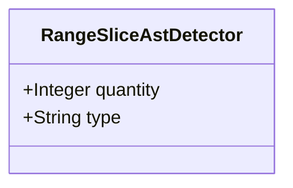

| Attribute | Specification Detail |
| :--- | :--- |
| **Issue ID** | #660 |
| **Title** | Feature 06: [BP 02 Check 34 AST Purity Fail Closed IO and Anti Gaming Test Gate Blueprint] RangeSliceAstDetector |
| **Type** | feature |
| **Parent Epic** | [EPIC-02-BP_02_Check_34_AST_Purity_Fail_Closed_IO_and_Anti_Gaming_Test_Gate_Blueprint](../epics/EPIC-02-BP_02_Check_34_AST_Purity_Fail_Closed_IO_and_Anti_Gaming_Test_Gate_Blueprint.md) |
| **Interface Type** | Physical / Structural / Internal Bus |
| **Schema Containers** | `BP_02_Check_34_AST_Purity_Fail_Closed_IO_and_Anti_Gaming_Test_Gate_Blueprint::RangeSliceAstDetector` |
| **Generation Mode** | subagent |
| **Specification Source** | [schema/model.sysml](../../schema/model.sysml) |

# Feature 06: [BP 02 Check 34 AST Purity Fail Closed IO and Anti Gaming Test Gate Blueprint] RangeSliceAstDetector

## UML Class Diagram



## Interface Requirements
### 1. Test Data Shape
```json
{
  "$schema": "https://json-schema.org/draft/2020-12/schema",
  "title": "RangeSliceAstDetectorPayloadSchema",
  "type": "object",
  "properties": {
    "part": {
      "type": "string",
      "const": "RangeSliceAstDetector"
    },
    "status": {
      "type": "string",
      "enum": ["nominal", "degraded", "fault"]
    },
    "quantity": {
      "type": "integer",
      "description": "Subsystem attribute quantity"
    },
    "type": {
      "type": "string",
      "description": "Subsystem attribute type"
    }
  },
  "required": [
    "part",
    "status",
    "quantity",
    "type"
  ],
  "additionalProperties": false
}
```

### 2. Validation & Constraints
Formal constraints and invariant guarantees enforced by RangeSliceAstDetector.

### 3. Visual Layout & Arrangement
Logical layout, viewport containment, and container structure for RangeSliceAstDetector conforming to platform design tokens. Container boundaries enforce @container isolation rules.

### 4. Interactive Flow & States
Operational lifecycle events and discrete state transitions for RangeSliceAstDetector.

### Layer 1: Domain State & Signal Model
Domain state vector representing RangeSliceAstDetector status, AST references, and typed signal models.

### Layer 2: Logic & Safety State Management
Deterministic state machine solver and safety monitor logic for RangeSliceAstDetector.

### Layer 3: Presentation & Actuator Interface Binding
Presentation interface binding and diagnostic event routing for RangeSliceAstDetector.

### Associated Use Cases & User Stories

#### Associated Use Cases
- [ ] #629 - [Use Case 06: General Direct Range Slice Indexing Rejection](../use-cases/UC-06-General_Direct_Range_Slice_Indexing_Rejection.md)
- [ ] #630 - [Use Case 07: Fail Closed Filesystem and Walk Dir Enforcement](../use-cases/UC-07-Fail_Closed_Filesystem_and_WalkDir_Enforcement.md)
- [ ] #631 - [Use Case 08: Anti Gaming Test Body AST Enforcement](../use-cases/UC-08-Anti_Gaming_Test_Body_AST_Enforcement.md)
- [ ] #632 - [Use Case 09: SSOT Cryptographic and Lexer Deduplication](../use-cases/UC-09-SSOT_Cryptographic_and_Lexer_Deduplication.md)
- [ ] #633 - [Use Case 10: Deterministic Dogfood Ingestion into Canonical Sys ML v2](../use-cases/UC-10-Deterministic_Dogfood_Ingestion_into_Canonical_SysML_v2.md)

#### Associated User Stories
- [ ] #567 - [User Story 06: check compiler ast purity](../user-stories/US-06-check_compiler_ast_purity.md)
- [ ] #568 - [User Story 07: mask literals and comments](../user-stories/US-07-mask_literals_and_comments.md)
- [ ] #569 - [User Story 08: Masked](../user-stories/US-08-Masked.md)
- [ ] #570 - [User Story 09: contains direct range slice](../user-stories/US-09-contains_direct_range_slice.md)
- [ ] #571 - [User Story 10: audit fail closed io patterns](../user-stories/US-10-audit_fail_closed_io_patterns.md)
- [ ] #572 - [User Story 11: audit test integrity and anti gaming](../user-stories/US-11-audit_test_integrity_and_anti_gaming.md)
- [ ] #573 - [User Story 12: C PURITY 03](../user-stories/US-12-C_PURITY_03.md)
- [ ] #574 - [User Story 13: audit ssot symbol deduplication](../user-stories/US-13-audit_ssot_symbol_deduplication.md)
- [ ] #575 - [User Story 14: C PURITY 04](../user-stories/US-14-C_PURITY_04.md)
- [ ] #576 - [User Story 15: Sorted](../user-stories/US-15-Sorted.md)

## Acceptance Criteria (BDD)
- [ ] AC-01: Given nominal RangeSliceAstDetector domain state, When command or input signals are received, Then updates internal state and signal outputs within declared bounds.
- [ ] AC-02: Given operational state, When RangeSliceAstDetector evaluates constraint 'Invariant_REQ_0602_SC_01', Then asserts invariant satisfaction without violation.
- [ ] AC-03: Given operational state, When RangeSliceAstDetector evaluates constraint 'Invariant_REQ_0602_SC_02', Then asserts invariant satisfaction without violation.
- [ ] AC-04: Given malformed input signals or boundary condition violation, When RangeSliceAstDetector error handling is invoked, Then transitions safely to failsafe fallback state without corruption.

## Source References
Formal component specifications and normative systems engineering requirements:
- System Architecture Model: `schema/model.sysml`
- Normative Systems Engineering Standard: ISO/IEC/IEEE 15288:2023 §6.4.3 Architecture Definition Process

Component behavior and interface definitions derive from `schema/model.sysml` pursuant to ISO/IEC/IEEE 15288.
