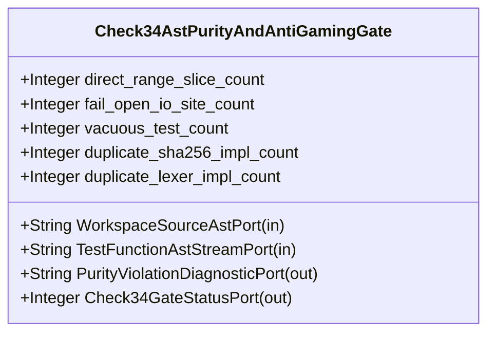

| Attribute | Specification Detail |
| :--- | :--- |
| **Issue ID** | #664 |
| **Title** | Feature 07: [BP 02 Check 34 AST Purity Fail Closed IO and Anti Gaming Test Gate Blueprint] Check34AstPurityAndAntiGamingGate |
| **Type** | feature |
| **Parent Epic** | [EPIC-02-BP_02_Check_34_AST_Purity_Fail_Closed_IO_and_Anti_Gaming_Test_Gate_Blueprint](../epics/EPIC-02-BP_02_Check_34_AST_Purity_Fail_Closed_IO_and_Anti_Gaming_Test_Gate_Blueprint.md) |
| **Interface Type** | Physical / Structural / Internal Bus |
| **Schema Containers** | `BP_02_Check_34_AST_Purity_Fail_Closed_IO_and_Anti_Gaming_Test_Gate_Blueprint::Check34AstPurityAndAntiGamingGate` |
| **Generation Mode** | subagent |
| **Specification Source** | [schema/model.sysml](../../schema/model.sysml) |

# Feature 07: [BP 02 Check 34 AST Purity Fail Closed IO and Anti Gaming Test Gate Blueprint] Check34AstPurityAndAntiGamingGate

## UML Class Diagram



## Interface Requirements
### 1. Test Data Shape
```json
{
  "$schema": "https://json-schema.org/draft/2020-12/schema",
  "title": "Check34AstPurityAndAntiGamingGatePayloadSchema",
  "type": "object",
  "properties": {
    "part": {
      "type": "string",
      "const": "Check34AstPurityAndAntiGamingGate"
    },
    "status": {
      "type": "string",
      "enum": ["nominal", "degraded", "fault"]
    },
    "direct_range_slice_count": {
      "type": "integer",
      "x-sysml-type": "Integer",
      "description": "Declared attribute direct_range_slice_count (Integer)",
      "default": 0
    },
    "fail_open_io_site_count": {
      "type": "integer",
      "x-sysml-type": "Integer",
      "description": "Total detected fail-open filesystem or directory traversal error-swallowing call sites across workspace crates [unit: count]",
      "default": 0
    },
    "vacuous_test_count": {
      "type": "integer",
      "x-sysml-type": "Integer",
      "description": "Total `#[test]` functions exhibiting zero assertions, `mem::size_of` dummy checks, conditional `.exists()` skips, or shared temp paths [unit: count]",
      "default": 0
    },
    "duplicate_sha256_impl_count": {
      "type": "integer",
      "x-sysml-type": "Integer",
      "description": "Total occurrences of SHA-256 round constant `0x428a2f98` outside `crates/deap-core/src/digest.rs` [unit: count]",
      "default": 0
    },
    "duplicate_lexer_impl_count": {
      "type": "integer",
      "x-sysml-type": "Integer",
      "description": "Total duplicate Rust source lexical state machines defined outside `crates/deap-core/src/source_ast.rs` [unit: count]",
      "default": 0
    },
    "WorkspaceSourceAstPort": {
      "type": "object",
      "properties": {
        "direction": { "type": "string", "const": "in" },
        "port_type": { "type": "string", "const": "String" }
      },
      "required": ["direction", "port_type"]
    },
    "TestFunctionAstStreamPort": {
      "type": "object",
      "properties": {
        "direction": { "type": "string", "const": "in" },
        "port_type": { "type": "string", "const": "String" }
      },
      "required": ["direction", "port_type"]
    },
    "PurityViolationDiagnosticPort": {
      "type": "object",
      "properties": {
        "direction": { "type": "string", "const": "out" },
        "port_type": { "type": "string", "const": "String" }
      },
      "required": ["direction", "port_type"]
    },
    "Check34GateStatusPort": {
      "type": "object",
      "properties": {
        "direction": { "type": "string", "const": "out" },
        "port_type": { "type": "string", "const": "Integer" }
      },
      "required": ["direction", "port_type"]
    }
  },
  "required": [
    "part",
    "status",
    "WorkspaceSourceAstPort",
    "TestFunctionAstStreamPort",
    "PurityViolationDiagnosticPort",
    "Check34GateStatusPort"
  ],
  "additionalProperties": false
}
```

### 2. Validation & Constraints
Declared structural attributes, boundary ports, invariants, and allocated requirements for classifier `Check34AstPurityAndAntiGamingGate`:

| AST Member Kind | Identifier | Declared Type / Direction | Default / Invariant Contract |
| :--- | :--- | :--- | :--- |
| Attribute | `direct_range_slice_count` | `Integer` | Default `0` |
| Attribute | `fail_open_io_site_count` | `Integer` | Default `0` |
| Attribute | `vacuous_test_count` | `Integer` | Default `0` |
| Attribute | `duplicate_sha256_impl_count` | `Integer` | Default `0` |
| Attribute | `duplicate_lexer_impl_count` | `Integer` | Default `0` |
| Port | `WorkspaceSourceAstPort` | `in String` | Boundary interface contract |
| Port | `TestFunctionAstStreamPort` | `in String` | Boundary interface contract |
| Port | `PurityViolationDiagnosticPort` | `out String` | Boundary interface contract |
| Port | `Check34GateStatusPort` | `out Integer` | Boundary interface contract |

### 3. Visual Layout & Arrangement
Structural composition and boundary topology for classifier `Check34AstPurityAndAntiGamingGate` organize no nested subparts declared in schema paired with boundary ports `in WorkspaceSourceAstPort : String`, `in TestFunctionAstStreamPort : String`, `out PurityViolationDiagnosticPort : String`, `out Check34GateStatusPort : Integer`.

### 4. Interactive Flow & States
Operational lifecycle events and discrete state transitions for Check34AstPurityAndAntiGamingGate.

### Layer 1: Domain State & Signal Model
Classifier `Check34AstPurityAndAntiGamingGate` encapsulates typed domain state attributes `direct_range_slice_count : Integer`, `fail_open_io_site_count : Integer`, `vacuous_test_count : Integer`, `duplicate_sha256_impl_count : Integer`, `duplicate_lexer_impl_count : Integer` alongside operational lifecycle status.

### Layer 2: Logic & Safety State Management
Classifier `Check34AstPurityAndAntiGamingGate` governs stateless structural transition evaluation enforcing no additional invariant guards declared in schema.

### Layer 3: Presentation & Actuator Interface Binding
Classifier `Check34AstPurityAndAntiGamingGate` binds external and behavioral interfaces across port `in WorkspaceSourceAstPort : String`, port `in TestFunctionAstStreamPort : String`, port `out PurityViolationDiagnosticPort : String`, port `out Check34GateStatusPort : Integer`.

### Associated Use Cases & User Stories

#### Associated Use Cases
- None allocated (structural subsystem component)

#### Associated User Stories
- [ ] #567 - [User Story 06: check compiler ast purity](../user-stories/US-06-check_compiler_ast_purity.md)
- [ ] #568 - [User Story 07: mask literals and comments](../user-stories/US-07-mask_literals_and_comments.md)
- [ ] #570 - [User Story 08: contains direct range slice](../user-stories/US-08-contains_direct_range_slice.md)
- [ ] #571 - [User Story 09: audit fail closed io patterns](../user-stories/US-09-audit_fail_closed_io_patterns.md)
- [ ] #572 - [User Story 10: audit test integrity and anti gaming](../user-stories/US-10-audit_test_integrity_and_anti_gaming.md)
- [ ] #574 - [User Story 11: audit ssot symbol deduplication](../user-stories/US-11-audit_ssot_symbol_deduplication.md)

## Acceptance Criteria (BDD)
- [ ] AC-01: Given valid `Check34AstPurityAndAntiGamingGate` initialization inputs for `direct_range_slice_count` (`Integer`), `fail_open_io_site_count` (`Integer`), `vacuous_test_count` (`Integer`), `duplicate_sha256_impl_count` (`Integer`), `duplicate_lexer_impl_count` (`Integer`) (no additional constraints specified in schema), When `Check34AstPurityAndAntiGamingGate` commits typed domain state, Then declared state attributes hold verified values.
- [ ] AC-02: Given malformed or out-of-domain input values for `direct_range_slice_count` (`Integer`), `fail_open_io_site_count` (`Integer`), `vacuous_test_count` (`Integer`), `duplicate_sha256_impl_count` (`Integer`), `duplicate_lexer_impl_count` (`Integer`), When `Check34AstPurityAndAntiGamingGate` validates incoming state updates, Then `Check34AstPurityAndAntiGamingGate` rejects the invalid state update and emits a diagnostic via diagnostic port `PurityViolationDiagnosticPort`.
- [ ] AC-03: Given nominal signal arrival across `WorkspaceSourceAstPort` (`in String`), `TestFunctionAstStreamPort` (`in String`), `PurityViolationDiagnosticPort` (`out String`), `Check34GateStatusPort` (`out Integer`), When `Check34AstPurityAndAntiGamingGate` processes the declared interface transaction, Then output state conforms to the structural classifier contract.
- [ ] AC-04: Given an invalid or unrecognized interface frame across `WorkspaceSourceAstPort` (`in String`), `TestFunctionAstStreamPort` (`in String`), `PurityViolationDiagnosticPort` (`out String`), `Check34GateStatusPort` (`out Integer`), When `Check34AstPurityAndAntiGamingGate` boundary validation executes, Then `Check34AstPurityAndAntiGamingGate` refuses the malformed frame via diagnostic port `PurityViolationDiagnosticPort` and preserves prior verified state.

## Source References
Formal component specifications and normative systems engineering requirements:
- System Architecture Model: `schema/model.sysml`
- Normative Systems Engineering Standard: ISO/IEC/IEEE 15288:2023 §6.4.3 Architecture Definition Process

Component behavior and interface definitions derive from `schema/model.sysml` pursuant to ISO/IEC/IEEE 15288.
