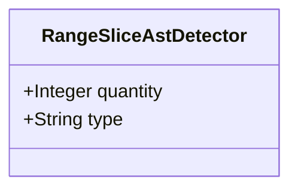

| Attribute | Specification Detail |
| :--- | :--- |
| **Issue ID** | #660 |
| **Title** | Feature 09: [BP 02 Check 34 AST Purity Fail Closed IO and Anti Gaming Test Gate Blueprint] RangeSliceAstDetector |
| **Type** | feature |
| **Parent Epic** | [EPIC-02-BP_02_Check_34_AST_Purity_Fail_Closed_IO_and_Anti_Gaming_Test_Gate_Blueprint](../epics/EPIC-02-BP_02_Check_34_AST_Purity_Fail_Closed_IO_and_Anti_Gaming_Test_Gate_Blueprint.md) (#686) |
| **Interface Type** | Physical / Structural / Internal Bus |
| **Schema Containers** | `BP_02_Check_34_AST_Purity_Fail_Closed_IO_and_Anti_Gaming_Test_Gate_Blueprint::RangeSliceAstDetector` |
| **Generation Mode** | subagent |
| **Specification Source** | [schema/model.sysml](../../schema/model.sysml) |

# Feature 09: [BP 02 Check 34 AST Purity Fail Closed IO and Anti Gaming Test Gate Blueprint] RangeSliceAstDetector

## UML Class Diagram



## Interface Requirements
### 1. Test Data Shape
```json
{
  "$schema": "https://json-schema.org/draft/2020-12/schema",
  "title": "RangeSliceAstDetectorPayloadSchema",
  "type": "object",
  "properties": {
    "part": {
      "type": "string",
      "const": "RangeSliceAstDetector"
    },
    "status": {
      "type": "string",
      "enum": ["nominal", "degraded", "fault"]
    },
    "quantity": {
      "type": "integer",
      "x-sysml-type": "Integer",
      "description": "Declared attribute quantity (Integer)",
      "default": 1
    },
    "type": {
      "type": "string",
      "x-sysml-type": "String",
      "description": "Declared attribute type (String)",
      "default": "Subcomponent"
    }
  },
  "required": [
    "part",
    "status"
  ],
  "additionalProperties": false
}
```

### 2. Validation & Constraints
Declared structural attributes, boundary ports, invariants, and allocated requirements for classifier `RangeSliceAstDetector`:

| AST Member Kind | Identifier | Declared Type / Direction | Default / Invariant Contract |
| :--- | :--- | :--- | :--- |
| Attribute | `quantity` | `Integer` | Default `1` |
| Attribute | `type` | `String` | Default `"Subcomponent"` |

### 3. Visual Layout & Arrangement
Structural composition and boundary topology for classifier `RangeSliceAstDetector` organize no nested subparts declared in schema paired with no external boundary ports declared in schema, modularized into `< 380`-SLOC submodules (`./crates/verify-baseline/src/ast_purity/` and `./crates/deap-core/src/rust_cst/`) with explicit legacy hand-rolled scanner deletion.

### 4. Interactive Flow & States
Operational lifecycle events and discrete state transitions for `RangeSliceAstDetector` enforcing Contract A (full OMG SysML v2.0 + KerML 1.0 grammar coverage, zero 16-construct caps) and Contract B (`ra_ap_syntax` typed `ast::{MatchExpr, MatchArmList, CallExpr, MethodCallExpr, TryExpr, IndexExpr}` I/O and slice purity + `cargo_metadata`, `cargo-lock`, `cargo-util-schemas`, `cargo-platform`, `toml_edit`, zero hand-rolled scanner mandates).

### Layer 1: Domain State & Signal Model
Classifier `RangeSliceAstDetector` encapsulates typed domain state attributes `quantity : Integer`, `type : String` alongside operational lifecycle status, typed `ra_ap_syntax` (`ast::{IndexExpr, MatchExpr, MatchArmList, CallExpr, MethodCallExpr, TryExpr}`) syntax nodes, `cargo_metadata`, `cargo-lock`, `cargo-util-schemas`, `cargo-platform`, and `toml_edit` workspace metadata, and full OMG SysML v2.0 + KerML 1.0 grammar representations (zero 16-construct caps).

### Layer 2: Logic & Safety State Management
Classifier `RangeSliceAstDetector` governs stateless structural transition evaluation enforcing `C-PURITY-01` (`Invariant_REQ_0602_SC_01`, `Invariant_REQ_0602_SC_02`) via typed `ra_ap_syntax` CST/AST inspection of bracketed range-slice indexing expressions (`expr[a..b]`, `expr[..idx]`, `expr[start..]`, `expr[..=end]`) inside `< 380`-SLOC submodules with explicit deletion of legacy hand-rolled character/bracket scanners.

### Layer 3: Presentation & Actuator Interface Binding
Classifier `RangeSliceAstDetector` exposes an internal structural boundary bound to `Check34AstPurityAndAntiGamingGate`, propagating `direct_range_slice_count` increments and `ariadne` / `miette` file-and-line diagnostics to `PurityViolationDiagnosticPort` and `Check34GateStatusPort`.

## Acceptance Criteria (BDD)
- [ ] AC-01: Given valid `RangeSliceAstDetector` initialization inputs for `quantity` (`Integer`), `type` (`String`) (no additional constraints specified in schema), When `RangeSliceAstDetector` commits typed domain state, Then declared state attributes hold verified values.
- [ ] AC-02: Given malformed or out-of-domain input values for `quantity` (`Integer`), `type` (`String`), When `RangeSliceAstDetector` validates incoming state updates, Then `RangeSliceAstDetector` rejects the invalid state update and emits a diagnostic via deterministic error diagnostic output.
- [ ] AC-03: Given nominal signal arrival across `RangeSliceAstDetector` structural boundary, When `RangeSliceAstDetector` processes the declared interface transaction, Then output state conforms to the structural classifier contract.
- [ ] AC-04: Given an invalid or unrecognized interface frame across `RangeSliceAstDetector` structural boundary, When `RangeSliceAstDetector` boundary validation executes, Then `RangeSliceAstDetector` refuses the malformed frame via deterministic error diagnostic output and preserves prior verified state.

## Source References
Formal component specifications and normative systems engineering requirements:
- System Architecture Model: `schema/model.sysml`
- Normative Systems Engineering Standard: ISO/IEC/IEEE 15288:2023 §6.4.3 Architecture Definition Process

Component behavior and interface definitions derive from `schema/model.sysml` pursuant to ISO/IEC/IEEE 15288.
