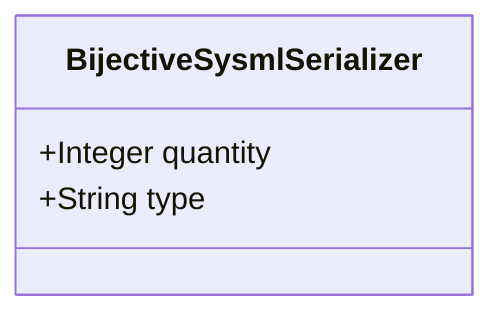

| Attribute | Specification Detail |
| :--- | :--- |
| **Issue ID** | #667 |
| **Title** | Feature 11: [BP 03 SysML v2 AST Bijective Roundtrip and Token Stream Parser Gate Blueprint] BijectiveSysmlSerializer |
| **Type** | feature |
| **Parent Epic** | [EPIC-03-BP_03_SysML_v2_AST_Bijective_Roundtrip_and_Token_Stream_Parser_Gate_Blueprint](../epics/EPIC-03-BP_03_SysML_v2_AST_Bijective_Roundtrip_and_Token_Stream_Parser_Gate_Blueprint.md) |
| **Interface Type** | Physical / Structural / Internal Bus |
| **Schema Containers** | `BP_03_SysML_v2_AST_Bijective_Roundtrip_and_Token_Stream_Parser_Gate_Blueprint::BijectiveSysmlSerializer` |
| **Generation Mode** | subagent |
| **Specification Source** | [schema/model.sysml](../../schema/model.sysml) |

# Feature 11: [BP 03 SysML v2 AST Bijective Roundtrip and Token Stream Parser Gate Blueprint] BijectiveSysmlSerializer

## UML Class Diagram



## Interface Requirements
### 1. Test Data Shape
```json
{
  "$schema": "https://json-schema.org/draft/2020-12/schema",
  "title": "BijectiveSysmlSerializerPayloadSchema",
  "type": "object",
  "properties": {
    "part": {
      "type": "string",
      "const": "BijectiveSysmlSerializer"
    },
    "status": {
      "type": "string",
      "enum": ["nominal", "degraded", "fault"]
    },
    "quantity": {
      "type": "integer",
      "x-sysml-type": "Integer",
      "description": "Declared attribute quantity (Integer)",
      "default": 1
    },
    "type": {
      "type": "string",
      "x-sysml-type": "String",
      "description": "Declared attribute type (String)",
      "default": "Subcomponent"
    }
  },
  "required": [
    "part",
    "status"
  ],
  "additionalProperties": false
}
```

### 2. Validation & Constraints
Declared structural attributes, boundary ports, invariants, and allocated requirements for classifier `BijectiveSysmlSerializer`:

| AST Member Kind | Identifier | Declared Type / Direction | Default / Invariant Contract |
| :--- | :--- | :--- | :--- |
| Attribute | `quantity` | `Integer` | Default `1` |
| Attribute | `type` | `String` | Default `"Subcomponent"` |
| Constraint | `Invariant_REQ_0603_Formal_Bijectivity_Complexity_Invariants` | Invariant (`REQ-0603 (REQ_0603_BP_03_SysML_v2_AST_Bijective_Roundtrip_and_Token_Stream_Parser_Gate_Blueprint)`) | Declared structural invariant |
| Constraint | `Invariant_REQ_0603_SC_04` | Invariant (`REQ-0603 (REQ_0603_BP_03_SysML_v2_AST_Bijective_Roundtrip_and_Token_Stream_Parser_Gate_Blueprint)`) | Declared structural invariant |
| Requirement | `REQ-0603 (REQ_0603_BP_03_SysML_v2_AST_Bijective_Roundtrip_and_Token_Stream_Parser_Gate_Blueprint)` | Allocated Requirement | The Digital Engineering Agent Platform (DEAP) compiler pipeline (DEAP-BP-DET-03, subsystem SysmlBijectiveRoundtripCompilerGate, deterministic UUIDv5 6ba7b810-9dad-11d1-80b4-00c04fd430c3, complexity class Class P, diagnostic code bindings E0100, E0200, E0300, E0400, governed by ISO/IEC/IEEE |

```sysml
constraint Invariant_REQ_0603_Formal_Bijectivity_Complexity_Invariants {}
constraint Invariant_REQ_0603_SC_04 {}
```

### 3. Visual Layout & Arrangement
Structural composition and boundary topology for classifier `BijectiveSysmlSerializer` organize no nested subparts declared in schema paired with no external boundary ports declared in schema.

### 4. Interactive Flow & States
Operational lifecycle events and discrete state transitions for BijectiveSysmlSerializer.

### Layer 1: Domain State & Signal Model
Classifier `BijectiveSysmlSerializer` encapsulates typed domain state attributes `quantity : Integer`, `type : String` alongside operational lifecycle status.

### Layer 2: Logic & Safety State Management
Classifier `BijectiveSysmlSerializer` governs stateless structural transition evaluation enforcing invariant obligations `Invariant_REQ_0603_Formal_Bijectivity_Complexity_Invariants`, `Invariant_REQ_0603_SC_04`.

### Layer 3: Presentation & Actuator Interface Binding
Classifier `BijectiveSysmlSerializer` exposes an internal structural boundary with no external ports, operations, or actions declared in schema.

### Associated Use Cases & User Stories

#### Associated Use Cases
- [ ] #634 - [Use Case 11: Native Lexer Sigil and Lifetime Tokenization](../use-cases/UC-11-Native_Lexer_Sigil_and_Lifetime_Tokenization.md)
- [ ] #635 - [Use Case 12: Fail Closed Inner Block and Composite Type Parsing](../use-cases/UC-12-Fail_Closed_Inner_Block_and_Composite_Type_Parsing.md)
- [ ] #636 - [Use Case 13: Token Stream State Transition Parsing and Recursive MBD Synthesis](../use-cases/UC-13-Token_Stream_State_Transition_Parsing_and_Recursive_MBD_Synthesis.md)
- [ ] #637 - [Use Case 14: Lossless to sysml Serialization and Fail Closed Bijective Roundtrip Gate](../use-cases/UC-14-Lossless_to_sysml_Serialization_and_Fail_Closed_Bijective_Roundtrip_Gate.md)
- [ ] #638 - [Use Case 15: Dogfood Markdown to SysML Ingestion and Baseline Verification](../use-cases/UC-15-Dogfood_Markdown_to_SysML_Ingestion_and_Baseline_Verification.md)

#### Associated User Stories
- [ ] #577 - [User Story 12: scan all](../user-stories/US-12-scan_all.md)
- [ ] #579 - [User Story 13: parse package or file](../user-stories/US-13-parse_package_or_file.md)
- [ ] #705 - [User Story 14: Parse Type Expr And Parse Transition](../user-stories/US-14-ParseTypeExprAndParseTransition.md)
- [ ] #582 - [User Story 15: verify bijective ast roundtrip](../user-stories/US-15-verify_bijective_ast_roundtrip.md)
- [ ] #583 - [User Story 16: ast orig to sysml](../user-stories/US-16-ast_orig_to_sysml.md)
- [ ] #706 - [User Story 17: Assert Ast Orig Equals Ast Reparsed](../user-stories/US-17-AssertAstOrigEqualsAstReparsed.md)

## Acceptance Criteria (BDD)
- [ ] AC-01: Given valid `BijectiveSysmlSerializer` inputs satisfying `Invariant_REQ_0603_Formal_Bijectivity_Complexity_Invariants` [Req `REQ-0603 (REQ_0603_BP_03_SysML_v2_AST_Bijective_Roundtrip_and_Token_Stream_Parser_Gate_Blueprint)`], When `BijectiveSysmlSerializer` evaluates invariant `Invariant_REQ_0603_Formal_Bijectivity_Complexity_Invariants`, Then the invariant holds and verified state is committed.
- [ ] AC-02: Given boundary inputs that violate `Invariant_REQ_0603_Formal_Bijectivity_Complexity_Invariants` [Req `REQ-0603 (REQ_0603_BP_03_SysML_v2_AST_Bijective_Roundtrip_and_Token_Stream_Parser_Gate_Blueprint)`], When `BijectiveSysmlSerializer` evaluates invariant `Invariant_REQ_0603_Formal_Bijectivity_Complexity_Invariants`, Then `BijectiveSysmlSerializer` rejects the invalid transition and routes a diagnostic via deterministic error diagnostic output.
- [ ] AC-03: Given valid `BijectiveSysmlSerializer` inputs satisfying `Invariant_REQ_0603_SC_04` [Req `REQ-0603 (REQ_0603_BP_03_SysML_v2_AST_Bijective_Roundtrip_and_Token_Stream_Parser_Gate_Blueprint)`], When `BijectiveSysmlSerializer` evaluates invariant `Invariant_REQ_0603_SC_04`, Then the invariant holds and verified state is committed.
- [ ] AC-04: Given boundary inputs that violate `Invariant_REQ_0603_SC_04` [Req `REQ-0603 (REQ_0603_BP_03_SysML_v2_AST_Bijective_Roundtrip_and_Token_Stream_Parser_Gate_Blueprint)`], When `BijectiveSysmlSerializer` evaluates invariant `Invariant_REQ_0603_SC_04`, Then `BijectiveSysmlSerializer` rejects the invalid transition and routes a diagnostic via deterministic error diagnostic output.
- [ ] AC-05: Given nominal typed values for `quantity` (`Integer`), `type` (`String`) across `BijectiveSysmlSerializer` structural boundary, When `BijectiveSysmlSerializer` executes structural interface processing, Then state and output ports conform to declared schema types.
- [ ] AC-06: Given malformed input frames across `quantity` (`Integer`), `type` (`String`) or `BijectiveSysmlSerializer` structural boundary, When `BijectiveSysmlSerializer` boundary validation executes, Then `BijectiveSysmlSerializer` rejects the malformed input via deterministic error diagnostic output.

## Source References
Formal component specifications and normative systems engineering requirements:
- System Architecture Model: `schema/model.sysml`
- Normative Systems Engineering Standard: ISO/IEC/IEEE 15288:2023 §6.4.3 Architecture Definition Process

Component behavior and interface definitions derive from `schema/model.sysml` pursuant to ISO/IEC/IEEE 15288.
