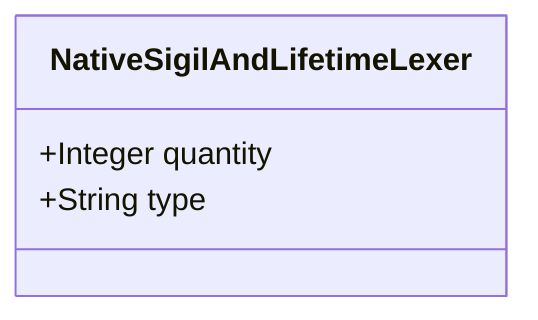

| Attribute | Specification Detail |
| :--- | :--- |
| **Issue ID** | #665 |
| **Title** | Feature 11: [BP 03 Sys ML v2 AST Bijective Roundtrip and Token Stream Parser Gate Blueprint] NativeSigilAndLifetimeLexer |
| **Type** | feature |
| **Parent Epic** | [EPIC-03-BP_03_SysML_v2_AST_Bijective_Roundtrip_and_Token_Stream_Parser_Gate_Blueprint](../epics/EPIC-03-BP_03_SysML_v2_AST_Bijective_Roundtrip_and_Token_Stream_Parser_Gate_Blueprint.md) |
| **Interface Type** | Physical / Structural / Internal Bus |
| **Schema Containers** | `BP_03_SysML_v2_AST_Bijective_Roundtrip_and_Token_Stream_Parser_Gate_Blueprint::NativeSigilAndLifetimeLexer` |
| **Generation Mode** | subagent |
| **Specification Source** | [schema/model.sysml](../../schema/model.sysml) |

# Feature 11: [BP 03 Sys ML v2 AST Bijective Roundtrip and Token Stream Parser Gate Blueprint] NativeSigilAndLifetimeLexer

## UML Class Diagram



## Interface Requirements
### 1. Test Data Shape
```json
{
  "$schema": "https://json-schema.org/draft/2020-12/schema",
  "title": "NativeSigilAndLifetimeLexerPayloadSchema",
  "type": "object",
  "properties": {
    "part": {
      "type": "string",
      "const": "NativeSigilAndLifetimeLexer"
    },
    "status": {
      "type": "string",
      "enum": ["nominal", "degraded", "fault"]
    },
    "quantity": {
      "type": "integer",
      "description": "Subsystem attribute quantity"
    },
    "type": {
      "type": "string",
      "description": "Subsystem attribute type"
    }
  },
  "required": [
    "part",
    "status",
    "quantity",
    "type"
  ],
  "additionalProperties": false
}
```

### 2. Validation & Constraints
Formal constraints and invariant guarantees enforced by NativeSigilAndLifetimeLexer.

### 3. Visual Layout & Arrangement
Logical layout, viewport containment, and container structure for NativeSigilAndLifetimeLexer conforming to platform design tokens. Container boundaries enforce @container isolation rules.

### 4. Interactive Flow & States
Operational lifecycle events and discrete state transitions for NativeSigilAndLifetimeLexer.

### Layer 1: Domain State & Signal Model
Domain state vector representing NativeSigilAndLifetimeLexer status, AST references, and typed signal models.

### Layer 2: Logic & Safety State Management
Deterministic state machine solver and safety monitor logic for NativeSigilAndLifetimeLexer.

### Layer 3: Presentation & Actuator Interface Binding
Presentation interface binding and diagnostic event routing for NativeSigilAndLifetimeLexer.

### Associated Use Cases & User Stories

#### Associated Use Cases
- [ ] #634 - [Use Case 11: Native Lexer Sigil and Lifetime Tokenization](../use-cases/UC-11-Native_Lexer_Sigil_and_Lifetime_Tokenization.md)
- [ ] #635 - [Use Case 12: Fail Closed Inner Block and Composite Type Parsing](../use-cases/UC-12-Fail_Closed_Inner_Block_and_Composite_Type_Parsing.md)
- [ ] #636 - [Use Case 13: Token Stream State Transition Parsing and Recursive MBD Synthesis](../use-cases/UC-13-Token_Stream_State_Transition_Parsing_and_Recursive_MBD_Synthesis.md)
- [ ] #637 - [Use Case 14: Lossless to sysml Serialization and Fail Closed Bijective Roundtrip Gate](../use-cases/UC-14-Lossless_to_sysml_Serialization_and_Fail_Closed_Bijective_Roundtrip_Gate.md)
- [ ] #638 - [Use Case 15: Dogfood Markdown to Sys ML Ingestion and Baseline Verification](../use-cases/UC-15-Dogfood_Markdown_to_SysML_Ingestion_and_Baseline_Verification.md)

#### Associated User Stories
- [ ] #577 - [User Story 16: scan all](../user-stories/US-16-scan_all.md)
- [ ] #578 - [User Story 17: Vec](../user-stories/US-17-Vec.md)
- [ ] #579 - [User Story 18: parse package or file](../user-stories/US-18-parse_package_or_file.md)
- [ ] #580 - [User Story 19: parse type expr](../user-stories/US-19-parse_type_expr.md)
- [ ] #581 - [User Story 20: Canonical](../user-stories/US-20-Canonical.md)
- [ ] #582 - [User Story 21: verify bijective ast roundtrip](../user-stories/US-21-verify_bijective_ast_roundtrip.md)
- [ ] #583 - [User Story 22: ast orig to sysml](../user-stories/US-22-ast_orig_to_sysml.md)
- [ ] #584 - [User Story 23: Reparsed](../user-stories/US-23-Reparsed.md)
- [ ] #585 - [User Story 24: Assert item](../user-stories/US-24-Assert_item.md)
- [ ] #586 - [User Story 25: Ok](../user-stories/US-25-Ok.md)

## Acceptance Criteria (BDD)
- [ ] AC-01: Given nominal NativeSigilAndLifetimeLexer domain state, When command or input signals are received, Then updates internal state and signal outputs within declared bounds.
- [ ] AC-02: Given operational state, When NativeSigilAndLifetimeLexer evaluates constraint 'Invariant_REQ_0603_Formal_Bijectivity_Complexity_Invariants', Then asserts invariant satisfaction without violation.
- [ ] AC-03: Given operational state, When NativeSigilAndLifetimeLexer evaluates constraint 'Invariant_REQ_0603_SC_04', Then asserts invariant satisfaction without violation.
- [ ] AC-04: Given malformed input signals or boundary condition violation, When NativeSigilAndLifetimeLexer error handling is invoked, Then transitions safely to failsafe fallback state without corruption.

## Source References
Formal component specifications and normative systems engineering requirements:
- System Architecture Model: `schema/model.sysml`
- Normative Systems Engineering Standard: ISO/IEC/IEEE 15288:2023 §6.4.3 Architecture Definition Process

Component behavior and interface definitions derive from `schema/model.sysml` pursuant to ISO/IEC/IEEE 15288.
