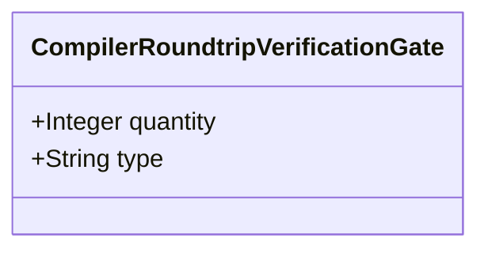

| Attribute | Specification Detail |
| :--- | :--- |
| **Issue ID** | #668 |
| **Title** | Feature 12: [BP 03 SysML v2 AST Bijective Roundtrip and Token Stream Parser Gate Blueprint] CompilerRoundtripVerificationGate |
| **Type** | feature |
| **Parent Epic** | [EPIC-03-BP_03_SysML_v2_AST_Bijective_Roundtrip_and_Token_Stream_Parser_Gate_Blueprint](../epics/EPIC-03-BP_03_SysML_v2_AST_Bijective_Roundtrip_and_Token_Stream_Parser_Gate_Blueprint.md) |
| **Interface Type** | Physical / Structural / Internal Bus |
| **Schema Containers** | `BP_03_SysML_v2_AST_Bijective_Roundtrip_and_Token_Stream_Parser_Gate_Blueprint::CompilerRoundtripVerificationGate` |
| **Generation Mode** | subagent |
| **Specification Source** | [schema/model.sysml](../../schema/model.sysml) |

# Feature 12: [BP 03 SysML v2 AST Bijective Roundtrip and Token Stream Parser Gate Blueprint] CompilerRoundtripVerificationGate

## UML Class Diagram



## Interface Requirements
### 1. Test Data Shape
```json
{
  "$schema": "https://json-schema.org/draft/2020-12/schema",
  "title": "CompilerRoundtripVerificationGatePayloadSchema",
  "type": "object",
  "properties": {
    "part": {
      "type": "string",
      "const": "CompilerRoundtripVerificationGate"
    },
    "status": {
      "type": "string",
      "enum": ["nominal", "degraded", "fault"]
    },
    "quantity": {
      "type": "integer",
      "x-sysml-type": "Integer",
      "description": "Declared attribute quantity (Integer)",
      "default": 1
    },
    "type": {
      "type": "string",
      "x-sysml-type": "String",
      "description": "Declared attribute type (String)",
      "default": "Subcomponent"
    }
  },
  "required": [
    "part",
    "status"
  ],
  "additionalProperties": false
}
```

### 2. Validation & Constraints
Declared structural attributes, boundary ports, invariants, and allocated requirements for classifier `CompilerRoundtripVerificationGate`:

| AST Member Kind | Identifier | Declared Type / Direction | Default / Invariant Contract |
| :--- | :--- | :--- | :--- |
| Attribute | `quantity` | `Integer` | Default `1` |
| Attribute | `type` | `String` | Default `"Subcomponent"` |

### 3. Visual Layout & Arrangement
Structural composition and boundary topology for classifier `CompilerRoundtripVerificationGate` organize no nested subparts declared in schema paired with no external boundary ports declared in schema, operating within the lossless `deap_core::sysml_cst` (`logos` + `rowan` Red/Green CST) and `salsa` incremental query database pipeline.

### 4. Interactive Flow & States
Operational lifecycle events and discrete state transitions for `CompilerRoundtripVerificationGate` (`RoundtripReparsing -> AstStructuralEqualityCheck -> VerifiedBijectiveAst` or `RejectedE0400`), enforcing Stage-1 == Stage-2 bijective round-trip parity (`parse_sysml(to_sysml(ast_orig)) == ast_orig`, `roundtrip_ast_mismatch_count == 0`).

### Layer 1: Domain State & Signal Model
Classifier `CompilerRoundtripVerificationGate` encapsulates typed domain state attributes `quantity : Integer`, `type : String` alongside operational lifecycle status, verifying structural equality across 100% of the normative OMG SysML v2.0 + KerML 1.0 BNF grammar across all 6 clauses (zero 16-construct artificial caps): (1) Namespaces & Metadata (`package`, `library package`, `standard library package`, `import`, `alias`, `doc`, `comment`, `rep`, `dependency`, `metadata def`/`metadata`/`@Metadata`/`#user_keyword` for `#hazard`, `#risk`, `#capability`, `#rt_loop`, `#dal`, `#fls` plus backward-compatible `hazard def`, `risk def`, `capability def`), (2) Structural & Data Types (`attribute def`/`attribute`, `enum def`/`enum`, `item def`/`item`, `part def`/`part`, `port def`/`port`, `connection def`/`connection`, `interface def`/`interface`, `flow def`/`flow`, `allocation def`/`allocation`, `occurrence def`/`occurrence`), (3) Behavioral & State (`action def`/`action`, `state def`/`state`), (4) Calculations, Constraints & Requirements (`calc def`/`calc`, `constraint def`/`constraint`, `requirement def`/`requirement`, `concern def`/`concern`), (5) Use Cases, Analysis, Verification & Views (`use case def`/`use case`, `analysis def`/`analysis`, `verification def`/`verification`, `test case def`/`test case`, `interaction def`/`interaction`, `view def`/`view`, `viewpoint def`/`viewpoint`, `rendering def`/`rendering`, `variation`/`variant`), and (6) KerML 1.0 Specialization, Multiplicity & Expressions (`:`, `:>`, `:>>`, `::>`, `~`, `ref`, `abstract`, `readonly`, `derived`, `end`, `default`, `:=`, `[lo..hi]`, `[*]`, `{ordered, nonunique}`, `implies`, `xor`, `??`, `->`, `collect`, `select`, `forAll`, `exists`, `ISQ`/`SI`/`ScalarValues`).

### Layer 2: Logic & Safety State Management
Classifier `CompilerRoundtripVerificationGate` governs stateless structural transition evaluation enforcing no additional invariant guards declared in schema while executing the Stage-1 == Stage-2 bijective round-trip verification gate (`verify_bijective_ast_roundtrip`, `AssertAstOrigEqualsAstReparsed`) over `logos` + `rowan` lossless Red/Green CSTs (`deap_core::sysml_cst`) and `salsa` incremental queries (`salsa::input`, `salsa::tracked`) with zero hand-rolled scanners. Implementation is bounded inside `< 380` exec SLOC submodules (`./crates/deap-core/src/sysml_cst/` and `./crates/compile-sysml/src/roundtrip/`) with explicit deletion of legacy hand-rolled scanner/parser monoliths (`-2,400+` SLOC retired).

### Layer 3: Presentation & Actuator Interface Binding
Classifier `CompilerRoundtripVerificationGate` exposes an internal structural boundary with no external ports, operations, or actions declared in schema, emitting `ariadne` field-level AST diff diagnostics (`E0400`) through `SysmlBijectiveRoundtripCompilerGate` when `roundtrip_ast_mismatch_count > 0`.

## Acceptance Criteria (BDD)
- [ ] AC-01: Given valid `CompilerRoundtripVerificationGate` initialization inputs for `quantity` (`Integer`), `type` (`String`) (no additional constraints specified in schema), When `CompilerRoundtripVerificationGate` commits typed domain state, Then declared state attributes hold verified values.
- [ ] AC-02: Given malformed or out-of-domain input values for `quantity` (`Integer`), `type` (`String`), When `CompilerRoundtripVerificationGate` validates incoming state updates, Then `CompilerRoundtripVerificationGate` rejects the invalid state update and emits a diagnostic via deterministic error diagnostic output.
- [ ] AC-03: Given nominal signal arrival across `CompilerRoundtripVerificationGate` structural boundary, When `CompilerRoundtripVerificationGate` processes the declared interface transaction, Then output state conforms to the structural classifier contract.
- [ ] AC-04: Given an invalid or unrecognized interface frame across `CompilerRoundtripVerificationGate` structural boundary, When `CompilerRoundtripVerificationGate` boundary validation executes, Then `CompilerRoundtripVerificationGate` refuses the malformed frame via deterministic error diagnostic output and preserves prior verified state.

## Source References
Formal component specifications and normative systems engineering requirements:
- System Architecture Model: `schema/model.sysml`
- Normative Systems Engineering Standard: ISO/IEC/IEEE 15288:2023 §6.4.3 Architecture Definition Process

Component behavior and interface definitions derive from `schema/model.sysml` pursuant to ISO/IEC/IEEE 15288.
