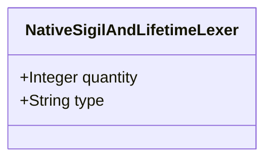

| Attribute | Specification Detail |
| :--- | :--- |
| **Issue ID** | #665 |
| **Title** | Feature 14: [BP 03 SysML v2 AST Bijective Roundtrip and Token Stream Parser Gate Blueprint] NativeSigilAndLifetimeLexer |
| **Type** | feature |
| **Parent Epic** | [EPIC-03-BP_03_SysML_v2_AST_Bijective_Roundtrip_and_Token_Stream_Parser_Gate_Blueprint](../epics/EPIC-03-BP_03_SysML_v2_AST_Bijective_Roundtrip_and_Token_Stream_Parser_Gate_Blueprint.md) |
| **Interface Type** | Physical / Structural / Internal Bus |
| **Schema Containers** | `BP_03_SysML_v2_AST_Bijective_Roundtrip_and_Token_Stream_Parser_Gate_Blueprint::NativeSigilAndLifetimeLexer` |
| **Generation Mode** | subagent |
| **Specification Source** | [schema/model.sysml](../../schema/model.sysml) |

# Feature 14: [BP 03 SysML v2 AST Bijective Roundtrip and Token Stream Parser Gate Blueprint] NativeSigilAndLifetimeLexer

## UML Class Diagram



## Interface Requirements
### 1. Test Data Shape
```json
{
  "$schema": "https://json-schema.org/draft/2020-12/schema",
  "title": "NativeSigilAndLifetimeLexerPayloadSchema",
  "type": "object",
  "properties": {
    "part": {
      "type": "string",
      "const": "NativeSigilAndLifetimeLexer"
    },
    "status": {
      "type": "string",
      "enum": ["nominal", "degraded", "fault"]
    },
    "quantity": {
      "type": "integer",
      "x-sysml-type": "Integer",
      "description": "Declared attribute quantity (Integer)",
      "default": 1
    },
    "type": {
      "type": "string",
      "x-sysml-type": "String",
      "description": "Declared attribute type (String)",
      "default": "Subcomponent"
    }
  },
  "required": [
    "part",
    "status"
  ],
  "additionalProperties": false
}
```

### 2. Validation & Constraints
Declared structural attributes, boundary ports, invariants, and allocated requirements for classifier `NativeSigilAndLifetimeLexer`:

| AST Member Kind | Identifier | Declared Type / Direction | Default / Invariant Contract |
| :--- | :--- | :--- | :--- |
| Attribute | `quantity` | `Integer` | Default `1` |
| Attribute | `type` | `String` | Default `"Subcomponent"` |

### 3. Visual Layout & Arrangement
Structural composition and boundary topology for classifier `NativeSigilAndLifetimeLexer` organize no nested subparts declared in schema paired with no external boundary ports declared in schema, operating as the `logos` DFA lexer front-end for `deap_core::sysml_cst` (`rowan` Red/Green CST) and `salsa` incremental query inputs.

### 4. Interactive Flow & States
Operational lifecycle events and discrete state transitions for `NativeSigilAndLifetimeLexer` (`LexicalScanning -> RecursiveDescentParsing` on `zeroDriftTokenStream` or `RejectedE0100` on `lexicalSpanError`), enforcing `span_offset_drift_bytes == 0` with zero `normalize_type_sigils` pre-lexer string rewriting.

### Layer 1: Domain State & Signal Model
Classifier `NativeSigilAndLifetimeLexer` encapsulates typed domain state attributes `quantity : Integer`, `type : String` alongside operational lifecycle status, tokenizing 100% of the normative OMG SysML v2.0 + KerML 1.0 BNF lexical grammar across all 6 clauses (zero 16-construct artificial caps), including reference sigils (`&`), optionality sigils (`?`), lifetime tokens (`'a`), qualified path separators (`::`), KerML operators (`:>`, `:>>`, `::>`, `~`, `:=`, `??`, `->`, `implies`, `xor`), and `#user_keyword` / `@Metadata` sigils for `#hazard`, `#risk`, `#capability`, `#rt_loop`, `#dal`, `#fls` `metadata def` annotations alongside backward-compatible `hazard def`, `risk def`, and `capability def` keywords.

### Layer 2: Logic & Safety State Management
Classifier `NativeSigilAndLifetimeLexer` governs stateless structural transition evaluation enforcing no additional invariant guards declared in schema while executing `logos::Logos` DFA tokenization (`scan_all`) into lossless `rowan` Red/Green trivia-preserving token streams (`deap_core::sysml_cst`) and `salsa` query inputs (`salsa::input`, `salsa::tracked`) with zero hand-rolled string/line/char-by-char scanners. Implementation is bounded inside `< 380` exec SLOC submodules (`./crates/deap-core/src/sysml_cst/` and `./crates/compile-sysml/src/roundtrip/`) with explicit deletion of legacy hand-rolled character scanners and `normalize_type_sigils` string rewriters (`-2,400+` SLOC retired).

### Layer 3: Presentation & Actuator Interface Binding
Classifier `NativeSigilAndLifetimeLexer` exposes an internal structural boundary with no external ports, operations, or actions declared in schema, streaming zero-drift tokens onto `TokenStreamChannelPort` and routing `ariadne` lexical span diagnostics (`E0100`) through `SysmlBijectiveRoundtripCompilerGate`.

### Associated Use Cases & User Stories

#### Associated Use Cases
- None allocated (structural subsystem component)

#### Associated User Stories
- [ ] #577 - [User Story 12: scan all](../user-stories/US-12-scan_all.md)
- [ ] #579 - [User Story 13: parse package or file](../user-stories/US-13-parse_package_or_file.md)
- [ ] #705 - [User Story 14: Parse Type Expr And Parse Transition](../user-stories/US-14-ParseTypeExprAndParseTransition.md)
- [ ] #582 - [User Story 15: verify bijective ast roundtrip](../user-stories/US-15-verify_bijective_ast_roundtrip.md)
- [ ] #583 - [User Story 16: ast orig to sysml](../user-stories/US-16-ast_orig_to_sysml.md)
- [ ] #706 - [User Story 17: Assert Ast Orig Equals Ast Reparsed](../user-stories/US-17-AssertAstOrigEqualsAstReparsed.md)

## Acceptance Criteria (BDD)
- [ ] AC-01: Given valid `NativeSigilAndLifetimeLexer` initialization inputs for `quantity` (`Integer`), `type` (`String`) (no additional constraints specified in schema), When `NativeSigilAndLifetimeLexer` commits typed domain state, Then declared state attributes hold verified values.
- [ ] AC-02: Given malformed or out-of-domain input values for `quantity` (`Integer`), `type` (`String`), When `NativeSigilAndLifetimeLexer` validates incoming state updates, Then `NativeSigilAndLifetimeLexer` rejects the invalid state update and emits a diagnostic via deterministic error diagnostic output.
- [ ] AC-03: Given nominal signal arrival across `NativeSigilAndLifetimeLexer` structural boundary, When `NativeSigilAndLifetimeLexer` processes the declared interface transaction, Then output state conforms to the structural classifier contract.
- [ ] AC-04: Given an invalid or unrecognized interface frame across `NativeSigilAndLifetimeLexer` structural boundary, When `NativeSigilAndLifetimeLexer` boundary validation executes, Then `NativeSigilAndLifetimeLexer` refuses the malformed frame via deterministic error diagnostic output and preserves prior verified state.

## Source References
Formal component specifications and normative systems engineering requirements:
- System Architecture Model: `schema/model.sysml`
- Normative Systems Engineering Standard: ISO/IEC/IEEE 15288:2023 §6.4.3 Architecture Definition Process

Component behavior and interface definitions derive from `schema/model.sysml` pursuant to ISO/IEC/IEEE 15288.
