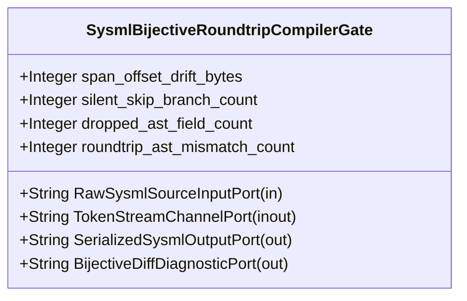

| Attribute | Specification Detail |
| :--- | :--- |
| **Issue ID** | #669 |
| **Title** | Feature 15: [BP 03 SysML v2 AST Bijective Roundtrip and Token Stream Parser Gate Blueprint] SysmlBijectiveRoundtripCompilerGate |
| **Type** | feature |
| **Parent Epic** | [EPIC-03-BP_03_SysML_v2_AST_Bijective_Roundtrip_and_Token_Stream_Parser_Gate_Blueprint](../epics/EPIC-03-BP_03_SysML_v2_AST_Bijective_Roundtrip_and_Token_Stream_Parser_Gate_Blueprint.md) |
| **Interface Type** | Physical / Structural / Internal Bus |
| **Schema Containers** | `BP_03_SysML_v2_AST_Bijective_Roundtrip_and_Token_Stream_Parser_Gate_Blueprint::SysmlBijectiveRoundtripCompilerGate` |
| **Generation Mode** | subagent |
| **Specification Source** | [schema/model.sysml](../../schema/model.sysml) |

# Feature 15: [BP 03 SysML v2 AST Bijective Roundtrip and Token Stream Parser Gate Blueprint] SysmlBijectiveRoundtripCompilerGate

## UML Class Diagram



## Interface Requirements
### 1. Test Data Shape
```json
{
  "$schema": "https://json-schema.org/draft/2020-12/schema",
  "title": "SysmlBijectiveRoundtripCompilerGatePayloadSchema",
  "type": "object",
  "properties": {
    "part": {
      "type": "string",
      "const": "SysmlBijectiveRoundtripCompilerGate"
    },
    "status": {
      "type": "string",
      "enum": ["nominal", "degraded", "fault"]
    },
    "span_offset_drift_bytes": {
      "type": "integer",
      "x-sysml-type": "Integer",
      "description": "Declared attribute span_offset_drift_bytes (Integer)",
      "default": 0
    },
    "silent_skip_branch_count": {
      "type": "integer",
      "x-sysml-type": "Integer",
      "description": "Count of `skip_until_semi_or_brace` silent erasure fallback branches in inner block parsers [unit: branches]",
      "default": 0
    },
    "dropped_ast_field_count": {
      "type": "integer",
      "x-sysml-type": "Integer",
      "description": "Count of AST struct fields omitted during `SysmlSerializable::to_sysml` serialization [unit: fields]",
      "default": 0
    },
    "roundtrip_ast_mismatch_count": {
      "type": "integer",
      "x-sysml-type": "Integer",
      "description": "Count of structural AST nodes differing between `ast` and `parse_sysml(to_sysml(ast))` [unit: nodes]",
      "default": 0
    },
    "RawSysmlSourceInputPort": {
      "type": "object",
      "properties": {
        "direction": { "type": "string", "const": "in" },
        "port_type": { "type": "string", "const": "String" }
      },
      "required": ["direction", "port_type"]
    },
    "TokenStreamChannelPort": {
      "type": "object",
      "properties": {
        "direction": { "type": "string", "const": "inout" },
        "port_type": { "type": "string", "const": "String" }
      },
      "required": ["direction", "port_type"]
    },
    "SerializedSysmlOutputPort": {
      "type": "object",
      "properties": {
        "direction": { "type": "string", "const": "out" },
        "port_type": { "type": "string", "const": "String" }
      },
      "required": ["direction", "port_type"]
    },
    "BijectiveDiffDiagnosticPort": {
      "type": "object",
      "properties": {
        "direction": { "type": "string", "const": "out" },
        "port_type": { "type": "string", "const": "String" }
      },
      "required": ["direction", "port_type"]
    }
  },
  "required": [
    "part",
    "status",
    "RawSysmlSourceInputPort",
    "TokenStreamChannelPort",
    "SerializedSysmlOutputPort",
    "BijectiveDiffDiagnosticPort"
  ],
  "additionalProperties": false
}
```

### 2. Validation & Constraints
Declared structural attributes, boundary ports, invariants, and allocated requirements for classifier `SysmlBijectiveRoundtripCompilerGate`:

| AST Member Kind | Identifier | Declared Type / Direction | Default / Invariant Contract |
| :--- | :--- | :--- | :--- |
| Attribute | `span_offset_drift_bytes` | `Integer` | Default `0` |
| Attribute | `silent_skip_branch_count` | `Integer` | Default `0` |
| Attribute | `dropped_ast_field_count` | `Integer` | Default `0` |
| Attribute | `roundtrip_ast_mismatch_count` | `Integer` | Default `0` |
| Port | `RawSysmlSourceInputPort` | `in String` | Boundary interface contract |
| Port | `TokenStreamChannelPort` | `inout String` | Boundary interface contract |
| Port | `SerializedSysmlOutputPort` | `out String` | Boundary interface contract |
| Port | `BijectiveDiffDiagnosticPort` | `out String` | Boundary interface contract |

### 3. Visual Layout & Arrangement
Structural composition and boundary topology for classifier `SysmlBijectiveRoundtripCompilerGate` organize no nested subparts declared in schema paired with boundary ports `in RawSysmlSourceInputPort : String`, `inout TokenStreamChannelPort : String`, `out SerializedSysmlOutputPort : String`, `out BijectiveDiffDiagnosticPort : String`.

### 4. Interactive Flow & States
Operational lifecycle events and discrete state transitions for SysmlBijectiveRoundtripCompilerGate.

### Layer 1: Domain State & Signal Model
Classifier `SysmlBijectiveRoundtripCompilerGate` encapsulates typed domain state attributes `span_offset_drift_bytes : Integer`, `silent_skip_branch_count : Integer`, `dropped_ast_field_count : Integer`, `roundtrip_ast_mismatch_count : Integer` alongside operational lifecycle status.

### Layer 2: Logic & Safety State Management
Classifier `SysmlBijectiveRoundtripCompilerGate` governs stateless structural transition evaluation enforcing no additional invariant guards declared in schema.

### Layer 3: Presentation & Actuator Interface Binding
Classifier `SysmlBijectiveRoundtripCompilerGate` binds external and behavioral interfaces across port `in RawSysmlSourceInputPort : String`, port `inout TokenStreamChannelPort : String`, port `out SerializedSysmlOutputPort : String`, port `out BijectiveDiffDiagnosticPort : String`.

## Acceptance Criteria (BDD)
- [ ] AC-01: Given valid `SysmlBijectiveRoundtripCompilerGate` initialization inputs for `span_offset_drift_bytes` (`Integer`), `silent_skip_branch_count` (`Integer`), `dropped_ast_field_count` (`Integer`), `roundtrip_ast_mismatch_count` (`Integer`) (no additional constraints specified in schema), When `SysmlBijectiveRoundtripCompilerGate` commits typed domain state, Then declared state attributes hold verified values.
- [ ] AC-02: Given malformed or out-of-domain input values for `span_offset_drift_bytes` (`Integer`), `silent_skip_branch_count` (`Integer`), `dropped_ast_field_count` (`Integer`), `roundtrip_ast_mismatch_count` (`Integer`), When `SysmlBijectiveRoundtripCompilerGate` validates incoming state updates, Then `SysmlBijectiveRoundtripCompilerGate` rejects the invalid state update and emits a diagnostic via diagnostic port `TokenStreamChannelPort`.
- [ ] AC-03: Given nominal signal arrival across `RawSysmlSourceInputPort` (`in String`), `TokenStreamChannelPort` (`inout String`), `SerializedSysmlOutputPort` (`out String`), `BijectiveDiffDiagnosticPort` (`out String`), When `SysmlBijectiveRoundtripCompilerGate` processes the declared interface transaction, Then output state conforms to the structural classifier contract.
- [ ] AC-04: Given an invalid or unrecognized interface frame across `RawSysmlSourceInputPort` (`in String`), `TokenStreamChannelPort` (`inout String`), `SerializedSysmlOutputPort` (`out String`), `BijectiveDiffDiagnosticPort` (`out String`), When `SysmlBijectiveRoundtripCompilerGate` boundary validation executes, Then `SysmlBijectiveRoundtripCompilerGate` refuses the malformed frame via diagnostic port `TokenStreamChannelPort` and preserves prior verified state.

## Source References
Formal component specifications and normative systems engineering requirements:
- System Architecture Model: `schema/model.sysml`
- Normative Systems Engineering Standard: ISO/IEC/IEEE 15288:2023 §6.4.3 Architecture Definition Process

Component behavior and interface definitions derive from `schema/model.sysml` pursuant to ISO/IEC/IEEE 15288.
