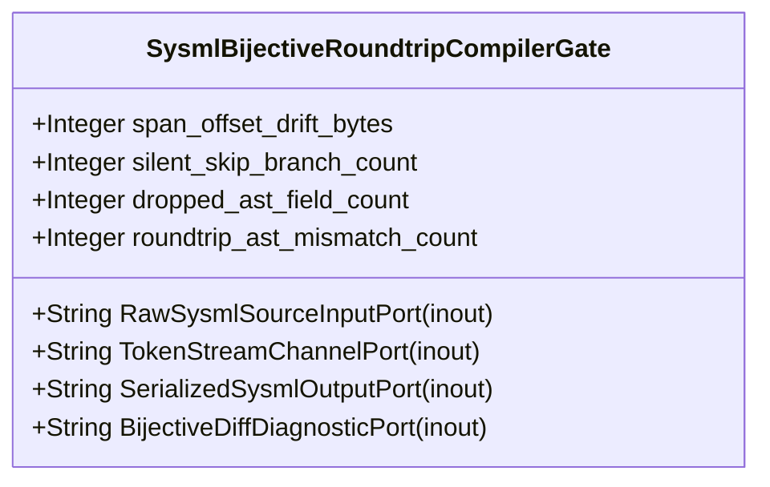

| Attribute | Specification Detail |
| :--- | :--- |
| **Issue ID** | #669 |
| **Title** | Feature 15: [BP 03 Sys ML v2 AST Bijective Roundtrip and Token Stream Parser Gate Blueprint] SysmlBijectiveRoundtripCompilerGate |
| **Type** | feature |
| **Parent Epic** | [EPIC-03-BP_03_SysML_v2_AST_Bijective_Roundtrip_and_Token_Stream_Parser_Gate_Blueprint](../epics/EPIC-03-BP_03_SysML_v2_AST_Bijective_Roundtrip_and_Token_Stream_Parser_Gate_Blueprint.md) |
| **Interface Type** | Physical / Structural / Internal Bus |
| **Schema Containers** | `BP_03_SysML_v2_AST_Bijective_Roundtrip_and_Token_Stream_Parser_Gate_Blueprint::SysmlBijectiveRoundtripCompilerGate` |
| **Generation Mode** | subagent |
| **Specification Source** | [schema/model.sysml](../../schema/model.sysml) |

# Feature 15: [BP 03 Sys ML v2 AST Bijective Roundtrip and Token Stream Parser Gate Blueprint] SysmlBijectiveRoundtripCompilerGate

## UML Class Diagram



## Interface Requirements
### 1. Test Data Shape
```json
{
  "$schema": "https://json-schema.org/draft/2020-12/schema",
  "title": "SysmlBijectiveRoundtripCompilerGatePayloadSchema",
  "type": "object",
  "properties": {
    "part": {
      "type": "string",
      "const": "SysmlBijectiveRoundtripCompilerGate"
    },
    "status": {
      "type": "string",
      "enum": ["nominal", "degraded", "fault"]
    },
    "span_offset_drift_bytes": {
      "type": "integer",
      "description": "Subsystem attribute span_offset_drift_bytes"
    },
    "silent_skip_branch_count": {
      "type": "integer",
      "description": "Subsystem attribute silent_skip_branch_count"
    },
    "dropped_ast_field_count": {
      "type": "integer",
      "description": "Subsystem attribute dropped_ast_field_count"
    },
    "roundtrip_ast_mismatch_count": {
      "type": "integer",
      "description": "Subsystem attribute roundtrip_ast_mismatch_count"
    },
    "RawSysmlSourceInputPort": {
      "type": "object",
      "properties": {
        "direction": { "type": "string", "const": "inout" },
        "port_type": { "type": "string", "const": "String" }
      },
      "required": ["direction", "port_type"]
    },
    "TokenStreamChannelPort": {
      "type": "object",
      "properties": {
        "direction": { "type": "string", "const": "inout" },
        "port_type": { "type": "string", "const": "String" }
      },
      "required": ["direction", "port_type"]
    },
    "SerializedSysmlOutputPort": {
      "type": "object",
      "properties": {
        "direction": { "type": "string", "const": "inout" },
        "port_type": { "type": "string", "const": "String" }
      },
      "required": ["direction", "port_type"]
    },
    "BijectiveDiffDiagnosticPort": {
      "type": "object",
      "properties": {
        "direction": { "type": "string", "const": "inout" },
        "port_type": { "type": "string", "const": "String" }
      },
      "required": ["direction", "port_type"]
    }
  },
  "required": [
    "part",
    "status",
    "span_offset_drift_bytes",
    "silent_skip_branch_count",
    "dropped_ast_field_count",
    "roundtrip_ast_mismatch_count",
    "RawSysmlSourceInputPort",
    "TokenStreamChannelPort",
    "SerializedSysmlOutputPort",
    "BijectiveDiffDiagnosticPort"
  ],
  "additionalProperties": false
}
```

### 2. Validation & Constraints
Formal constraints and invariant guarantees enforced by SysmlBijectiveRoundtripCompilerGate.

### 3. Visual Layout & Arrangement
Logical layout, viewport containment, and container structure for SysmlBijectiveRoundtripCompilerGate conforming to platform design tokens. Container boundaries enforce @container isolation rules.

### 4. Interactive Flow & States
Operational lifecycle events and discrete state transitions for SysmlBijectiveRoundtripCompilerGate.

### Layer 1: Domain State & Signal Model
Domain state vector representing SysmlBijectiveRoundtripCompilerGate status, AST references, and typed signal models.

### Layer 2: Logic & Safety State Management
Deterministic state machine solver and safety monitor logic for SysmlBijectiveRoundtripCompilerGate.

### Layer 3: Presentation & Actuator Interface Binding
Presentation interface binding and diagnostic event routing for SysmlBijectiveRoundtripCompilerGate.

## Acceptance Criteria (BDD)
- [ ] AC-01: Given nominal SysmlBijectiveRoundtripCompilerGate domain state, When command or input signals are received, Then updates internal state and signal outputs within declared bounds.
- [ ] AC-02: Given operational state, When SysmlBijectiveRoundtripCompilerGate evaluates constraint 'assert_span_offset_drift_bytes_range', Then asserts invariant satisfaction without violation.
- [ ] AC-03: Given operational state, When SysmlBijectiveRoundtripCompilerGate evaluates constraint 'assert_silent_skip_branch_count_range', Then asserts invariant satisfaction without violation.
- [ ] AC-04: Given operational state, When SysmlBijectiveRoundtripCompilerGate evaluates constraint 'assert_dropped_ast_field_count_range', Then asserts invariant satisfaction without violation.
- [ ] AC-05: Given operational state, When SysmlBijectiveRoundtripCompilerGate evaluates constraint 'assert_roundtrip_ast_mismatch_count_range', Then asserts invariant satisfaction without violation.
- [ ] AC-06: Given malformed input signals or boundary condition violation, When SysmlBijectiveRoundtripCompilerGate error handling is invoked, Then transitions safely to failsafe fallback state without corruption.

## Source References
Formal component specifications and normative systems engineering requirements:
- System Architecture Model: `schema/model.sysml`
- Normative Systems Engineering Standard: ISO/IEC/IEEE 15288:2023 §6.4.3 Architecture Definition Process

Component behavior and interface definitions derive from `schema/model.sysml` pursuant to ISO/IEC/IEEE 15288.
