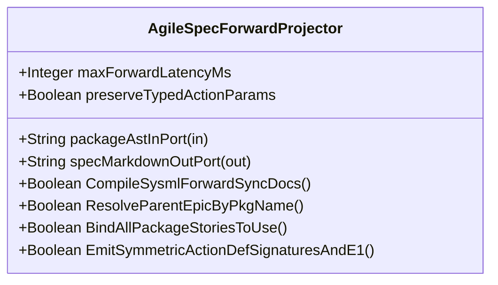

| Attribute | Specification Detail |
| :--- | :--- |
| **Issue ID** | #670 |
| **Title** | Feature 16: [BP 04 Deterministic Specification ICD and WBS Forward Compiler Blueprint] AgileSpecForwardProjector |
| **Type** | feature |
| **Parent Epic** | [EPIC-04-BP_04_Deterministic_Specification_ICD_and_WBS_Forward_Compiler_Blueprint](../epics/EPIC-04-BP_04_Deterministic_Specification_ICD_and_WBS_Forward_Compiler_Blueprint.md) |
| **Interface Type** | Physical / Structural / Internal Bus |
| **Schema Containers** | `BP_04_Deterministic_Specification_ICD_and_WBS_Forward_Compiler_Blueprint::AgileSpecForwardProjector` |
| **Generation Mode** | subagent |
| **Specification Source** | [schema/model.sysml](../../schema/model.sysml) |

# Feature 16: [BP 04 Deterministic Specification ICD and WBS Forward Compiler Blueprint] AgileSpecForwardProjector

## UML Class Diagram



## Interface Requirements
### 1. Test Data Shape
```json
{
  "$schema": "https://json-schema.org/draft/2020-12/schema",
  "title": "AgileSpecForwardProjectorPayloadSchema",
  "type": "object",
  "properties": {
    "part": {
      "type": "string",
      "const": "AgileSpecForwardProjector"
    },
    "status": {
      "type": "string",
      "enum": ["nominal", "degraded", "fault"]
    },
    "maxForwardLatencyMs": {
      "type": "integer",
      "x-sysml-type": "Integer",
      "description": "Declared attribute maxForwardLatencyMs (Integer)",
      "default": 25
    },
    "preserveTypedActionParams": {
      "type": "boolean",
      "x-sysml-type": "Boolean",
      "description": "Enforces symmetric `in` and `out` `ActionDef` parameter emission across Mermaid and Markdown bullets. [unit: flag]",
      "default": true
    },
    "packageAstInPort": {
      "type": "object",
      "properties": {
        "direction": { "type": "string", "const": "in" },
        "port_type": { "type": "string", "const": "String" }
      },
      "required": ["direction", "port_type"]
    },
    "specMarkdownOutPort": {
      "type": "object",
      "properties": {
        "direction": { "type": "string", "const": "out" },
        "port_type": { "type": "string", "const": "String" }
      },
      "required": ["direction", "port_type"]
    }
  },
  "required": [
    "part",
    "status",
    "packageAstInPort",
    "specMarkdownOutPort"
  ],
  "additionalProperties": false
}
```

### 2. Validation & Constraints
Declared structural attributes, boundary ports, invariants, and allocated requirements for classifier `AgileSpecForwardProjector`:

| AST Member Kind | Identifier | Declared Type / Direction | Default / Invariant Contract |
| :--- | :--- | :--- | :--- |
| Attribute | `maxForwardLatencyMs` | `Integer` | Default `25` (`<= 25` ms deterministic forward projection bound) |
| Attribute | `preserveTypedActionParams` | `Boolean` | Default `true` (symmetric `in`, `out`, `inout`, and `return` `action def` / `calc def` parameter emission across Mermaid diagrams and Markdown bullets) |
| Port | `packageAstInPort` | `in String` | Boundary interface contract receiving lossless `logos` + `rowan` + `salsa` SysML v2 CST/AST slices (`deap_core::sysml_cst`) |
| Port | `specMarkdownOutPort` | `out String` | Boundary interface contract emitting lossless `pulldown-cmark` + `pulldown-cmark-to-cmark` CommonMark specification suites |
| Constraint | `Invariant_REQ_0604_SC_01` | Invariant (`REQ-0604 (REQ_0604_BP_04_Deterministic_Specification_ICD_and_WBS_Forward_Compiler_Blueprint)`) | Enforces `llm_subagent_invocation_count == 0`, `ast_node_coverage_percent == 100.0`, and `mermaid_e1_e5_violation_count == 0` across all projected specifications |
| Constraint | `Invariant_REQ_0604_SC_02` | Invariant (`REQ-0604 (REQ_0604_BP_04_Deterministic_Specification_ICD_and_WBS_Forward_Compiler_Blueprint)`) | Enforces `forward_reverse_drift_count == 0` and SHA-256 `SchemaDigest` parity across forward-then-reverse synchronization |
| Requirement | `REQ-0604 (REQ_0604_BP_04_Deterministic_Specification_ICD_and_WBS_Forward_Compiler_Blueprint)` | Allocated Requirement | The Digital Engineering Agent Platform (DEAP) compiler pipeline SHALL deterministically project all Agile functional specifications (`./docs/epics/`, `./docs/features/`, `./docs/user-stories/`, `./docs/use-cases/`), ConOps units (`./docs/conops/`), Logical Interface Control Documents (`./docs/interfaces/ICD_01_SYSTEM_INTERFACE_MATRIX.md`, `./docs/interfaces/ICD_02_MASTER_SIGNAL_DICTIONARY.md`), and MIL-STD-881E WBS artifacts (`./docs/management/`) via `salsa` derived queries and `pulldown-cmark-to-cmark` AST serialization with zero LLM invocations and zero hand-rolled string scanners. |

```sysml
constraint Invariant_REQ_0604_SC_01 {}
constraint Invariant_REQ_0604_SC_02 {}
```

- **Contract A (Full OMG SysML v2.0 + KerML 1.0 Grammar Coverage -- Zero 16-Construct Caps)**: `AgileSpecForwardProjector` projects 100% of normative OMG SysML v2.0 and KerML 1.0 Definition and Usage constructs without any 16-construct artificial cap (`package`/`library package`/`standard library package`, `import`, `alias`, `doc`, `comment`, `rep`, `dependency`, `metadata def`/`metadata`/`@Metadata`/`#user_keyword` including `#hazard`, `#risk`, `#capability`, `#rt_loop`, `#dal`, `#fls` and legacy `hazard def`/`risk def`/`capability def`, `attribute def`/`attribute`, `enum def`/`enum`, `item def`/`item`, `part def`/`part`, `port def`/`port` (`in`, `out`, `inout`, `~`), `connection def`/`connection`, `interface def`/`interface`, `flow def`/`flow`, `allocation def`/`allocation`, `occurrence def`/`occurrence`, `action def`/`action`, `state def`/`state`, `calc def`/`calc`, `constraint def`/`constraint`, `requirement def`/`requirement`, `concern def`/`concern`, `use case def`/`use case`, `analysis def`/`analysis`, `verification def`/`verification`, `test case def`/`test case`, `interaction def`/`interaction`, `view def`/`view`, `viewpoint def`/`viewpoint`, `rendering def`/`rendering`, `variation`/`variant`, and KerML specialization/expressions `:`, `:>`, `:>>`, `::>`, `~`, `[lo..hi]`, `implies`, `xor`, `??`, `->`, `collect`, `select`, `forAll`, `exists`, `ISQ`/`SI`/`ScalarValues`).
- **Contract B (`pulldown-cmark` + `pulldown-cmark-to-cmark` Lossless Markdown AST + `toml_edit` + `salsa` Derived Projection Across All 6 Crates -- Zero Hand-Rolled Scanners)**: All Spec, ConOps, ICD, and WBS projections across `deap-core`, `compile-sysml`, `ingest-sysml`, `reconcile-backlog`, `verify-baseline`, and `assemble-conops` are computed via memoized `salsa` queries over `logos` + `rowan` CST nodes and serialized via `pulldown-cmark` + `pulldown-cmark-to-cmark` and `toml_edit`, with zero hand-rolled line, string, or character-by-character scanners.

### 3. Visual Layout & Arrangement
Structural composition and boundary topology for classifier `AgileSpecForwardProjector` organize boundary ports `in packageAstInPort : String` and `out specMarkdownOutPort : String` across modular `< 380` executable SLOC submodules under `./crates/compile-sysml/src/forward_sync/` and `./crates/assemble-conops/src/`.

### 4. Interactive Flow & States
Operational lifecycle events and discrete state transitions for `AgileSpecForwardProjector` follow `BP_04_Deterministic_Specification_ICD_and_WBS_Forward_Compiler_Blueprint_LifecycleState`: `AstLoaded -> ForwardProjected` on `forwardSyncSpecs` (`CompileSysmlForwardSyncDocs`, `ResolveParentEpicByPkgName`, `BindAllPackageStoriesToUse`, `EmitSymmetricActionDefSignaturesAndE1`), and fail-closed transition to `Rejected` (`Diagnostic: E0100`) if any `PackageDef` parent epic binding or Check 13B E1-E5 Mermaid invariant is violated.

### Layer 1: Domain State & Signal Model
Classifier `AgileSpecForwardProjector` encapsulates typed domain state attributes `maxForwardLatencyMs : Integer` (default `25`) and `preserveTypedActionParams : Boolean` (default `true`), backed by full OMG SysML v2.0 + KerML 1.0 `logos` + `rowan` + `salsa` HIR structures (`deap_core::sysml_cst`, zero 16-construct caps), `pulldown-cmark::Event` AST trees, and `toml_edit::DocumentMut` manifest records across all 6 workspace crates.

### Layer 2: Logic & Safety State Management
Classifier `AgileSpecForwardProjector` governs deterministic `salsa` derived query execution (`CompileSysmlForwardSyncDocs`, `ResolveParentEpicByPkgName`, `BindAllPackageStoriesToUse`, `EmitSymmetricActionDefSignaturesAndE1`) enforcing `Invariant_REQ_0604_SC_01` and `Invariant_REQ_0604_SC_02`. Implementation is strictly modularized within `< 380` executable SLOC submodules (`./crates/compile-sysml/src/forward_sync/`, `./crates/assemble-conops/src/`) with explicit deletion of legacy hand-rolled Markdown/SysML string emitters and line-by-line scanners (`-1,100+` SLOC net-negative ratchet).

### Layer 3: Presentation & Actuator Interface Binding
Classifier `AgileSpecForwardProjector` binds external and behavioral interfaces across ingress port `in packageAstInPort : String` and egress port `out specMarkdownOutPort : String`, serializing CommonMark ASTs losslessly via `pulldown-cmark-to-cmark` and emitting span-accurate `ariadne` / `miette` diagnostics (`E0100`) on failure.

### Associated Use Cases & User Stories

#### Associated Use Cases
- [ ] #639 - [Use Case 16: Deterministic Multi Story Use Case and Con Ops Parent Epic Projection](../use-cases/UC-16-Deterministic_Multi_Story_Use_Case_and_ConOps_Parent_Epic_Projection.md)
- [ ] #640 - [Use Case 17: Deterministic Logical ICD Matrix and Signal Dictionary Synthesis](../use-cases/UC-17-Deterministic_Logical_ICD_Matrix_and_Signal_Dictionary_Synthesis.md)
- [ ] #641 - [Use Case 18: Deterministic MIL STD 881 E WBS and Enterprise Export Synthesis](../use-cases/UC-18-Deterministic_MIL_STD_881E_WBS_and_Enterprise_Export_Synthesis.md)
- [ ] #642 - [Use Case 19: Fail Closed Stateful HTML Comment Frontmatter Guard and Parent Inclusive Checklist Reconciliation](../use-cases/UC-19-Fail_Closed_Stateful_HTML_Comment_Frontmatter_Guard_and_Parent_Inclusive_Checklist_Reconciliation.md)
- [ ] #643 - [Use Case 20: Fail Closed Subpackage Scoped Reverse Sync and Dogfood Blueprint Ingestion Parity](../use-cases/UC-20-Fail_Closed_Subpackage_Scoped_Reverse_Sync_and_Dogfood_Blueprint_Ingestion_Parity.md)

#### Associated User Stories
- [ ] #707 - [User Story 18: Compile Sysml Forward Sync Docs](../user-stories/US-18-CompileSysmlForwardSyncDocs.md)
- [ ] #708 - [User Story 19: Resolve Parent Epic By Pkg Name](../user-stories/US-19-ResolveParentEpicByPkgName.md)
- [ ] #709 - [User Story 20: Bind All Package Stories To Use](../user-stories/US-20-BindAllPackageStoriesToUse.md)
- [ ] #710 - [User Story 21: Emit Symmetric Action Def Signatures And E1](../user-stories/US-21-EmitSymmetricActionDefSignaturesAndE1.md)
- [ ] #711 - [User Story 22: Compile Sysml Emit Icd Docs Interfaces](../user-stories/US-22-CompileSysmlEmitIcdDocsInterfaces.md)
- [ ] #712 - [User Story 23: Project Nx N Connection Def Matrix And Flow Def](../user-stories/US-23-ProjectNxNConnectionDefMatrixAndFlowDef.md)
- [ ] #713 - [User Story 24: Compile Sysml Emit Wbs Docs Management](../user-stories/US-24-CompileSysmlEmitWbsDocsManagement.md)
- [ ] #714 - [User Story 25: Synthesize Mil Std881 e Tree And](../user-stories/US-25-SynthesizeMilStd881eTreeAnd.md)
- [ ] #715 - [User Story 26: Reconcile Backlog Reconcile Docs Dir Docs](../user-stories/US-26-ReconcileBacklogReconcileDocsDirDocs.md)
- [ ] #716 - [User Story 27: Parse CommonMark Tables With In Html](../user-stories/US-27-ParseCommonMarkTablesWithInHtml.md)
- [ ] #717 - [User Story 28: Reconcile Checklists With Parent Inclusive Epic](../user-stories/US-28-ReconcileChecklistsWithParentInclusiveEpic.md)
- [ ] #718 - [User Story 29: Compile Sysml Reverse Sync Docs](../user-stories/US-29-CompileSysmlReverseSyncDocs.md)
- [ ] #719 - [User Story 30: Merge Extracted Entities Into Owning Subpackages](../user-stories/US-30-MergeExtractedEntitiesIntoOwningSubpackages.md)

## Acceptance Criteria (BDD)
- [ ] AC-01: Given valid `AgileSpecForwardProjector` inputs satisfying `Invariant_REQ_0604_SC_01` [Req `REQ-0604 (REQ_0604_BP_04_Deterministic_Specification_ICD_and_WBS_Forward_Compiler_Blueprint)`], When `AgileSpecForwardProjector` evaluates invariant `Invariant_REQ_0604_SC_01` via `salsa` derived queries and `pulldown-cmark-to-cmark`, Then the invariant holds (`llm_subagent_invocation_count == 0`, `ast_node_coverage_percent == 100.0`, `mermaid_e1_e5_violation_count == 0`) and verified state is committed.
- [ ] AC-02: Given boundary inputs that violate `Invariant_REQ_0604_SC_01` [Req `REQ-0604 (REQ_0604_BP_04_Deterministic_Specification_ICD_and_WBS_Forward_Compiler_Blueprint)`], When `AgileSpecForwardProjector` evaluates invariant `Invariant_REQ_0604_SC_01`, Then `AgileSpecForwardProjector` rejects the invalid transition fail-closed (`E0100`) and routes an `ariadne` / `miette` diagnostic via port `specMarkdownOutPort`.
- [ ] AC-03: Given valid `AgileSpecForwardProjector` inputs satisfying `Invariant_REQ_0604_SC_02` [Req `REQ-0604 (REQ_0604_BP_04_Deterministic_Specification_ICD_and_WBS_Forward_Compiler_Blueprint)`], When `AgileSpecForwardProjector` evaluates invariant `Invariant_REQ_0604_SC_02`, Then the invariant holds (`forward_reverse_drift_count == 0`) and verified state is committed.
- [ ] AC-04: Given boundary inputs that violate `Invariant_REQ_0604_SC_02` [Req `REQ-0604 (REQ_0604_BP_04_Deterministic_Specification_ICD_and_WBS_Forward_Compiler_Blueprint)`], When `AgileSpecForwardProjector` evaluates invariant `Invariant_REQ_0604_SC_02`, Then `AgileSpecForwardProjector` rejects the invalid transition and routes a diagnostic via port `specMarkdownOutPort`.
- [ ] AC-05: Given nominal typed values for `maxForwardLatencyMs` (`Integer`), `preserveTypedActionParams` (`Boolean`) across `packageAstInPort` (`in String`), `specMarkdownOutPort` (`out String`) covering the full OMG SysML v2.0 + KerML 1.0 grammar (Contract A, zero 16-construct caps), When `AgileSpecForwardProjector` executes `salsa` + `pulldown-cmark-to-cmark` projection (Contract B, zero hand-rolled scanners) inside `< 380`-SLOC submodules with legacy hand-rolled scanners deleted, Then state and output ports conform to declared schema types within `25` ms.
- [ ] AC-06: Given malformed input frames across `maxForwardLatencyMs` (`Integer`), `preserveTypedActionParams` (`Boolean`) or `packageAstInPort` (`in String`), `specMarkdownOutPort` (`out String`), When `AgileSpecForwardProjector` boundary validation executes, Then `AgileSpecForwardProjector` rejects the malformed input via diagnostic port `specMarkdownOutPort`.

## Source References
Formal component specifications and normative systems engineering requirements:
- System Architecture Model: `schema/model.sysml`
- Normative Systems Engineering Standard: ISO/IEC/IEEE 15288:2023 §6.4.3 Architecture Definition Process

Component behavior and interface definitions derive from `schema/model.sysml` pursuant to ISO/IEC/IEEE 15288.
