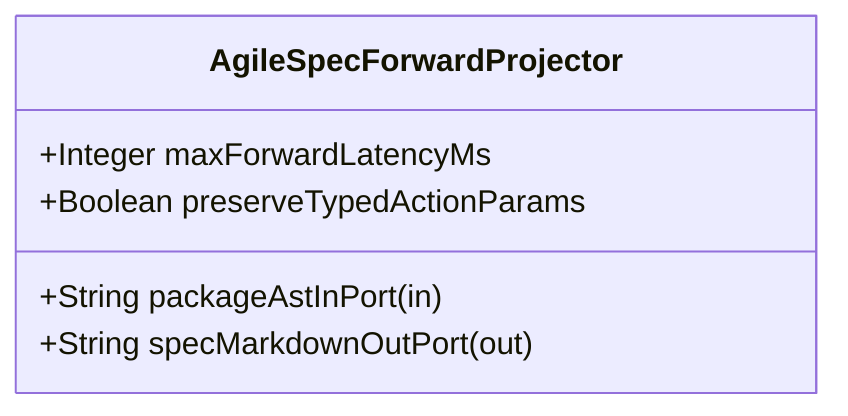

| Attribute | Specification Detail |
| :--- | :--- |
| **Issue ID** | #670 |
| **Title** | Feature 16: [BP 04 Deterministic Specification ICD and WBS Forward Compiler Blueprint] AgileSpecForwardProjector |
| **Type** | feature |
| **Parent Epic** | [EPIC-04-BP_04_Deterministic_Specification_ICD_and_WBS_Forward_Compiler_Blueprint](../epics/EPIC-04-BP_04_Deterministic_Specification_ICD_and_WBS_Forward_Compiler_Blueprint.md) |
| **Interface Type** | Physical / Structural / Internal Bus |
| **Schema Containers** | `BP_04_Deterministic_Specification_ICD_and_WBS_Forward_Compiler_Blueprint::AgileSpecForwardProjector` |
| **Generation Mode** | subagent |
| **Specification Source** | [schema/model.sysml](../../schema/model.sysml) |

# Feature 16: [BP 04 Deterministic Specification ICD and WBS Forward Compiler Blueprint] AgileSpecForwardProjector

## UML Class Diagram



## Interface Requirements
### 1. Test Data Shape
```json
{
  "$schema": "https://json-schema.org/draft/2020-12/schema",
  "title": "AgileSpecForwardProjectorPayloadSchema",
  "type": "object",
  "properties": {
    "part": {
      "type": "string",
      "const": "AgileSpecForwardProjector"
    },
    "status": {
      "type": "string",
      "enum": ["nominal", "degraded", "fault"]
    },
    "maxForwardLatencyMs": {
      "type": "integer",
      "x-sysml-type": "Integer",
      "description": "Declared attribute maxForwardLatencyMs (Integer)",
      "default": 25
    },
    "preserveTypedActionParams": {
      "type": "boolean",
      "x-sysml-type": "Boolean",
      "description": "Enforces symmetric `in` and `out` `ActionDef` parameter emission across Mermaid and Markdown bullets. [unit: flag]",
      "default": true
    },
    "packageAstInPort": {
      "type": "object",
      "properties": {
        "direction": { "type": "string", "const": "in" },
        "port_type": { "type": "string", "const": "String" }
      },
      "required": ["direction", "port_type"]
    },
    "specMarkdownOutPort": {
      "type": "object",
      "properties": {
        "direction": { "type": "string", "const": "out" },
        "port_type": { "type": "string", "const": "String" }
      },
      "required": ["direction", "port_type"]
    }
  },
  "required": [
    "part",
    "status",
    "packageAstInPort",
    "specMarkdownOutPort"
  ],
  "additionalProperties": false
}
```

### 2. Validation & Constraints
Declared structural attributes, boundary ports, invariants, and allocated requirements for classifier `AgileSpecForwardProjector`:

| AST Member Kind | Identifier | Declared Type / Direction | Default / Invariant Contract |
| :--- | :--- | :--- | :--- |
| Attribute | `maxForwardLatencyMs` | `Integer` | Default `25` |
| Attribute | `preserveTypedActionParams` | `Boolean` | Default `true` |
| Port | `packageAstInPort` | `in String` | Boundary interface contract |
| Port | `specMarkdownOutPort` | `out String` | Boundary interface contract |
| Constraint | `Invariant_REQ_0604_SC_01` | Invariant (`REQ-0604 (REQ_0604_BP_04_Deterministic_Specification_ICD_and_WBS_Forward_Compiler_Blueprint)`) | Declared structural invariant |
| Constraint | `Invariant_REQ_0604_SC_02` | Invariant (`REQ-0604 (REQ_0604_BP_04_Deterministic_Specification_ICD_and_WBS_Forward_Compiler_Blueprint)`) | Declared structural invariant |
| Requirement | `REQ-0604 (REQ_0604_BP_04_Deterministic_Specification_ICD_and_WBS_Forward_Compiler_Blueprint)` | Allocated Requirement | The Digital Engineering Agent Platform (DEAP) compiler pipeline SHALL deterministically project all Agile functional specifications (docs/epics/, docs/features/, docs/user-stories/, docs/use-cases/), Logical Interface Control Documents (docs/interfaces/ICD_01_SYSTEM_INTERFACE_MATRIX.md, |

```sysml
constraint Invariant_REQ_0604_SC_01 {}
constraint Invariant_REQ_0604_SC_02 {}
```

### 3. Visual Layout & Arrangement
Structural composition and boundary topology for classifier `AgileSpecForwardProjector` organize no nested subparts declared in schema paired with boundary ports `in packageAstInPort : String`, `out specMarkdownOutPort : String`.

### 4. Interactive Flow & States
Operational lifecycle events and discrete state transitions for AgileSpecForwardProjector.

### Layer 1: Domain State & Signal Model
Classifier `AgileSpecForwardProjector` encapsulates typed domain state attributes `maxForwardLatencyMs : Integer`, `preserveTypedActionParams : Boolean` alongside operational lifecycle status.

### Layer 2: Logic & Safety State Management
Classifier `AgileSpecForwardProjector` governs stateless structural transition evaluation enforcing invariant obligations `Invariant_REQ_0604_SC_01`, `Invariant_REQ_0604_SC_02`.

### Layer 3: Presentation & Actuator Interface Binding
Classifier `AgileSpecForwardProjector` binds external and behavioral interfaces across port `in packageAstInPort : String`, port `out specMarkdownOutPort : String`.

### Associated Use Cases & User Stories

#### Associated Use Cases
- [ ] #639 - [Use Case 16: Deterministic Multi Story Use Case and Con Ops Parent Epic Projection](../use-cases/UC-16-Deterministic_Multi_Story_Use_Case_and_ConOps_Parent_Epic_Projection.md)
- [ ] #640 - [Use Case 17: Deterministic Logical ICD Matrix and Signal Dictionary Synthesis](../use-cases/UC-17-Deterministic_Logical_ICD_Matrix_and_Signal_Dictionary_Synthesis.md)
- [ ] #641 - [Use Case 18: Deterministic MIL STD 881 E WBS and Enterprise Export Synthesis](../use-cases/UC-18-Deterministic_MIL_STD_881E_WBS_and_Enterprise_Export_Synthesis.md)
- [ ] #642 - [Use Case 19: Fail Closed Stateful HTML Comment Frontmatter Guard and Parent Inclusive Checklist Reconciliation](../use-cases/UC-19-Fail_Closed_Stateful_HTML_Comment_Frontmatter_Guard_and_Parent_Inclusive_Checklist_Reconciliation.md)
- [ ] #643 - [Use Case 20: Fail Closed Subpackage Scoped Reverse Sync and Dogfood Blueprint Ingestion Parity](../use-cases/UC-20-Fail_Closed_Subpackage_Scoped_Reverse_Sync_and_Dogfood_Blueprint_Ingestion_Parity.md)

#### Associated User Stories
- [ ] #707 - [User Story 18: Compile Sysml Forward Sync Docs](../user-stories/US-18-CompileSysmlForwardSyncDocs.md)
- [ ] #708 - [User Story 19: Resolve Parent Epic By Pkg Name](../user-stories/US-19-ResolveParentEpicByPkgName.md)
- [ ] #709 - [User Story 20: Bind All Package Stories To Use](../user-stories/US-20-BindAllPackageStoriesToUse.md)
- [ ] #710 - [User Story 21: Emit Symmetric Action Def Signatures And E1](../user-stories/US-21-EmitSymmetricActionDefSignaturesAndE1.md)
- [ ] #711 - [User Story 22: Compile Sysml Emit Icd Docs Interfaces](../user-stories/US-22-CompileSysmlEmitIcdDocsInterfaces.md)
- [ ] #712 - [User Story 23: Project Nx N Connection Def Matrix And Flow Def](../user-stories/US-23-ProjectNxNConnectionDefMatrixAndFlowDef.md)
- [ ] #713 - [User Story 24: Compile Sysml Emit Wbs Docs Management](../user-stories/US-24-CompileSysmlEmitWbsDocsManagement.md)
- [ ] #714 - [User Story 25: Synthesize Mil Std881 e Tree And](../user-stories/US-25-SynthesizeMilStd881eTreeAnd.md)
- [ ] #715 - [User Story 26: Reconcile Backlog Reconcile Docs Dir Docs](../user-stories/US-26-ReconcileBacklogReconcileDocsDirDocs.md)
- [ ] #716 - [User Story 27: Parse CommonMark Tables With In Html](../user-stories/US-27-ParseCommonMarkTablesWithInHtml.md)
- [ ] #717 - [User Story 28: Reconcile Checklists With Parent Inclusive Epic](../user-stories/US-28-ReconcileChecklistsWithParentInclusiveEpic.md)
- [ ] #718 - [User Story 29: Compile Sysml Reverse Sync Docs](../user-stories/US-29-CompileSysmlReverseSyncDocs.md)
- [ ] #719 - [User Story 30: Merge Extracted Entities Into Owning Subpackages](../user-stories/US-30-MergeExtractedEntitiesIntoOwningSubpackages.md)

## Acceptance Criteria (BDD)
- [ ] AC-01: Given valid `AgileSpecForwardProjector` inputs satisfying `Invariant_REQ_0604_SC_01` [Req `REQ-0604 (REQ_0604_BP_04_Deterministic_Specification_ICD_and_WBS_Forward_Compiler_Blueprint)`], When `AgileSpecForwardProjector` evaluates invariant `Invariant_REQ_0604_SC_01`, Then the invariant holds and verified state is committed.
- [ ] AC-02: Given boundary inputs that violate `Invariant_REQ_0604_SC_01` [Req `REQ-0604 (REQ_0604_BP_04_Deterministic_Specification_ICD_and_WBS_Forward_Compiler_Blueprint)`], When `AgileSpecForwardProjector` evaluates invariant `Invariant_REQ_0604_SC_01`, Then `AgileSpecForwardProjector` rejects the invalid transition and routes a diagnostic via diagnostic port `specMarkdownOutPort`.
- [ ] AC-03: Given valid `AgileSpecForwardProjector` inputs satisfying `Invariant_REQ_0604_SC_02` [Req `REQ-0604 (REQ_0604_BP_04_Deterministic_Specification_ICD_and_WBS_Forward_Compiler_Blueprint)`], When `AgileSpecForwardProjector` evaluates invariant `Invariant_REQ_0604_SC_02`, Then the invariant holds and verified state is committed.
- [ ] AC-04: Given boundary inputs that violate `Invariant_REQ_0604_SC_02` [Req `REQ-0604 (REQ_0604_BP_04_Deterministic_Specification_ICD_and_WBS_Forward_Compiler_Blueprint)`], When `AgileSpecForwardProjector` evaluates invariant `Invariant_REQ_0604_SC_02`, Then `AgileSpecForwardProjector` rejects the invalid transition and routes a diagnostic via diagnostic port `specMarkdownOutPort`.
- [ ] AC-05: Given nominal typed values for `maxForwardLatencyMs` (`Integer`), `preserveTypedActionParams` (`Boolean`) across `packageAstInPort` (`in String`), `specMarkdownOutPort` (`out String`), When `AgileSpecForwardProjector` executes structural interface processing, Then state and output ports conform to declared schema types.
- [ ] AC-06: Given malformed input frames across `maxForwardLatencyMs` (`Integer`), `preserveTypedActionParams` (`Boolean`) or `packageAstInPort` (`in String`), `specMarkdownOutPort` (`out String`), When `AgileSpecForwardProjector` boundary validation executes, Then `AgileSpecForwardProjector` rejects the malformed input via diagnostic port `specMarkdownOutPort`.

## Source References
Formal component specifications and normative systems engineering requirements:
- System Architecture Model: `schema/model.sysml`
- Normative Systems Engineering Standard: ISO/IEC/IEEE 15288:2023 §6.4.3 Architecture Definition Process

Component behavior and interface definitions derive from `schema/model.sysml` pursuant to ISO/IEC/IEEE 15288.
