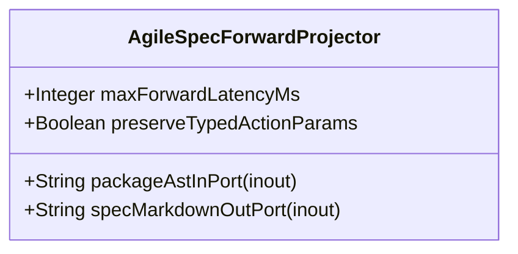

| Attribute | Specification Detail |
| :--- | :--- |
| **Issue ID** | #670 |
| **Title** | Feature 16: [BP 04 Deterministic Specification ICD and WBS Forward Compiler Blueprint] AgileSpecForwardProjector |
| **Type** | feature |
| **Parent Epic** | [EPIC-04-BP_04_Deterministic_Specification_ICD_and_WBS_Forward_Compiler_Blueprint](../epics/EPIC-04-BP_04_Deterministic_Specification_ICD_and_WBS_Forward_Compiler_Blueprint.md) |
| **Interface Type** | Physical / Structural / Internal Bus |
| **Schema Containers** | `BP_04_Deterministic_Specification_ICD_and_WBS_Forward_Compiler_Blueprint::AgileSpecForwardProjector` |
| **Generation Mode** | subagent |
| **Specification Source** | [schema/model.sysml](../../schema/model.sysml) |

# Feature 16: [BP 04 Deterministic Specification ICD and WBS Forward Compiler Blueprint] AgileSpecForwardProjector

## UML Class Diagram



## Interface Requirements
### 1. Test Data Shape
```json
{
  "$schema": "https://json-schema.org/draft/2020-12/schema",
  "title": "AgileSpecForwardProjectorPayloadSchema",
  "type": "object",
  "properties": {
    "part": {
      "type": "string",
      "const": "AgileSpecForwardProjector"
    },
    "status": {
      "type": "string",
      "enum": ["nominal", "degraded", "fault"]
    },
    "maxForwardLatencyMs": {
      "type": "integer",
      "description": "Subsystem attribute maxForwardLatencyMs"
    },
    "preserveTypedActionParams": {
      "type": "boolean",
      "description": "Subsystem attribute preserveTypedActionParams"
    },
    "packageAstInPort": {
      "type": "object",
      "properties": {
        "direction": { "type": "string", "const": "inout" },
        "port_type": { "type": "string", "const": "String" }
      },
      "required": ["direction", "port_type"]
    },
    "specMarkdownOutPort": {
      "type": "object",
      "properties": {
        "direction": { "type": "string", "const": "inout" },
        "port_type": { "type": "string", "const": "String" }
      },
      "required": ["direction", "port_type"]
    }
  },
  "required": [
    "part",
    "status",
    "maxForwardLatencyMs",
    "preserveTypedActionParams",
    "packageAstInPort",
    "specMarkdownOutPort"
  ],
  "additionalProperties": false
}
```

### 2. Validation & Constraints
Formal constraints and invariant guarantees enforced by AgileSpecForwardProjector.

### 3. Visual Layout & Arrangement
Logical layout, viewport containment, and container structure for AgileSpecForwardProjector conforming to platform design tokens. Container boundaries enforce @container isolation rules.

### 4. Interactive Flow & States
Operational lifecycle events and discrete state transitions for AgileSpecForwardProjector.

### Layer 1: Domain State & Signal Model
Domain state vector representing AgileSpecForwardProjector status, AST references, and typed signal models.

### Layer 2: Logic & Safety State Management
Deterministic state machine solver and safety monitor logic for AgileSpecForwardProjector.

### Layer 3: Presentation & Actuator Interface Binding
Presentation interface binding and diagnostic event routing for AgileSpecForwardProjector.

### Associated Use Cases & User Stories

#### Associated Use Cases
- [ ] #639 - [Use Case 16: Deterministic Multi Story Use Case and Con Ops Parent Epic Projection](../use-cases/UC-16-Deterministic_Multi_Story_Use_Case_and_ConOps_Parent_Epic_Projection.md)
- [ ] #640 - [Use Case 17: Deterministic Logical ICD Matrix and Signal Dictionary Synthesis](../use-cases/UC-17-Deterministic_Logical_ICD_Matrix_and_Signal_Dictionary_Synthesis.md)
- [ ] #641 - [Use Case 18: Deterministic MIL STD 881E WBS and Enterprise Export Synthesis](../use-cases/UC-18-Deterministic_MIL_STD_881E_WBS_and_Enterprise_Export_Synthesis.md)
- [ ] #642 - [Use Case 19: Fail Closed Stateful HTML Comment Frontmatter Guard and Parent Inclusive Checklist Reconciliation](../use-cases/UC-19-Fail_Closed_Stateful_HTML_Comment_Frontmatter_Guard_and_Parent_Inclusive_Checklist_Reconciliation.md)
- [ ] #643 - [Use Case 20: Fail Closed Subpackage Scoped Reverse Sync and Dogfood Blueprint Ingestion Parity](../use-cases/UC-20-Fail_Closed_Subpackage_Scoped_Reverse_Sync_and_Dogfood_Blueprint_Ingestion_Parity.md)

#### Associated User Stories
- [ ] #587 - [User Story 26: compile sysml](../user-stories/US-26-compile_sysml.md)
- [ ] #588 - [User Story 27: [AgileSpecForwardProjector] Resolve](../user-stories/US-27-Resolve.md)
- [ ] #589 - [User Story 28: Bind](../user-stories/US-28-Bind.md)
- [ ] #590 - [User Story 29: [AgileSpecForwardProjector] Emit](../user-stories/US-29-Emit.md)
- [ ] #591 - [User Story 30: Epics](../user-stories/US-30-Epics.md)
- [ ] #592 - [User Story 31: Project](../user-stories/US-31-Project.md)
- [ ] #593 - [User Story 32: ICD 01](../user-stories/US-32-ICD_01.md)
- [ ] #594 - [User Story 33: Synthesize](../user-stories/US-33-Synthesize.md)
- [ ] #595 - [User Story 34: WBS 01 03](../user-stories/US-34-WBS_01_03.md)
- [ ] #596 - [User Story 35: reconcile backlog](../user-stories/US-35-reconcile_backlog.md)
- [ ] #597 - [User Story 36: Parse](../user-stories/US-36-Parse.md)
- [ ] #598 - [User Story 37: Reconcile](../user-stories/US-37-Reconcile.md)
- [ ] #599 - [User Story 38: Zero](../user-stories/US-38-Zero.md)
- [ ] #600 - [User Story 39: Merge](../user-stories/US-39-Merge.md)
- [ ] #601 - [User Story 40: Bit identical](../user-stories/US-40-Bit_identical.md)

## Acceptance Criteria (BDD)
- [ ] AC-01: Given nominal AgileSpecForwardProjector domain state, When command or input signals are received, Then updates internal state and signal outputs within declared bounds.
- [ ] AC-02: Given operational state, When AgileSpecForwardProjector evaluates constraint 'Invariant_REQ_0604_SC_01', Then asserts invariant satisfaction without violation.
- [ ] AC-03: Given operational state, When AgileSpecForwardProjector evaluates constraint 'Invariant_REQ_0604_SC_02', Then asserts invariant satisfaction without violation.
- [ ] AC-04: Given malformed input signals or boundary condition violation, When AgileSpecForwardProjector error handling is invoked, Then transitions safely to failsafe fallback state without corruption.

## Source References
Formal component specifications and normative systems engineering requirements:
- System Architecture Model: `schema/model.sysml`
- Normative Systems Engineering Standard: ISO/IEC/IEEE 15288:2023 §6.4.3 Architecture Definition Process

Component behavior and interface definitions derive from `schema/model.sysml` pursuant to ISO/IEC/IEEE 15288.
