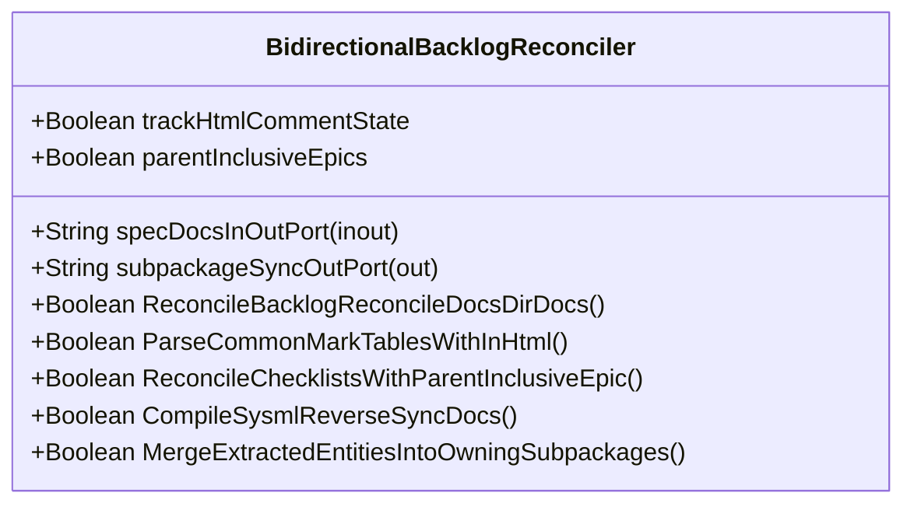

| Attribute | Specification Detail |
| :--- | :--- |
| **Issue ID** | #671 |
| **Title** | Feature 17: [BP 04 Deterministic Specification ICD and WBS Forward Compiler Blueprint] BidirectionalBacklogReconciler |
| **Type** | feature |
| **Parent Epic** | [EPIC-04-BP_04_Deterministic_Specification_ICD_and_WBS_Forward_Compiler_Blueprint](../epics/EPIC-04-BP_04_Deterministic_Specification_ICD_and_WBS_Forward_Compiler_Blueprint.md) |
| **Interface Type** | Physical / Structural / Internal Bus |
| **Schema Containers** | `BP_04_Deterministic_Specification_ICD_and_WBS_Forward_Compiler_Blueprint::BidirectionalBacklogReconciler` |
| **Generation Mode** | subagent |
| **Specification Source** | [schema/model.sysml](../../schema/model.sysml) |

# Feature 17: [BP 04 Deterministic Specification ICD and WBS Forward Compiler Blueprint] BidirectionalBacklogReconciler

## UML Class Diagram



## Interface Requirements
### 1. Test Data Shape
```json
{
  "$schema": "https://json-schema.org/draft/2020-12/schema",
  "title": "BidirectionalBacklogReconcilerPayloadSchema",
  "type": "object",
  "properties": {
    "part": {
      "type": "string",
      "const": "BidirectionalBacklogReconciler"
    },
    "status": {
      "type": "string",
      "enum": ["nominal", "degraded", "fault"]
    },
    "trackHtmlCommentState": {
      "type": "boolean",
      "x-sysml-type": "Boolean",
      "description": "Declared attribute trackHtmlCommentState (Boolean)",
      "default": true
    },
    "parentInclusiveEpics": {
      "type": "boolean",
      "x-sysml-type": "Boolean",
      "description": "Computes parent-inclusive Epic count so child-only slices never trigger single-epic wildcard matching. [unit: flag]",
      "default": true
    },
    "specDocsInOutPort": {
      "type": "object",
      "properties": {
        "direction": { "type": "string", "const": "inout" },
        "port_type": { "type": "string", "const": "String" }
      },
      "required": ["direction", "port_type"]
    },
    "subpackageSyncOutPort": {
      "type": "object",
      "properties": {
        "direction": { "type": "string", "const": "out" },
        "port_type": { "type": "string", "const": "String" }
      },
      "required": ["direction", "port_type"]
    }
  },
  "required": [
    "part",
    "status",
    "specDocsInOutPort",
    "subpackageSyncOutPort"
  ],
  "additionalProperties": false
}
```

### 2. Validation & Constraints
Declared structural attributes, boundary ports, invariants, and allocated requirements for classifier `BidirectionalBacklogReconciler`:

| AST Member Kind | Identifier | Declared Type / Direction | Default / Invariant Contract |
| :--- | :--- | :--- | :--- |
| Attribute | `trackHtmlCommentState` | `Boolean` | Default `true` (tracks `in_html_comment` state via `pulldown-cmark::Event::Html` so commented-out tables never spoof frontmatter) |
| Attribute | `parentInclusiveEpics` | `Boolean` | Default `true` (computes parent-inclusive Epic cardinality so child-only slices never trigger wildcard matching) |
| Port | `specDocsInOutPort` | `inout String` | Boundary interface contract reading and splicing CommonMark AST specification documents via `pulldown-cmark` + `pulldown-cmark-to-cmark` |
| Port | `subpackageSyncOutPort` | `out String` | Boundary interface contract emitting reverse-synced SysML v2 CST subpackage merges via `logos` + `rowan` + `salsa` |
| Constraint | `Invariant_REQ_0604_SC_01` | Invariant (`REQ-0604 (REQ_0604_BP_04_Deterministic_Specification_ICD_and_WBS_Forward_Compiler_Blueprint)`) | Enforces zero unpopulated checklist placeholders and 100% AST node coverage across reconciled specifications |
| Constraint | `Invariant_REQ_0604_SC_02` | Invariant (`REQ-0604 (REQ_0604_BP_04_Deterministic_Specification_ICD_and_WBS_Forward_Compiler_Blueprint)`) | Enforces `forward_reverse_drift_count == 0` and zero root namespace pollution during subpackage-scoped reverse sync |
| Requirement | `REQ-0604 (REQ_0604_BP_04_Deterministic_Specification_ICD_and_WBS_Forward_Compiler_Blueprint)` | Allocated Requirement | The DEAP compiler pipeline SHALL reconcile CommonMark specification frontmatter tables and parent-child checklists via `pulldown-cmark` + `pulldown-cmark-to-cmark` AST streams and reverse-synchronize extracted entities into owning SysML v2 `PackageDef` subpackages via `salsa` and `rowan` with zero hand-rolled scanners. |

```sysml
constraint Invariant_REQ_0604_SC_01 {}
constraint Invariant_REQ_0604_SC_02 {}
```

- **Contract A (Full OMG SysML v2.0 + KerML 1.0 Grammar Coverage -- Zero 16-Construct Caps)**: Preserves full Definition and Usage symmetry across all OMG SysML v2.0 and KerML 1.0 constructs (`package`/`library package`/`standard library package`, `part def`/`part`, `item def`/`item`, `attribute def`/`attribute`, `enum def`/`enum`, `port def`/`port` (`in`, `out`, `inout`, `~`), `connection def`/`connection`, `flow def`/`flow`, `interface def`/`interface`, `allocation def`/`allocation`, `occurrence def`/`occurrence`, `action def`/`action`, `state def`/`state`, `calc def`/`calc`, `constraint def`/`constraint`, `requirement def`/`requirement`, `use case def`/`use case`, `interaction def`/`interaction`, `verification def`/`verification`, `test case def`/`test case`, `metadata def`/`@Metadata`/`#user_keyword`, and KerML specialization/expressions) during bidirectional synchronization with zero 16-construct caps.
- **Contract B (`pulldown-cmark` + `pulldown-cmark-to-cmark` Lossless Markdown AST + `toml_edit` + `salsa` Derived Projection Across All 6 Crates -- Zero Hand-Rolled Scanners)**: Replaces all legacy line-by-line pipe-splitting (`line.split('|')`) and regex HTML comment scanners in `reconcile-backlog` and `compile-sysml` with `pulldown-cmark` event-stream parsing, `pulldown-cmark-to-cmark` lossless serialization, `toml_edit` manifest updates, and `salsa` derived queries across all 6 workspace crates (`deap-core`, `compile-sysml`, `ingest-sysml`, `reconcile-backlog`, `verify-baseline`, `assemble-conops`).

### 3. Visual Layout & Arrangement
Structural composition and boundary topology for classifier `BidirectionalBacklogReconciler` organize boundary ports `inout specDocsInOutPort : String` and `out subpackageSyncOutPort : String` across `< 380` executable SLOC submodules under `./crates/reconcile-backlog/src/table_cst/` and `./crates/compile-sysml/src/forward_sync/`.

### 4. Interactive Flow & States
Operational lifecycle events and discrete state transitions for `BidirectionalBacklogReconciler` govern `WbsExported -> BacklogReconciled` on `reconcileBacklog`, `BacklogReconciled -> ReverseSynced` on `reverseSyncToSubpackages`, `BacklogReconciled -> Rejected` (`Diagnostic: E0300`) on `htmlCommentSpoofOrCardinalityError`, and `ReverseSynced -> Rejected` (`Diagnostic: E0400`) on `rootAstPollutionOrDriftDetected`.

### Layer 1: Domain State & Signal Model
Classifier `BidirectionalBacklogReconciler` encapsulates typed domain state attributes `trackHtmlCommentState : Boolean` (default `true`) and `parentInclusiveEpics : Boolean` (default `true`), backed by `pulldown-cmark::Event` CommonMark table/tasklist AST nodes, `toml_edit::DocumentMut` structures, and `logos` + `rowan` + `salsa` SysML v2 `PackageDef` CST/AST hierarchies (`deap_core::sysml_cst`, zero 16-construct caps).

### Layer 2: Logic & Safety State Management
Classifier `BidirectionalBacklogReconciler` governs stateful `pulldown-cmark` HTML-comment guard evaluation (`ParseCommonMarkTablesWithInHtml`), parent-inclusive Epic checklist reconciliation (`ReconcileChecklistsWithParentInclusiveEpic`), and subpackage-scoped reverse AST merging (`CompileSysmlReverseSyncDocs`, `MergeExtractedEntitiesIntoOwningSubpackages`) enforcing `Invariant_REQ_0604_SC_01` and `Invariant_REQ_0604_SC_02`. Implementation is bounded within `< 380` executable SLOC submodules (`./crates/reconcile-backlog/src/table_cst/`, `./crates/compile-sysml/src/forward_sync/`) with explicit deletion of legacy hand-rolled Markdown table/checklist line scanners (`-1,100+` SLOC net-negative ratchet).

### Layer 3: Presentation & Actuator Interface Binding
Classifier `BidirectionalBacklogReconciler` binds external and behavioral interfaces across port `inout specDocsInOutPort : String` (via lossless `pulldown-cmark-to-cmark` AST serialization) and port `out subpackageSyncOutPort : String` (via `rowan` CST splicing), emitting structured `ariadne` / `miette` diagnostics (`E0300`, `E0400`) on guard failure.

### Associated Use Cases & User Stories

#### Associated Use Cases
- [ ] #642 - [Use Case 19: Fail Closed Stateful HTML Comment Frontmatter Guard and Parent Inclusive Checklist Reconciliation](../use-cases/UC-19-Fail_Closed_Stateful_HTML_Comment_Frontmatter_Guard_and_Parent_Inclusive_Checklist_Reconciliation.md)
- [ ] #643 - [Use Case 20: Fail Closed Subpackage Scoped Reverse Sync and Dogfood Blueprint Ingestion Parity](../use-cases/UC-20-Fail_Closed_Subpackage_Scoped_Reverse_Sync_and_Dogfood_Blueprint_Ingestion_Parity.md)

#### Associated User Stories
- [ ] #707 - [User Story 18: Compile Sysml Forward Sync Docs](../user-stories/US-18-CompileSysmlForwardSyncDocs.md)
- [ ] #708 - [User Story 19: Resolve Parent Epic By Pkg Name](../user-stories/US-19-ResolveParentEpicByPkgName.md)
- [ ] #709 - [User Story 20: Bind All Package Stories To Use](../user-stories/US-20-BindAllPackageStoriesToUse.md)
- [ ] #710 - [User Story 21: Emit Symmetric Action Def Signatures And E1](../user-stories/US-21-EmitSymmetricActionDefSignaturesAndE1.md)
- [ ] #711 - [User Story 22: Compile Sysml Emit Icd Docs Interfaces](../user-stories/US-22-CompileSysmlEmitIcdDocsInterfaces.md)
- [ ] #712 - [User Story 23: Project Nx N Connection Def Matrix And Flow Def](../user-stories/US-23-ProjectNxNConnectionDefMatrixAndFlowDef.md)
- [ ] #713 - [User Story 24: Compile Sysml Emit Wbs Docs Management](../user-stories/US-24-CompileSysmlEmitWbsDocsManagement.md)
- [ ] #714 - [User Story 25: Synthesize Mil Std881 e Tree And](../user-stories/US-25-SynthesizeMilStd881eTreeAnd.md)
- [ ] #715 - [User Story 26: Reconcile Backlog Reconcile Docs Dir Docs](../user-stories/US-26-ReconcileBacklogReconcileDocsDirDocs.md)
- [ ] #716 - [User Story 27: Parse CommonMark Tables With In Html](../user-stories/US-27-ParseCommonMarkTablesWithInHtml.md)
- [ ] #717 - [User Story 28: Reconcile Checklists With Parent Inclusive Epic](../user-stories/US-28-ReconcileChecklistsWithParentInclusiveEpic.md)
- [ ] #718 - [User Story 29: Compile Sysml Reverse Sync Docs](../user-stories/US-29-CompileSysmlReverseSyncDocs.md)
- [ ] #719 - [User Story 30: Merge Extracted Entities Into Owning Subpackages](../user-stories/US-30-MergeExtractedEntitiesIntoOwningSubpackages.md)

## Acceptance Criteria (BDD)
- [ ] AC-01: Given valid `BidirectionalBacklogReconciler` initialization inputs for `trackHtmlCommentState` (`Boolean`), `parentInclusiveEpics` (`Boolean`) satisfying `Invariant_REQ_0604_SC_01` and `Invariant_REQ_0604_SC_02` [Req `REQ-0604 (REQ_0604_BP_04_Deterministic_Specification_ICD_and_WBS_Forward_Compiler_Blueprint)`], When `BidirectionalBacklogReconciler` commits typed domain state via `pulldown-cmark` + `pulldown-cmark-to-cmark` and `salsa`, Then declared state attributes hold verified values with zero HTML-comment frontmatter spoofing.
- [ ] AC-02: Given malformed or spoofed HTML-comment frontmatter tables or out-of-domain input values for `trackHtmlCommentState` (`Boolean`), `parentInclusiveEpics` (`Boolean`), When `BidirectionalBacklogReconciler` validates incoming state updates, Then `BidirectionalBacklogReconciler` rejects the invalid state update fail-closed (`E0300`) and emits an `ariadne` / `miette` diagnostic via port `specDocsInOutPort`.
- [ ] AC-03: Given nominal signal arrival across `specDocsInOutPort` (`inout String`), `subpackageSyncOutPort` (`out String`) covering the full OMG SysML v2.0 + KerML 1.0 grammar (Contract A, zero 16-construct caps), When `BidirectionalBacklogReconciler` processes the declared interface transaction via `pulldown-cmark` + `pulldown-cmark-to-cmark` + `toml_edit` + `salsa` (Contract B, zero hand-rolled scanners) inside `< 380`-SLOC submodules with legacy hand-rolled scanners deleted, Then output state conforms to the structural classifier contract with `forward_reverse_drift_count == 0`.
- [ ] AC-04: Given an invalid or unrecognized interface frame or root AST namespace pollution across `specDocsInOutPort` (`inout String`), `subpackageSyncOutPort` (`out String`), When `BidirectionalBacklogReconciler` boundary validation executes, Then `BidirectionalBacklogReconciler` refuses the malformed frame fail-closed (`E0400`) via diagnostic port `specDocsInOutPort` and preserves prior verified state.

## Source References
Formal component specifications and normative systems engineering requirements:
- System Architecture Model: `schema/model.sysml`
- Normative Systems Engineering Standard: ISO/IEC/IEEE 15288:2023 §6.4.3 Architecture Definition Process

Component behavior and interface definitions derive from `schema/model.sysml` pursuant to ISO/IEC/IEEE 15288.
