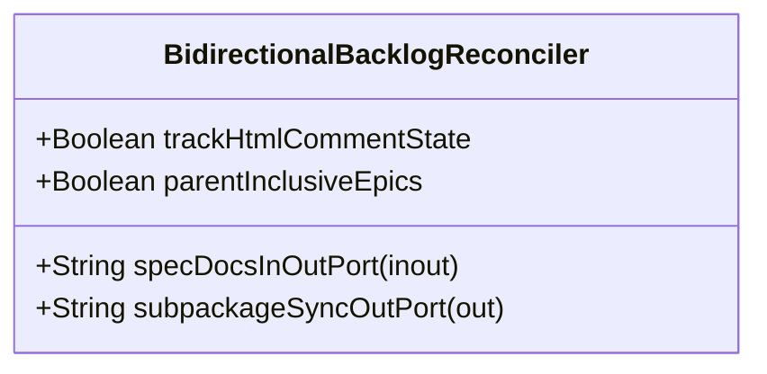

| Attribute | Specification Detail |
| :--- | :--- |
| **Issue ID** | #671 |
| **Title** | Feature 17: [BP 04 Deterministic Specification ICD and WBS Forward Compiler Blueprint] BidirectionalBacklogReconciler |
| **Type** | feature |
| **Parent Epic** | [EPIC-04-BP_04_Deterministic_Specification_ICD_and_WBS_Forward_Compiler_Blueprint](../epics/EPIC-04-BP_04_Deterministic_Specification_ICD_and_WBS_Forward_Compiler_Blueprint.md) |
| **Interface Type** | Physical / Structural / Internal Bus |
| **Schema Containers** | `BP_04_Deterministic_Specification_ICD_and_WBS_Forward_Compiler_Blueprint::BidirectionalBacklogReconciler` |
| **Generation Mode** | subagent |
| **Specification Source** | [schema/model.sysml](../../schema/model.sysml) |

# Feature 17: [BP 04 Deterministic Specification ICD and WBS Forward Compiler Blueprint] BidirectionalBacklogReconciler

## UML Class Diagram



## Interface Requirements
### 1. Test Data Shape
```json
{
  "$schema": "https://json-schema.org/draft/2020-12/schema",
  "title": "BidirectionalBacklogReconcilerPayloadSchema",
  "type": "object",
  "properties": {
    "part": {
      "type": "string",
      "const": "BidirectionalBacklogReconciler"
    },
    "status": {
      "type": "string",
      "enum": ["nominal", "degraded", "fault"]
    },
    "trackHtmlCommentState": {
      "type": "boolean",
      "x-sysml-type": "Boolean",
      "description": "Declared attribute trackHtmlCommentState (Boolean)",
      "default": true
    },
    "parentInclusiveEpics": {
      "type": "boolean",
      "x-sysml-type": "Boolean",
      "description": "Computes parent-inclusive Epic count so child-only slices never trigger single-epic wildcard matching. [unit: flag]",
      "default": true
    },
    "specDocsInOutPort": {
      "type": "object",
      "properties": {
        "direction": { "type": "string", "const": "inout" },
        "port_type": { "type": "string", "const": "String" }
      },
      "required": ["direction", "port_type"]
    },
    "subpackageSyncOutPort": {
      "type": "object",
      "properties": {
        "direction": { "type": "string", "const": "out" },
        "port_type": { "type": "string", "const": "String" }
      },
      "required": ["direction", "port_type"]
    }
  },
  "required": [
    "part",
    "status",
    "specDocsInOutPort",
    "subpackageSyncOutPort"
  ],
  "additionalProperties": false
}
```

### 2. Validation & Constraints
Declared structural attributes, boundary ports, invariants, and allocated requirements for classifier `BidirectionalBacklogReconciler`:

| AST Member Kind | Identifier | Declared Type / Direction | Default / Invariant Contract |
| :--- | :--- | :--- | :--- |
| Attribute | `trackHtmlCommentState` | `Boolean` | Default `true` |
| Attribute | `parentInclusiveEpics` | `Boolean` | Default `true` |
| Port | `specDocsInOutPort` | `inout String` | Boundary interface contract |
| Port | `subpackageSyncOutPort` | `out String` | Boundary interface contract |

### 3. Visual Layout & Arrangement
Structural composition and boundary topology for classifier `BidirectionalBacklogReconciler` organize no nested subparts declared in schema paired with boundary ports `inout specDocsInOutPort : String`, `out subpackageSyncOutPort : String`.

### 4. Interactive Flow & States
Operational lifecycle events and discrete state transitions for BidirectionalBacklogReconciler.

### Layer 1: Domain State & Signal Model
Classifier `BidirectionalBacklogReconciler` encapsulates typed domain state attributes `trackHtmlCommentState : Boolean`, `parentInclusiveEpics : Boolean` alongside operational lifecycle status.

### Layer 2: Logic & Safety State Management
Classifier `BidirectionalBacklogReconciler` governs stateless structural transition evaluation enforcing no additional invariant guards declared in schema.

### Layer 3: Presentation & Actuator Interface Binding
Classifier `BidirectionalBacklogReconciler` binds external and behavioral interfaces across port `inout specDocsInOutPort : String`, port `out subpackageSyncOutPort : String`.

### Associated Use Cases & User Stories

#### Associated Use Cases
- None allocated (structural subsystem component)

#### Associated User Stories
- [ ] #707 - [User Story 18: Compile Sysml Forward Sync Docs](../user-stories/US-18-CompileSysmlForwardSyncDocs.md)
- [ ] #708 - [User Story 19: Resolve Parent Epic By Pkg Name](../user-stories/US-19-ResolveParentEpicByPkgName.md)
- [ ] #709 - [User Story 20: Bind All Package Stories To Use](../user-stories/US-20-BindAllPackageStoriesToUse.md)
- [ ] #710 - [User Story 21: Emit Symmetric Action Def Signatures And E1](../user-stories/US-21-EmitSymmetricActionDefSignaturesAndE1.md)
- [ ] #711 - [User Story 22: Compile Sysml Emit Icd Docs Interfaces](../user-stories/US-22-CompileSysmlEmitIcdDocsInterfaces.md)
- [ ] #712 - [User Story 23: Project Nx N Connection Def Matrix And Flow Def](../user-stories/US-23-ProjectNxNConnectionDefMatrixAndFlowDef.md)
- [ ] #713 - [User Story 24: Compile Sysml Emit Wbs Docs Management](../user-stories/US-24-CompileSysmlEmitWbsDocsManagement.md)
- [ ] #714 - [User Story 25: Synthesize Mil Std881 e Tree And](../user-stories/US-25-SynthesizeMilStd881eTreeAnd.md)
- [ ] #715 - [User Story 26: Reconcile Backlog Reconcile Docs Dir Docs](../user-stories/US-26-ReconcileBacklogReconcileDocsDirDocs.md)
- [ ] #716 - [User Story 27: Parse CommonMark Tables With In Html](../user-stories/US-27-ParseCommonMarkTablesWithInHtml.md)
- [ ] #717 - [User Story 28: Reconcile Checklists With Parent Inclusive Epic](../user-stories/US-28-ReconcileChecklistsWithParentInclusiveEpic.md)
- [ ] #718 - [User Story 29: Compile Sysml Reverse Sync Docs](../user-stories/US-29-CompileSysmlReverseSyncDocs.md)
- [ ] #719 - [User Story 30: Merge Extracted Entities Into Owning Subpackages](../user-stories/US-30-MergeExtractedEntitiesIntoOwningSubpackages.md)

## Acceptance Criteria (BDD)
- [ ] AC-01: Given valid `BidirectionalBacklogReconciler` initialization inputs for `trackHtmlCommentState` (`Boolean`), `parentInclusiveEpics` (`Boolean`) (no additional constraints specified in schema), When `BidirectionalBacklogReconciler` commits typed domain state, Then declared state attributes hold verified values.
- [ ] AC-02: Given malformed or out-of-domain input values for `trackHtmlCommentState` (`Boolean`), `parentInclusiveEpics` (`Boolean`), When `BidirectionalBacklogReconciler` validates incoming state updates, Then `BidirectionalBacklogReconciler` rejects the invalid state update and emits a diagnostic via diagnostic port `specDocsInOutPort`.
- [ ] AC-03: Given nominal signal arrival across `specDocsInOutPort` (`inout String`), `subpackageSyncOutPort` (`out String`), When `BidirectionalBacklogReconciler` processes the declared interface transaction, Then output state conforms to the structural classifier contract.
- [ ] AC-04: Given an invalid or unrecognized interface frame across `specDocsInOutPort` (`inout String`), `subpackageSyncOutPort` (`out String`), When `BidirectionalBacklogReconciler` boundary validation executes, Then `BidirectionalBacklogReconciler` refuses the malformed frame via diagnostic port `specDocsInOutPort` and preserves prior verified state.

## Source References
Formal component specifications and normative systems engineering requirements:
- System Architecture Model: `schema/model.sysml`
- Normative Systems Engineering Standard: ISO/IEC/IEEE 15288:2023 §6.4.3 Architecture Definition Process

Component behavior and interface definitions derive from `schema/model.sysml` pursuant to ISO/IEC/IEEE 15288.
