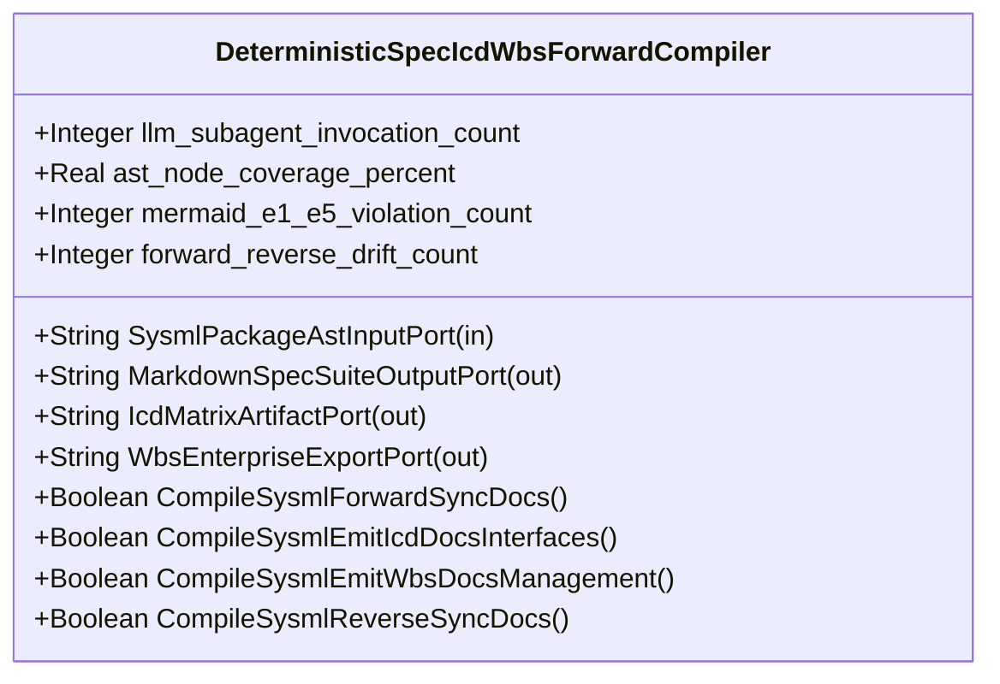

| Attribute | Specification Detail |
| :--- | :--- |
| **Issue ID** | #672 |
| **Title** | Feature 18: [BP 04 Deterministic Specification ICD and WBS Forward Compiler Blueprint] DeterministicSpecIcdWbsForwardCompiler |
| **Type** | feature |
| **Parent Epic** | [EPIC-04-BP_04_Deterministic_Specification_ICD_and_WBS_Forward_Compiler_Blueprint](../epics/EPIC-04-BP_04_Deterministic_Specification_ICD_and_WBS_Forward_Compiler_Blueprint.md) |
| **Interface Type** | Physical / Structural / Internal Bus |
| **Schema Containers** | `BP_04_Deterministic_Specification_ICD_and_WBS_Forward_Compiler_Blueprint::DeterministicSpecIcdWbsForwardCompiler` |
| **Generation Mode** | subagent |
| **Specification Source** | [schema/model.sysml](../../schema/model.sysml) |

# Feature 18: [BP 04 Deterministic Specification ICD and WBS Forward Compiler Blueprint] DeterministicSpecIcdWbsForwardCompiler

## UML Class Diagram



## Interface Requirements
### 1. Test Data Shape
```json
{
  "$schema": "https://json-schema.org/draft/2020-12/schema",
  "title": "DeterministicSpecIcdWbsForwardCompilerPayloadSchema",
  "type": "object",
  "properties": {
    "part": {
      "type": "string",
      "const": "DeterministicSpecIcdWbsForwardCompiler"
    },
    "status": {
      "type": "string",
      "enum": ["nominal", "degraded", "fault"]
    },
    "llm_subagent_invocation_count": {
      "type": "integer",
      "x-sysml-type": "Integer",
      "description": "Declared attribute llm_subagent_invocation_count (Integer)",
      "default": 0
    },
    "ast_node_coverage_percent": {
      "type": "number",
      "x-sysml-type": "Real",
      "description": "Percentage of declared SysML v2 AST packages, parts, ports, flows, interactions, and use cases projected into specifications (`C-FWD-02 == 100.0`). [unit: percent]",
      "default": 100
    },
    "mermaid_e1_e5_violation_count": {
      "type": "integer",
      "x-sysml-type": "Integer",
      "description": "Count of Check 13B E1-E5 Mermaid syntax or layout violations across all compiler-synthesized diagrams (`C-FWD-03 == 0`). [unit: count]",
      "default": 0
    },
    "forward_reverse_drift_count": {
      "type": "integer",
      "x-sysml-type": "Integer",
      "description": "Count of AST structural or subpackage placement divergences after a forward-then-reverse synchronization cycle (`C-FWD-04 == 0`). [unit: count]",
      "default": 0
    },
    "SysmlPackageAstInputPort": {
      "type": "object",
      "properties": {
        "direction": { "type": "string", "const": "in" },
        "port_type": { "type": "string", "const": "String" }
      },
      "required": ["direction", "port_type"]
    },
    "MarkdownSpecSuiteOutputPort": {
      "type": "object",
      "properties": {
        "direction": { "type": "string", "const": "out" },
        "port_type": { "type": "string", "const": "String" }
      },
      "required": ["direction", "port_type"]
    },
    "IcdMatrixArtifactPort": {
      "type": "object",
      "properties": {
        "direction": { "type": "string", "const": "out" },
        "port_type": { "type": "string", "const": "String" }
      },
      "required": ["direction", "port_type"]
    },
    "WbsEnterpriseExportPort": {
      "type": "object",
      "properties": {
        "direction": { "type": "string", "const": "out" },
        "port_type": { "type": "string", "const": "String" }
      },
      "required": ["direction", "port_type"]
    }
  },
  "required": [
    "part",
    "status",
    "SysmlPackageAstInputPort",
    "MarkdownSpecSuiteOutputPort",
    "IcdMatrixArtifactPort",
    "WbsEnterpriseExportPort"
  ],
  "additionalProperties": false
}
```

### 2. Validation & Constraints
Declared structural attributes, boundary ports, invariants, and allocated requirements for classifier `DeterministicSpecIcdWbsForwardCompiler`:

| AST Member Kind | Identifier | Declared Type / Direction | Default / Invariant Contract |
| :--- | :--- | :--- | :--- |
| Attribute | `llm_subagent_invocation_count` | `Integer` | Default `0` (`C-FWD-01 == 0` zero-LLM compiler synthesis invariant) |
| Attribute | `ast_node_coverage_percent` | `Real` | Default `100` (`C-FWD-02 == 100.0` 100% OMG SysML v2.0 + KerML 1.0 AST projection coverage) |
| Attribute | `mermaid_e1_e5_violation_count` | `Integer` | Default `0` (`C-FWD-03 == 0` zero Check 13B E1-E5 Mermaid syntax/layout violations) |
| Attribute | `forward_reverse_drift_count` | `Integer` | Default `0` (`C-FWD-04 == 0` zero SHA-256 forward-then-reverse AST/subpackage drift) |
| Port | `SysmlPackageAstInputPort` | `in String` | Boundary interface contract ingesting lossless `logos` + `rowan` + `salsa` SysML v2 CST/AST models (`deap_core::sysml_cst`) |
| Port | `MarkdownSpecSuiteOutputPort` | `out String` | Boundary interface contract emitting lossless `pulldown-cmark-to-cmark` Agile and ConOps specification suites |
| Port | `IcdMatrixArtifactPort` | `out String` | Boundary interface contract emitting `ICD_01_SYSTEM_INTERFACE_MATRIX.md` and `ICD_02_MASTER_SIGNAL_DICTIONARY.md` |
| Port | `WbsEnterpriseExportPort` | `out String` | Boundary interface contract emitting MIL-STD-881E `WBS_01..03` Markdown registers and RFC 4180 CSV / JSON AST exports |
| Constraint | `Invariant_REQ_0604_SC_01` | Invariant (`REQ-0604 (REQ_0604_BP_04_Deterministic_Specification_ICD_and_WBS_Forward_Compiler_Blueprint)`) | Enforces `llm_subagent_invocation_count == 0 && ast_node_coverage_percent == 100.0 && mermaid_e1_e5_violation_count == 0` |
| Constraint | `Invariant_REQ_0604_SC_02` | Invariant (`REQ-0604 (REQ_0604_BP_04_Deterministic_Specification_ICD_and_WBS_Forward_Compiler_Blueprint)`) | Enforces `forward_reverse_drift_count == 0` and bit-identical SHA-256 roundtrip parity |
| Requirement | `REQ-0604 (REQ_0604_BP_04_Deterministic_Specification_ICD_and_WBS_Forward_Compiler_Blueprint)` | Allocated Requirement | The DEAP compiler pipeline SHALL deterministically project Spec, ConOps, ICD, and WBS artifacts across all 6 workspace crates (`deap-core`, `compile-sysml`, `ingest-sysml`, `reconcile-backlog`, `verify-baseline`, `assemble-conops`) via `salsa`, `pulldown-cmark`, `pulldown-cmark-to-cmark`, and `toml_edit` with zero hand-rolled scanners. |

```sysml
constraint Invariant_REQ_0604_SC_01 {}
constraint Invariant_REQ_0604_SC_02 {}
```

- **Contract A (Full OMG SysML v2.0 + KerML 1.0 Grammar Coverage -- Zero 16-Construct Caps)**: Compiles the complete OMG SysML v2.0 and KerML 1.0 grammar with full Definition and Usage symmetry and zero 16-construct caps across all structural, behavioral, requirement, verification, interaction, use case, view, metadata (`#hazard`, `#risk`, `#capability`, `#rt_loop`, `#dal`, `#fls`), and KerML expression constructs.
- **Contract B (`pulldown-cmark` + `pulldown-cmark-to-cmark` Lossless Markdown AST + `toml_edit` + `salsa` Derived Projection Across All 6 Crates -- Zero Hand-Rolled Scanners)**: Drives Spec, ConOps, ICD, and WBS compilation across `deap-core`, `compile-sysml`, `ingest-sysml`, `reconcile-backlog`, `verify-baseline`, and `assemble-conops` via `logos` + `rowan` + `salsa` + `ariadne`, `pulldown-cmark` + `pulldown-cmark-to-cmark`, and `toml_edit` with zero hand-rolled line/string/char-by-char scanners.

### 3. Visual Layout & Arrangement
Structural composition and boundary topology for classifier `DeterministicSpecIcdWbsForwardCompiler` coordinate `AgileSpecForwardProjector`, `LogicalIcdMatrixCompiler`, `MilStd881eWbsExporter`, and `BidirectionalBacklogReconciler` across boundary ports `in SysmlPackageAstInputPort : String`, `out MarkdownSpecSuiteOutputPort : String`, `out IcdMatrixArtifactPort : String`, and `out WbsEnterpriseExportPort : String` within `< 380` executable SLOC submodules.

### 4. Interactive Flow & States
Operational lifecycle events and discrete state transitions for `DeterministicSpecIcdWbsForwardCompiler` traverse `AstLoaded -> ForwardProjected -> IcdSynthesized -> WbsExported -> BacklogReconciled -> ReverseSynced -> VerifiedRoundtrip` (or fail-closed to `Rejected` on invariant or SHA-256 parity violation).

### Layer 1: Domain State & Signal Model
Classifier `DeterministicSpecIcdWbsForwardCompiler` encapsulates typed domain state attributes `llm_subagent_invocation_count : Integer`, `ast_node_coverage_percent : Real`, `mermaid_e1_e5_violation_count : Integer`, and `forward_reverse_drift_count : Integer`, backed by `salsa` interned SysML v2 HIR tables (`deap_core::sysml_cst`, zero 16-construct caps), `pulldown-cmark::Event` Markdown AST streams, and `toml_edit::DocumentMut` manifests across all 6 workspace crates.

### Layer 2: Logic & Safety State Management
Classifier `DeterministicSpecIcdWbsForwardCompiler` governs end-to-end `salsa` derived projection and SHA-256 roundtrip verification enforcing `Invariant_REQ_0604_SC_01` and `Invariant_REQ_0604_SC_02`. Implementation is partitioned into `< 380` executable SLOC submodules (`./crates/compile-sysml/src/forward_sync/`, `./crates/compile-sysml/src/icd_wbs/`, `./crates/reconcile-backlog/src/table_cst/`, `./crates/assemble-conops/src/`) with explicit deletion of legacy hand-rolled Markdown/table/SysML scanners (`-1,100+` SLOC net-negative ratchet).

### Layer 3: Presentation & Actuator Interface Binding
Classifier `DeterministicSpecIcdWbsForwardCompiler` binds external and behavioral interfaces across port `in SysmlPackageAstInputPort : String`, port `out MarkdownSpecSuiteOutputPort : String`, port `out IcdMatrixArtifactPort : String`, and port `out WbsEnterpriseExportPort : String` via lossless `pulldown-cmark-to-cmark` serialization and `ariadne` / `miette` diagnostics.

### Associated Use Cases & User Stories

#### Associated Use Cases
- [ ] #639 - [Use Case 16: Deterministic Multi Story Use Case and Con Ops Parent Epic Projection](../use-cases/UC-16-Deterministic_Multi_Story_Use_Case_and_ConOps_Parent_Epic_Projection.md)
- [ ] #640 - [Use Case 17: Deterministic Logical ICD Matrix and Signal Dictionary Synthesis](../use-cases/UC-17-Deterministic_Logical_ICD_Matrix_and_Signal_Dictionary_Synthesis.md)
- [ ] #641 - [Use Case 18: Deterministic MIL STD 881 E WBS and Enterprise Export Synthesis](../use-cases/UC-18-Deterministic_MIL_STD_881E_WBS_and_Enterprise_Export_Synthesis.md)
- [ ] #642 - [Use Case 19: Fail Closed Stateful HTML Comment Frontmatter Guard and Parent Inclusive Checklist Reconciliation](../use-cases/UC-19-Fail_Closed_Stateful_HTML_Comment_Frontmatter_Guard_and_Parent_Inclusive_Checklist_Reconciliation.md)
- [ ] #643 - [Use Case 20: Fail Closed Subpackage Scoped Reverse Sync and Dogfood Blueprint Ingestion Parity](../use-cases/UC-20-Fail_Closed_Subpackage_Scoped_Reverse_Sync_and_Dogfood_Blueprint_Ingestion_Parity.md)

#### Associated User Stories
- [ ] #707 - [User Story 18: Compile Sysml Forward Sync Docs](../user-stories/US-18-CompileSysmlForwardSyncDocs.md)
- [ ] #711 - [User Story 22: Compile Sysml Emit Icd Docs Interfaces](../user-stories/US-22-CompileSysmlEmitIcdDocsInterfaces.md)
- [ ] #713 - [User Story 24: Compile Sysml Emit Wbs Docs Management](../user-stories/US-24-CompileSysmlEmitWbsDocsManagement.md)
- [ ] #718 - [User Story 29: Compile Sysml Reverse Sync Docs](../user-stories/US-29-CompileSysmlReverseSyncDocs.md)

## Acceptance Criteria (BDD)
- [ ] AC-01: Given valid `DeterministicSpecIcdWbsForwardCompiler` initialization inputs for `llm_subagent_invocation_count` (`Integer`), `ast_node_coverage_percent` (`Real`), `mermaid_e1_e5_violation_count` (`Integer`), `forward_reverse_drift_count` (`Integer`) satisfying `Invariant_REQ_0604_SC_01` and `Invariant_REQ_0604_SC_02` [Req `REQ-0604 (REQ_0604_BP_04_Deterministic_Specification_ICD_and_WBS_Forward_Compiler_Blueprint)`], When `DeterministicSpecIcdWbsForwardCompiler` commits typed domain state via `salsa` and `pulldown-cmark-to-cmark`, Then declared state attributes hold verified values (`0`, `100.0`, `0`, `0`).
- [ ] AC-02: Given malformed or out-of-domain input values violating `Invariant_REQ_0604_SC_01` or `Invariant_REQ_0604_SC_02`, When `DeterministicSpecIcdWbsForwardCompiler` validates incoming state updates, Then `DeterministicSpecIcdWbsForwardCompiler` rejects the invalid state update fail-closed and emits an `ariadne` / `miette` diagnostic via port `MarkdownSpecSuiteOutputPort`.
- [ ] AC-03: Given nominal signal arrival across `SysmlPackageAstInputPort` (`in String`), `MarkdownSpecSuiteOutputPort` (`out String`), `IcdMatrixArtifactPort` (`out String`), `WbsEnterpriseExportPort` (`out String`) covering the full OMG SysML v2.0 + KerML 1.0 grammar (Contract A, zero 16-construct caps), When `DeterministicSpecIcdWbsForwardCompiler` processes the declared interface transaction via `pulldown-cmark` + `pulldown-cmark-to-cmark` + `toml_edit` + `salsa` across all 6 crates (Contract B, zero hand-rolled scanners) inside `< 380`-SLOC submodules with legacy hand-rolled scanners deleted, Then output state conforms to the structural classifier contract.
- [ ] AC-04: Given an invalid or unrecognized interface frame across `SysmlPackageAstInputPort` (`in String`), `MarkdownSpecSuiteOutputPort` (`out String`), `IcdMatrixArtifactPort` (`out String`), `WbsEnterpriseExportPort` (`out String`), When `DeterministicSpecIcdWbsForwardCompiler` boundary validation executes, Then `DeterministicSpecIcdWbsForwardCompiler` refuses the malformed frame via diagnostic port `MarkdownSpecSuiteOutputPort` and preserves prior verified state.

## Source References
Formal component specifications and normative systems engineering requirements:
- System Architecture Model: `schema/model.sysml`
- Normative Systems Engineering Standard: ISO/IEC/IEEE 15288:2023 §6.4.3 Architecture Definition Process

Component behavior and interface definitions derive from `schema/model.sysml` pursuant to ISO/IEC/IEEE 15288.
