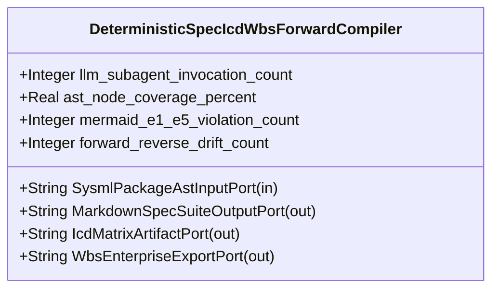

| Attribute | Specification Detail |
| :--- | :--- |
| **Issue ID** | #672 |
| **Title** | Feature 18: [BP 04 Deterministic Specification ICD and WBS Forward Compiler Blueprint] DeterministicSpecIcdWbsForwardCompiler |
| **Type** | feature |
| **Parent Epic** | [EPIC-04-BP_04_Deterministic_Specification_ICD_and_WBS_Forward_Compiler_Blueprint](../epics/EPIC-04-BP_04_Deterministic_Specification_ICD_and_WBS_Forward_Compiler_Blueprint.md) |
| **Interface Type** | Physical / Structural / Internal Bus |
| **Schema Containers** | `BP_04_Deterministic_Specification_ICD_and_WBS_Forward_Compiler_Blueprint::DeterministicSpecIcdWbsForwardCompiler` |
| **Generation Mode** | subagent |
| **Specification Source** | [schema/model.sysml](../../schema/model.sysml) |

# Feature 18: [BP 04 Deterministic Specification ICD and WBS Forward Compiler Blueprint] DeterministicSpecIcdWbsForwardCompiler

## UML Class Diagram



## Interface Requirements
### 1. Test Data Shape
```json
{
  "$schema": "https://json-schema.org/draft/2020-12/schema",
  "title": "DeterministicSpecIcdWbsForwardCompilerPayloadSchema",
  "type": "object",
  "properties": {
    "part": {
      "type": "string",
      "const": "DeterministicSpecIcdWbsForwardCompiler"
    },
    "status": {
      "type": "string",
      "enum": ["nominal", "degraded", "fault"]
    },
    "llm_subagent_invocation_count": {
      "type": "integer",
      "x-sysml-type": "Integer",
      "description": "Declared attribute llm_subagent_invocation_count (Integer)",
      "default": 0
    },
    "ast_node_coverage_percent": {
      "type": "number",
      "x-sysml-type": "Real",
      "description": "Percentage of declared SysML v2 AST packages, parts, ports, flows, interactions, and use cases projected into specifications (`C-FWD-02 == 100.0`). [unit: percent]",
      "default": 100
    },
    "mermaid_e1_e5_violation_count": {
      "type": "integer",
      "x-sysml-type": "Integer",
      "description": "Count of Check 13B E1-E5 Mermaid syntax or layout violations across all compiler-synthesized diagrams (`C-FWD-03 == 0`). [unit: count]",
      "default": 0
    },
    "forward_reverse_drift_count": {
      "type": "integer",
      "x-sysml-type": "Integer",
      "description": "Count of AST structural or subpackage placement divergences after a forward-then-reverse synchronization cycle (`C-FWD-04 == 0`). [unit: count]",
      "default": 0
    },
    "SysmlPackageAstInputPort": {
      "type": "object",
      "properties": {
        "direction": { "type": "string", "const": "in" },
        "port_type": { "type": "string", "const": "String" }
      },
      "required": ["direction", "port_type"]
    },
    "MarkdownSpecSuiteOutputPort": {
      "type": "object",
      "properties": {
        "direction": { "type": "string", "const": "out" },
        "port_type": { "type": "string", "const": "String" }
      },
      "required": ["direction", "port_type"]
    },
    "IcdMatrixArtifactPort": {
      "type": "object",
      "properties": {
        "direction": { "type": "string", "const": "out" },
        "port_type": { "type": "string", "const": "String" }
      },
      "required": ["direction", "port_type"]
    },
    "WbsEnterpriseExportPort": {
      "type": "object",
      "properties": {
        "direction": { "type": "string", "const": "out" },
        "port_type": { "type": "string", "const": "String" }
      },
      "required": ["direction", "port_type"]
    }
  },
  "required": [
    "part",
    "status",
    "SysmlPackageAstInputPort",
    "MarkdownSpecSuiteOutputPort",
    "IcdMatrixArtifactPort",
    "WbsEnterpriseExportPort"
  ],
  "additionalProperties": false
}
```

### 2. Validation & Constraints
Declared structural attributes, boundary ports, invariants, and allocated requirements for classifier `DeterministicSpecIcdWbsForwardCompiler`:

| AST Member Kind | Identifier | Declared Type / Direction | Default / Invariant Contract |
| :--- | :--- | :--- | :--- |
| Attribute | `llm_subagent_invocation_count` | `Integer` | Default `0` |
| Attribute | `ast_node_coverage_percent` | `Real` | Default `100` |
| Attribute | `mermaid_e1_e5_violation_count` | `Integer` | Default `0` |
| Attribute | `forward_reverse_drift_count` | `Integer` | Default `0` |
| Port | `SysmlPackageAstInputPort` | `in String` | Boundary interface contract |
| Port | `MarkdownSpecSuiteOutputPort` | `out String` | Boundary interface contract |
| Port | `IcdMatrixArtifactPort` | `out String` | Boundary interface contract |
| Port | `WbsEnterpriseExportPort` | `out String` | Boundary interface contract |

### 3. Visual Layout & Arrangement
Structural composition and boundary topology for classifier `DeterministicSpecIcdWbsForwardCompiler` organize no nested subparts declared in schema paired with boundary ports `in SysmlPackageAstInputPort : String`, `out MarkdownSpecSuiteOutputPort : String`, `out IcdMatrixArtifactPort : String`, `out WbsEnterpriseExportPort : String`.

### 4. Interactive Flow & States
Operational lifecycle events and discrete state transitions for DeterministicSpecIcdWbsForwardCompiler.

### Layer 1: Domain State & Signal Model
Classifier `DeterministicSpecIcdWbsForwardCompiler` encapsulates typed domain state attributes `llm_subagent_invocation_count : Integer`, `ast_node_coverage_percent : Real`, `mermaid_e1_e5_violation_count : Integer`, `forward_reverse_drift_count : Integer` alongside operational lifecycle status.

### Layer 2: Logic & Safety State Management
Classifier `DeterministicSpecIcdWbsForwardCompiler` governs stateless structural transition evaluation enforcing no additional invariant guards declared in schema.

### Layer 3: Presentation & Actuator Interface Binding
Classifier `DeterministicSpecIcdWbsForwardCompiler` binds external and behavioral interfaces across port `in SysmlPackageAstInputPort : String`, port `out MarkdownSpecSuiteOutputPort : String`, port `out IcdMatrixArtifactPort : String`, port `out WbsEnterpriseExportPort : String`.

## Acceptance Criteria (BDD)
- [ ] AC-01: Given valid `DeterministicSpecIcdWbsForwardCompiler` initialization inputs for `llm_subagent_invocation_count` (`Integer`), `ast_node_coverage_percent` (`Real`), `mermaid_e1_e5_violation_count` (`Integer`), `forward_reverse_drift_count` (`Integer`) (no additional constraints specified in schema), When `DeterministicSpecIcdWbsForwardCompiler` commits typed domain state, Then declared state attributes hold verified values.
- [ ] AC-02: Given malformed or out-of-domain input values for `llm_subagent_invocation_count` (`Integer`), `ast_node_coverage_percent` (`Real`), `mermaid_e1_e5_violation_count` (`Integer`), `forward_reverse_drift_count` (`Integer`), When `DeterministicSpecIcdWbsForwardCompiler` validates incoming state updates, Then `DeterministicSpecIcdWbsForwardCompiler` rejects the invalid state update and emits a diagnostic via diagnostic port `MarkdownSpecSuiteOutputPort`.
- [ ] AC-03: Given nominal signal arrival across `SysmlPackageAstInputPort` (`in String`), `MarkdownSpecSuiteOutputPort` (`out String`), `IcdMatrixArtifactPort` (`out String`), `WbsEnterpriseExportPort` (`out String`), When `DeterministicSpecIcdWbsForwardCompiler` processes the declared interface transaction, Then output state conforms to the structural classifier contract.
- [ ] AC-04: Given an invalid or unrecognized interface frame across `SysmlPackageAstInputPort` (`in String`), `MarkdownSpecSuiteOutputPort` (`out String`), `IcdMatrixArtifactPort` (`out String`), `WbsEnterpriseExportPort` (`out String`), When `DeterministicSpecIcdWbsForwardCompiler` boundary validation executes, Then `DeterministicSpecIcdWbsForwardCompiler` refuses the malformed frame via diagnostic port `MarkdownSpecSuiteOutputPort` and preserves prior verified state.

## Source References
Formal component specifications and normative systems engineering requirements:
- System Architecture Model: `schema/model.sysml`
- Normative Systems Engineering Standard: ISO/IEC/IEEE 15288:2023 §6.4.3 Architecture Definition Process

Component behavior and interface definitions derive from `schema/model.sysml` pursuant to ISO/IEC/IEEE 15288.
