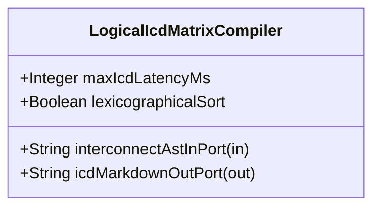

| Attribute | Specification Detail |
| :--- | :--- |
| **Issue ID** | #673 |
| **Title** | Feature 19: [BP 04 Deterministic Specification ICD and WBS Forward Compiler Blueprint] LogicalIcdMatrixCompiler |
| **Type** | feature |
| **Parent Epic** | [EPIC-04-BP_04_Deterministic_Specification_ICD_and_WBS_Forward_Compiler_Blueprint](../epics/EPIC-04-BP_04_Deterministic_Specification_ICD_and_WBS_Forward_Compiler_Blueprint.md) |
| **Interface Type** | Physical / Structural / Internal Bus |
| **Schema Containers** | `BP_04_Deterministic_Specification_ICD_and_WBS_Forward_Compiler_Blueprint::LogicalIcdMatrixCompiler` |
| **Generation Mode** | subagent |
| **Specification Source** | [schema/model.sysml](../../schema/model.sysml) |

# Feature 19: [BP 04 Deterministic Specification ICD and WBS Forward Compiler Blueprint] LogicalIcdMatrixCompiler

## UML Class Diagram



## Interface Requirements
### 1. Test Data Shape
```json
{
  "$schema": "https://json-schema.org/draft/2020-12/schema",
  "title": "LogicalIcdMatrixCompilerPayloadSchema",
  "type": "object",
  "properties": {
    "part": {
      "type": "string",
      "const": "LogicalIcdMatrixCompiler"
    },
    "status": {
      "type": "string",
      "enum": ["nominal", "degraded", "fault"]
    },
    "maxIcdLatencyMs": {
      "type": "integer",
      "x-sysml-type": "Integer",
      "description": "Declared attribute maxIcdLatencyMs (Integer)",
      "default": 10
    },
    "lexicographicalSort": {
      "type": "boolean",
      "x-sysml-type": "Boolean",
      "description": "Orders all `PartDef` matrix axes and `ConnectionDef` channels via `BTreeMap` deterministic traversal. [unit: flag]",
      "default": true
    },
    "interconnectAstInPort": {
      "type": "object",
      "properties": {
        "direction": { "type": "string", "const": "in" },
        "port_type": { "type": "string", "const": "String" }
      },
      "required": ["direction", "port_type"]
    },
    "icdMarkdownOutPort": {
      "type": "object",
      "properties": {
        "direction": { "type": "string", "const": "out" },
        "port_type": { "type": "string", "const": "String" }
      },
      "required": ["direction", "port_type"]
    }
  },
  "required": [
    "part",
    "status",
    "interconnectAstInPort",
    "icdMarkdownOutPort"
  ],
  "additionalProperties": false
}
```

### 2. Validation & Constraints
Declared structural attributes, boundary ports, invariants, and allocated requirements for classifier `LogicalIcdMatrixCompiler`:

| AST Member Kind | Identifier | Declared Type / Direction | Default / Invariant Contract |
| :--- | :--- | :--- | :--- |
| Attribute | `maxIcdLatencyMs` | `Integer` | Default `10` |
| Attribute | `lexicographicalSort` | `Boolean` | Default `true` |
| Port | `interconnectAstInPort` | `in String` | Boundary interface contract |
| Port | `icdMarkdownOutPort` | `out String` | Boundary interface contract |

### 3. Visual Layout & Arrangement
Structural composition and boundary topology for classifier `LogicalIcdMatrixCompiler` organize no nested subparts declared in schema paired with boundary ports `in interconnectAstInPort : String`, `out icdMarkdownOutPort : String`.

### 4. Interactive Flow & States
Operational lifecycle events and discrete state transitions for LogicalIcdMatrixCompiler.

### Layer 1: Domain State & Signal Model
Classifier `LogicalIcdMatrixCompiler` encapsulates typed domain state attributes `maxIcdLatencyMs : Integer`, `lexicographicalSort : Boolean` alongside operational lifecycle status.

### Layer 2: Logic & Safety State Management
Classifier `LogicalIcdMatrixCompiler` governs stateless structural transition evaluation enforcing no additional invariant guards declared in schema.

### Layer 3: Presentation & Actuator Interface Binding
Classifier `LogicalIcdMatrixCompiler` binds external and behavioral interfaces across port `in interconnectAstInPort : String`, port `out icdMarkdownOutPort : String`.

## Acceptance Criteria (BDD)
- [ ] AC-01: Given valid `LogicalIcdMatrixCompiler` initialization inputs for `maxIcdLatencyMs` (`Integer`), `lexicographicalSort` (`Boolean`) (no additional constraints specified in schema), When `LogicalIcdMatrixCompiler` commits typed domain state, Then declared state attributes hold verified values.
- [ ] AC-02: Given malformed or out-of-domain input values for `maxIcdLatencyMs` (`Integer`), `lexicographicalSort` (`Boolean`), When `LogicalIcdMatrixCompiler` validates incoming state updates, Then `LogicalIcdMatrixCompiler` rejects the invalid state update and emits a diagnostic via diagnostic port `icdMarkdownOutPort`.
- [ ] AC-03: Given nominal signal arrival across `interconnectAstInPort` (`in String`), `icdMarkdownOutPort` (`out String`), When `LogicalIcdMatrixCompiler` processes the declared interface transaction, Then output state conforms to the structural classifier contract.
- [ ] AC-04: Given an invalid or unrecognized interface frame across `interconnectAstInPort` (`in String`), `icdMarkdownOutPort` (`out String`), When `LogicalIcdMatrixCompiler` boundary validation executes, Then `LogicalIcdMatrixCompiler` refuses the malformed frame via diagnostic port `icdMarkdownOutPort` and preserves prior verified state.

## Source References
Formal component specifications and normative systems engineering requirements:
- System Architecture Model: `schema/model.sysml`
- Normative Systems Engineering Standard: ISO/IEC/IEEE 15288:2023 §6.4.3 Architecture Definition Process

Component behavior and interface definitions derive from `schema/model.sysml` pursuant to ISO/IEC/IEEE 15288.
