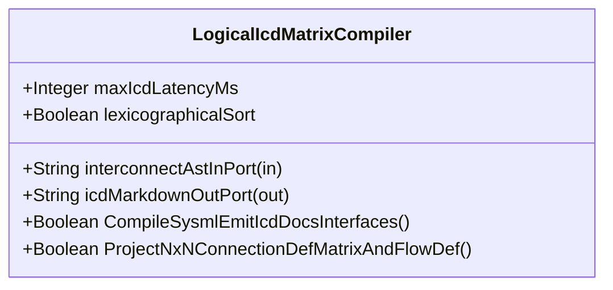

| Attribute | Specification Detail |
| :--- | :--- |
| **Issue ID** | #673 |
| **Title** | Feature 19: [BP 04 Deterministic Specification ICD and WBS Forward Compiler Blueprint] LogicalIcdMatrixCompiler |
| **Type** | feature |
| **Parent Epic** | [EPIC-04-BP_04_Deterministic_Specification_ICD_and_WBS_Forward_Compiler_Blueprint](../epics/EPIC-04-BP_04_Deterministic_Specification_ICD_and_WBS_Forward_Compiler_Blueprint.md) |
| **Interface Type** | Physical / Structural / Internal Bus |
| **Schema Containers** | `BP_04_Deterministic_Specification_ICD_and_WBS_Forward_Compiler_Blueprint::LogicalIcdMatrixCompiler` |
| **Generation Mode** | subagent |
| **Specification Source** | [schema/model.sysml](../../schema/model.sysml) |

# Feature 19: [BP 04 Deterministic Specification ICD and WBS Forward Compiler Blueprint] LogicalIcdMatrixCompiler

## UML Class Diagram



## Interface Requirements
### 1. Test Data Shape
```json
{
  "$schema": "https://json-schema.org/draft/2020-12/schema",
  "title": "LogicalIcdMatrixCompilerPayloadSchema",
  "type": "object",
  "properties": {
    "part": {
      "type": "string",
      "const": "LogicalIcdMatrixCompiler"
    },
    "status": {
      "type": "string",
      "enum": ["nominal", "degraded", "fault"]
    },
    "maxIcdLatencyMs": {
      "type": "integer",
      "x-sysml-type": "Integer",
      "description": "Declared attribute maxIcdLatencyMs (Integer)",
      "default": 10
    },
    "lexicographicalSort": {
      "type": "boolean",
      "x-sysml-type": "Boolean",
      "description": "Orders all `PartDef` matrix axes and `ConnectionDef` channels via `BTreeMap` deterministic traversal. [unit: flag]",
      "default": true
    },
    "interconnectAstInPort": {
      "type": "object",
      "properties": {
        "direction": { "type": "string", "const": "in" },
        "port_type": { "type": "string", "const": "String" }
      },
      "required": ["direction", "port_type"]
    },
    "icdMarkdownOutPort": {
      "type": "object",
      "properties": {
        "direction": { "type": "string", "const": "out" },
        "port_type": { "type": "string", "const": "String" }
      },
      "required": ["direction", "port_type"]
    }
  },
  "required": [
    "part",
    "status",
    "interconnectAstInPort",
    "icdMarkdownOutPort"
  ],
  "additionalProperties": false
}
```

### 2. Validation & Constraints
Declared structural attributes, boundary ports, invariants, and allocated requirements for classifier `LogicalIcdMatrixCompiler`:

| AST Member Kind | Identifier | Declared Type / Direction | Default / Invariant Contract |
| :--- | :--- | :--- | :--- |
| Attribute | `maxIcdLatencyMs` | `Integer` | Default `10` (`<= 10` ms deterministic Logical ICD compilation bound) |
| Attribute | `lexicographicalSort` | `Boolean` | Default `true` (`BTreeMap` lexicographical ordering of `PartDef` matrix axes, `PortDef` endpoints, `ConnectionDef` channels, and `FlowDef` signals) |
| Port | `interconnectAstInPort` | `in String` | Boundary interface contract receiving `PartDef`, `PortDef` (`in`, `out`, `inout`, `~`), `InterfaceDef`, `ConnectionDef`, `FlowDef`, and `ItemDef` AST nodes |
| Port | `icdMarkdownOutPort` | `out String` | Boundary interface contract emitting `ICD_01_SYSTEM_INTERFACE_MATRIX.md` and `ICD_02_MASTER_SIGNAL_DICTIONARY.md` via `pulldown-cmark-to-cmark` |
| Constraint | `Invariant_REQ_0604_SC_01` | Invariant (`REQ-0604 (REQ_0604_BP_04_Deterministic_Specification_ICD_and_WBS_Forward_Compiler_Blueprint)`) | Enforces 100% interconnect AST node coverage (`ast_node_coverage_percent == 100.0`) and zero Check 13B E1-E5 Mermaid violations (`mermaid_e1_e5_violation_count == 0`) |
| Constraint | `Invariant_REQ_0604_SC_02` | Invariant (`REQ-0604 (REQ_0604_BP_04_Deterministic_Specification_ICD_and_WBS_Forward_Compiler_Blueprint)`) | Enforces deterministic `BTreeMap` reproducibility with zero forward-reverse drift (`forward_reverse_drift_count == 0`) |
| Requirement | `REQ-0604 (REQ_0604_BP_04_Deterministic_Specification_ICD_and_WBS_Forward_Compiler_Blueprint)` | Allocated Requirement | The DEAP compiler pipeline SHALL deterministically synthesize `ICD_01_SYSTEM_INTERFACE_MATRIX.md` and `ICD_02_MASTER_SIGNAL_DICTIONARY.md` from SysML v2 `salsa` interconnect queries and `pulldown-cmark-to-cmark` AST serialization with zero hand-rolled scanners. |

```sysml
constraint Invariant_REQ_0604_SC_01 {}
constraint Invariant_REQ_0604_SC_02 {}
```

- **Contract A (Full OMG SysML v2.0 + KerML 1.0 Grammar Coverage -- Zero 16-Construct Caps)**: Extracts all OMG SysML v2.0 and KerML 1.0 interface constructs (`part def`/`part`, `port def`/`port` (`in`, `out`, `inout`, `~` conjugation), `interface def`/`interface`, `connection def`/`connection` (`connect ... to ...`), `flow def`/`flow` (`of ... from ... to ...`), `item def`/`item`, `attribute def`/`attribute`, `enum def`/`enum`, `allocation def`/`allocation`, `constraint def`/`constraint`, and `ISQ`/`SI`/`ScalarValues` physical units) with full Definition and Usage symmetry and zero 16-construct caps.
- **Contract B (`pulldown-cmark` + `pulldown-cmark-to-cmark` Lossless Markdown AST + `toml_edit` + `salsa` Derived Projection Across All 6 Crates -- Zero Hand-Rolled Scanners)**: Synthesizes Logical ICD tables and Mermaid topology diagrams from `salsa` derived queries over `deap_core::sysml_cst` (`logos` + `rowan`) and serializes CommonMark output via `pulldown-cmark` + `pulldown-cmark-to-cmark` with zero hand-rolled string or line scanners.

### 3. Visual Layout & Arrangement
Structural composition and boundary topology for classifier `LogicalIcdMatrixCompiler` organize boundary ports `in interconnectAstInPort : String` and `out icdMarkdownOutPort : String` within `< 380` executable SLOC submodules under `./crates/compile-sysml/src/icd_wbs/`.

### 4. Interactive Flow & States
Operational lifecycle events and discrete state transitions for `LogicalIcdMatrixCompiler` govern `ForwardProjected -> IcdSynthesized` on `emitLogicalIcd` (`CompileSysmlEmitIcdDocsInterfaces`, `ProjectNxNConnectionDefMatrixAndFlowDef`), and transition fail-closed to `Rejected` (`Diagnostic: E0200`) on any dangling `ConnectionDef` endpoint or undeclared `PortDef` / `FlowDef` signal reference.

### Layer 1: Domain State & Signal Model
Classifier `LogicalIcdMatrixCompiler` encapsulates typed domain state attributes `maxIcdLatencyMs : Integer` (default `10`) and `lexicographicalSort : Boolean` (default `true`), backed by `BTreeMap`-indexed `PartDef`, `PortDef`, `InterfaceDef`, `ConnectionDef`, `FlowDef`, and `ItemDef` `salsa` HIR records (`deap_core::sysml_cst`, zero 16-construct caps) and `pulldown-cmark::Event` table AST structures.

### Layer 2: Logic & Safety State Management
Classifier `LogicalIcdMatrixCompiler` governs deterministic NxN interconnect matrix projection and signal dictionary compilation (`CompileSysmlEmitIcdDocsInterfaces`, `ProjectNxNConnectionDefMatrixAndFlowDef`) enforcing `Invariant_REQ_0604_SC_01` and `Invariant_REQ_0604_SC_02`. Implementation is bounded inside `< 380` executable SLOC submodules (`./crates/compile-sysml/src/icd_wbs/`) with explicit deletion of legacy hand-rolled ICD string emitters and line-by-line scanners (`-1,100+` SLOC net-negative ratchet).

### Layer 3: Presentation & Actuator Interface Binding
Classifier `LogicalIcdMatrixCompiler` binds external and behavioral interfaces across port `in interconnectAstInPort : String` and port `out icdMarkdownOutPort : String`, emitting lossless CommonMark via `pulldown-cmark-to-cmark` and `ariadne` / `miette` diagnostics (`E0200`) on dangling endpoint faults.

### Associated Use Cases & User Stories

#### Associated Use Cases
- [ ] #640 - [Use Case 17: Deterministic Logical ICD Matrix and Signal Dictionary Synthesis](../use-cases/UC-17-Deterministic_Logical_ICD_Matrix_and_Signal_Dictionary_Synthesis.md)

#### Associated User Stories
- [ ] #711 - [User Story 22: Compile Sysml Emit Icd Docs Interfaces](../user-stories/US-22-CompileSysmlEmitIcdDocsInterfaces.md)
- [ ] #712 - [User Story 23: Project Nx N Connection Def Matrix And Flow Def](../user-stories/US-23-ProjectNxNConnectionDefMatrixAndFlowDef.md)

## Acceptance Criteria (BDD)
- [ ] AC-01: Given valid `LogicalIcdMatrixCompiler` initialization inputs for `maxIcdLatencyMs` (`Integer`), `lexicographicalSort` (`Boolean`) satisfying `Invariant_REQ_0604_SC_01` and `Invariant_REQ_0604_SC_02` [Req `REQ-0604 (REQ_0604_BP_04_Deterministic_Specification_ICD_and_WBS_Forward_Compiler_Blueprint)`], When `LogicalIcdMatrixCompiler` commits typed domain state via `salsa` and `BTreeMap` ordering, Then declared state attributes hold verified values within `10` ms.
- [ ] AC-02: Given dangling `ConnectionDef` endpoints or out-of-domain input values for `maxIcdLatencyMs` (`Integer`), `lexicographicalSort` (`Boolean`), When `LogicalIcdMatrixCompiler` validates incoming state updates, Then `LogicalIcdMatrixCompiler` rejects the invalid state update fail-closed (`E0200`) and emits an `ariadne` / `miette` diagnostic via port `icdMarkdownOutPort`.
- [ ] AC-03: Given nominal signal arrival across `interconnectAstInPort` (`in String`), `icdMarkdownOutPort` (`out String`) covering the full OMG SysML v2.0 + KerML 1.0 interconnect grammar (Contract A, zero 16-construct caps), When `LogicalIcdMatrixCompiler` processes the declared interface transaction via `pulldown-cmark` + `pulldown-cmark-to-cmark` + `salsa` (Contract B, zero hand-rolled scanners) inside `< 380`-SLOC submodules with legacy hand-rolled scanners deleted, Then `ICD_01_SYSTEM_INTERFACE_MATRIX.md` and `ICD_02_MASTER_SIGNAL_DICTIONARY.md` conform to the structural classifier contract.
- [ ] AC-04: Given an invalid or unrecognized interface frame across `interconnectAstInPort` (`in String`), `icdMarkdownOutPort` (`out String`), When `LogicalIcdMatrixCompiler` boundary validation executes, Then `LogicalIcdMatrixCompiler` refuses the malformed frame via diagnostic port `icdMarkdownOutPort` and preserves prior verified state.

## Source References
Formal component specifications and normative systems engineering requirements:
- System Architecture Model: `schema/model.sysml`
- Normative Systems Engineering Standard: ISO/IEC/IEEE 15288:2023 §6.4.3 Architecture Definition Process

Component behavior and interface definitions derive from `schema/model.sysml` pursuant to ISO/IEC/IEEE 15288.
