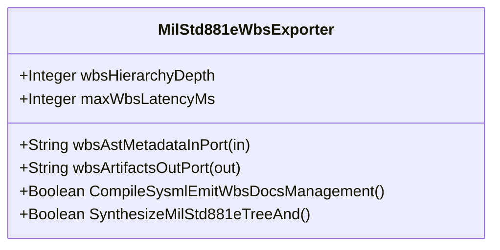

| Attribute | Specification Detail |
| :--- | :--- |
| **Issue ID** | #674 |
| **Title** | Feature 20: [BP 04 Deterministic Specification ICD and WBS Forward Compiler Blueprint] MilStd881eWbsExporter |
| **Type** | feature |
| **Parent Epic** | [EPIC-04-BP_04_Deterministic_Specification_ICD_and_WBS_Forward_Compiler_Blueprint](../epics/EPIC-04-BP_04_Deterministic_Specification_ICD_and_WBS_Forward_Compiler_Blueprint.md) |
| **Interface Type** | Physical / Structural / Internal Bus |
| **Schema Containers** | `BP_04_Deterministic_Specification_ICD_and_WBS_Forward_Compiler_Blueprint::MilStd881eWbsExporter` |
| **Generation Mode** | subagent |
| **Specification Source** | [schema/model.sysml](../../schema/model.sysml) |

# Feature 20: [BP 04 Deterministic Specification ICD and WBS Forward Compiler Blueprint] MilStd881eWbsExporter

## UML Class Diagram



## Interface Requirements
### 1. Test Data Shape
```json
{
  "$schema": "https://json-schema.org/draft/2020-12/schema",
  "title": "MilStd881eWbsExporterPayloadSchema",
  "type": "object",
  "properties": {
    "part": {
      "type": "string",
      "const": "MilStd881eWbsExporter"
    },
    "status": {
      "type": "string",
      "enum": ["nominal", "degraded", "fault"]
    },
    "wbsHierarchyDepth": {
      "type": "integer",
      "x-sysml-type": "Integer",
      "description": "Declared attribute wbsHierarchyDepth (Integer)",
      "default": 4
    },
    "maxWbsLatencyMs": {
      "type": "integer",
      "x-sysml-type": "Integer",
      "description": "Maximum deterministic execution bound for `--emit-wbs` Markdown and CSV/JSON export generation. [unit: ms]",
      "default": 15
    },
    "wbsAstMetadataInPort": {
      "type": "object",
      "properties": {
        "direction": { "type": "string", "const": "in" },
        "port_type": { "type": "string", "const": "String" }
      },
      "required": ["direction", "port_type"]
    },
    "wbsArtifactsOutPort": {
      "type": "object",
      "properties": {
        "direction": { "type": "string", "const": "out" },
        "port_type": { "type": "string", "const": "String" }
      },
      "required": ["direction", "port_type"]
    }
  },
  "required": [
    "part",
    "status",
    "wbsAstMetadataInPort",
    "wbsArtifactsOutPort"
  ],
  "additionalProperties": false
}
```

### 2. Validation & Constraints
Declared structural attributes, boundary ports, invariants, and allocated requirements for classifier `MilStd881eWbsExporter`:

| AST Member Kind | Identifier | Declared Type / Direction | Default / Invariant Contract |
| :--- | :--- | :--- | :--- |
| Attribute | `wbsHierarchyDepth` | `Integer` | Default `4` (4-level MIL-STD-881E hierarchy: Level 1 System, Level 2 Subsystem, Level 3 Work Package, Level 4 Deliverable Task) |
| Attribute | `maxWbsLatencyMs` | `Integer` | Default `15` (`<= 15` ms deterministic WBS synthesis and enterprise export bound) |
| Port | `wbsAstMetadataInPort` | `in String` | Boundary interface contract receiving `salsa` SysML v2 `PackageDef` AST hierarchies and `pulldown-cmark` specification frontmatter tables |
| Port | `wbsArtifactsOutPort` | `out String` | Boundary interface contract emitting `WBS_01..03` Markdown registers via `pulldown-cmark-to-cmark` and RFC 4180 CSV / JSON AST exports via `serde_json` |
| Constraint | `Invariant_REQ_0604_SC_01` | Invariant (`REQ-0604 (REQ_0604_BP_04_Deterministic_Specification_ICD_and_WBS_Forward_Compiler_Blueprint)`) | Enforces 100% WBS work package traceability (`ast_node_coverage_percent == 100.0`) and zero Check 13B E1-E5 Mermaid violations (`mermaid_e1_e5_violation_count == 0`) |
| Constraint | `Invariant_REQ_0604_SC_02` | Invariant (`REQ-0604 (REQ_0604_BP_04_Deterministic_Specification_ICD_and_WBS_Forward_Compiler_Blueprint)`) | Enforces zero forward-reverse drift (`forward_reverse_drift_count == 0`) between WBS registers and `schema/model.sysml` |
| Requirement | `REQ-0604 (REQ_0604_BP_04_Deterministic_Specification_ICD_and_WBS_Forward_Compiler_Blueprint)` | Allocated Requirement | The DEAP compiler pipeline SHALL deterministically synthesize MIL-STD-881E WBS Markdown registers (`WBS_01..03`) and enterprise project management exports (Jira, Monday.com, MS Project RFC 4180 CSV and JSON AST) via `salsa`, `pulldown-cmark`, `pulldown-cmark-to-cmark`, and `toml_edit` with zero hand-rolled scanners. |

```sysml
constraint Invariant_REQ_0604_SC_01 {}
constraint Invariant_REQ_0604_SC_02 {}
```

- **Contract A (Full OMG SysML v2.0 + KerML 1.0 Grammar Coverage -- Zero 16-Construct Caps)**: Maps 100% of OMG SysML v2.0 and KerML 1.0 `package`/`library package`/`standard library package`, `part def`/`part`, `allocation def`/`allocation`, `requirement def`/`requirement`, `verification def`/`verification`, `test case def`/`test case`, `use case def`/`use case`, `interaction def`/`interaction`, and `#capability`/`#dal`/`#fls`/`#hazard`/`#risk` metadata constructs into the 4-level MIL-STD-881E WBS tree with zero 16-construct caps.
- **Contract B (`pulldown-cmark` + `pulldown-cmark-to-cmark` Lossless Markdown AST + `toml_edit` + `salsa` Derived Projection Across All 6 Crates -- Zero Hand-Rolled Scanners)**: Computes WBS decomposition and technical realization registers from `salsa` derived queries, parses specification metadata tables via `pulldown-cmark`, and serializes `WBS_01..03` via `pulldown-cmark-to-cmark` and typed `serde_json` / `toml_edit` with zero hand-rolled string or line scanners.

### 3. Visual Layout & Arrangement
Structural composition and boundary topology for classifier `MilStd881eWbsExporter` organize boundary ports `in wbsAstMetadataInPort : String` and `out wbsArtifactsOutPort : String` within `< 380` executable SLOC submodules under `./crates/compile-sysml/src/icd_wbs/`.

### 4. Interactive Flow & States
Operational lifecycle events and discrete state transitions for `MilStd881eWbsExporter` govern `IcdSynthesized -> WbsExported` on `emitMilStd881eWbs` (`CompileSysmlEmitWbsDocsManagement`, `SynthesizeMilStd881eTreeAnd`), and transition fail-closed to `Rejected` (`Diagnostic: E0300`) if specification frontmatter metadata or WBS level bindings are inconsistent.

### Layer 1: Domain State & Signal Model
Classifier `MilStd881eWbsExporter` encapsulates typed domain state attributes `wbsHierarchyDepth : Integer` (default `4`) and `maxWbsLatencyMs : Integer` (default `15`), backed by `salsa` 4-level MIL-STD-881E WBS tree records (`deap_core::sysml_cst`, zero 16-construct caps), `pulldown-cmark::Event` metadata table structures, and typed `serde_json` / RFC 4180 CSV export models.

### Layer 2: Logic & Safety State Management
Classifier `MilStd881eWbsExporter` governs deterministic 4-level MIL-STD-881E WBS synthesis (`CompileSysmlEmitWbsDocsManagement`, `SynthesizeMilStd881eTreeAnd`) enforcing `Invariant_REQ_0604_SC_01` and `Invariant_REQ_0604_SC_02`. Implementation is bounded inside `< 380` executable SLOC submodules (`./crates/compile-sysml/src/icd_wbs/`) with explicit deletion of legacy hand-rolled WBS/Markdown string emitters and line-by-line table scanners (`-1,100+` SLOC net-negative ratchet).

### Layer 3: Presentation & Actuator Interface Binding
Classifier `MilStd881eWbsExporter` binds external and behavioral interfaces across port `in wbsAstMetadataInPort : String` and port `out wbsArtifactsOutPort : String`, serializing `WBS_01..03` Markdown via `pulldown-cmark-to-cmark`, exporting RFC 4180 CSV and JSON AST payloads, and emitting `ariadne` / `miette` diagnostics (`E0300`) on validation failure.

### Associated Use Cases & User Stories

#### Associated Use Cases
- [ ] #641 - [Use Case 18: Deterministic MIL STD 881 E WBS and Enterprise Export Synthesis](../use-cases/UC-18-Deterministic_MIL_STD_881E_WBS_and_Enterprise_Export_Synthesis.md)

#### Associated User Stories
- [ ] #713 - [User Story 24: Compile Sysml Emit Wbs Docs Management](../user-stories/US-24-CompileSysmlEmitWbsDocsManagement.md)
- [ ] #714 - [User Story 25: Synthesize Mil Std881 e Tree And](../user-stories/US-25-SynthesizeMilStd881eTreeAnd.md)

## Acceptance Criteria (BDD)
- [ ] AC-01: Given valid `MilStd881eWbsExporter` initialization inputs for `wbsHierarchyDepth` (`Integer`), `maxWbsLatencyMs` (`Integer`) satisfying `Invariant_REQ_0604_SC_01` and `Invariant_REQ_0604_SC_02` [Req `REQ-0604 (REQ_0604_BP_04_Deterministic_Specification_ICD_and_WBS_Forward_Compiler_Blueprint)`], When `MilStd881eWbsExporter` commits typed domain state via `salsa` and `pulldown-cmark`, Then declared state attributes hold verified values (`wbsHierarchyDepth == 4`, `maxWbsLatencyMs <= 15`).
- [ ] AC-02: Given inconsistent frontmatter metadata or out-of-domain input values for `wbsHierarchyDepth` (`Integer`), `maxWbsLatencyMs` (`Integer`), When `MilStd881eWbsExporter` validates incoming state updates, Then `MilStd881eWbsExporter` rejects the invalid state update fail-closed (`E0300`) and emits an `ariadne` / `miette` diagnostic via port `wbsArtifactsOutPort`.
- [ ] AC-03: Given nominal signal arrival across `wbsAstMetadataInPort` (`in String`), `wbsArtifactsOutPort` (`out String`) covering the full OMG SysML v2.0 + KerML 1.0 grammar (Contract A, zero 16-construct caps), When `MilStd881eWbsExporter` processes the declared interface transaction via `pulldown-cmark` + `pulldown-cmark-to-cmark` + `toml_edit` + `salsa` (Contract B, zero hand-rolled scanners) inside `< 380`-SLOC submodules with legacy hand-rolled scanners deleted, Then `WBS_01..03` Markdown and CSV/JSON exports conform to the structural classifier contract.
- [ ] AC-04: Given an invalid or unrecognized interface frame across `wbsAstMetadataInPort` (`in String`), `wbsArtifactsOutPort` (`out String`), When `MilStd881eWbsExporter` boundary validation executes, Then `MilStd881eWbsExporter` refuses the malformed frame via diagnostic port `wbsArtifactsOutPort` and preserves prior verified state.

## Source References
Formal component specifications and normative systems engineering requirements:
- System Architecture Model: `schema/model.sysml`
- Normative Systems Engineering Standard: ISO/IEC/IEEE 15288:2023 §6.4.3 Architecture Definition Process

Component behavior and interface definitions derive from `schema/model.sysml` pursuant to ISO/IEC/IEEE 15288.
