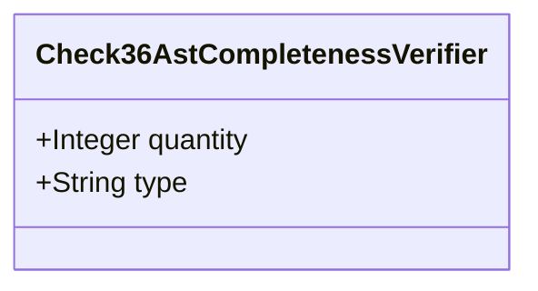

| Attribute | Specification Detail |
| :--- | :--- |
| **Issue ID** | #678 |
| **Title** | Feature 21: [BP 05 Unified AST Safety Docstring Synthesizer and Check 36 Verification Blueprint] Check36AstCompletenessVerifier |
| **Type** | feature |
| **Parent Epic** | [EPIC-05-BP_05_Unified_AST_Safety_Docstring_Synthesizer_and_Check_36_Verification_Blueprint](../epics/EPIC-05-BP_05_Unified_AST_Safety_Docstring_Synthesizer_and_Check_36_Verification_Blueprint.md) |
| **Interface Type** | Physical / Structural / Internal Bus |
| **Schema Containers** | `BP_05_Unified_AST_Safety_Docstring_Synthesizer_and_Check_36_Verification_Blueprint::Check36AstCompletenessVerifier` |
| **Generation Mode** | subagent |
| **Specification Source** | [schema/model.sysml](../../schema/model.sysml) |

# Feature 21: [BP 05 Unified AST Safety Docstring Synthesizer and Check 36 Verification Blueprint] Check36AstCompletenessVerifier

## UML Class Diagram



## Interface Requirements
### 1. Test Data Shape
```json
{
  "$schema": "https://json-schema.org/draft/2020-12/schema",
  "title": "Check36AstCompletenessVerifierPayloadSchema",
  "type": "object",
  "properties": {
    "part": {
      "type": "string",
      "const": "Check36AstCompletenessVerifier"
    },
    "status": {
      "type": "string",
      "enum": ["nominal", "degraded", "fault"]
    },
    "quantity": {
      "type": "integer",
      "x-sysml-type": "Integer",
      "description": "Declared attribute quantity (Integer)",
      "default": 1
    },
    "type": {
      "type": "string",
      "x-sysml-type": "String",
      "description": "Declared attribute type (String)",
      "default": "Component"
    }
  },
  "required": [
    "part",
    "status"
  ],
  "additionalProperties": false
}
```

### 2. Validation & Constraints
Declared structural attributes, boundary ports, invariants, and allocated requirements for classifier `Check36AstCompletenessVerifier`:

| AST Member Kind | Identifier | Declared Type / Direction | Default / Invariant Contract |
| :--- | :--- | :--- | :--- |
| Attribute | `quantity` | `Integer` | Default `1` |
| Attribute | `type` | `String` | Default `"Component"` |
| Constraint | `Invariant_REQ_0605_Under_REQ_0605_and_parametric_constraints_C_DOC_01_through_C_DOC_04_lexical_scanning_schema_context_resolution_and_forward_docstring_injection_satisfy_the_following_linear_complexity_and_idempotency_bounds` | Invariant (`REQ-0605 (REQ_0605_BP_05_Unified_AST_Safety_Docstring_Synthesizer_and_Check_36_Verification_Blueprint)`) | Declared structural invariant |
| Requirement | `REQ-0605 (REQ_0605_BP_05_Unified_AST_Safety_Docstring_Synthesizer_and_Check_36_Verification_Blueprint)` | Allocated Requirement | The Digital Engineering Agent Platform (DEAP) requires 100% of production Rust (.rs) and Dart (.dart) declarations to carry complete, non-placeholder 7-section high-assurance safety docstrings (## 1. Safety Intent & Regulatory Scope through ## 7. Realization & Traceability) bound to formal SysML v2 |

```sysml
constraint Invariant_REQ_0605_Under_REQ_0605_and_parametric_constraints_C_DOC_01_through_C_DOC_04_lexical_scanning_schema_context_resolution_and_forward_docstring_injection_satisfy_the_following_linear_complexity_and_idempotency_bounds {}
```

### 3. Visual Layout & Arrangement
Structural composition and boundary topology for classifier `Check36AstCompletenessVerifier` organize no nested subparts declared in schema paired with no external boundary ports declared in schema.

### 4. Interactive Flow & States
Operational lifecycle events and discrete state transitions for Check36AstCompletenessVerifier.

### Layer 1: Domain State & Signal Model
Classifier `Check36AstCompletenessVerifier` encapsulates typed domain state attributes `quantity : Integer`, `type : String` alongside operational lifecycle status.

### Layer 2: Logic & Safety State Management
Classifier `Check36AstCompletenessVerifier` governs stateless structural transition evaluation enforcing invariant obligations `Invariant_REQ_0605_Under_REQ_0605_and_parametric_constraints_C_DOC_01_through_C_DOC_04_lexical_scanning_schema_context_resolution_and_forward_docstring_injection_satisfy_the_following_linear_complexity_and_idempotency_bounds`.

### Layer 3: Presentation & Actuator Interface Binding
Classifier `Check36AstCompletenessVerifier` exposes an internal structural boundary with no external ports, operations, or actions declared in schema.

### Associated Use Cases & User Stories

#### Associated Use Cases
- [ ] #644 - [Use Case 21: Unified Rust and Dart Lexical State Machine Without Magic Offsets](../use-cases/UC-21-Unified_Rust_and_Dart_Lexical_State_Machine_Without_Magic_Offsets.md)
- [ ] #645 - [Use Case 22: Strict Schema Context Resolution and Recursive Part Traversal](../use-cases/UC-22-Strict_Schema_Context_Resolution_and_Recursive_Part_Traversal.md)
- [ ] #646 - [Use Case 23: Scoped mod tests Brace Tracking unsafe extern Classification and Arrow Aware impl Headers](../use-cases/UC-23-Scoped_mod_tests_Brace_Tracking_unsafe_extern_Classification_and_Arrow_Aware_impl_Headers.md)
- [ ] #647 - [Use Case 24: Bit for Bit Idempotency and Fail Closed Check 34 Per Function Normalized Body Uniqueness](../use-cases/UC-24-Bit_for_Bit_Idempotency_and_Fail_Closed_Check_34_Per_Function_Normalized_Body_Uniqueness.md)
- [ ] #648 - [Use Case 25: Dogfood Ingestion and SysML v2 Compilation of REQ 0605](../use-cases/UC-25-Dogfood_Ingestion_and_SysML_v2_Compilation_of_REQ_0605.md)

#### Associated User Stories
- [ ] #720 - [User Story 31: Run Compile Sysml Inject Safety Docstrings](../user-stories/US-31-RunCompileSysmlInjectSafetyDocstrings.md)
- [ ] #721 - [User Story 32: Scan Source Lines Via Rust Dart Lex State And](../user-stories/US-32-ScanSourceLinesViaRustDartLexStateAnd.md)
- [ ] #722 - [User Story 33: Resolve Schema Context Via Collect All](../user-stories/US-33-ResolveSchemaContextViaCollectAll.md)
- [ ] #723 - [User Story 34: Run Verify Baseline No Domain](../user-stories/US-34-RunVerifyBaselineNoDomain.md)
- [ ] #724 - [User Story 35: Tokenize Rs And Dart Files Using](../user-stories/US-35-TokenizeRsAndDartFilesUsing.md)
- [ ] #725 - [User Story 36: Run Ingest Sysml Schema Blueprint05](../user-stories/US-36-RunIngestSysmlSchemaBlueprint05.md)

## Acceptance Criteria (BDD)
- [ ] AC-01: Given valid `Check36AstCompletenessVerifier` inputs satisfying `Invariant_REQ_0605_Under_REQ_0605_and_parametric_constraints_C_DOC_01_through_C_DOC_04_lexical_scanning_schema_context_resolution_and_forward_docstring_injection_satisfy_the_following_linear_complexity_and_idempotency_bounds` [Req `REQ-0605 (REQ_0605_BP_05_Unified_AST_Safety_Docstring_Synthesizer_and_Check_36_Verification_Blueprint)`], When `Check36AstCompletenessVerifier` evaluates invariant `Invariant_REQ_0605_Under_REQ_0605_and_parametric_constraints_C_DOC_01_through_C_DOC_04_lexical_scanning_schema_context_resolution_and_forward_docstring_injection_satisfy_the_following_linear_complexity_and_idempotency_bounds`, Then the invariant holds and verified state is committed.
- [ ] AC-02: Given boundary inputs that violate `Invariant_REQ_0605_Under_REQ_0605_and_parametric_constraints_C_DOC_01_through_C_DOC_04_lexical_scanning_schema_context_resolution_and_forward_docstring_injection_satisfy_the_following_linear_complexity_and_idempotency_bounds` [Req `REQ-0605 (REQ_0605_BP_05_Unified_AST_Safety_Docstring_Synthesizer_and_Check_36_Verification_Blueprint)`], When `Check36AstCompletenessVerifier` evaluates invariant `Invariant_REQ_0605_Under_REQ_0605_and_parametric_constraints_C_DOC_01_through_C_DOC_04_lexical_scanning_schema_context_resolution_and_forward_docstring_injection_satisfy_the_following_linear_complexity_and_idempotency_bounds`, Then `Check36AstCompletenessVerifier` rejects the invalid transition and routes a diagnostic via deterministic error diagnostic output.
- [ ] AC-03: Given nominal typed values for `quantity` (`Integer`), `type` (`String`) across `Check36AstCompletenessVerifier` structural boundary, When `Check36AstCompletenessVerifier` executes structural interface processing, Then state and output ports conform to declared schema types.
- [ ] AC-04: Given malformed input frames across `quantity` (`Integer`), `type` (`String`) or `Check36AstCompletenessVerifier` structural boundary, When `Check36AstCompletenessVerifier` boundary validation executes, Then `Check36AstCompletenessVerifier` rejects the malformed input via deterministic error diagnostic output.

## Source References
Formal component specifications and normative systems engineering requirements:
- System Architecture Model: `schema/model.sysml`
- Normative Systems Engineering Standard: ISO/IEC/IEEE 15288:2023 §6.4.3 Architecture Definition Process

Component behavior and interface definitions derive from `schema/model.sysml` pursuant to ISO/IEC/IEEE 15288.
