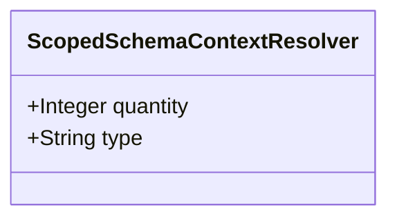

| Attribute | Specification Detail |
| :--- | :--- |
| **Issue ID** | #676 |
| **Title** | Feature 22: [BP 05 Unified AST Safety Docstring Synthesizer and Check 36 Verification Blueprint] ScopedSchemaContextResolver |
| **Type** | feature |
| **Parent Epic** | [EPIC-05-BP_05_Unified_AST_Safety_Docstring_Synthesizer_and_Check_36_Verification_Blueprint](../epics/EPIC-05-BP_05_Unified_AST_Safety_Docstring_Synthesizer_and_Check_36_Verification_Blueprint.md) |
| **Interface Type** | Physical / Structural / Internal Bus |
| **Schema Containers** | `BP_05_Unified_AST_Safety_Docstring_Synthesizer_and_Check_36_Verification_Blueprint::ScopedSchemaContextResolver` |
| **Generation Mode** | subagent |
| **Specification Source** | [schema/model.sysml](../../schema/model.sysml) |

# Feature 22: [BP 05 Unified AST Safety Docstring Synthesizer and Check 36 Verification Blueprint] ScopedSchemaContextResolver

## UML Class Diagram



## Interface Requirements
### 1. Test Data Shape
```json
{
  "$schema": "https://json-schema.org/draft/2020-12/schema",
  "title": "ScopedSchemaContextResolverPayloadSchema",
  "type": "object",
  "properties": {
    "part": {
      "type": "string",
      "const": "ScopedSchemaContextResolver"
    },
    "status": {
      "type": "string",
      "enum": ["nominal", "degraded", "fault"]
    },
    "quantity": {
      "type": "integer",
      "x-sysml-type": "Integer",
      "description": "Declared attribute quantity (Integer)",
      "default": 1
    },
    "type": {
      "type": "string",
      "x-sysml-type": "String",
      "description": "Declared attribute type (String)",
      "default": "Component"
    }
  },
  "required": [
    "part",
    "status"
  ],
  "additionalProperties": false
}
```

### 2. Validation & Constraints
Declared structural attributes, boundary ports, invariants, and allocated requirements for classifier `ScopedSchemaContextResolver`:

| AST Member Kind | Identifier | Declared Type / Direction | Default / Invariant Contract |
| :--- | :--- | :--- | :--- |
| Attribute | `quantity` | `Integer` | Default `1` |
| Attribute | `type` | `String` | Default `"Component"` |

### 3. Visual Layout & Arrangement
Structural composition and boundary topology for classifier `ScopedSchemaContextResolver` organize no nested subparts declared in schema paired with no external boundary ports declared in schema.

### 4. Interactive Flow & States
Operational lifecycle events and discrete state transitions for ScopedSchemaContextResolver.

### Layer 1: Domain State & Signal Model
Classifier `ScopedSchemaContextResolver` encapsulates typed domain state attributes `quantity : Integer`, `type : String` alongside operational lifecycle status.

### Layer 2: Logic & Safety State Management
Classifier `ScopedSchemaContextResolver` governs stateless structural transition evaluation enforcing no additional invariant guards declared in schema.

### Layer 3: Presentation & Actuator Interface Binding
Classifier `ScopedSchemaContextResolver` exposes an internal structural boundary with no external ports, operations, or actions declared in schema.

### Associated Use Cases & User Stories

#### Associated Use Cases
- None allocated (structural subsystem component)

#### Associated User Stories
- [ ] #720 - [User Story 31: Run Compile Sysml Inject Safety Docstrings](../user-stories/US-31-RunCompileSysmlInjectSafetyDocstrings.md)
- [ ] #721 - [User Story 32: Scan Source Lines Via Rust Dart Lex State And](../user-stories/US-32-ScanSourceLinesViaRustDartLexStateAnd.md)
- [ ] #722 - [User Story 33: Resolve Schema Context Via Collect All](../user-stories/US-33-ResolveSchemaContextViaCollectAll.md)
- [ ] #723 - [User Story 34: Run Verify Baseline No Domain](../user-stories/US-34-RunVerifyBaselineNoDomain.md)
- [ ] #724 - [User Story 35: Tokenize Rs And Dart Files Using](../user-stories/US-35-TokenizeRsAndDartFilesUsing.md)
- [ ] #725 - [User Story 36: Run Ingest Sysml Schema Blueprint05](../user-stories/US-36-RunIngestSysmlSchemaBlueprint05.md)

## Acceptance Criteria (BDD)
- [ ] AC-01: Given valid `ScopedSchemaContextResolver` initialization inputs for `quantity` (`Integer`), `type` (`String`) (no additional constraints specified in schema), When `ScopedSchemaContextResolver` commits typed domain state, Then declared state attributes hold verified values.
- [ ] AC-02: Given malformed or out-of-domain input values for `quantity` (`Integer`), `type` (`String`), When `ScopedSchemaContextResolver` validates incoming state updates, Then `ScopedSchemaContextResolver` rejects the invalid state update and emits a diagnostic via deterministic error diagnostic output.
- [ ] AC-03: Given nominal signal arrival across `ScopedSchemaContextResolver` structural boundary, When `ScopedSchemaContextResolver` processes the declared interface transaction, Then output state conforms to the structural classifier contract.
- [ ] AC-04: Given an invalid or unrecognized interface frame across `ScopedSchemaContextResolver` structural boundary, When `ScopedSchemaContextResolver` boundary validation executes, Then `ScopedSchemaContextResolver` refuses the malformed frame via deterministic error diagnostic output and preserves prior verified state.

## Source References
Formal component specifications and normative systems engineering requirements:
- System Architecture Model: `schema/model.sysml`
- Normative Systems Engineering Standard: ISO/IEC/IEEE 15288:2023 §6.4.3 Architecture Definition Process

Component behavior and interface definitions derive from `schema/model.sysml` pursuant to ISO/IEC/IEEE 15288.
