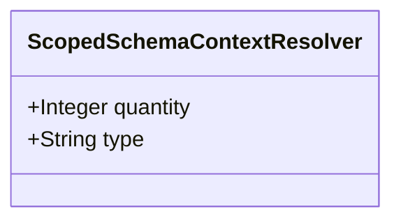

| Attribute | Specification Detail |
| :--- | :--- |
| **Issue ID** | #676 |
| **Title** | Feature 22: [BP 05 Unified AST Safety Docstring Synthesizer and Check 36 Verification Blueprint] ScopedSchemaContextResolver |
| **Type** | feature |
| **Parent Epic** | [EPIC-05-BP_05_Unified_AST_Safety_Docstring_Synthesizer_and_Check_36_Verification_Blueprint](../epics/EPIC-05-BP_05_Unified_AST_Safety_Docstring_Synthesizer_and_Check_36_Verification_Blueprint.md) |
| **Interface Type** | Physical / Structural / Internal Bus |
| **Schema Containers** | `BP_05_Unified_AST_Safety_Docstring_Synthesizer_and_Check_36_Verification_Blueprint::ScopedSchemaContextResolver` |
| **Generation Mode** | subagent |
| **Specification Source** | [schema/model.sysml](../../schema/model.sysml) |

# Feature 22: [BP 05 Unified AST Safety Docstring Synthesizer and Check 36 Verification Blueprint] ScopedSchemaContextResolver

## UML Class Diagram



## Interface Requirements
### 1. Test Data Shape
```json
{
  "$schema": "https://json-schema.org/draft/2020-12/schema",
  "title": "ScopedSchemaContextResolverPayloadSchema",
  "type": "object",
  "properties": {
    "part": {
      "type": "string",
      "const": "ScopedSchemaContextResolver"
    },
    "status": {
      "type": "string",
      "enum": ["nominal", "degraded", "fault"]
    },
    "quantity": {
      "type": "integer",
      "description": "Subsystem attribute quantity"
    },
    "type": {
      "type": "string",
      "description": "Subsystem attribute type"
    }
  },
  "required": [
    "part",
    "status",
    "quantity",
    "type"
  ],
  "additionalProperties": false
}
```

### 2. Validation & Constraints
Formal constraints and invariant guarantees enforced by ScopedSchemaContextResolver.

### 3. Visual Layout & Arrangement
Logical layout, viewport containment, and container structure for ScopedSchemaContextResolver conforming to platform design tokens. Container boundaries enforce @container isolation rules.

### 4. Interactive Flow & States
Operational lifecycle events and discrete state transitions for ScopedSchemaContextResolver.

### Layer 1: Domain State & Signal Model
Domain state vector representing ScopedSchemaContextResolver status, AST references, and typed signal models.

### Layer 2: Logic & Safety State Management
Deterministic state machine solver and safety monitor logic for ScopedSchemaContextResolver.

### Layer 3: Presentation & Actuator Interface Binding
Presentation interface binding and diagnostic event routing for ScopedSchemaContextResolver.

### Associated Use Cases & User Stories

#### Associated Use Cases
- None allocated (structural subsystem component)

#### Associated User Stories
- [ ] #602 - [User Story 41: [UnifiedRustDartLexicalScanner] Run](../user-stories/US-41-Run.md)
- [ ] #603 - [User Story 42: Scan](../user-stories/US-42-Scan.md)
- [ ] #604 - [User Story 43: [UnifiedRustDartLexicalScanner] Return](../user-stories/US-43-Return.md)
- [ ] #605 - [User Story 44: [UnifiedRustDartLexicalScanner] Resolve](../user-stories/US-44-Resolve.md)
- [ ] #606 - [User Story 45: Write](../user-stories/US-45-Write.md)
- [ ] #607 - [User Story 46: Tokenize](../user-stories/US-46-Tokenize.md)
- [ ] #608 - [User Story 47: Verify item](../user-stories/US-47-Verify_item.md)
- [ ] #609 - [User Story 48: [UnifiedRustDartLexicalScanner] Emit](../user-stories/US-48-Emit.md)

## Acceptance Criteria (BDD)
- [ ] AC-01: Given nominal ScopedSchemaContextResolver domain state, When command or input signals are received, Then updates internal state and signal outputs within declared bounds.
- [ ] AC-02: Given operational state, When ScopedSchemaContextResolver evaluates constraint 'operational_invariants', Then asserts invariant satisfaction without violation.
- [ ] AC-03: Given malformed input signals or boundary condition violation, When ScopedSchemaContextResolver error handling is invoked, Then transitions safely to failsafe fallback state without corruption.

## Source References
Formal component specifications and normative systems engineering requirements:
- System Architecture Model: `schema/model.sysml`
- Normative Systems Engineering Standard: ISO/IEC/IEEE 15288:2023 §6.4.3 Architecture Definition Process

Component behavior and interface definitions derive from `schema/model.sysml` pursuant to ISO/IEC/IEEE 15288.
