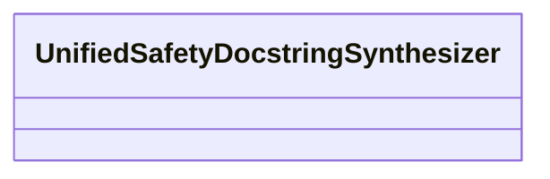

| Attribute | Specification Detail |
| :--- | :--- |
| **Issue ID** | #679 |
| **Title** | Feature 25: [BP 05 Unified AST Safety Docstring Synthesizer and Check 36 Verification Blueprint] UnifiedSafetyDocstringSynthesizer |
| **Type** | feature |
| **Parent Epic** | [EPIC-05-BP_05_Unified_AST_Safety_Docstring_Synthesizer_and_Check_36_Verification_Blueprint](../epics/EPIC-05-BP_05_Unified_AST_Safety_Docstring_Synthesizer_and_Check_36_Verification_Blueprint.md) |
| **Interface Type** | Physical / Structural / Internal Bus |
| **Schema Containers** | `BP_05_Unified_AST_Safety_Docstring_Synthesizer_and_Check_36_Verification_Blueprint::UnifiedSafetyDocstringSynthesizer` |
| **Generation Mode** | subagent |
| **Specification Source** | [schema/model.sysml](../../schema/model.sysml) |

# Feature 25: [BP 05 Unified AST Safety Docstring Synthesizer and Check 36 Verification Blueprint] UnifiedSafetyDocstringSynthesizer

## UML Class Diagram



## Interface Requirements
### 1. Test Data Shape
```json
{
  "$schema": "https://json-schema.org/draft/2020-12/schema",
  "title": "UnifiedSafetyDocstringSynthesizerPayloadSchema",
  "type": "object",
  "properties": {
    "part": {
      "type": "string",
      "const": "UnifiedSafetyDocstringSynthesizer"
    },
    "status": {
      "type": "string",
      "enum": ["nominal", "degraded", "fault"]
    }
  },
  "required": [
    "part",
    "status"
  ],
  "additionalProperties": false
}
```

### 2. Validation & Constraints
Classifier `UnifiedSafetyDocstringSynthesizer` declares no additional constraints specified in schema.

### 3. Visual Layout & Arrangement
Structural composition and boundary topology for classifier `UnifiedSafetyDocstringSynthesizer` organize no nested subparts declared in schema paired with no external boundary ports declared in schema.

### 4. Interactive Flow & States
Operational lifecycle events and discrete state transitions for UnifiedSafetyDocstringSynthesizer.

### Layer 1: Domain State & Signal Model
Classifier `UnifiedSafetyDocstringSynthesizer` maintains typed lifecycle status (`nominal`, `degraded`, `fault`) with no additional value attributes declared in schema.

### Layer 2: Logic & Safety State Management
Classifier `UnifiedSafetyDocstringSynthesizer` governs stateless structural transition evaluation enforcing no additional invariant guards declared in schema.

### Layer 3: Presentation & Actuator Interface Binding
Classifier `UnifiedSafetyDocstringSynthesizer` exposes an internal structural boundary with no external ports, operations, or actions declared in schema.

## Acceptance Criteria (BDD)
- [ ] AC-01: Given valid `UnifiedSafetyDocstringSynthesizer` initialization inputs for `UnifiedSafetyDocstringSynthesizer` state representation (no additional constraints specified in schema), When `UnifiedSafetyDocstringSynthesizer` commits typed domain state, Then declared state attributes hold verified values.
- [ ] AC-02: Given malformed or out-of-domain input values for `UnifiedSafetyDocstringSynthesizer` state representation, When `UnifiedSafetyDocstringSynthesizer` validates incoming state updates, Then `UnifiedSafetyDocstringSynthesizer` rejects the invalid state update and emits a diagnostic via deterministic error diagnostic output.
- [ ] AC-03: Given nominal signal arrival across `UnifiedSafetyDocstringSynthesizer` structural boundary, When `UnifiedSafetyDocstringSynthesizer` processes the declared interface transaction, Then output state conforms to the structural classifier contract.
- [ ] AC-04: Given an invalid or unrecognized interface frame across `UnifiedSafetyDocstringSynthesizer` structural boundary, When `UnifiedSafetyDocstringSynthesizer` boundary validation executes, Then `UnifiedSafetyDocstringSynthesizer` refuses the malformed frame via deterministic error diagnostic output and preserves prior verified state.

## Source References
Formal component specifications and normative systems engineering requirements:
- System Architecture Model: `schema/model.sysml`
- Normative Systems Engineering Standard: ISO/IEC/IEEE 15288:2023 §6.4.3 Architecture Definition Process

Component behavior and interface definitions derive from `schema/model.sysml` pursuant to ISO/IEC/IEEE 15288.
