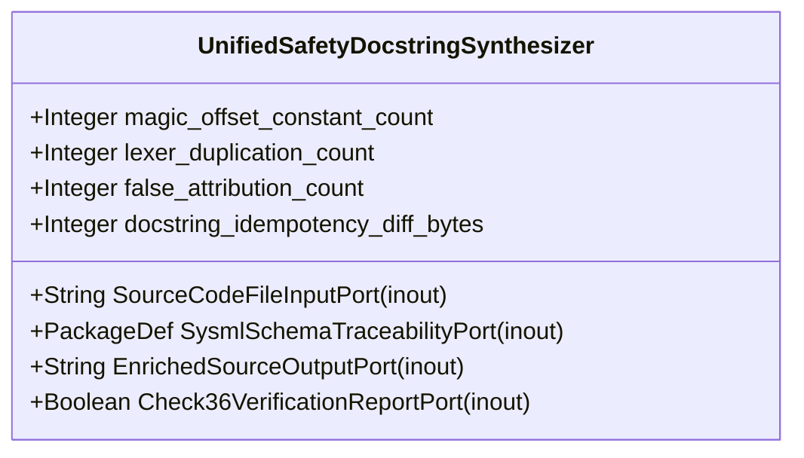

| Attribute | Specification Detail |
| :--- | :--- |
| **Issue ID** | #679 |
| **Title** | Feature 25: [BP 05 Unified AST Safety Docstring Synthesizer and Check 36 Verification Blueprint] UnifiedSafetyDocstringSynthesizer |
| **Type** | feature |
| **Parent Epic** | [EPIC-05-BP_05_Unified_AST_Safety_Docstring_Synthesizer_and_Check_36_Verification_Blueprint](../epics/EPIC-05-BP_05_Unified_AST_Safety_Docstring_Synthesizer_and_Check_36_Verification_Blueprint.md) |
| **Interface Type** | Physical / Structural / Internal Bus |
| **Schema Containers** | `BP_05_Unified_AST_Safety_Docstring_Synthesizer_and_Check_36_Verification_Blueprint::UnifiedSafetyDocstringSynthesizer` |
| **Generation Mode** | subagent |
| **Specification Source** | [schema/model.sysml](../../schema/model.sysml) |

# Feature 25: [BP 05 Unified AST Safety Docstring Synthesizer and Check 36 Verification Blueprint] UnifiedSafetyDocstringSynthesizer

## UML Class Diagram



## Interface Requirements
### 1. Test Data Shape
```json
{
  "$schema": "https://json-schema.org/draft/2020-12/schema",
  "title": "UnifiedSafetyDocstringSynthesizerPayloadSchema",
  "type": "object",
  "properties": {
    "part": {
      "type": "string",
      "const": "UnifiedSafetyDocstringSynthesizer"
    },
    "status": {
      "type": "string",
      "enum": ["nominal", "degraded", "fault"]
    },
    "magic_offset_constant_count": {
      "type": "integer",
      "description": "Subsystem attribute magic_offset_constant_count"
    },
    "lexer_duplication_count": {
      "type": "integer",
      "description": "Subsystem attribute lexer_duplication_count"
    },
    "false_attribution_count": {
      "type": "integer",
      "description": "Subsystem attribute false_attribution_count"
    },
    "docstring_idempotency_diff_bytes": {
      "type": "integer",
      "description": "Subsystem attribute docstring_idempotency_diff_bytes"
    },
    "SourceCodeFileInputPort": {
      "type": "object",
      "properties": {
        "direction": { "type": "string", "const": "inout" },
        "port_type": { "type": "string", "const": "String" }
      },
      "required": ["direction", "port_type"]
    },
    "SysmlSchemaTraceabilityPort": {
      "type": "object",
      "properties": {
        "direction": { "type": "string", "const": "inout" },
        "port_type": { "type": "string", "const": "PackageDef" }
      },
      "required": ["direction", "port_type"]
    },
    "EnrichedSourceOutputPort": {
      "type": "object",
      "properties": {
        "direction": { "type": "string", "const": "inout" },
        "port_type": { "type": "string", "const": "String" }
      },
      "required": ["direction", "port_type"]
    },
    "Check36VerificationReportPort": {
      "type": "object",
      "properties": {
        "direction": { "type": "string", "const": "inout" },
        "port_type": { "type": "string", "const": "Boolean" }
      },
      "required": ["direction", "port_type"]
    }
  },
  "required": [
    "part",
    "status",
    "magic_offset_constant_count",
    "lexer_duplication_count",
    "false_attribution_count",
    "docstring_idempotency_diff_bytes",
    "SourceCodeFileInputPort",
    "SysmlSchemaTraceabilityPort",
    "EnrichedSourceOutputPort",
    "Check36VerificationReportPort"
  ],
  "additionalProperties": false
}
```

### 2. Validation & Constraints
Formal constraints and invariant guarantees enforced by UnifiedSafetyDocstringSynthesizer.

### 3. Visual Layout & Arrangement
Logical layout, viewport containment, and container structure for UnifiedSafetyDocstringSynthesizer conforming to platform design tokens. Container boundaries enforce @container isolation rules.

### 4. Interactive Flow & States
Operational lifecycle events and discrete state transitions for UnifiedSafetyDocstringSynthesizer.

### Layer 1: Domain State & Signal Model
Domain state vector representing UnifiedSafetyDocstringSynthesizer status, AST references, and typed signal models.

### Layer 2: Logic & Safety State Management
Deterministic state machine solver and safety monitor logic for UnifiedSafetyDocstringSynthesizer.

### Layer 3: Presentation & Actuator Interface Binding
Presentation interface binding and diagnostic event routing for UnifiedSafetyDocstringSynthesizer.

## Acceptance Criteria (BDD)
- [ ] AC-01: Given nominal UnifiedSafetyDocstringSynthesizer domain state, When command or input signals are received, Then updates internal state and signal outputs within declared bounds.
- [ ] AC-02: Given operational state, When UnifiedSafetyDocstringSynthesizer evaluates constraint 'assert_magic_offset_constant_count_range', Then asserts invariant satisfaction without violation.
- [ ] AC-03: Given operational state, When UnifiedSafetyDocstringSynthesizer evaluates constraint 'assert_lexer_duplication_count_range', Then asserts invariant satisfaction without violation.
- [ ] AC-04: Given operational state, When UnifiedSafetyDocstringSynthesizer evaluates constraint 'assert_false_attribution_count_range', Then asserts invariant satisfaction without violation.
- [ ] AC-05: Given operational state, When UnifiedSafetyDocstringSynthesizer evaluates constraint 'assert_docstring_idempotency_diff_bytes_range', Then asserts invariant satisfaction without violation.
- [ ] AC-06: Given malformed input signals or boundary condition violation, When UnifiedSafetyDocstringSynthesizer error handling is invoked, Then transitions safely to failsafe fallback state without corruption.

## Source References
Formal component specifications and normative systems engineering requirements:
- System Architecture Model: `schema/model.sysml`
- Normative Systems Engineering Standard: ISO/IEC/IEEE 15288:2023 §6.4.3 Architecture Definition Process

Component behavior and interface definitions derive from `schema/model.sysml` pursuant to ISO/IEC/IEEE 15288.
