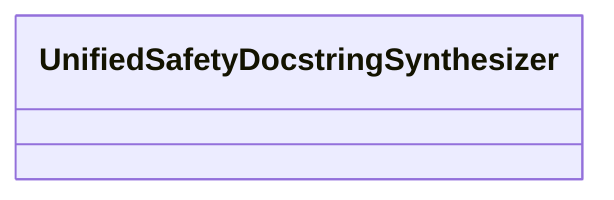

| Attribute | Specification Detail |
| :--- | :--- |
| **Issue ID** | #679 |
| **Title** | Feature 25: [BP 05 Unified AST Safety Docstring Synthesizer and Check 36 Verification Blueprint] UnifiedSafetyDocstringSynthesizer |
| **Type** | feature |
| **Parent Epic** | [EPIC-05-BP_05_Unified_AST_Safety_Docstring_Synthesizer_and_Check_36_Verification_Blueprint](../epics/EPIC-05-BP_05_Unified_AST_Safety_Docstring_Synthesizer_and_Check_36_Verification_Blueprint.md) (#689) |
| **Interface Type** | Physical / Structural / Internal Bus |
| **Schema Containers** | `BP_05_Unified_AST_Safety_Docstring_Synthesizer_and_Check_36_Verification_Blueprint::UnifiedSafetyDocstringSynthesizer` |
| **Generation Mode** | subagent |
| **Specification Source** | [schema/model.sysml](../../schema/model.sysml) |

# Feature 25: [BP 05 Unified AST Safety Docstring Synthesizer and Check 36 Verification Blueprint] UnifiedSafetyDocstringSynthesizer

## UML Class Diagram



## Interface Requirements
### 1. Test Data Shape
```json
{
  "$schema": "https://json-schema.org/draft/2020-12/schema",
  "title": "UnifiedSafetyDocstringSynthesizerPayloadSchema",
  "type": "object",
  "properties": {
    "part": {
      "type": "string",
      "const": "UnifiedSafetyDocstringSynthesizer"
    },
    "status": {
      "type": "string",
      "enum": ["nominal", "degraded", "fault"]
    }
  },
  "required": [
    "part",
    "status"
  ],
  "additionalProperties": false
}
```

### 2. Validation & Constraints
Classifier `UnifiedSafetyDocstringSynthesizer` declares no additional constraints specified in schema.

### 3. Visual Layout & Arrangement
Structural composition and boundary topology for classifier `UnifiedSafetyDocstringSynthesizer` orchestrate `UnifiedRustDartCstParser`, `ScopedSchemaContextResolver`, `SevenSectionDocstringGenerator`, and `Check36AstCompletenessVerifier` across `< 380`-SLOC submodules (`./crates/compile-sysml/src/safety_docstrings/`, `./crates/deap-core/src/rust_cst/`, `./crates/deap-core/src/dart_cst/`).

### 4. Interactive Flow & States
Operational lifecycle events and discrete state transitions for `UnifiedSafetyDocstringSynthesizer` under `BP_05_Unified_AST_Safety_Docstring_Synthesizer_and_Check_36_Verification_Blueprint_LifecycleState`.

### Layer 1: Domain State & Signal Model
Classifier `UnifiedSafetyDocstringSynthesizer` maintains typed lifecycle status (`nominal`, `degraded`, `fault`) and coordinates lossless CST/AST structures (`deap_core::sysml_cst`, `deap_core::rust_cst`, `deap_core::dart_cst` via `ra_ap_syntax`, `logos`, `rowan`, `salsa`) under **Contract A (100% Normative OMG SysML v2.0 + KerML 1.0 Grammar Coverage -- Zero 16-Construct Caps)** spanning 100% of the normative OMG SysML v2.0 + KerML 1.0 grammar (`package`/`library package`/`standard library package`, `part def`/`part`, `item def`/`item`, `attribute def`/`attribute`, `enum def`/`enum`, `port def`/`port`, `connection def`/`connection`, `interface def`/`interface`, `flow def`/`flow`, `allocation def`/`allocation`, `occurrence def`/`occurrence`, `action def`/`action`, `state def`/`state`, `calc def`/`calc`, `constraint def`/`constraint`, `requirement def`/`requirement`, `concern def`/`concern`, `use case def`/`use case`, `analysis def`/`analysis`, `verification def`/`verification`, `test case def`/`test case`, `interaction def`/`interaction`, `view def`/`view`, `viewpoint def`/`viewpoint`, `rendering def`/`rendering`, `variation`/`variant`, `metadata def`/`@Metadata`/`#user_keyword` (`#hazard`, `#risk`, `#capability`, `#rt_loop`, `#dal`, `#fls`), and KerML specialization `:`, `:>`, `:>>`, `::>`, `~`, `ISQ`/`SI`/`ScalarValues`, zero 16-construct caps).

### Layer 2: Logic & Safety State Management
Classifier `UnifiedSafetyDocstringSynthesizer` governs idempotent docstring synthesis (`docstring_idempotency_diff_bytes == 0`) under **Contract B (Official Rust Compiler & `rust-analyzer` Crate Stack -- Zero Hand-Rolled Scanners)** and the **3-Layer Definition of Done (DoD)** using `ra_ap_syntax` (`ast::HasDocComments`, `ast::HasAttrs`) + `ra_ap_text_edit` + `ra_ap_line_index` to enforce `<= 4`-line Tier-B/C `[REQ-*]`/`[FLS: fls_*]` docstrings on internal declarations and explicit `[DOC-TIER: A]` 7-section entrypoints inside `< 380`-SLOC submodules with explicit deletion of legacy hand-rolled line/char-by-char scanners (`-800+` SLOC retired).

### Layer 3: Presentation & Actuator Interface Binding
Classifier `UnifiedSafetyDocstringSynthesizer` binds `BP_05_SafetyDocstringPortDef` (`source_cst_in`, `docstring_verdict_out`) and `BP_05_ContextToDocstringGeneratorConnection` for CLI execution (`compile-sysml --inject-safety-docstrings`, `verify-baseline . --no-domain`).

## Acceptance Criteria (BDD)
- [ ] AC-01: Given valid `UnifiedSafetyDocstringSynthesizer` initialization inputs for `UnifiedSafetyDocstringSynthesizer` state representation (no additional constraints specified in schema), When `UnifiedSafetyDocstringSynthesizer` commits typed domain state, Then declared state attributes hold verified values.
- [ ] AC-02: Given malformed or out-of-domain input values for `UnifiedSafetyDocstringSynthesizer` state representation, When `UnifiedSafetyDocstringSynthesizer` validates incoming state updates, Then `UnifiedSafetyDocstringSynthesizer` rejects the invalid state update and emits a diagnostic via deterministic error diagnostic output.
- [ ] AC-03: Given nominal signal arrival across `UnifiedSafetyDocstringSynthesizer` structural boundary, When `UnifiedSafetyDocstringSynthesizer` processes the declared interface transaction, Then output state conforms to the structural classifier contract.
- [ ] AC-04: Given an invalid or unrecognized interface frame across `UnifiedSafetyDocstringSynthesizer` structural boundary, When `UnifiedSafetyDocstringSynthesizer` boundary validation executes, Then `UnifiedSafetyDocstringSynthesizer` refuses the malformed frame via deterministic error diagnostic output and preserves prior verified state.

## Source References
Formal component specifications and normative systems engineering requirements:
- System Architecture Model: `schema/model.sysml`
- Normative Systems Engineering Standard: ISO/IEC/IEEE 15288:2023 §6.4.3 Architecture Definition Process

Component behavior and interface definitions derive from `schema/model.sysml` pursuant to ISO/IEC/IEEE 15288.
